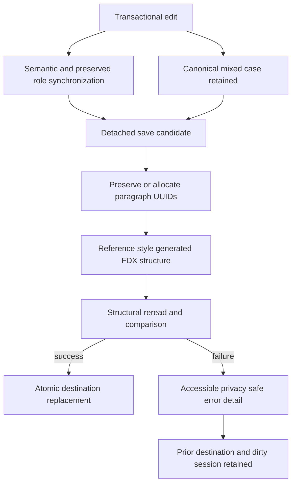

# FDX Fixes v2

## Status and evidence boundary

This is a source-inspection and reproduction-driven strategy record, not an approved implementation work order or a validation result. It continues [FDX fixes v1](fdx-fixes.md) after its five implementation orders were authored. The earlier orders remain user-unvalidated according to their own handoffs.

The user supplied the decisive reproduction on 2026-11-01: in an imported Final Draft document, adding a Character element makes both Save and Save As fail; lowercase entry is automatically uppercased in a new ScriptCraft document but errors in an imported document. Source inspection identifies a direct role/source mismatch for the Save failure and a separate legacy canonical-uppercasing defect for the lowercase failure.

No builds, tests, lint, formatting checks, desktop smoke tests, Final Draft interoperability checks, or other validation were run for this investigation. Repository policy in [the project manifest](../../.forge/project-manifest.md:71) leaves all review and validation to the user.

References inspected include [the populated Final Draft reference](../../.reference/reference2.fdx:1), [the blank Final Draft reference](../../.reference/reference.fdx:1), [the longer Final Draft example](../../.reference/real_script_example.fdx:1), [the editing session](../../crates/scriptcraft-core/src/editing.rs:268), [the preservation model](../../crates/scriptcraft-core/src/preservation.rs:270), [the FDX codec](../../crates/scriptcraft-core/src/fdx.rs:372), [transactional native storage](../../crates/scriptcraft-core/src/fdx_storage.rs:320), and [the desktop status presentation](../../apps/scriptcraft/src/status_bar.rs:1131).

## Executive findings

1. **The reproduced Character/Save failure has a concrete role-reconciliation cause.** Imported Tab transitions change the semantic role without updating the preserved FDX Type or source provenance. Save later detects that the semantic role and preserved Type disagree and returns an unsupported-construct error. New documents do not have a preservation tree, which explains why the same operation works there.
2. **Lowercase entry fails for a different reason.** The older cue-casing policy still rewrites canonical Scene Heading and Character text after edits. Its imported-source helper handles direct raw text nodes, while normal FDX paragraphs contain Text elements. The correct product fix is not to repair canonical uppercasing: it is to retire that policy and let the already implemented AllCaps display transform handle presentation.
3. **SceneProperties, SceneArcBeats, and CharacterArcBeats are not implicated in the reproduced Character failure.** They are retained in the ordered preservation tree. Structural edits to a Scene Heading carrying such attachments deliberately safe-stop today; that limitation should remain explicit and separate from the Character/Save fix.
4. **New-file XML is compact and ordered differently from Final Draft.** The new-document writer emits ElementSettings before Content and adds no formatting whitespace or XML declaration. Imported source whitespace is generally retained, but inserted managed paragraphs do not receive reference-style sibling formatting.
5. **Two non-UUID generators remain.** New files use scriptcraft-generated-N, while paragraphs inserted or split within imported documents use scriptcraft-paragraph-N. Existing imported IDs are already preserved through the source tree.
6. **The current save error hides useful detail twice.** Transactional save errors collapse codec/session causes into generic display messages, and the status row clips its single line. A full error-detail path is not guaranteed on wide layouts when no status controls overflow.

## 1. Imported Character creation and Save failure

### Confirmed source mechanism

The normal Tab branch in [`EditingSession::tab()`](../../crates/scriptcraft-core/src/editing.rs:461) assigns the new semantic role directly at [`project.elements[position.element].role = role`](../../crates/scriptcraft-core/src/editing.rs:512). It does not call [`update_preserved_role()`](../../crates/scriptcraft-core/src/editing.rs:994), even though explicit role assignment correctly uses that helper at [`EditingSession::change_role()`](../../crates/scriptcraft-core/src/editing.rs:555).

For an imported Action paragraph, Action → Character therefore leaves two contradictory authorities:

| Authority | Value after Tab |
|---|---|
| Semantic element role | Character |
| Preserved paragraph Type and source type | Action |
| Semantic source-provenance foreign role | Action |

The delimiter-only Parenthetical → Dialogue Tab branch has the same direct-assignment pattern at [`editing.rs`](../../crates/scriptcraft-core/src/editing.rs:486). Any other direct role-mutating path should be audited rather than fixing only the reported Action → Character example.

The failure is deferred until Save because [`reconcile_managed_paragraph()`](../../crates/scriptcraft-core/src/fdx.rs:713) requires the preserved source type and Type attribute to equal the semantic role at [`fdx.rs`](../../crates/scriptcraft-core/src/fdx.rs:717). The mismatch becomes [`FdxError::UnsupportedConstruct`](../../crates/scriptcraft-core/src/fdx.rs:61). Both Save and Save As use the same detached candidate serialization path before filesystem publication in [`save_session_with_codec()`](../../crates/scriptcraft-core/src/fdx_storage.rs:351), so both fail without replacing a destination or publishing a clean session. That safety behavior should remain unchanged.

The existing imported-Behavior regression performs Tab, then undoes it before the only Save in that test at [`wo005_native_role_keyboard_behavior.rs`](../../crates/scriptcraft-core/tests/wo005_native_role_keyboard_behavior.rs:296). It therefore does not exercise Save while the Tab-produced mismatch is present. The final reopened-session Tab also has no subsequent Save at [`wo005_native_role_keyboard_behavior.rs`](../../crates/scriptcraft-core/tests/wo005_native_role_keyboard_behavior.rs:344).

### Selected fix direction

- Route every actual semantic role change through one transactional role/source synchronization path. The existing [`update_preserved_role()`](../../crates/scriptcraft-core/src/editing.rs:994) is the appropriate base because it updates preserved Type, preserved source type, and foreign-role provenance together.
- Apply it to ordinary Tab transitions and special Tab branches that change roles, not only to toolbar role assignment. Same-role Tab no-ops remain unchanged.
- Preserve the existing candidate/rollback model: a source-mapping rejection must leave the entire edit, selection, history, and dirty state unchanged.
- Retain the current Scene Heading attachment safety rule in [`change_managed_role()`](../../crates/scriptcraft-core/src/preservation.rs:799). Moving into or out of Scene Heading while opaque or attached scene data exists may safe-stop; this order must not silently delete or relocate scene metadata to make a transition succeed.
- Add save/reopen coverage immediately after every supported imported Tab role change, especially Action → Character with subsequent lowercase text entry, rather than testing only the semantic role or undoing before Save.

### Scene-data disposition

Final Draft stores SceneProperties before Text within managed Scene Heading paragraphs, with nested SceneArcBeats and CharacterArcBeat data in [the populated reference](../../.reference/reference2.fdx:12). The reader retains these nodes through [`preserve_node()`](../../crates/scriptcraft-core/src/fdx.rs:1707), and ordinary managed Text-element edits can retain opaque siblings through [`replace_text_element_children()`](../../crates/scriptcraft-core/src/preservation.rs:1484).

A structural split is different: [`replace_managed_projection()`](../../crates/scriptcraft-core/src/preservation.rs:1032) requires a plain managed paragraph, and [`is_plain_managed_paragraph()`](../../crates/scriptcraft-core/src/preservation.rs:1316) rejects non-Text element children. The existing regression explicitly expects a Scene Heading split with nested scene payload to stop transactionally at [`wo012f_source_structural_edits.rs`](../../crates/scriptcraft-core/tests/wo012f_source_structural_edits.rs:188).

Accordingly:

- Do not treat scene metadata as the cause of the reported Character/Save defect.
- Add a preservation regression around ordinary Scene Heading text editing and Save to prove the nested nodes and their IDs remain intact.
- Keep Scene Heading split/join attachment semantics out of the hotfix except for regression coverage. Supporting such splits requires a separately designed ownership policy for SceneProperties, arc beats, page/length values, and references; silently copying, moving, or deleting them is not acceptable.

## 2. Canonical mixed-case text and AllCaps presentation

### Current contradiction

The v1 typography work already implements the correct display boundary: [`LayoutLine`](../../crates/scriptcraft-core/src/layout.rs:35) retains canonical text and source ranges separately from display text, and [`build_display_text()`](../../crates/scriptcraft-core/src/layout.rs:1005) applies Unicode AllCaps with display-to-source mapping. The durable requirement at [AC-WRITING-002.7](../../.forge/requirements/features/screenplay-writing-loop.md:118) says AllCaps transforms display only.

The older editing policy still does the opposite. [`EditPolicy`](../../crates/scriptcraft-core/src/editing.rs:42) enables uppercase cues by default, and [`normalize_element()`](../../crates/scriptcraft-core/src/editing.rs:1149) rewrites canonical Scene Heading and Character text after insertion. Role assignment and Tab use [`normalize_selection_in_element()`](../../crates/scriptcraft-core/src/editing.rs:1209), while cue-producing splits call the same normalization through [`split_at()`](../../crates/scriptcraft-core/src/editing.rs:1278).

For imported paragraphs, [`uppercase_managed_text()`](../../crates/scriptcraft-core/src/preservation.rs:756) obtains only direct raw text children through [`direct_text_child_indexes()`](../../crates/scriptcraft-core/src/preservation.rs:1632). Standard FDX uses Text elements instead, as shown in [the reference Character paragraph](../../.reference/reference2.fdx:25). The helper therefore has no compatible source segments and can reject the edit. Repairing that helper would still preserve the wrong product behavior: canonical text would continue losing the writer's chosen case.

Final Draft instead stores mixed-case source such as Int. house - night and John while declaring AllCaps in role FontSpec settings at [`reference2.fdx`](../../.reference/reference2.fdx:179). This is the model ScriptCraft should follow.

### Selected fix direction

- Retire cue uppercasing as an edit-time transformation. Typed, pasted, split, joined, role-assigned, undone, and redone text retains its exact canonical UTF-8 casing.
- Remove the now-unwanted normalization calls and their special imported-source uppercase mutation path. Remove the uppercase-cue field from runtime editing policy if no compatibility consumer remains; keep any legacy JSON decoding compatibility isolated from FDX editing behavior rather than retaining a misleading active policy.
- Continue using effective role FontSpec AllCaps solely in layout, desktop painting, and PDF presentation. Imported role overrides without AllCaps continue to display the actual canonical case.
- Use display-transformed text in plain-text export, matching the approved PDF/presentation behavior, while native FDX and the semantic model retain canonical case. Retain the existing Unicode expansion/source-offset behavior from v1 and do not introduce a second uppercase implementation in editing.
- Keep cast-list derivation canonical. Its existing case-insensitive deduplication and first-spelling retention in [`scene_cast_text()`](../../crates/scriptcraft-core/src/cast_list.rs:84) already align with mixed-case source ownership.
- Replace the expectations in [`wo004_role_casing.rs`](../../crates/scriptcraft-core/tests/wo004_role_casing.rs:1) rather than preserving tests that require canonical uppercase. Add imported mixed-case save/reopen and edit tests for every role whose shared default includes AllCaps, plus a source override that disables AllCaps. Plain-text export coverage belongs to the sequential V2-WO-002.2 order and checks display-transformed output.

## 3. Reference-style XML whitespace and section order

### Current output and reference evidence

[`make_new_document_nodes()`](../../crates/scriptcraft-core/src/fdx.rs:810) currently appends all ElementSettings blocks, then Content, then TitlePage. [`write_element()`](../../crates/scriptcraft-core/src/fdx.rs:1047) emits only the tags and preserved children; it adds no XML declaration, indentation, returns, or blank separators of its own.

All three Final Draft references instead use:

- An XML declaration followed by a return.
- Two ASCII spaces per structural indentation level, not tab-indented markup.
- LF returns and a blank line between top-level Final Draft children.
- No blank lines between adjacent Content paragraphs.
- A blank line between adjacent ElementSettings blocks.
- Content before the ElementSettings sequence, with TitlePage after ElementSettings.

The common reference order is visible in [the blank reference](../../.reference/reference.fdx:4), [the populated reference](../../.reference/reference2.fdx:4), and [the longer example](../../.reference/real_script_example.fdx:4). For the subset currently generated by ScriptCraft, the required order is therefore Content → all 17 ElementSettings in the existing native role order → TitlePage when present. This does not justify inventing DocumentRef, Watermarking, PageLayout, or other currently ungenerated sections.

Literal tab characters inside source Text, such as the header content in [`reference2.fdx`](../../.reference/reference2.fdx:137), remain canonical text and are unrelated to markup indentation.

### Selected fix direction

Use a bounded, structure-aware formatting contract rather than globally inserting whitespace around every XML node:

1. Emit the reference-style XML declaration and deterministic LF-based formatting for newly generated ScriptCraft FDX.
2. Generate Content before ElementSettings and TitlePage for new documents; retain the existing 17-role ElementSettings order.
3. Use two spaces per indentation level, a blank line between FinalDraft children and between ElementSettings blocks, no blank lines between Content paragraphs, and one final return.
4. Ensure paragraphs newly inserted or split into an imported Content section receive appropriate structural sibling whitespace so they do not appear concatenated with adjacent paragraphs.
5. Preserve canonical Text content exactly. Never strip, trim, indent, or otherwise rewrite whitespace inside Text, CDATA, comments, processing instructions, or opaque mixed content.
6. Keep imported top-level source order and opaque section content authoritative. Do not globally reorder or pretty-print unknown imported structures as part of this order. A ScriptCraft-authored document receives the canonical order on its first Save and retains it on reopen.
7. Keep formatting reconciliation compatible with the writer's structural re-read comparison in [`write_v6()`](../../crates/scriptcraft-core/src/fdx.rs:372). If formatting nodes are normalized in a detached output candidate, the expected comparison tree must undergo the same explicit, bounded transformation; do not weaken the comparison to make pretty-printing pass.

This is deliberately a generated-structure and managed-insertion policy, not a new blanket lexical-normalization promise for every imported FDX file.

## 4. UUID-backed FDX paragraph identities

### Current identity lifecycle

New files generate scriptcraft-generated-N in [`new_paragraph()`](../../crates/scriptcraft-core/src/fdx.rs:928). Imported-document insertion and split generate scriptcraft-paragraph-N in [`fresh_foreign_paragraph_id()`](../../crates/scriptcraft-core/src/preservation.rs:1086). These are FDX foreign identities, distinct from transient semantic element IDs and internal source-anchor IDs.

The existing lifecycle already provides most required behavior:

- Import records the original foreign ID in [`make_semantic_element()`](../../crates/scriptcraft-core/src/fdx.rs:1854) and retains the actual attribute in the preservation tree.
- [`insert_managed_paragraph()`](../../crates/scriptcraft-core/src/preservation.rs:889) creates a new foreign ID only for a new semantic paragraph.
- Split retains the left/original identity and creates a new right identity through [`split_at()`](../../crates/scriptcraft-core/src/editing.rs:1278) and [`reconcile_body_structure()`](../../crates/scriptcraft-core/src/preservation.rs:836).
- Join retains the left identity and removes the right paragraph through [`join_at()`](../../crates/scriptcraft-core/src/editing.rs:1319) and [`remove_managed_paragraph()`](../../crates/scriptcraft-core/src/preservation.rs:989).
- Deletion removes the corresponding source identity when the existing reference-safety checks permit deletion. Undo/redo snapshots include the complete preservation graph, so they restore the exact prior IDs rather than allocate replacements.

### Selected fix direction

- Add one shared FDX paragraph-UUID allocator and use it in both new-file and imported-insertion paths. Do not change semantic element IDs, source-anchor IDs, DocumentRef IDs, board/image IDs, or unrelated foreign domains.
- Generate RFC 4122 UUID version 4 values in lowercase hyphenated 36-character form. A direct maintained UUID crate dependency with only the v4 generation feature is the recommended implementation default; [the lockfile](../../Cargo.lock:3234) already contains the crate transitively, but that is not evidence that v4 generation is enabled or that a direct dependency has been approved.
- Preserve every existing imported paragraph ID verbatim, including non-UUID legacy IDs. Do not rewrite existing scriptcraft-generated-N, scriptcraft-paragraph-N, uppercase, or vendor-specific IDs merely because they are not UUIDs.
- Check candidate IDs against the current preservation identities and all source ID attributes, consistent with the existing collision scan. A collision should retry under a bounded policy and then return a typed error; no persistent tombstone or historical-ID registry is needed.
- Retain UUIDs across ordinary text edits, role changes, cast-list updates, Save, Save As, and reopen. Save As is not a paragraph-ID regeneration operation.
- On split, preserve the original/left UUID and allocate exactly one new UUID for the right paragraph. On join or deletion, remove only the deleted/right paragraph's UUID. Undo/redo restores the exact historical state for that session; reintroduced content after deletion is new content and receives a fresh UUID.
- Replace tests that require scriptcraft-generated-N or scriptcraft-paragraph-N at [`fdx.rs`](../../crates/scriptcraft-core/src/fdx.rs:3245) and [`wo012f_source_structural_edits.rs`](../../crates/scriptcraft-core/tests/wo012f_source_structural_edits.rs:36) with UUID shape/version/variant, uniqueness, and lifecycle assertions. Do not assert one hard-coded random value.

Random UUID allocation intentionally narrows any claim that repeatedly serializing a never-saved, preservation-free project produces identical bytes. Determinism should instead be asserted after identities are established: the same established source state serializes without changing its paragraph UUIDs.

## 5. Actionable save diagnostics

[`TransactionalSaveError::fmt()`](../../crates/scriptcraft-core/src/fdx_storage.rs:297) discards the underlying session and codec variants from its display text. [`show_fdx_save_error()`](../../apps/scriptcraft/src/main.rs:366) stores that generic detail, while [`paint_clipped_single_line()`](../../apps/scriptcraft/src/status_bar.rs:706) limits the center status to one clipped line.

The existing overflow menu can show a wrapping status message at [`status_bar.rs`](../../apps/scriptcraft/src/status_bar.rs:988), but it is rendered only when the right-control plan has overflow at [`status_bar.rs`](../../apps/scriptcraft/src/status_bar.rs:1211). A wide window with no overflow therefore has no guaranteed error-detail interaction.

The selected diagnostic improvement is deliberately minimal:

- Include a concise, privacy-safe underlying error category in the save detail, distinguishing candidate preparation, codec serialization/re-read, storage, and missing baseline without exposing screenplay text or unnecessary paths.
- Remove the center Clean/Dirty indicator and left-align the operation/error message in the freed center space. Retain the page indicator, existing right-side controls, noninteractive message text, and current panel structure.
- Retain document-unchanged safety wording in the message itself; dirty state remains owned by the session even though the redundant center indicator is removed. Do not add a new popup, details interaction, or broader status-bar redesign in this initiative.
- Improved diagnostics must not change save transaction behavior or weaken typed error handling.

## Recommended implementation sequence

These are candidate work-order boundaries for review, not yet drafted or approved work orders. Execute sequentially because several orders share editing, preservation, codec, and test files.

### Candidate V2-WO-001 — Imported role/source synchronization and Save regression

- Route all actual Tab role changes through the existing transactional role/source synchronization helper.
- Cover ordinary and special role-changing branches without altering same-role no-ops or keyboard targets.
- Add imported Action → Character → mixed-case typing → Save and Save As regressions, the complete imported Tab matrix, source-provenance checks, undo/redo, and failure atomicity.
- Add ordinary Scene Heading text-edit preservation coverage for SceneProperties and arc-beat data; keep structural attachment safe-stops explicit.
- Do not change canonical casing in this order except where the following order supersedes the old policy; the regression's final mixed-case assertion belongs to V2-WO-002 if strict order isolation is preferred.

### Candidate V2-WO-002 — Canonical mixed-case editing under AllCaps

- Retire edit-time cue uppercasing and its imported-source mutation helper.
- Preserve exact typed/pasted case through every editing and history operation.
- Keep AllCaps exclusively in the existing display/layout/export path, including Unicode expansion mapping.
- Replace legacy canonical-uppercase tests and update the durable editing requirement.
- Validate imported and new documents, source overrides without AllCaps, display-transformed plain-text export (V2-WO-002.2), and cast-list first-spelling behavior.

### Candidate V2-WO-003 — UUID paragraph identity lifecycle

- Introduce the shared UUID v4 allocator and direct dependency.
- Replace both non-UUID generators without changing internal or unrelated foreign identities.
- Cover new body/title paragraphs, imported preservation, split, join, delete, role change, undo/redo, Save As, save/reopen, collision handling, and legacy non-UUID retention.
- Update durable identity and deterministic-serialization language to distinguish established source state from first-time random allocation.

### Candidate V2-WO-004 — Reference-style FDX structure and formatting

- Add the XML declaration, canonical generated-section order, two-space indentation, returns, blank separators, and final return.
- Format newly inserted managed paragraphs consistently without modifying canonical text or opaque mixed content.
- Keep imported top-level/unknown ordering preservation and structural re-read checks intact.
- Compare generated structure against the checked-in references and include reopened ScriptCraft output with subsequent insertions.

### Candidate V2-WO-005 — Accessible and specific Save errors

- Preserve underlying privacy-safe error categories in desktop detail text.
- Remove the center Clean/Dirty label and left-align the existing operation/error message without adding a popup or overflow interaction.
- Add headless status-layout and error-projection coverage without changing native save behavior.

## Durable documentation updates during implementation

The approved implementation orders should update, rather than contradict, these contracts:

- [AC-WRITING-001.2](../../.forge/requirements/features/screenplay-writing-loop.md:24): remove transactional canonical cue-uppercasing and state exact-case editing with presentation-only AllCaps.
- [Native persistence requirements](../../.forge/requirements/features/screenplay-writing-loop.md:136): record UUID lifecycle, generated-structure formatting/order, and the established-source determinism boundary.
- [Product overview](../../.forge/requirements/product-overview.md:20): clarify canonical mixed-case ownership, durable UUID-backed paragraph identities, and reference-style generated FDX output without promising blanket lexical normalization or Final Draft parity.
- [Technical context](../../.forge/blueprints/technical-context.md:43): document the single role/source synchronization path, shared UUID allocator, formatting ownership, and diagnostic boundary.
- [FDX fixes v1](fdx-fixes.md): preserve its implementation history. This v2 record supersedes only the old cue-casing direction and identifies the residual defects; it does not reclassify earlier user-unvalidated orders as accepted.

## User-owned acceptance matrix

When the candidate orders are drafted, their handoffs should include at least:

1. Open the populated reference, convert an Action to Character with Tab, enter John in lowercase/mixed case, Save, reopen, and repeat through Save As. Confirm saved source text is John while ordinary AllCaps presentation is JOHN.
2. Repeat every imported Tab transition on plain managed paragraphs and Save immediately after each transition. Confirm semantic role, preserved Type, and foreign-role provenance agree before and after reopen.
3. Edit Scene Headings and Character rosters across new and imported documents. Confirm every heading gains supported SceneProperties/SceneArcBeats, matched nested IDs remain, Cast List text follows the synchronized arc data, and unsupported structural scene edits stop atomically rather than losing data.
4. Type and paste mixed case into every shared-default AllCaps role, including expanding Unicode such as Straße. Verify canonical case, display mapping, carets, selections, undo/redo, plain-text export, and save/reopen independently.
5. Save a new document and inspect exact declaration, section order, indentation, blank lines, and final return against the references. Reopen it, insert and split paragraphs, Save again, and confirm formatting remains coherent and canonical Text whitespace is unchanged.
6. Inspect new body/title paragraph IDs as UUID v4 values; verify imported legacy IDs remain verbatim, split allocates only the right ID, join/delete removes only the removed ID, and undo/redo restores exact prior IDs.
7. Trigger a remaining save failure with a disposable fixture and confirm the left-aligned status message provides the available privacy-safe failure category without exposing screenplay content. Confirm the destination and unsaved session remain intact.
8. Perform optional Final Draft open/edit/reopen checks only on disposable copies. Structural XML tests alone do not establish Final Draft compatibility.

## Approved amendments and scene-cast architecture — 2026-11-01

The user approved the general strategy with these amendments. This section supersedes the earlier candidate work-order boundaries, the initial canonical plain-text export suggestion, and the initial error-details-menu suggestion.

### SceneProperties is the native scene-cast storage

Every managed Scene Heading shall have a SceneProperties child containing SceneArcBeats. This becomes the canonical FDX storage for the derived scene cast; semantic Character elements remain the editing input from which that projection is refreshed.

- Create missing supported structure before the first Text child. New SceneProperties values default to Length 1/8, Page 1, and an empty Title, matching [the blank reference](../../.reference/reference.fdx:9). Existing values and unknown attributes remain preserved. Page and Length recalculation is not included in this initiative.
- Derive one CharacterArcBeat per unique nonblank Character in the scene range after that heading and before the next heading. Trim outer Unicode whitespace, deduplicate case-insensitively, retain first spelling and first-occurrence order, and preserve canonical case in the Name value.
- Give each newly derived CharacterArcBeat one nested Paragraph using the reference formatting attributes shown in [the populated reference](../../.reference/reference2.fdx:15). New nested paragraph identities receive fresh source IDs and become UUID v4 values in the UUID order.
- Reconcile recognized entries transactionally. Matching entries retain their existing nested paragraph identity; newly introduced names receive a fresh identity; removed derived names are removed only when their entries match the supported derived shape.
- Preserve existing SceneProperties, SceneArcBeats, and recognized entries wherever possible. Ambiguous duplicates, unknown authored arc payloads, or unsupported structures safe-stop rather than being deleted or guessed away. Existing structural Scene Heading split/join safe-stops remain unchanged.
- Refresh scene metadata before deriving Cast List text. [`correct_cast_lists()`](../../crates/scriptcraft-core/src/cast_list.rs:35), the scheduled session refresh, detached Save/Save As preparation, and undo/redo correction shall use the same ordered update so the saved scene metadata and visible Cast List cannot drift.
- Cast List text reads the synchronized scene arc projection rather than rescanning Character elements independently. Existing alphabetical, case-insensitive list formatting remains a presentation of that scene-cast data.

### Other approved amendments

- Plain-text export shall emit [`LayoutLine.display_text`](../../crates/scriptcraft-core/src/layout.rs:35), not canonical line text, so AllCaps is consistent across desktop, PDF, and plain-text output. Native FDX remains canonical-case.
- Additional Final Draft top-level sections are deferred until their product features are implemented; the new-document subset still follows reference order.
- Status-bar work is limited to removing the center Clean/Dirty label, left-aligning the message, and preserving a more specific privacy-safe save error. No new details popup or overflow behavior will be added.

### Approved short work-order sequence

The implementation orders will be split into short sequential artifacts under [work-orders-v2](work-orders-v2/):

1. [V2-WO-001.1 — imported role/source synchronization](work-orders-v2/WO-001.1-imported-role-source-synchronization.md)
2. [V2-WO-001.2 — SceneProperties and scene arc creation/reconciliation](work-orders-v2/WO-001.2-scene-properties-and-arc-reconciliation.md)
3. [V2-WO-001.3 — Cast List consumption of synchronized scene arc data](work-orders-v2/WO-001.3-scene-arc-cast-list.md)
4. [V2-WO-002.1 — canonical mixed-case editing under display-only AllCaps](work-orders-v2/WO-002.1-canonical-mixed-case-editing.md)
5. [V2-WO-002.2 — AllCaps plain-text export](work-orders-v2/WO-002.2-all-caps-text-export.md)
6. [V2-WO-003.1 — shared UUID v4 allocation for new paragraphs](work-orders-v2/WO-003.1-uuid-v4-allocation.md)
7. [V2-WO-003.2 — UUID edit/save/history lifecycle regressions](work-orders-v2/WO-003.2-uuid-lifecycle.md)
8. [V2-WO-004.1 — reference section order and XML declaration](work-orders-v2/WO-004.1-reference-section-order.md)
9. [V2-WO-004.2 — structural whitespace and managed-paragraph insertion formatting](work-orders-v2/WO-004.2-fdx-structural-whitespace.md)
10. [V2-WO-005.1 — specific save detail and minimal status-message layout](work-orders-v2/WO-005.1-save-error-status-layout.md)

## Implementation handoff — V2-WO-001.1 — 2026-11-01

V2-WO-001.1 is implemented on the already-active initiative branch `dev/2026-10-31-fdx-formatting` (preflight HEAD `310a69fbf5e0f527f73ff77f049347b674d04675`); no branch switch or other Git mutation was needed. Existing untracked initiative plan files were retained and updated in place. The approved role/source boundary now covers ordinary Tab changes, both special Parenthetical transitions, and generated Parenthetical text changes under the existing candidate rollback model. Same-role Tab behavior and Scene Heading attachment safe-stops remain unchanged. Regression tests were authored for imported Tab role/source round-trips, undo/redo, Parenthetical cases, mapping/attachment rollback, and immediate Save/Save As after Action → Character. Tests and all other validation remain unrun by agent per repository policy; user review/validation is pending, and this record does not claim acceptance or Final Draft interoperability. See the [work-order handoff](work-orders-v2/WO-001.1-imported-role-source-synchronization.md) for file and test details. The sequential handoff is to [V2-WO-001.2](work-orders-v2/WO-001.2-scene-properties-and-arc-reconciliation.md), which owns SceneProperties and scene arc creation/reconciliation; no part of that next order is implemented here.

## Approved bounded defaults

The approved work orders use these three bounded defaults:

- **Generated formatting scope:** canonicalize new ScriptCraft structure and newly inserted managed-paragraph sibling formatting, while preserving imported top-level and opaque source order rather than globally normalizing every imported file.
- **Reference indentation:** match the references' actual two-space markup indentation; tabs remain only canonical content where authored.
- **UUID implementation:** use UUID v4 through a focused direct dependency, with no historical-ID tombstones and no migration of existing non-UUID IDs.

The user approved all ten work orders on 2026-11-01 and directed Orchestrator mode to dispatch individual coding agents sequentially, beginning with V2-WO-001.1 and waiting for each implementation handoff before dispatching the next. No implementation, branch operation, dependency change, review, or validation has been performed by this planning task.

## Implementation handoff — V2-WO-001.2 — 2026-11-01

V2-WO-001.2 is authored on the existing checkout without branch or Git mutations. Scene metadata reconciliation is included in the existing derived refresh and detached save-candidate path, before the existing Cast List updater; new-document FDX generation emits the same supported scene properties and scene-cast arc projection. Preservation graph paragraph identities are registered for generated nested arc Paragraphs, which remain opaque and are not semantic body elements or anchors. Existing properties, unknown attributes and matching nested paragraph IDs are retained; matching names are case-insensitive while first canonical spelling and Character occurrence order drive the projection. Values default only when SceneProperties is newly created; Page and Length are not recalculated.

Removal is deliberately narrower than shape recognition: only an entry with explicit in-session ScriptCraft creation tracking, exact supported shape, a registered unique paragraph identity, and no known references or source-tree ID occurrence can be removed. Existing imported entries are never assumed owned because they resemble the generated shape. Stale unowned entries, unsupported structures, authored nested beat text, ambiguous duplicates, or reference conflicts cause an atomic scene reconciliation safe-stop. Runtime creation tracking is carried through the writer's detached serialization/re-read for successful saves, but is not embedded in FDX and is lost on a separate reopen; stale entries then remain preserved and stop reconciliation rather than being discarded. This is an intentional limitation in the absence of a durable ownership marker that does not alter FDX content.

Focused tests were authored in [`scene_metadata.rs`](../../crates/scriptcraft-core/src/scene_metadata.rs) for new-document output, multiple-scene creation, imported structure creation/reordering, Unicode trim and duplicate casing, existing metadata/identity retention, owned-entry removal, refresh/undo/redo synchronization, source-reference rejection, and atomic safe-stops for stale unowned or nested authored payloads. These are authored cases, not test results; tests, builds, lint, formatting, manual checks, reviews, and all validation were not run. User-owned review and validation remain pending.

Changed implementation files: [`scene_metadata.rs`](../../crates/scriptcraft-core/src/scene_metadata.rs), [`preservation.rs`](../../crates/scriptcraft-core/src/preservation.rs), [`cast_list.rs`](../../crates/scriptcraft-core/src/cast_list.rs), [`fdx.rs`](../../crates/scriptcraft-core/src/fdx.rs), [`fdx_storage.rs`](../../crates/scriptcraft-core/src/fdx_storage.rs), and [`lib.rs`](../../crates/scriptcraft-core/src/lib.rs). Durable updates: [`screenplay-writing-loop.md`](../../.forge/requirements/features/screenplay-writing-loop.md), [`product-overview.md`](../../.forge/requirements/product-overview.md), and [`technical-context.md`](../../.forge/blueprints/technical-context.md); this handoff and the [WO-001.2 record](work-orders-v2/WO-001.2-scene-properties-and-arc-reconciliation.md) were updated.

Next-order interface: V2-WO-001.3 may switch Cast List derivation to consume each synchronized SceneArcBeats projection and preserve its existing alphabetical presentation. It must not broaden scene-entry deletion authority, infer ownership after reopen, alter scene properties, or weaken source preservation and writer re-read checks. No WO-001.3 Cast List consumption, UUID migration/allocation, later casing, XML formatting, or UI work is included here.

## Implementation handoff — V2-WO-001.3 — 2026-11-02

V2-WO-001.3 is authored on the existing checkout without Git operations. The ordered cast-list correction still reconciles scene metadata first, then reads recognized `CharacterArcBeat` names from the preserved scene arc for each managed heading. Projects without preservation use the shared `character_names()` projection that also feeds new-document scene-arc generation. Cast List output remains case-insensitively alphabetical with first-spelling retention, parentheses, existing scene boundaries, and existing safe-stops. Refresh, detached Save/Save As preparation, and undo/redo correction continue through the same candidate update; scene metadata and Cast List changes publish together.

Focused regression cases were authored for imported Character add/rename/delete, multiple scenes, detached candidate and Save/reopen arc/list agreement, refresh plus undo/redo consistency, and the separate-reopen stale-arc atomic safe-stop. Existing coverage remains for pre-heading/no-heading lists, preservation-free fallback, and formatted-list refusal. No tests, builds, lint, formatting, manual checks, reviews, or other validation were run; authored tests are not results and user-owned review/validation remain pending. No prior or pre-existing work was removed.

The intentional WO-001.2 boundary remains: if a stale scene beat is imported/reopened without in-session ownership proof, its ownership is ambiguous; reconciliation (and therefore ordered Cast List refresh) safely stops instead of removing it or dropping unknown/authored payload. No ownership rule or preservation safeguard was weakened. Changed implementation: [`cast_list.rs`](../../crates/scriptcraft-core/src/cast_list.rs), [`scene_metadata.rs`](../../crates/scriptcraft-core/src/scene_metadata.rs). Durable requirements/blueprint: [`product-overview.md`](../../.forge/requirements/product-overview.md), [`technical-context.md`](../../.forge/blueprints/technical-context.md). Detailed handoff: [WO-001.3](work-orders-v2/WO-001.3-scene-arc-cast-list.md). Sequential next order: [V2-WO-002.1](work-orders-v2/WO-002.1-canonical-mixed-case-editing.md); UUID, casing, XML formatting, and status orders beyond that are not part of this change.

## Implementation handoff — V2-WO-002.1 — 2026-11-01

V2-WO-002.1 removes edit-time cue uppercasing from insertion/paste, split, role assignment, and Tab behavior. `EditPolicy` no longer has an active `uppercase_cues` runtime field, and the preservation-layer uppercase mutation helper is retired. Exact canonical casing is retained through editing and history operations; existing layout AllCaps presentation and Unicode display-to-source mapping are unchanged. Role/source synchronization, transactional edit publication, legacy JSON compatibility, scene-cast synchronization, and the existing Scene Heading attachment and ambiguous imported-arc safe-stops were preserved. Prior and pre-existing work, including authored/unvalidated V2-WO-001.1–001.3 work and scene-cast source changes, was left in place.

Focused cases were authored in [`wo004_role_casing.rs`](../../crates/scriptcraft-core/tests/wo004_role_casing.rs:1) for all eight shared-default AllCaps roles, exact-case editing/history, expanding Unicode mapping, new and imported native FDX save/reopen, a source FontSpec override without AllCaps, and legacy JSON `uppercase_cues` compatibility independently from FDX behavior. These are test cases, not results. No tests, builds, lint, formatting, manual verification, implementation checks, reviews, or other validation were run; user review and validation remain pending under [`project-manifest.md`](../../.forge/project-manifest.md:71).

Durable records updated: [`screenplay-writing-loop.md`](../../.forge/requirements/features/screenplay-writing-loop.md:24), [`product-overview.md`](../../.forge/requirements/product-overview.md:20), and [`technical-context.md`](../../.forge/blueprints/technical-context.md:43). Detailed order handoff: [`WO-002.1`](work-orders-v2/WO-002.1-canonical-mixed-case-editing.md).

**Sequential handoff to V2-WO-002.2:** update `export_text_with_layout_inputs()` in `crates/scriptcraft-core/src/exports.rs` to emit `LayoutLine.display_text`; retain current HiddenText omission, wrapping, loss reporting, and source-document behavior; author the specified export regressions and update AC-WRITING-002.7/product overview as approved. Plain-text output case is not changed or asserted by WO-002.1; no claim is made that canonical source casing survives plain-text export. Native semantic text and FDX remain canonical-case. UUID allocation/lifecycle, XML formatting, and status work remain out of scope.

## Implementation handoff — V2-WO-002.2 — 2026-11-01

V2-WO-002.2 changes plain-text export to emit the shared print-layout `LayoutLine.display_text`; no second AllCaps transform was introduced. Effective AllCaps, including Unicode expansions, is represented in text output, while non-AllCaps roles retain canonical display casing. HiddenText omission, print-layout wrapping, lossy-export reporting, and the source-project boundary remain part of the contract. Native FDX serialization and the semantic model retain canonical case; PDF/layout behavior was not changed by this order.

Focused tests were authored in [`wo0022_all_caps_text_export.rs`](../../crates/scriptcraft-core/tests/wo0022_all_caps_text_export.rs:1), and the prior export unit expectation was updated. Coverage addresses role/source overrides, native-versus-text casing, Unicode expansion, wrapping, hidden-role omission, source immutability, and loss reporting. The approved export requirement is AC-WRITING-004.4; the earlier WO-002.1 handoff's AC-WRITING-002.7 reference is superseded for this export behavior. Tests and all checks/verification/reviews/validation were not run; authored tests are not results. The user owns review and validation under the manifest. Pre-existing and earlier unvalidated work remains preserved.

Changed files for this order: [`exports.rs`](../../crates/scriptcraft-core/src/exports.rs), [`wo0022_all_caps_text_export.rs`](../../crates/scriptcraft-core/tests/wo0022_all_caps_text_export.rs), [writing-loop requirements](../../.forge/requirements/features/screenplay-writing-loop.md), [product overview](../../.forge/requirements/product-overview.md), [technical context](../../.forge/blueprints/technical-context.md), this order, [V2-WO-003.1](work-orders-v2/WO-003.1-uuid-v4-allocation.md), and this initiative plan. The order-specific handoff is [WO-002.2](work-orders-v2/WO-002.2-all-caps-text-export.md).

**Sequential handoff:** V2-WO-003.1 is next for UUID v4 allocation only. WO-002.2 remains unreviewed and unvalidated by the user; this record neither dispatches WO-003.1 nor claims predecessor acceptance. No UUID, XML-formatting, or status behavior is included here.

## Implementation handoff — V2-WO-003.1 — 2026-11-02

V2-WO-003.1 is implemented in authored source and remains pending user review and validation. All generated managed body/title-page IDs, source-backed insertion/split IDs, and nested scene-arc Paragraph IDs now use one shared bounded UUID v4 allocator. It reserves current preservation identities and source `id` attributes, uses fallible operating-system randomness, and reports entropy failure or collision exhaustion as typed errors without publishing partial candidate state. Existing imported IDs—including legacy non-UUID values—remain unchanged. Semantic element IDs, anchors, DocumentRef IDs, and board/image identities remain outside this allocator; scene-arc creation ownership, safe-stops, writer re-read identity comparisons, and atomic save publication were retained.

First-time allocation in an unsaved preservation-free project is random, so two independent first-time serializations may contain different IDs. A successful save/re-read establishes those IDs as source state, after which later serialization preserves them. This is established-source identity stability and does not promise first-write byte determinism. Focused tests were authored for allocator shape/collision/entropy behavior, new body/title/scene-arc IDs, source-backed Enter/split, and legacy ID retention; legacy ID assertions were adapted. Tests and all other checks/reviews/validation were not run, and authored cases are not results. User review/validation remains pending. No Final Draft interoperability claim is made.

Changed files: core [`Cargo.toml`](../../crates/scriptcraft-core/Cargo.toml), [`Cargo.lock`](../../Cargo.lock), [`paragraph_id.rs`](../../crates/scriptcraft-core/src/paragraph_id.rs), [`lib.rs`](../../crates/scriptcraft-core/src/lib.rs), [`fdx.rs`](../../crates/scriptcraft-core/src/fdx.rs), [`preservation.rs`](../../crates/scriptcraft-core/src/preservation.rs), [`scene_metadata.rs`](../../crates/scriptcraft-core/src/scene_metadata.rs), [`wo0031_uuid_allocation.rs`](../../crates/scriptcraft-core/tests/wo0031_uuid_allocation.rs), [`wo012f_source_structural_edits.rs`](../../crates/scriptcraft-core/tests/wo012f_source_structural_edits.rs), [native persistence requirements](../../.forge/requirements/features/screenplay-writing-loop.md), [product overview](../../.forge/requirements/product-overview.md), [technical context](../../.forge/blueprints/technical-context.md), this plan, and the [WO-003.1 handoff](work-orders-v2/WO-003.1-uuid-v4-allocation.md). The direct UUID dependency enables v4; direct `getrandom` supplies fallible entropy handling.

**Exact next order:** V2-WO-003.2 owns UUID lifecycle cases only: ordinary edits, role changes, scene-cast refresh, Save/Save As/reopen retention; split identity continuity; join/delete removal; matched/new/removed nested scene-arc identity behavior; undo/redo restoration; and fresh allocation after deletion without tombstones. Preserve the current imported-ID policy, scene-arc ownership/safe-stops, writer re-read and identity comparisons, and atomic save behavior. Do not change XML formatting or status work, or treat authored tests as validation results.

## Implementation handoff — V2-WO-003.2 — 2026-11-01

V2-WO-003.2 lifecycle regressions are authored; no production behavior or shared allocator changes were needed from source inspection. Coverage was added in [`wo0032_uuid_lifecycle.rs`](../../crates/scriptcraft-core/tests/wo0032_uuid_lifecycle.rs) for ordinary edit/role/cast-refresh identity retention, split/join/delete identity changes, undo/redo snapshots, new content after deletion, scene-arc matching/case-only rename/new/renamed/removed entries, and atomic safety on a stale imported arc after separate reopen. A storage unit case covers transactional Save and Save As with reopen identity retention. Legacy assertions in [`fdx.rs`](../../crates/scriptcraft-core/src/fdx.rs) and [`wo012f_source_structural_edits.rs`](../../crates/scriptcraft-core/tests/wo012f_source_structural_edits.rs) were aligned with canonical UUID v4 allocation and multiple generated identities. No tests, builds, lint, formatting, manual verification, implementation checks, reviews, validator dispatches, or other validation were run under the [authoritative project policy](../../.forge/project-manifest.md:73); authored cases are not results, and user review/validation remain pending.

The implemented lifecycle preserves established IDs through edits, role changes, scene-cast refresh, transactional Save/Save As, and reopen; split retains the left/original identity and allocates only for the right; join/delete remove the removed identity; session undo/redo restores snapshot identities; and new content uses fresh UUID allocation. No tombstone registry exists, so absolute non-reuse against every historical deleted ID is not promised. Existing imported IDs remain verbatim. Scene-arc deletion is limited to positively tracked in-session ScriptCraft-created entries that also pass exact-shape and reference checks. After separate reopen, stale arc ownership is ambiguous and reconciliation/cast refresh safe-stops atomically while preserving the entry; this remains an explicit unachievable safe action without a durable ownership marker, not a defect fixed by this order. Writer re-read/identity checks and atomic save publication were preserved. No formatting or status behavior changed.

Changed files: [`wo0032_uuid_lifecycle.rs`](../../crates/scriptcraft-core/tests/wo0032_uuid_lifecycle.rs), [`fdx_storage.rs`](../../crates/scriptcraft-core/src/fdx_storage.rs), [`fdx.rs`](../../crates/scriptcraft-core/src/fdx.rs), [`wo012f_source_structural_edits.rs`](../../crates/scriptcraft-core/tests/wo012f_source_structural_edits.rs), [WO-003.2](work-orders-v2/WO-003.2-uuid-lifecycle.md), [native persistence requirements](../../.forge/requirements/features/screenplay-writing-loop.md), and [technical context](../../.forge/blueprints/technical-context.md). The requirement and technical context now record the full lifecycle guarantee and its no-tombstone and ambiguous-arc boundaries.

**Sequential handoff:** V2-WO-004.1 is next for reference section order/XML declaration only. Keep established identity and preservation boundaries, writer re-read and identity checks, and atomic save semantics intact. No WO-004.1 formatting implementation is included here.

## Implementation handoff — V2-WO-004.1 — 2026-11-02

V2-WO-004.1 authors the reference-compatible XML declaration and generated top-level ordering only. Each `write_v6()` serialization begins with exactly one `<?xml version="1.0" encoding="UTF-8" standalone="no" ?>` declaration. The declaration is emitted outside the retained XML tree; the bounded reader validates but does not retain XML declarations, so a reopened write emits one fresh declaration rather than accumulating one. New ScriptCraft documents now emit Content, then the existing 17 ElementSettings in native role order, then TitlePage only when present. The imported preservation path is unchanged and does not reorder root children, imported settings, or opaque source content. No other top-level sections were added. Namespace-aware bounded parsing, semantic and preservation re-read comparisons, identity checks, scene metadata, UUID stability, and transactional save behavior remain as before.

Focused cases were authored in [`fdx.rs`](../../crates/scriptcraft-core/src/fdx.rs) for exact declaration bytes/count, generated ordering with and without TitlePage over three write/read iterations, and source order retention for an imported document with opaque sections around ElementSettings and Content. These are authored cases only: no tests, builds, lint, formatting, manual verification, implementation checks, reviews, validator dispatches, or other validation were run under the [authoritative policy](../../.forge/project-manifest.md:73). User review and validation remain pending; earlier authored/unvalidated work was preserved.

Changed files: [`fdx.rs`](../../crates/scriptcraft-core/src/fdx.rs), [AC-WRITING-003.1](../../.forge/requirements/features/screenplay-writing-loop.md), [technical context](../../.forge/blueprints/technical-context.md), [WO-004.1](work-orders-v2/WO-004.1-reference-section-order.md), [WO-004.2](work-orders-v2/WO-004.2-fdx-structural-whitespace.md), and this plan. The declaration's trailing LF is the only structural newline introduced here. Indentation, structural separators/final newline, and inserted/split paragraph whitespace remain untouched.

**Sequential handoff to V2-WO-004.2:** implement only reference-style structural whitespace and managed-paragraph sibling formatting. Preserve the one-per-serialization declaration and generated Content → 17 native-order ElementSettings → optional TitlePage order; do not reorder imported/opaque source content or mutate canonical Text/opaque whitespace; keep writer re-read semantic/preservation comparisons intact. WO-004.2 remains user-unreviewed and unvalidated, and this handoff is not an authorization to run checks or dispatch review/validation.

## Implementation handoff — V2-WO-004.2 — 2026-11-02

V2-WO-004.2 authors reference-style whitespace for newly generated FDX structure: LF returns, two-space indentation, blank lines between direct FinalDraft children and ElementSettings, contiguous Content paragraphs, recursively indented element-only SceneProperties/scene-arc structure, and one final LF. The WO-004.1 declaration and generated section order remain unchanged. Text/CDATA/comments/PIs/mixed content are not formatted.

Imported documents are not globally pretty-printed. Whitespace sibling gaps are adjusted only adjacent to newly inserted/split managed Content Paragraphs when direct Content consists exclusively of Paragraph elements and whitespace-only sibling text and no effective `xml:space="preserve"` applies. The adjusted expected source tree is compared through the existing strict re-read comparison. If the required formatting context is mixed, opaque, or `xml:space` preserving, the writer returns `FdxError::UnsupportedConstruct`; it does not guess or silently emit an ambiguous insertion. Existing UUID and scene-cast behavior, semantic checks, identity checks, budgets, and detached/atomic save behavior were intentionally left in place.

Focused regressions were authored in [`wo0042_fdx_structural_whitespace.rs`](../../crates/scriptcraft-core/tests/wo0042_fdx_structural_whitespace.rs) for generated layout and nested scene arcs, exact tabs/LF/CR and whitespace-only Text preservation, split/reopen/resave formatting, and safe refusal for ambiguous contexts. No tests, builds, lint, formatting, manual verification, implementation checks, reviews, or validator dispatches were run; authored cases are not results. User review and validation remain pending under the [authoritative policy](../../.forge/project-manifest.md:73). No prior authored changes were removed.

Changed implementation/test files: [`fdx.rs`](../../crates/scriptcraft-core/src/fdx.rs) and [`wo0042_fdx_structural_whitespace.rs`](../../crates/scriptcraft-core/tests/wo0042_fdx_structural_whitespace.rs). Durable contract changes: [native persistence requirements](../../.forge/requirements/features/screenplay-writing-loop.md), [technical context](../../.forge/blueprints/technical-context.md), this work order, the [WO-005.1 predecessor boundary](work-orders-v2/WO-005.1-save-error-status-layout.md), and this plan.

**Sequential handoff to V2-WO-005.1:** implement only the approved privacy-safe save error category and minimal status-message layout. Preserve serialization refusal on ambiguous inserted-paragraph formatting, detached candidate behavior, re-read integrity, destination/session atomicity, and document-unchanged error semantics. Do not expand status scope or alter formatting/UUID/scene-cast behavior. WO-004.2 remains user-unreviewed and unvalidated; no validation or reviewer/validator dispatch is authorized by this handoff.

## Implementation handoff — V2-WO-005.1 — 2026-11-02

V2-WO-005.1 authors the approved save-detail and status-layout changes without altering save transaction behavior. [`TransactionalSaveError::fmt()`](../../crates/scriptcraft-core/src/fdx_storage.rs:297) now retains privacy-safe categories for session preparation, codec serialization/re-read, storage operation, and missing baseline. Session categories use fixed labels, codec categories use bounded `FdxError` display text, and storage diagnostics continue omitting paths and document content. The desktop status preserves “FDX save failed; document unchanged” while projecting the error category into the existing message.

The center Clean/Dirty indicator is removed from the status row and existing overflow summary; the existing operation/error message is left-aligned in the freed center region. Page status, right-side controls, noninteractive text, panel structure, and existing overflow behavior remain. Dirty/clean truth remains owned by the live session. No new popup, overflow behavior, copy affordance, or unrelated status UI was introduced. Save failure remains detached and atomic.

Focused tests were authored for safe error-category projection, absence of screenplay text/path data, dirty and initially clean session state remaining unchanged when save errors are projected, removed Clean/Dirty labels, wide/compact left-aligned message geometry, and retained page/right-control access. These cases are authored, not results. No tests, builds, lint, formatting, manual verification, implementation checks, reviews, or validator dispatches were run under the [project policy](../../.forge/project-manifest.md:73); user review and validation remain pending.

Changed implementation/test files: [`fdx_storage.rs`](../../crates/scriptcraft-core/src/fdx_storage.rs), [`main.rs`](../../apps/scriptcraft/src/main.rs), and [`status_bar.rs`](../../apps/scriptcraft/src/status_bar.rs). Durable contracts: [screenplay writing-loop requirements](../../.forge/requirements/features/screenplay-writing-loop.md) and [technical context](../../.forge/blueprints/technical-context.md). Detailed handoff: [WO-005.1](work-orders-v2/WO-005.1-save-error-status-layout.md).

The WO-004.2 refusal remains unchanged: inserted/split paragraph formatting in ambiguous mixed Content or effective `xml:space="preserve"` still returns `FdxError::UnsupportedConstruct`, and no error presentation masks that refusal. Strict writer re-read comparison, destination/session atomicity, UUID/scene-cast behavior, and every earlier authored/unvalidated change remain preserved. User-owned review and validation are the remaining handoff; no implementation acceptance or Final Draft interoperability is claimed.

## User-owned validation handoff — all ten V2 work orders — 2026-11-02

**State: every item below is pending.** The work-order handoffs report implementation/source changes and authored regression cases, but explicitly report that agents ran no tests, builds, lint, formatting, manual checks, reviews, or other validation. Authored tests are not passing results. Nothing here establishes acceptance or Final Draft interoperability. The repository manifest prohibits agent-run validation and assigns it to the user; agents did not run the checks below.

### 0. Protect work and record your baseline

- Keep originals untouched. Make at least two disposable copies of each FDX fixture (one working copy and one known-good backup); use a separate disposable destination for Save As and induced save failures. Verify you can restore the original before experimenting.
- Prefer synthetic or anonymized scripts with invented names and short text. Keep all work local. Do not paste screenplay text, screenshots containing text, full XML, private filenames, filesystem paths, image/path data, or identifying UUIDs into issue reports. Redact document titles and paths; report only the smallest relevant sanitized XML structure, operation, category, and whether bytes/session state changed.
- Record app/build revision, macOS version, fixture provenance (synthetic, blank reference, or imported copy), operation sequence, and result for each item. Mark each `PASS`, `FAIL`, `BLOCKED`, or `NOT RUN` only after your own observation; until then leave it pending.

### 1. Run the workspace check inventory yourself

The following are the commands listed in the manifest. Its historical 2026-10-25 outcomes are not current results. Run only under your own validation direction and record the exact command, outcome, and relevant sanitized output; no agent ran them for this initiative:

- [ ] `cargo fmt --all -- --check`
- [ ] `cargo clippy --workspace --all-targets -- -D warnings`
- [ ] `cargo test --workspace`
- [ ] `cargo build --workspace`
- [ ] `cargo check --workspace`
- [ ] If you choose to perform the manifest's run/manual check, `cargo run -p scriptcraft`; record whether it only reports headless readiness or actually opens a visible window. The historical headless output is not a UI check.

### 2. Imported role transition, typing, Save, and Save As

- [ ] Open a disposable copy of an imported FDX containing a plain Action paragraph. Use Tab to change it to Character, type a synthetic mixed-case name such as `John`, save, close, and reopen in ScriptCraft. Repeat with Save As to a new disposable copy. Also exercise the role-changing Parenthetical Tab transitions on plain managed paragraphs where applicable.
- [ ] Expected: the operation and save complete without the former imported role/source mismatch; after reopen, the source/canonical text remains exactly `John`, while an AllCaps presentation may display `JOHN`. Undo/redo should restore the corresponding text and role. Do not infer success from the editor display alone; reopen the saved copy in ScriptCraft and inspect only the synthetic source text if needed.
- [ ] Separately confirm the existing structural Scene Heading attachment boundary: a split/join that would move or discard attached SceneProperties/arc data may refuse atomically rather than silently losing or relocating it. Record the exact action and outcome; this is distinct from Action-to-Character.

### 3. Scene arcs and Cast List reconciliation

- [ ] In disposable new and imported multi-scene documents, add, rename, and remove synthetic Character cues within different scene ranges; save/reopen and compare the visible Cast List with the scene's `CharacterArcBeat` projection. Exercise duplicate names with case differences and outer whitespace.
- [ ] Expected: each scene arc has one entry per unique nonblank Character in first-occurrence order, matching is case-insensitive, outer Unicode whitespace is trimmed, and the first spelling is retained. Cast List presentation stays alphabetically ordered and synchronized with the arc after refresh, Save/Save As, reopen, undo, and redo. Existing scene properties, unknown attributes, and matched nested paragraph identities remain preserved; Page and Length are not recalculated by this work.
- [ ] On a disposable fixture containing a stale arc entry whose ownership is ambiguous after a separate close/reopen, attempt a roster change that would require removing/reconciling it. Expected safe-stop: preserve the stale/unknown authored entry; do not partially update the scene arc or Cast List; do not publish an unsafe save or replace the destination. Record whether the live edit/session is unchanged and the exact privacy-safe UI feedback. This is a documented safety limitation, not a claim that reconciliation succeeds in this case.

### 4. Canonical casing, AllCaps display, Unicode, and plain-text export

- [ ] In new and imported disposable files, type and paste mixed case into shared-default AllCaps roles (Scene Heading, Character, Transition, Shot, Cast List, New Act, Sequence, End of Act); edit, split/join/delete, undo/redo, save/reopen. Include a synthetic Unicode expansion case such as `Straße`. Also use an imported role FontSpec override without AllCaps.
- [ ] Expected: semantic/native FDX text preserves the exact canonical casing the writer entered; AllCaps roles display in uppercase without changing the source or breaking caret/selection mapping (the Unicode expansion may display as `STRASSE`); a role override without AllCaps displays its canonical case. Plain-text export uses the display/layout casing for AllCaps roles, preserves non-AllCaps case, omits HiddenText as specified, and does not mutate the open source document. Compare native FDX and text export independently.

### 5. Paragraph identity lifecycle

- [ ] Inspect only the synthetic disposable FDX XML in a local editor. Check IDs on newly created body/title paragraphs and newly derived nested arc paragraphs; retain an imported fixture's existing legacy/non-UUID IDs as a control. Exercise ordinary edits/role changes, Save, Save As, close/reopen, split, join, delete, and undo/redo.
- [ ] Expected: new allocations have lowercase hyphenated UUID v4 shape; existing imported IDs remain verbatim. IDs remain stable through ordinary edits, cast refresh, Save/Save As, and reopen. Split retains the original/left ID and assigns one new ID to the right; join/delete remove only the removed paragraph's ID; undo/redo restores the exact prior IDs. New content after deletion receives a new allocation, but there is no historical tombstone registry, so absolute non-reuse of every previously deleted random UUID is not promised. Do not compare against a hard-coded random UUID.

### 6. Generated FDX declaration, ordering, and whitespace

- [ ] Save a new disposable document, inspect its XML locally, reopen it in ScriptCraft, insert and split paragraphs, save again, and compare with the checked-in reference structure without sharing screenplay content.
- [ ] Expected for generated output: exactly one `<?xml version="1.0" encoding="UTF-8" standalone="no" ?>` declaration per serialization; root-child order is Content, the 17 native-order ElementSettings, then TitlePage only when present; structural markup uses LF, two-space indentation, blank separation between top-level children/ElementSettings, contiguous Content paragraphs, and a final LF. Canonical Text content and opaque/mixed-content whitespace remain exact. Imported source top-level/opaque order is retained rather than globally reordered or pretty-printed.

### 7. Save-error detail, status layout, and failure atomicity

- [ ] On disposable data only, inspect the save-error message at wide and compact/narrow window widths. Exercise a safe, controlled failure against a disposable destination (for example, a deliberately unavailable destination) from both initially clean and dirty sessions. Do not induce failure against valuable data.
- [ ] Expected: the existing status message is left-aligned, the Clean/Dirty center label is absent, page status and right-side controls remain, and the message remains noninteractive. Save failure retains the `FDX save failed; document unchanged` safety wording and a privacy-safe category, without screenplay text or filesystem path. The destination bytes and live session/path/baseline/dirty state remain unchanged. Narrow single-line text may still clip; there is no newly added popup or overflow interaction. Record the actual category and width at which any text becomes unreadable.

### 8. Formatting-safe refusal for ambiguous imported Content

- [ ] On another disposable imported fixture, add or split a managed paragraph where Content has mixed/opaque children or effective `xml:space="preserve"`. Attempt Save (and Save As to a disposable target if useful).
- [ ] Expected: ScriptCraft refuses the ambiguous inserted/split formatting rather than guessing; the privacy-safe save error is visible as space permits, and the destination plus live session remain unchanged. A clear `UnsupportedConstruct`-class refusal is expected; do not treat refusal in this boundary case as evidence that ordinary inserted/split paragraphs save correctly. Conversely, do not consider bypassing the refusal acceptable.

### 9. Optional Final Draft interoperability (not established by other steps)

- [ ] Only if Final Draft is available, use disposable synthetic copies: open ScriptCraft-generated and ScriptCraft-saved imported files in Final Draft; inspect, save a separate copy there, reopen it in both applications, and note the Final Draft version and any warnings, data loss, normalization, or round-trip differences. Do not use the original screenplay.
- [ ] No Final Draft compatibility result is currently known or implied. Structural XML checks, ScriptCraft reopen, and authored tests do not establish interoperability.

### Reporting observations

For each failure or unexpected success-safe-stop, record the checklist item, app and OS versions, fixture type (not its private name/path), minimal reproducible action sequence, expected versus observed behavior, exact sanitized error category, whether the file destination changed, whether the live session/dirty state changed, and whether the behavior repeats after restoring the backup. For XML, report only sanitized element/attribute names and structural ordering; replace all text and IDs with placeholders. Keep all results pending until personally observed; no result is pre-filled by this handoff.
