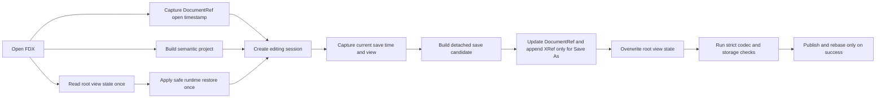

# FDX Fixes v6 — document lineage, ephemeral view state, and physical page presentation

**Status:** Approved 2026-11-02; V6-WO-001.1–001.4 implementation and regression coverage authored 2026-11-03; coverage is unexecuted and user validation remains pending. All review and validation remain user-owned. No builds, tests, formatting, lint, manual verification, desktop checks, implementation checks, reviews, independent validators, or Final Draft interoperability checks were run while preparing or implementing 001.1–001.4.

## Objective

Add and manage the standard root-level DocumentRef, WindowState, and TextState blocks, then correct desktop 100% page presentation without changing cross-platform document geometry:

1. Keep DocumentRef ID stable and make DocumentRef DateTime the current saved-document timestamp.
2. On Save As, append a new XRef containing the DocumentRef timestamp captured when the file was opened, then update DocumentRef DateTime to the new save time.
3. Read root WindowState/TextState once on Open, restore supported runtime values with safe defaults, and overwrite those root blocks from current state on Save.
4. Keep core/PDF geometry stable in document points across operating systems. Apply OS logical-coordinate conversion and native display scale only in the desktop presentation layer.

The nested TitlePage TextState remains source-preserved and is not a screenplay-editor view-state input.

## User decisions captured for v6

- DocumentRef DateTime records when the persistent document was saved. Ordinary Save replaces it with the current save time.
- Deserialization retains the DocumentRef DateTime that existed when the file was opened. Save As appends one new XRef with that opened timestamp and a fresh UUID, preserves every prior XRef, and then replaces DocumentRef DateTime with the current save time.
- DocumentRef ID remains stable across Save and Save As.
- Root WindowState and TextState are disposable runtime view state. Restore them once on Open and overwrite them on Save; do not continuously synchronize them into semantic screenplay content or preserve their imported values as source-owned settings.
- Use native display scaling on macOS and Windows. Do not use the former 2.333 fallback.
- Core logical document definitions and PDF geometry must remain OS-independent. Scaling needed to approximate physical size belongs only to rendering/GUI presentation.

## 1. Reference findings

### 1.1 Observed root structure

All four checked-in references contain one DocumentRef before Content, one root WindowState and one root TextState between PageLayout and ElementSettings, and a separate TextState inside TitlePage:

- [`reference.fdx`](../../.reference/reference.fdx:4): DocumentRef and one XRef; root window/text state at [`reference.fdx`](../../.reference/reference.fdx:57); title-page text state at [`reference.fdx`](../../.reference/reference.fdx:260).
- [`reference2.fdx`](../../.reference/reference2.fdx:4): DocumentRef and one XRef; root window/text state at [`reference2.fdx`](../../.reference/reference2.fdx:169); title-page text state at [`reference2.fdx`](../../.reference/reference2.fdx:372).
- [`arc copy.fdx`](../../.reference/arc%20copy.fdx:4): DocumentRef and one XRef; root window/text state at [`arc copy.fdx`](../../.reference/arc%20copy.fdx:103); title-page text state at [`arc copy.fdx`](../../.reference/arc%20copy.fdx:306).
- [`real_script_example.fdx`](../../.reference/real_script_example.fdx:4): DocumentRef and two ordered XRefs; root window/text state at [`real_script_example.fdx`](../../.reference/real_script_example.fdx:108); title-page text state at [`real_script_example.fdx`](../../.reference/real_script_example.fdx:275).

The standard generated top-level order should therefore become:

1. DocumentRef
2. Content
3. WindowState
4. TextState
5. The existing 17 ElementSettings blocks in native role order
6. TitlePage when present

Other imported top-level sections retain source order. Insert missing blocks at reference-compatible anchors without globally reordering or pretty-printing imported source.

### 1.2 Observed values

| Reference | DocumentRef DateTime | XRef DateTime values | WindowState | Root TextState | TitlePage TextState |
|---|---|---|---|---|---|
| [`reference.fdx`](../../.reference/reference.fdx:4) | 20261026T213956 | 20261026T213946 | 870 × 874 at 0,75; Normal | Scaling 100; Selection 0,0; invisibles No | Scaling 100; Selection 0,0 |
| [`reference2.fdx`](../../.reference/reference2.fdx:4) | 20261031T005031 | 20261031T003725 | 870 × 854 at 0,95; Normal | Scaling 100; Selection 403,403; invisibles No | Scaling 100; Selection 0,0 |
| [`arc copy.fdx`](../../.reference/arc%20copy.fdx:4) | 20261102T030406 | 20261102T030236 | 870 × 824 at 29,125; Normal | Scaling 100; Selection 48,48; invisibles No | Scaling 100; Selection 0,0 |
| [`real_script_example.fdx`](../../.reference/real_script_example.fdx:4) | 20261101T013407 | 20261026T173412, then 20261026T190711 | 1510 × 854 at 2,95; Normal | Scaling 75; Selection 1277,1277; invisibles No | Scaling 100; Selection 14,20 |

Additional observations:

- Every timestamp uses 15 characters: eight date digits, T, and six time digits. There is no zone suffix or fractional second.
- DocumentRef is later than the prior XRef entries in every example, consistent with DocumentRef representing the latest persistent save and XRefs representing earlier Save As lineage.
- IDs use lowercase hyphenated UUID-shaped values in these files. Imported non-UUID values must nevertheless remain verbatim under existing source-identity policy.
- The same XRef ID occurs in multiple references, consistent with copied document lineage. The examples do not establish the complete Final Draft algorithm; the clarified user contract is authoritative for ScriptCraft.
- Window coordinates and dimensions are decimal integers. Negative coordinates are valid desktop possibilities even though they are absent here.
- Root Selection contains flat numeric offsets, while TitlePage has a separate Selection. The references do not prove the exact Unicode or paragraph-separator units.
- No checked-in reference demonstrates missing blocks, duplicate root blocks, unknown Mode values, malformed timestamps, or out-of-range selections. Fallback behavior for those cases is a ScriptCraft safety contract.

## 2. Current implementation findings

### 2.1 Existing blocks survive import but are not projected or generated

[`read_v6()`](crates/scriptcraft-core/src/fdx.rs:365) retains the complete parsed tree, so existing DocumentRef, WindowState, TextState, and XRef elements already survive source-backed serialization as opaque structure. [`FdxDocument`](crates/scriptcraft-core/src/fdx.rs:244), however, exposes only Project and no opened-timestamp or runtime view-state projection.

[`make_new_document_nodes()`](crates/scriptcraft-core/src/fdx.rs:1734) generates Content, ElementSettings, and optional TitlePage, but not the requested root defaults.

### 2.2 Save mode must reach the writer explicitly

[`save_session_with_codec()`](crates/scriptcraft-core/src/fdx_storage.rs:382) knows Save versus Save As; [`write_v6()`](crates/scriptcraft-core/src/fdx.rs:500) does not. A save-scoped input must carry the operation kind and one captured save timestamp, later extended with current view state.

Not every serialization is a Save. The desktop health check calls [`write_v6()`](crates/scriptcraft-core/src/fdx.rs:500) from [`session_health()`](apps/scriptcraft/src/main.rs:563), and import validates through the writer. These direct calls must not update DocumentRef, append XRefs, or overwrite imported view state.

### 2.3 The opened timestamp is session lineage state

Reading DocumentRef DateTime again at Save As is insufficient after an earlier in-session Save, because that Save has already advanced the persistent timestamp. The deserialized value must be captured once and carried across save rebases until the next Open.

The proposed ownership is:

- [`FdxDocument`](crates/scriptcraft-core/src/fdx.rs:244) exposes the valid DocumentRef DateTime observed at deserialization.
- [`EditingSession`](crates/scriptcraft-core/src/editing.rs:86) retains that optional opened timestamp as private per-session lineage state, outside undo/redo snapshots.
- Existing session constructors derive the same value from imported preservation for headless callers; the desktop can also consume the reader's explicit projection.
- [`prepare_saved_rebase()`](crates/scriptcraft-core/src/editing.rs:212) carries the original opened timestamp forward rather than replacing it with the newly saved DocumentRef DateTime.
- A never-saved project has no opened timestamp. Its first Save As uses the current save time for both DocumentRef and the initial XRef. This is the required no-source fallback.
- Repeated Save As operations in one opened session use the same originally deserialized timestamp with different fresh XRef IDs. Reopening establishes a new anchor from the then-current DocumentRef.

### 2.4 Identity checks must remain strict

[`identity_domain()`](crates/scriptcraft-core/src/fdx.rs:3260) classifies DocumentRef in the Document domain and XRef in its existing Other domain. Save As therefore changes the registered identity graph as well as XML.

The correct sequence is:

1. Compare the live candidate's original non-paragraph identity graph with the original source under code 4.
2. Clone preservation state for detached save reconciliation.
3. Apply only the authorized DocumentRef timestamp update and, for Save As, one XRef addition.
4. Use the updated clone for expected identities/tree, managed reconciliation, serialization, and strict code 29/code 30 comparisons.
5. Publish the re-read project only after filesystem success.

This does not weaken code 4 for unrelated changes and does not exempt the new XRef from output checks. The collision-checked UUID v4 pattern in [`ParagraphIdAllocator`](crates/scriptcraft-core/src/paragraph_id.rs:14) can be reused with lineage-appropriate errors and reservation against all source identities and ID attributes.

### 2.5 Desktop view state ownership

[`EditingSession::with_policy_and_layout_inputs()`](crates/scriptcraft-core/src/editing.rs:110) initializes the caret at element 0, byte offset 0. [`ScriptCraftApp::new()`](apps/scriptcraft/src/main.rs:145) initializes zoom to 100. V6-WO-001.2 now projects a valid direct-root WindowState during import and transfers it as a one-shot pending native restore at successful activation; TextState remains separately scoped to 001.3.

The app captures latest viewport outer position and inner size as OS logical geometry for Save/Save As. The snapshot and pending restore are desktop-only state, not Project/session history. Incomplete geometry retains the last complete report; no complete report uses the documented 870 × 854 at (0,95) agent-default. Native restore commands are consumed once and make no claim about OS acceptance.

### 2.6 The scaling defect and requirements conflict

Before 001.4, [`presentation_metrics_at_zoom()`](apps/scriptcraft/src/main.rs:1355) hard-coded a 360-point width at 100%, although the default shared page is 612 × 792 document points. V6-WO-001.4 replaces that baseline with effective paper width and the platform logical-coordinate factor. The corresponding stale requirement has been replaced.

Before 001.4, [`status_bar.rs`](apps/scriptcraft/src/status_bar.rs:215) applied a 2.3 fallback when native scale was missing or invalid. It now resolves to neutral 1.0. Native display scale is applied once by the desktop, never embedded in document geometry, PDF coordinates, or TextState Scaling.

## 3. Corrected lifecycle and presentation contracts

### 3.1 DocumentRef and XRef

At deserialization:

- read and validate the root DocumentRef DateTime using the exact timestamp shape and valid calendar/time fields;
- retain that valid value as the session's opened timestamp;
- preserve all existing XRefs in source order;
- preserve DocumentRef ID verbatim, including imported non-UUID values.

For ordinary Save:

1. Capture one current save timestamp.
2. Replace DocumentRef DateTime with that value.
3. Preserve DocumentRef ID and every XRef, including all XRef IDs and DateTime values.

For Save As:

1. Capture one current save timestamp.
2. Select the XRef timestamp: the session's opened DocumentRef DateTime when present; otherwise the current pre-save DocumentRef DateTime when valid; otherwise the current save timestamp for a new/missing/malformed source.
3. Append one direct child XRef after existing XRefs, with a fresh collision-checked UUID v4 and that selected timestamp.
4. Replace DocumentRef DateTime with the current save timestamp.
5. Preserve DocumentRef ID and all prior XRefs unchanged.

For a missing DocumentRef, create one during save preparation with a fresh collision-checked UUID v4. New IDs use lowercase hyphenated UUID v4; existing IDs remain verbatim.

Direct source-backed serialization does not change lineage. Failed Save/Save As publishes neither the new DocumentRef timestamp nor the candidate XRef into the live session or destination.

**Agent-default clock contract:** capture local wall-clock time once per attempted save because FDX stores no zone. If local offset discovery is unavailable, use UTC rather than failing an otherwise valid save. Tests inject fixed timestamps and never depend on the real clock.

### 3.2 Root WindowState

At Open, project only a direct root WindowState. Restore supported Left, Top, Width, Height, and Normal mode once through native viewport commands. Missing/unusable geometry leaves current native geometry unchanged; unknown Mode falls back to Normal. Do not reapply restoration each frame or claim the window manager accepted it.

At Save, overwrite root WindowState from latest reported runtime geometry. Use inner-window dimensions and outer-window position consistently, with safe fallback if the backend does not report them. Negative Left/Top values remain valid. V6 emits Normal only and does not invent maximized/minimized mappings without evidence.

Root WindowState may be replaced wholesale because it is disposable. This does not authorize changes to any other source section.

### 3.3 Root TextState

At Open, project only direct root TextState, never nested TitlePage TextState:

- Missing/invalid Scaling defaults to 100 before applying the desktop's 75–300 limits.
- Malformed, negative, out-of-range, or non-boundary Selection falls back to caret 0,0 rather than inventing a clamped range.
- ShowInvisibles is outside the editing feature scope and is emitted as No.

Apply restored Selection through the existing validated selection API, set page zoom, and synchronize pinch state without changing dirty state or adding history. At Save, overwrite root TextState from current ordered Selection and whole-percent zoom.

**Agent-default selection mapping:** use ordered UTF-16 code-unit offsets over canonical body text with one paragraph separator between adjacent body paragraphs, mapping to and from the existing element-plus-UTF-8-byte Selection. This is a reversible ScriptCraft mapping, not yet proven Final Draft parity. Backward selection direction is not represented in FDX and is not persisted.

The implemented core conversion is isolated in `text_state.rs` and excludes TitlePage, SceneProperties, CharacterArcBeat paragraphs, opaque content, and display-only AllCaps. After successful activation, the desktop applies Selection once through the validated session API, restores whole-percent zoom, synchronizes the pinch baseline, and invalidates presentation geometry. Save-scoped input carries current Selection and zoom into the detached candidate; actual Save/Save As replace duplicate direct-root TextState with one canonical Scaling/Selection/ShowInvisibles=No block, inserting a missing block after WindowState. Direct source-backed serialization leaves imported root state untouched. TextState stays outside Project, dirty/history, fixed layout, and exports; nested TitlePage TextState remains source-preserved.

### 3.4 Stable core geometry and OS-specific presentation

Document and print geometry remain in signed document points, with 72 points per inch. Core layout, pagination, source mapping, and PDF do not change by OS. A default Letter page remains 612 × 792 points everywhere.

Only desktop presentation converts document points into egui logical coordinates:

| Platform | Logical points per document point at 100% | Default Letter width before native scale |
|---|---:|---:|
| macOS | 1.0 | 612 |
| Windows | 96 / 72 | 816 |

The native display multiplier then applies exactly once through egui. A valid native value uses UI zoom 1.0; missing/invalid native scale uses neutral 1.0 until a valid value arrives. There is no 2.333 or 2.3 fallback.

This follows the platforms' logical-coordinate conventions to approximate physical page size. It is not monitor calibration or a promise about arbitrary physical display hardware. Zoom scales this presentation linearly from 75–300%, while TextState stores only the percentage, never the native multiplier.

### 3.5 Transaction and failure behavior

The candidate/re-read/conflict/atomic-publication sequence remains authoritative:

- failed Save As does not publish its XRef, DocumentRef timestamp, or view state;
- failed Save does not publish its DocumentRef timestamp or view state;
- destination, live session, path, baseline, and dirty state remain unchanged on failure;
- successful Save rebases from actual saved bytes while preserving the original per-session opened timestamp;
- code 30 compares the expected tree already containing authorized changes and remains strict;
- new UnsupportedConstruct save branches receive appended diagnostic numbers without renumbering existing codes.

## 4. Runtime data flow

## 5. Proposed work orders

Execute sequentially under the repository's default parallelism policy. Every order includes durable documentation and authored regression coverage; none authorizes agent-run validation.

1. [`V6-WO-001.1 — DocumentRef and Save As lineage`](work-orders-v6/WO-001.1-documentref-save-lineage.md): save-scoped writer input, opened-timestamp session state, DocumentRef save updates, XRef append behavior, identity checks, and transaction regressions.
2. [`V6-WO-001.2 — Root WindowState restore and overwrite`](work-orders-v6/WO-001.2-window-state.md): typed root-only projection, safe one-shot native restore, current-geometry save snapshot, and disposable root-block replacement.
3. [`V6-WO-001.3 — Root TextState restore and overwrite`](work-orders-v6/WO-001.3-text-state.md): Scaling and Selection mapping, safe fallbacks, editor restore, current-state save, and TitlePage isolation.
4. [`V6-WO-001.4 — OS-independent document geometry with physical desktop presentation`](work-orders-v6/WO-001.4-physical-page-presentation.md): remove the 360-point baseline, retain stable core/PDF points, apply macOS/Windows logical conversion and native scale once, and use neutral fallback.

Dependencies: 001.2 and 001.3 build on 001.1's save-scoped candidate path and share the root view-state projection. 001.3 supplies persisted zoom for 001.4's presentation behavior. 001.4 must not alter core/PDF geometry while integrating with that saved percentage.

### V6-WO-001.1 implementation record — 2026-11-03

Implemented first and only this work order, on the initiative branch `dev/2026-11-03-fdx-v6-lineage-view-state`. The reader projects a valid opened DocumentRef DateTime; the editing session retains it across save rebases outside undo/redo. The transactional writer receives an explicit Save/Save As context with one timestamp captured before candidate preparation. Ordinary Save updates only DocumentRef DateTime; Save As appends one fresh-XRef identity with the original session anchor, or the specified pre-save/current-time fallback, then updates DocumentRef DateTime. New documents emit DocumentRef before Content; first Save As emits matching DocumentRef/XRef timestamps. Direct source-backed serialization remains non-mutating. The original code 4 graph gate precedes lineage changes, authorized identities/tree feed strict code 29/code 30 checks, and storage does not publish candidate session state until atomic publication succeeds.

Implementation and authored coverage changed [`fdx.rs`](../../crates/scriptcraft-core/src/fdx.rs), [`editing.rs`](../../crates/scriptcraft-core/src/editing.rs), [`fdx_storage.rs`](../../crates/scriptcraft-core/src/fdx_storage.rs), [`Cargo.toml`](../../crates/scriptcraft-core/Cargo.toml), [`Cargo.lock`](../../Cargo.lock), and [`v6_wo0011_documentref_save_lineage.rs`](../../crates/scriptcraft-core/tests/v6_wo0011_documentref_save_lineage.rs). Durable semantics and appended diagnostics 35–38 are recorded in the Forge writing-loop requirement, product overview, and technical context. Regression coverage was authored, including deterministic unit seams, but not run. No validation/review artifact or user evidence has been produced; 001.1 awaits user validation. Work orders 001.2 and 001.3 are implemented as recorded below; 001.4 remains not started and was not implemented.

### V6-WO-001.2 implementation record — 2026-11-03

Implemented the bounded root WindowState projection and save overwrite on top of 001.1 without implementing TextState or presentation scaling. Core read results expose `Option<WindowState>` only when exactly one direct root child in the FinalDraft expanded namespace has usable bounded coordinates; unknown/missing Mode is Normal, negative position is supported, and unusable/duplicate state does not block Open. Nested lookalikes remain source-only.

The desktop stores a valid imported restore as pending and emits outer-position/inner-size viewport commands once after activation. Latest complete geometry is read from native logical viewport rectangles and passed through the new save-scoped storage entry point; no complete snapshot uses the documented default. Movement/resizing does not enter Project, revision, dirty/history, fixed layout, or PDF. Actual Save/Save As replace direct root duplicates with one canonical ordered block; missing imported blocks use PageLayout/ElementSettings anchors, while new native output emits WindowState after Content. Direct source-backed serialization stays neutral, and detached expected-tree, source identity, conflict, and atomic publication safeguards remain intact. TitlePage and unrelated opaque source are not part of the projection/reconciliation target.

Implementation and authored coverage changed [`fdx.rs`](../../crates/scriptcraft-core/src/fdx.rs), [`fdx_storage.rs`](../../crates/scriptcraft-core/src/fdx_storage.rs), [`main.rs`](../../apps/scriptcraft/src/main.rs), and [`v6_wo0012_window_state.rs`](../../crates/scriptcraft-core/tests/v6_wo0012_window_state.rs); durable behavior was recorded in the writing-loop requirements, product overview, and technical context. Coverage authored but not executed covers all four reference projections, valid/invalid/root-only cases, duplicate collapse versus direct serialization neutrality, current geometry and canonical attributes with Save As XRef assertion, both missing-block insertion anchors and no-snapshot default, TitlePage/opaque preservation, new-output order, injected partial-write rollback for combined view-state/lineage, desktop coordinate conversion, unusable-geometry no-op, successful activation neutrality, one-shot command generation, and no Project/history/layout/PDF mutation from desktop geometry. No build, test, formatting, lint, manual verification, implementation check, review, independent validator, or desktop check was run. User-owned validation and evidence remain outstanding; 001.2 is implemented but not validated or closed.

### V6-WO-001.3 implementation record — 2026-11-03

Implemented only the approved root TextState work order on top of 001.1/001.2. `FdxDocument` exposes a safe typed root projection: exactly one direct FinalDraft child in the matching expanded namespace is considered; absent/duplicate state defaults safely; missing, malformed, nonpositive, or overflowing Scaling defaults to 100, while valid positive numeric values normalize to 75–300. Selection requires exactly two unsigned decimal endpoints and falls back atomically to caret 0,0 when malformed, reversed, out of range, or not a valid UTF-16/UTF-8 boundary. The focused core `text_state` module maps ordered flat UTF-16 code-unit offsets over canonical body text with one separator between paragraphs to/from existing element-plus-UTF-8-byte positions. TitlePage, SceneProperties, CharacterArcBeat paragraphs, opaque content, and display-only AllCaps are excluded.

After successful activation, the desktop applies Selection once through the validated session API, restores whole-percent zoom, synchronizes the pinch baseline, and invalidates presentation geometry. Zoom/caret state remains outside Project, dirty/revision/history, fixed pagination, and PDF/plain-text exports. Save-scoped input carries current Selection and zoom beside 001.2 WindowState; actual Save/Save As replace duplicate direct-root TextState with one canonical Scaling/Selection/ShowInvisibles=No element, inserting a missing block after WindowState. New output emits TextState after WindowState; direct source-backed serialization retains imported root state. Nested TitlePage TextState and unrelated opaque data remain source-preserved. Existing detached candidate, identity, source-tree, conflict, and atomic-publication gates remain unchanged. No 001.4 presentation-scaling changes were made.

Changed implementation and authored coverage: [`text_state.rs`](../../crates/scriptcraft-core/src/text_state.rs), [`lib.rs`](../../crates/scriptcraft-core/src/lib.rs), [`fdx.rs`](../../crates/scriptcraft-core/src/fdx.rs), [`fdx_storage.rs`](../../crates/scriptcraft-core/src/fdx_storage.rs), [`main.rs`](../../apps/scriptcraft/src/main.rs), [`v6_wo0013_text_state.rs`](../../crates/scriptcraft-core/tests/v6_wo0013_text_state.rs), and a combined view-state failure regression in [`fdx_storage.rs`](../../crates/scriptcraft-core/src/fdx_storage.rs). Durable behavior was updated in the Forge writing-loop requirement, product overview, and technical context.

Authored-but-unexecuted coverage covers all four reference projections and TitlePage isolation; missing, duplicate, malformed, overflowing, zero/negative Scaling and clamping; malformed, reversed, out-of-range, surrogate-splitting and otherwise unmappable Selection; ASCII/accented/non-BMP/mixed-run and multi-paragraph boundaries; backward-selection serialization; canonical actual-save overwrite on ordinary Save and Save As and direct-serialization neutrality; TitlePage preservation; Save As with current TextState, WindowState and XRef; missing-block insertion and generated ordering; combined injected storage-failure non-publication; and desktop activation plus later caret/zoom neutrality for Selection, pinch state, Project/preservation, dirty state, history, fixed layout, and PDF. No build, test, formatting, lint, manual verification, implementation check, review, independent validator, or desktop check was run. User-owned validation/evidence remains outstanding; 001.3 is implemented but not validated or closed. 001.4 is implemented as recorded below.

### V6-WO-001.4 implementation record — 2026-11-03

Implemented only the approved physical-presentation work order on top of 001.1–001.3. Removed the desktop's fixed 360-point baseline. Presentation now derives page width and scale from effective paper width in shared document points, normalized whole-percent zoom, and an explicit logical-points-per-document-point factor: macOS 1.0, Windows 96/72, unsupported platforms neutral 1.0. Base typography uses that same presentation scale. Core layout, source mapping, pagination, and PDF remain untouched and OS-independent; native display scale remains a desktop-only multiplier applied exactly once through egui.

Missing, nonfinite, zero, or negative native scale now resolves to neutral 1.0 with UI zoom 1.0; a later valid native value replaces it. TextState continues to save only the user's whole-percent zoom and does not receive either the OS conversion or native multiplier. Page centering, overflow/scrolling, hit testing, caret/selection transforms, and visible-page geometry continue to use the layout-to-presentation transform.

Changed implementation and authored coverage: [`main.rs`](../../apps/scriptcraft/src/main.rs) and [`status_bar.rs`](../../apps/scriptcraft/src/status_bar.rs). Durable contracts were updated in the Forge writing-loop requirement, product overview, and technical context. The 001.4 work order and this parent record document implementation details and remaining user-owned validation.

Authored-but-unexecuted coverage includes explicit macOS/Windows/unsupported pure conversion expectations; default Letter and arbitrary paper widths; 75%, 100%, 137%, and 300% linear page/font scaling; layout/PDF invariance across presentation platforms; cross-platform pointer-to-source mapping; corrected center/overflow geometry; valid native scales including 1.25, 1.5, and 2.0 applied once; neutral absent/invalid fallback; and later-valid-scale replacement. Existing TextState coverage continues to cover saved percentage-only behavior and existing editor interaction regressions remain authored against corrected geometry. No build, test, formatting, lint, manual verification, implementation check, review, independent validator, or desktop validation was run. User-owned macOS/Windows physical-size and interaction evidence remains pending; 001.4 is implemented but not validated or closed.

## 6. User-owned validation matrix

User-owned validation only; repository policy forbids agent-run checks. On disposable FDX copies, the user may apply the applicable checks and scenarios:

1. Open an existing file, Save ordinarily, and verify only DocumentRef DateTime advances; DocumentRef ID and all XRefs remain unchanged.
2. Reopen, Save As, and verify the appended XRef contains the DocumentRef timestamp observed at Open plus a fresh UUID, while DocumentRef receives the new save time.
3. Save more than once before Save As and confirm the XRef still uses the original opened timestamp rather than an intermediate save time.
4. Repeat Save As in one session and confirm fresh IDs with the same session anchor; reopen and confirm a new anchor is established.
5. Create a new document and Save As; verify DocumentRef and initial XRef use the current save time when no deserialized timestamp exists.
6. Inject codec, conflict, and storage failures and confirm no lineage/view-state publication.
7. Open reference copies, restore root view state once, change window/zoom/selection, Save, reopen, and verify current values return while TitlePage TextState remains unchanged.
8. Exercise missing/malformed root state, non-ASCII and multi-paragraph selections, and invalid offsets without losing screenplay access.
9. On macOS and Windows, compare 100% against physical Letter size and another document editor where practical. Check native scale changes and neutral fallback without double scaling.
10. Confirm fixed layout and PDF bytes/geometry remain OS-independent, then check 75%, 100%, 300%, scrolling, hit testing, selection painting, and caret reveal.
11. Open ScriptCraft output in Final Draft only on disposable copies and record observations without claiming blanket compatibility.

## 7. Durable document checklist

Implementation must update:

- [`screenplay-writing-loop.md`](.forge/requirements/features/screenplay-writing-loop.md:138): DocumentRef/XRef lifecycle, generated order, root view-state behavior, and transaction guarantees.
- [`screenplay-writing-loop.md`](.forge/requirements/features/screenplay-writing-loop.md:475): persisted disposable Scaling, OS presentation conversion, neutral native fallback, and removal of the obsolete 360-point requirement.
- [`product-overview.md`](.forge/requirements/product-overview.md:20): distinguish semantic truth, durable lineage, and disposable native view state.
- [`technical-context.md`](.forge/blueprints/technical-context.md:20): reader/session/desktop handoffs, save-scoped codec input, identity reconciliation order, stable core geometry, OS presentation scaling, and appended diagnostics.
- [`fdx-fixes-v6.md`](.plan/2026-10-31-FDX-fixes/fdx-fixes-v6.md) and the applicable [`work-orders-v6`](.plan/2026-10-31-FDX-fixes/work-orders-v6/) record: implementation details, changed files, authored coverage, user evidence, and remaining validation.

No project-manifest scope or policy change is anticipated. No commit, merge, build, test, review, or validation is part of this planning artifact.

## 8. Consolidated user-validation checklist — pending

All checks below are for the user to run. No authored test, build, formatter, lint, desktop check, manual verification, or Final Draft interoperability check is represented as executed or passing by this closeout.

### Cargo gates

- [ ] Run formatting check: `cargo fmt --all -- --check`.
- [ ] Run workspace lint: `cargo clippy --workspace --all-targets -- -D warnings`.
- [ ] Build the full workspace: `cargo build --workspace`.
- [ ] Run the full workspace test suite: `cargo test --workspace`.
- [ ] Run the focused lineage integration target: `cargo test -p scriptcraft-core --test v6_wo0011_documentref_save_lineage`.
- [ ] Run the focused WindowState integration target: `cargo test -p scriptcraft-core --test v6_wo0012_window_state`.
- [ ] Run the focused TextState integration target: `cargo test -p scriptcraft-core --test v6_wo0013_text_state`.
- [ ] Run the authored focused desktop tests for V6-WO-001.2, 001.3, and 001.4 in the app test target, using the test names documented in the corresponding work orders; confirm the pure platform conversion tests cover macOS and Windows independent of the host OS.

### Disposable-copy FDX lifecycle and failure safety

- [ ] Use disposable copies of representative reference documents. On ordinary Save, verify only DocumentRef DateTime advances; its ID and every prior XRef (IDs, timestamps, order, and unrelated attributes) remain unchanged.
- [ ] On Save As, verify exactly one fresh XRef is appended with the DocumentRef timestamp captured at Open, and DocumentRef DateTime advances to the save time. Repeat Save before Save As, repeat Save As in one session, then reopen and verify the new session anchor. Also verify first Save As for a new document uses the specified current-time fallback.
- [ ] Verify a missing DocumentRef is generated as specified, existing non-UUID DocumentRef IDs remain verbatim, and direct non-save serialization/health-check behavior does not refresh lineage.
- [ ] Exercise codec, identity/source-tree, conflict, and storage failures where the user test seams permit. Confirm destination bytes, live lineage and view state, session anchor, path, baseline, selection, and dirty state are unchanged after failure; confirm successful publication alone installs the saved re-read state.

### Root WindowState and TextState

- [ ] On Open, confirm only a supported direct-root WindowState is considered and restored once. Check negative Left/Top, invalid or missing geometry, duplicate blocks, unknown Mode, and that unusable geometry does not prevent opening or trigger arbitrary restoration.
- [ ] Move and resize the native window, Save and reopen, and confirm the latest complete outer-position/inner-size logical geometry is persisted without marking screenplay content dirty. Verify Save does not move or resize the current window, and missing native geometry uses the documented fallback.
- [ ] Confirm actual Save/Save As emits one canonical root WindowState, preserves nested lookalikes and unrelated source, and leaves direct non-save source serialization unchanged.
- [ ] Confirm only direct-root TextState restores body-editor zoom and Selection; nested TitlePage TextState is not applied to the body and remains source-preserved. Check absent, duplicate, malformed, nonpositive, overflowing, and clamped Scaling values.
- [ ] Exercise Selection mapping with ASCII, accented and non-BMP text, mixed runs, multiple paragraphs, empty paragraphs, paragraph boundaries, document boundaries, backward selections, malformed/reversed/out-of-range offsets, surrogate splits, and invalid mappings. Verify rejected pairs fall back atomically to caret 0,0 and valid selections restore and save as expected.
- [ ] Change caret, selection, and zoom without editing; confirm no Project/revision/dirty/history change. Save and reopen to verify current ordered Selection and whole-percent Scaling are restored, ShowInvisibles is No, and fixed layout, canonical screenplay text, and exports are unaffected by view-state changes.
- [ ] Confirm Save As stages current WindowState, TextState, and lineage together and failure does not publish any subset. Verify generated section order and bounded insertion anchors on disposable copies.

### macOS/Windows presentation, editor behavior, and PDF invariance

- [ ] On macOS and Windows, compare 100% Letter presentation against the documented logical-coordinate expectations and another editor where practical; treat physical-size observations as display-dependent, not calibration guarantees.
- [ ] Check native scales including 1.25, 1.5, and 2.0 and movement between displays. Verify the native multiplier applies exactly once, missing/invalid scale is neutral 1.0, a later valid scale takes effect, and neither OS nor native scaling is persisted in TextState.
- [ ] Check 75%, 100%, 137%, and 300% zoom; page centering, horizontal overflow/scrolling, pointer-to-source mapping, hit testing, selection painting, caret reveal, preferred vertical navigation, and visible-page tracking.
- [ ] Compare identical fixed-layout and PDF output across operating systems, native scales, and TextState zoom values under the existing deterministic export contract. Confirm the shared 612 × 792 point Letter geometry and PDF coordinates do not acquire desktop presentation factors.

### Final Draft interoperability

- [ ] If Final Draft is available, open and inspect only disposable copies of ScriptCraft output. Record observed DocumentRef/XRef, root view-state, selection-offset, and presentation behavior without editing source fixtures or claiming blanket compatibility or proven offset parity. Preserve the original files and report any interoperability differences as observations.

## 9. V6 implementation-state summary — validation still pending

All four implementation work orders report complete in their execution records: [V6-WO-001.1](work-orders-v6/WO-001.1-documentref-save-lineage.md), [V6-WO-001.2](work-orders-v6/WO-001.2-window-state.md), [V6-WO-001.3](work-orders-v6/WO-001.3-text-state.md), and [V6-WO-001.4](work-orders-v6/WO-001.4-physical-page-presentation.md). “Complete” here means implementation and regression coverage were authored; it does not mean validated or closed.

- **001.1 — DocumentRef/XRef lineage:** added opened-timestamp projection and session anchoring, save-scoped Save versus Save As input, current-save DocumentRef timestamps, append-only Save As XRefs, collision-checked IDs, and detached candidate reconciliation while retaining strict identity/source-tree checks and atomic publication.
- **001.2 — WindowState:** added bounded direct-root projection, one-shot best-effort desktop restore, latest logical geometry capture, and canonical root-block overwrite on actual Save/Save As without treating window geometry as screenplay state.
- **001.3 — TextState:** added root-only Scaling/Selection projection, safe fallback and UTF-16 flat-offset/UTF-8 position mapping, one-shot editor restore, current view-state save overwrite, and TitlePage isolation. Zoom and caret/selection remain outside semantic content, dirty/history state, fixed layout, and exports.
- **001.4 — physical presentation:** removed the 360-point baseline and 2.3/2.333 native-scale fallback; desktop presentation now uses effective paper width, platform logical conversion, user zoom, and native display scale once. Core layout, pagination, source mapping, and PDF geometry remain in OS-independent document points.

Regression coverage was authored across the three focused core integration targets, core/app unit-test seams, and storage-failure cases. It includes lineage lifecycle and failure atomicity; root-only WindowState/TextState projection, insertion/replacement, fallback and TitlePage/opaque preservation; selection mapping and editor-state neutrality; macOS/Windows presentation conversions, native-scale handling, interactions, and layout/PDF invariance. **This authored coverage has not been executed and must not be described as passing.** No agent-run formatting, lint, build, tests, manual verification, desktop validation, implementation check, review, independent validator, or Final Draft check was performed; the checklist above is user-owned.

Durable behavior was recorded in [screenplay-writing-loop.md](../../.forge/requirements/features/screenplay-writing-loop.md), [product-overview.md](../../.forge/requirements/product-overview.md), and [technical-context.md](../../.forge/blueprints/technical-context.md), in addition to the v6 plan and four work-order execution records.

At the pre-closeout Git inspection, [reference2.fdx](../../.reference/reference2.fdx) was a modified tracked file separate from the implementation/documentation set. Its provenance was not established in this closeout; it is included in the user-authorized all-changes commit. No validation result or Final Draft compatibility claim is inferred from that modification.
