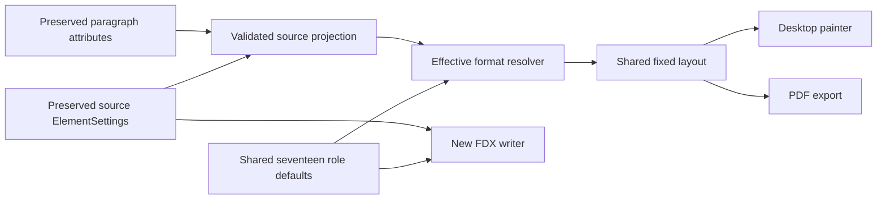

# FDX Fixes

## Element formatting investigation — 2026-11-01

### Status and selected direction

This is a source-inspection finding and strategy record, not an implementation work order or validation result. No builds, tests, lint, formatting checks, desktop smoke tests, or Final Draft interoperability checks were run; repository policy leaves review and validation to the user.

The selected direction is:

- Maintain one shared default table for all 17 directed element roles.
- Emit those defaults as native FDX element settings in newly created files.
- Progressively honor validated imported geometry, spacing, visibility, and text styling through deterministic fallbacks.
- Preserve imported source settings and unsupported values exactly through the existing source-preservation path; runtime interpretation must not rewrite them.

References inspected: [the blank Final Draft save](../../.reference/reference.fdx:1), [the populated Final Draft save](../../.reference/reference2.fdx:1), [the semantic model](../../crates/scriptcraft-core/src/lib.rs:128), [shared layout](../../crates/scriptcraft-core/src/layout.rs:147), [the FDX codec](../../crates/scriptcraft-core/src/fdx.rs:237), [source preservation](../../crates/scriptcraft-core/src/preservation.rs:270), [desktop painting](../../apps/scriptcraft/src/main.rs:707), [desktop font registration](../../apps/scriptcraft/src/document_font.rs:9), and [PDF export](../../crates/scriptcraft-core/src/exports.rs:74).

## Executive findings

1. **Current formatting is a runtime, application-owned fixed profile, not an FDX-driven document format.** [`LayoutInputs`](../../crates/scriptcraft-core/src/lib.rs:390) owns page geometry, global font metrics, seven mandatory role boxes, and ten optional role boxes. FDX projects begin with these application defaults through [`Project::session_layout_inputs()`](../../crates/scriptcraft-core/src/lib.rs:575).
2. **All 17 roles exist semantically, but only the original seven have explicit default geometry.** [`Role::ALL`](../../crates/scriptcraft-core/src/lib.rs:150) contains all 17 roles. The other ten fall back to the full text area in [`role_box()`](../../crates/scriptcraft-core/src/layout.rs:486).
3. **Current vertical spacing is not per-role FDX spacing.** [`role_boundary_gap()`](../../crates/scriptcraft-core/src/layout.rs:509) applies zero extra gap before Dialogue and Parenthetical and one global 12-point gap before every other role. Native settings instead specify per-role SpaceBefore values of 0, 12, 14, 16, or 24 points.
4. **Current rendering has one font family, size, color, and weight for every line.** [`ScriptCraftApp::paint_page()`](../../apps/scriptcraft/src/main.rs:707) uses the global inputs for every role. It does not apply role alignment, bold, italic, underline, AllCaps, role color, or role size.
5. **Imported FDX settings are already preserved well, but barely interpreted.** [`read_source_layout_settings()`](../../crates/scriptcraft-core/src/fdx.rs:1789) projects only HiddenText and StartsNewPage into [`SourceLayoutSettings`](../../crates/scriptcraft-core/src/lib.rs:460). The complete XML remains in [`PreservationState`](../../crates/scriptcraft-core/src/preservation.rs:271), and the writer re-emits that source tree.
6. **New native files contain no default element settings.** [`make_new_document_nodes()`](../../crates/scriptcraft-core/src/fdx.rs:808) emits only Content and an optional TitlePage. Adding native default settings is therefore a contained writer enhancement, not a preservation-model redesign.
7. **The two Final Draft references contain the same complete 17-role default table.** Their FontSpec, ParagraphSpec, Behavior, and Outline values match. This is strong evidence for a default profile derived from these files, but not proof of every FDX file's semantics or universal Final Draft compatibility.
8. **The work splits naturally into a small native/default-model change and progressively larger layout/rendering changes.** Native emission plus a shared typed default table is low-to-moderate complexity. Full imported typography and exact paragraph geometry is moderate-to-high complexity because the current renderer and layout assume global unsigned integer fixed-cell metrics.

## Current formatting and persistence method

### Semantic model and runtime defaults

[`Role`](../../crates/scriptcraft-core/src/lib.rs:129) represents all 17 directed roles. [`LayoutInputs::default()`](../../crates/scriptcraft-core/src/lib.rs:424) currently establishes:

- US Letter at 612 × 792 points.
- Margins of 108 points left and 72 points top, right, and bottom.
- A seven-unit character cell, 12-unit line advance, and 12-unit boundary gap.
- Courier Prime at 12 points.
- Seven explicit role boxes; ten additional boxes are absent.

The current original-seven geometry differs from the supplied native defaults in several important places:

| Role | Current default | Native reference default | Main difference |
|---|---|---|---|
| Scene Heading | x 108, width 432, incoming gap 12 | Left 1.50, right 7.50, SpaceBefore 24 | Geometry matches; native spacing is 24 |
| Action | x 108, width 432, incoming gap 12 | Left 1.50, right 7.50, SpaceBefore 12 | Matches geometry and spacing |
| Character | x 259, width 175 | Left 3.50, right 7.25 | Native box is x 252, width 270 before any alignment policy |
| Parenthetical | x 216, width 180 | Left 3.00, right 5.50, FirstIndent -0.10 | Base box matches; first-line indent is not represented |
| Dialogue | x 180, width 216 | Left 2.50, right 6.00 | Native box is x 180, width 252 |
| Transition | x 432, width 108, left-painted | Left 5.50, right 7.10, right-aligned | Native bounds are fractional and alignment is not represented |
| Note | x 108, width 432, visible without source overrides | Arial 12 italic hidden, left 1.62, right 7.50 | New-document defaults have no native note formatting or hidden behavior |
| Other ten roles | Full 432-point text area, ordinary 12-point Courier Prime | Role-specific bounds, spacing, styles, and behavior | Optional geometry is unset; neutral fallback is not native formatting |

The references use values that appear interpretable as inches from the page's left edge for both LeftIndent and RightIndent. Under that bounded interpretation, a role box is left × 72 through right × 72. This matches familiar screenplay geometry and the supplied values, but the implementation should treat it as a validated mapping for these fields rather than a universal FDX specification claim.

### Layout and rendering

[`ScreenplayLayout::build_with_effective_inputs()`](../../crates/scriptcraft-core/src/layout.rs:165) combines runtime inputs with the two recognized source settings. [`LayoutCache`](../../crates/scriptcraft-core/src/layout.rs:71) already keys cached layout on the complete runtime inputs and source-settings value, so expanding the typed source-settings projection naturally participates in invalidation.

Current layout limitations relevant to FDX formatting are:

- [`RoleBox`](../../crates/scriptcraft-core/src/lib.rs:378) contains only unsigned integer x and width. It cannot represent FirstIndent, negative values, alignment, SpaceBefore, font style, or fractional point geometry.
- [`LayoutLine`](../../crates/scriptcraft-core/src/layout.rs:35) carries role, source range, text, and rectangle, but no effective text style or per-line font metric.
- [`keep_with_next()`](../../crates/scriptcraft-core/src/layout.rs:502) is a separate role policy and does not consume native PaginateAs.
- Title-page layout uses full content width and plain text, while imported title-page paragraph formatting remains preservation-only.
- [`renderer_font()`](../../apps/scriptcraft/src/main.rs:1405) selects one regular family. Bold, italic, and bold-italic Courier Prime assets are registered in [`font_definitions()`](../../apps/scriptcraft/src/document_font.rs:9), but no document-style semantics select them.
- [`page_content()`](../../crates/scriptcraft-core/src/exports.rs:154) uses one PDF font resource and one global size. Per-role fonts/styles require additional PDF resources and text operations; underline requires separate drawing or an explicit fallback.

### FDX import, preservation, and save

[`read_v6()`](../../crates/scriptcraft-core/src/fdx.rs:237) parses the complete source into a semantic projection plus ordered preservation state. [`read_source_layout_settings()`](../../crates/scriptcraft-core/src/fdx.rs:1789) recognizes only:

- HiddenText in a role FontSpec, mapped to print visibility.
- StartsNewPage in a role ParagraphSpec.

All other settings remain source-owned XML. [`write_v6()`](../../crates/scriptcraft-core/src/fdx.rs:370) reconciles managed paragraphs into cloned preserved sections for imported projects. Runtime projection changes are deliberately not serialized back into source settings. This is the correct boundary for the selected direction: reading more settings should expand the ephemeral projection, not cause source normalization.

For a new project with no preservation state, [`make_new_document_nodes()`](../../crates/scriptcraft-core/src/fdx.rs:808) creates a minimal document. A shared default table can generate ordered ElementSettings nodes there. Once saved and reopened, those settings become source-owned preserved settings. The same defaults must therefore drive new in-memory documents immediately, avoiding a behavior change merely because a document was saved and reopened.

### Editing behavior is separate from formatting

[`enter_transition()`](../../crates/scriptcraft-core/src/editing.rs:1365) and [`tab_transition()`](../../crates/scriptcraft-core/src/editing.rs:1389) preserve the original seven-role policies but keep most added roles unchanged on Enter and consume Tab as a no-op. The references provide native ReturnKey and TabKey defaults for every role, but those are editing behaviors rather than visual formatting.

The durable requirements currently make cue uppercasing an edit-time policy only for Scene Heading and Character in [AC-WRITING-001.2](../../.forge/requirements/features/screenplay-writing-loop.md:24). Imported text is not rewritten. By contrast, native AllCaps is a FontSpec display style; the populated reference stores mixed-case source such as a scene heading and character names in [its Content paragraphs](../../.reference/reference2.fdx:12). Imported AllCaps must not trigger text normalization during open.

## Native defaults evidenced by both references

The following table condenses matching ElementSettings from [the blank reference](../../.reference/reference.fdx:61) and [the populated reference](../../.reference/reference2.fdx:172). Font means the native declared family/size, not the font ScriptCraft can necessarily render.

| Role | Left / right / first indent | SpaceBefore | Alignment | Native font and style | Starts new page |
|---|---|---:|---|---|---|
| General | 1.50 / 7.50 / 0.00 | 0 | Left | Courier Final Draft 12, regular | No |
| Scene Heading | 1.50 / 7.50 / 0.00 | 24 | Left | Courier Final Draft 12, AllCaps | No |
| Action | 1.50 / 7.50 / 0.00 | 12 | Left | Courier Final Draft 12, regular | No |
| Character | 3.50 / 7.25 / 0.00 | 12 | Left | Courier Final Draft 12, AllCaps | No |
| Parenthetical | 3.00 / 5.50 / -0.10 | 0 | Left | Courier Final Draft 12, regular | No |
| Dialogue | 2.50 / 6.00 / 0.00 | 0 | Left | Courier Final Draft 12, regular | No |
| Transition | 5.50 / 7.10 / 0.00 | 12 | Right | Courier Final Draft 12, AllCaps | No |
| Shot | 1.50 / 7.50 / 0.00 | 12 | Left | Courier Final Draft 12, AllCaps | No |
| Cast List | 1.50 / 7.50 / 0.00 | 0 | Left | Courier Final Draft 12, AllCaps | No |
| New Act | 1.00 / 7.50 / 0.00 | 12 | Center | Courier Final Draft 12, Bold+Underline+AllCaps | Yes |
| Sequence | 1.25 / 7.50 / 0.00 | 24 | Left | Courier Final Draft 12, Bold+Underline+AllCaps | No |
| End of Act | 1.00 / 7.50 / 0.00 | 24 | Center | Courier Final Draft 12, Bold+Underline+AllCaps | No |
| Summary | 0.88 / 7.50 / 0.00 | 12 | Left | Arial 12, HiddenText, source color | No |
| Outline 1 | 0.88 / 7.50 / 0.00 | 16 | Left | Arial 16, Bold+HiddenText, source color | No |
| Outline 2 | 1.12 / 7.50 / 0.00 | 14 | Left | Arial 14, Bold+HiddenText, source color | No |
| Outline 3 | 1.38 / 7.50 / 0.00 | 12 | Left | Arial 12, Bold+HiddenText, source color | No |
| Note | 1.62 / 7.50 / 0.00 | 12 | Left | Arial 12, Italic+HiddenText, source color | No |

All observed roles use Leading Regular and Spacing 1. Unknown future Leading or Spacing values should remain preserved and use an explicit application fallback rather than being guessed.

### Native behavior defaults not currently matched

The references also provide a complete Behavior table. The largest differences from current editing are:

| Role | Native ReturnKey | Native TabKey | Current added-role behavior |
|---|---|---|---|
| Shot | Action | Action | Enter retains Shot; Tab no-op |
| Cast List | Action | Action | Enter retains Cast List; Tab no-op |
| New Act | Scene Heading | Scene Heading | Enter retains New Act; Tab no-op |
| Sequence | Scene Heading | Scene Heading | Enter retains Sequence; Tab no-op |
| End of Act | New Act | New Act | Enter retains End of Act; Tab no-op |
| Summary | Summary | Outline 1 | Enter retains Summary; Tab no-op |
| Outline 1 | Summary | Outline 2 | Enter retains Outline 1; Tab no-op |
| Outline 2 | Summary | Outline 3 | Enter retains Outline 2; Tab no-op |
| Outline 3 | Summary | Note | Enter retains Outline 3; Tab no-op |
| Note | Summary | Summary | Enter retains Note; Tab no-op |

Native defaults can be serialized without immediately importing Behavior into runtime editing. Aligning actual Enter/Tab behavior should be a discrete, explicitly approved follow-up because it changes the existing editing contract and requirements.

### Paragraph-level overrides matter

FDX formatting is not only role-level. Two Summary paragraphs in [the populated reference](../../.reference/reference2.fdx:107) carry direct paragraph formatting attributes, including values that differ from the role's default SpaceBefore. Title-page paragraphs likewise carry direct formatting throughout [the TitlePage content](../../.reference/reference2.fdx:303).

The long-run precedence should be:

1. Validated direct paragraph attributes.
2. Validated role ElementSettings.
3. Shared application defaults.

The current typed source projection is role-only, so direct paragraph overrides should be an explicit later phase rather than accidentally treated as already supported.

## Recommended architecture

Extract formatting ownership from the already large [core root module](../../crates/scriptcraft-core/src/lib.rs:1) into a focused core module, preferably [formatting.rs](../../crates/scriptcraft-core/src/formatting.rs). This module should own:

- Typed font, paragraph, behavior, and outline settings needed by runtime and native emission.
- The complete ordered 17-role default table derived from the references.
- Optional source-setting projections that distinguish absent values from explicit values.
- Validation and deterministic conversion from FDX decimal inches and point values into layout geometry.
- Effective-format resolution using paragraph override, role source setting, then application default precedence.
- Deterministic application font/style fallbacks without changing source family names, colors, or unsupported tokens.

Keep XML parsing and node construction in [the FDX codec](../../crates/scriptcraft-core/src/fdx.rs:1), but have it call the formatting module rather than duplicating the role table. Keep source XML authoritative in [the preservation model](../../crates/scriptcraft-core/src/preservation.rs:270). Keep presentation-specific font selection in the desktop adapter.

### Recommended implementation sequence

These are candidate work-order boundaries, not drafted or approved work orders.

#### Candidate WO-001 — shared formatting model and native default emission

- Add the focused formatting module and typed all-role default table.
- Move role-specific formatting knowledge out of ad hoc arrays and layout helper match statements where practical.
- Generate complete deterministic ElementSettings for new FDX documents, including FontSpec, ParagraphSpec, Behavior, and Outline values evidenced by both references.
- Preserve imported settings exactly; do not inject or rewrite missing imported settings during this order.
- Use the same defaults for new in-memory sessions so save/reopen does not change behavior.
- Establish numeric parsing, unit conversion, duplicate handling, unsupported-value fallback, and output-order contracts.
- Cover all 17 roles and native save/reopen structurally. Do not claim Final Draft acceptance without user-run external verification.

This is the smallest useful first step and directly addresses native default persistence and file clarity.

#### Candidate WO-002 — default and imported paragraph geometry and spacing

- Represent left/right bounds, signed FirstIndent, Alignment, SpaceBefore, and StartsNewPage per role.
- Replace the neutral full-width fallback with native defaults for every role.
- Project validated imported ParagraphSpec fields and retain per-field fallback when values are absent or unsupported.
- Apply FirstIndent only to the first visual line, and alignment without changing canonical text or source ranges.
- Replace the global incoming-role gap policy with effective per-role SpaceBefore while retaining deterministic page-capacity behavior.
- Decide and document fractional-point precision. A signed fixed-point representation is safer than truncating native values such as 0.88 and 7.10 into the current unsigned integer boxes.
- Keep PaginateAs and direct paragraph overrides for later explicit mappings; current keep-with-next behavior must not be silently replaced.

Expect pagination and source-mapping changes from corrected role widths and spacing. Golden fixtures should distinguish intentional changes from regressions.

#### Candidate WO-003 — role typography and deterministic font fallbacks

- Carry effective font family, size, weight, slant, underline, AllCaps, color, and visibility through layout lines or an equivalent style reference.
- Map Courier Final Draft to bundled Courier Prime for display while retaining the native family string in FDX.
- Select the already bundled bold, italic, and bold-italic faces where applicable.
- Define an explicit fallback for Arial and unsupported colors. Do not claim proportional-font or exact color fidelity while layout remains fixed-cell.
- Handle per-role sizes and line metrics deliberately; a 16-point role cannot safely share the current 12-unit line box without a documented normalization or clipping policy.
- Extend PDF resources and drawing only to the same supported formatting subset as desktop output.

AllCaps needs special care: Unicode uppercasing can change character and byte counts. A display-only transform must preserve source offsets, wrapping, selection, and caret mapping. Do not mutate imported canonical text to achieve the style.

#### Candidate WO-004 — direct paragraph overrides and remaining precedence

- Project validated direct body-paragraph formatting above role defaults.
- Preserve unknown attributes and mixed content as today.
- Add fixtures based on the overridden Summary paragraphs in the populated reference.
- Keep title-page formatting preservation-only until separately scoped.

#### Candidate WO-005 — native Behavior alignment, if separately approved

- Reconcile native ReturnKey and TabKey defaults with current editing behavior and durable requirements.
- Implement transactional Enter/Tab changes only after the exact new matrix is approved.
- Do not infer the three existing application editing policies from native Behavior.

### Editor visibility needs an explicit decision before hidden defaults are expanded

Currently hidden roles are omitted from the one shared layout in [`ScreenplayLayout::build_with_effective_inputs()`](../../crates/scriptcraft-core/src/layout.rs:210), and that layout feeds both desktop display and export. If native hidden defaults are applied to new documents without further distinction, selecting Note or an outline role can make the current writing line disappear from the editor.

Before the typography/default-visibility work orders, choose one of these contracts:

- **Recommended:** hidden means suppressed from print/PDF but visible in the writing surface with a distinct subdued treatment. This requires an explicit layout-purpose or visibility-mode boundary.
- **Compatibility-minimal:** retain current omission from both editor and print, and document that hidden-role editing remains limited. This avoids renderer expansion but is a weaker writing experience.

This decision should be settled in the relevant work order rather than emerging accidentally from native emission.

## Difficulty assessment

| Area | Relative difficulty | Why |
|---|---|---|
| Extract a typed all-role default table | Low to moderate | Mostly mechanical, but must avoid divergent role order and fallback definitions |
| Emit defaults in new FDX files | Low to moderate | One new-document writer path; imported preservation can remain unchanged |
| Import more role settings | Moderate | Requires bounded numeric parsing, per-field presence/fallback, cache correctness, and tests |
| Apply native geometry and spacing | Moderate | Current unsigned integer boxes and global gap cannot express the native model |
| Apply bold, italic, underline, alignment, and role size | Moderate to high | Desktop and PDF currently assume one global regular font and metric |
| Apply AllCaps faithfully | Moderate to high | Presentation transforms can invalidate source-byte and fixed-cell mappings |
| Honor direct paragraph overrides | Moderate | Requires element-level projection and precedence beyond the current role arrays |
| Custom formatting and custom elements | High and deferred | Requires managed source-setting edits, custom role identity, UI, validation, and broader preservation semantics |

The native default-emission part is not difficult architecturally. The larger effort comes from honoring all formatting in a renderer designed around one global fixed metric. Phasing keeps the native improvement useful without forcing a full typography rewrite in the first work order.

## Safety and compatibility constraints for future work orders

- Do not add a private FDX extension or sidecar for these settings; standard FDX ElementSettings is the appropriate native home.
- Do not regenerate imported settings merely because the runtime projection gained a new recognized field.
- Do not drop unknown FontSpec style tokens, attributes, namespaces, or unsupported values; preserve them and use a bounded runtime fallback.
- Do not treat source font family names as proof that a matching font exists on the host.
- Do not rewrite canonical source casing on import to implement AllCaps.
- Do not conflate native Behavior with the application's cue-casing, automatic-parenthetical, or strict-boundary policies.
- Do not claim exact Final Draft layout, font, color, pagination, or interoperability parity from structural tests alone.
- Keep layout deterministic for identical semantic content and effective settings, and keep zoom presentation-only.
- Update [the product overview](../../.forge/requirements/product-overview.md:86), [writing-loop requirements](../../.forge/requirements/features/screenplay-writing-loop.md:76), and [technical context](../../.forge/blueprints/technical-context.md:43) when approved implementation changes their formatting contracts.

## Suggested user-owned acceptance coverage

When work orders are drafted, their validation handoffs should include:

1. A 17-role default-table audit against both reference files, including every attribute and stable emission order.
2. New-document save/reopen showing identical effective defaults before and after native settings appear.
3. Imported custom settings proving per-field source override, fallback, and unchanged source XML after save.
4. Geometry fixtures for fractional indents, negative FirstIndent, right/center alignment, all SpaceBefore values, and New Act page starts.
5. Canonical-text/source-mapping fixtures for mixed-case AllCaps input and Unicode whose uppercase form expands.
6. Visible/hidden editor and print cases for Note, Summary, and all three outline roles.
7. Desktop and PDF checks for every supported font style and deterministic fallback, with external Final Draft checks performed separately by the user where available.

## Approved planning decisions and work-order handoff

The user approved the phased strategy on 2026-11-01 and selected these implementation contracts:

- HiddenText roles remain visible and subdued in the writing surface but are omitted from print/PDF; plain-text export follows the same hidden-text exclusion.
- Signed fixed-point geometry with 1/100-point precision is part of the paragraph geometry work.
- The five orders are drafted for sequential implementation so each coding agent receives a stable handoff and shared files do not change concurrently.
- All review and validation remain user-owned. Drafted tests are implementation artifacts, not authorization for agents to run checks.

The detailed work orders are:

1. [WO-001 — Shared element formatting and native default emission](work-orders/WO-001-shared-element-formatting-and-native-defaults.md)
2. [WO-002 — FDX paragraph geometry and spacing](work-orders/WO-002-fdx-paragraph-geometry-and-spacing.md)
3. [WO-003 — Role typography and editor/print visibility](work-orders/WO-003-role-typography-and-print-visibility.md)
4. [WO-004 — Direct paragraph formatting overrides](work-orders/WO-004-direct-paragraph-format-overrides.md)
5. [WO-005 — Native role keyboard behavior](work-orders/WO-005-native-role-keyboard-behavior.md)

Next state: user approval of the complete work-order set, followed by initiative-branch creation and orchestrator dispatch in the listed sequence. No implementation, branch operation, or validation has been performed by this planning task.

## Branch setup and approved implementation handoff

The `Next state` note immediately above records the preceding planner's state and is superseded by this setup record.

- **Explicit user approval:** The user approved all five drafted work orders and directed creation/switch to a new initiative branch before sequential coding-agent dispatch. This records the explicit approval in the current instruction; no separate approval date is asserted.
- **Branch and base:** Created and switched to `dev/2026-10-31-fdx-formatting` from the then-current `master` branch at HEAD `d517e3b2846988f8d898b635d490b6c88570945a`. The requested local branch was absent before creation. After switching, HEAD and the new branch tip both remained `d517e3b2846988f8d898b635d490b6c88570945a`.
- **Worktree preservation:** Read-only porcelain status before switching showed one already-modified tracked file, this plan, with unstaged changes; no staged entries; and five untracked work-order files under [`.plan/work-orders/`](../work-orders/). Post-switch status showed the same plan modification and same five untracked files, with HEAD unchanged and no other tracked/staged/untracked entries reported. The branch operation did not stage, commit, stash, clean, reset, merge, delete, or alter those pre-existing changes. This appended record further updates the already-modified plan; no other file was edited as part of this handoff.
- **Work-order location correction:** At branch setup, all five drafts were in the repository-level [`.plan/work-orders/`](../work-orders/) directory, and the initiative-local [`work-orders/`](work-orders/) directory existed but was empty. This relocation moved the five drafts into the requested initiative-local directory without overwriting any pre-existing file; their relative links were rebased for the new location.
- **Dispatch sequence:** Once implementation dispatch begins, use the approved sequence already listed above: [WO-001](work-orders/WO-001-shared-element-formatting-and-native-defaults.md), [WO-002](work-orders/WO-002-fdx-paragraph-geometry-and-spacing.md), [WO-003](work-orders/WO-003-role-typography-and-print-visibility.md), [WO-004](work-orders/WO-004-direct-paragraph-format-overrides.md), then [WO-005](work-orders/WO-005-native-role-keyboard-behavior.md). Dispatch is not performed by this setup.
- **Scope and policy:** No work order was implemented, no agent was dispatched, and no review or validation was performed. No tests, builds, lint, formatting checks, manual verification, implementation checks, or other validation were run, in accordance with the active repository policy.

## WO-001 implementation status — 2026-11-01

This execution record supersedes the setup-time statement above that no work order had been implemented; it does not supersede or alter the recorded branch, base, worktree-preservation, or repository-policy facts.

- **State:** WO-001 code and regression-test authoring are present. No review or validation is claimed. No tests, builds, lint, formatting checks, implementation checks, manual verification, or external application checks were run, as required by the current project policy.
- **Implementation boundary:** A single ordered typed 17-role formatting table now backs new-document native ElementSettings emission and the currently interpreted HiddenText / StartsNewPage fallbacks. Emission is limited to the no-preservation path. Imported ElementSettings remain governed by the existing preservation tree and clone/reconcile writer path. Existing save/re-read safeguards were not relaxed.
- **Deferred behavior:** Runtime geometry, spacing, text styling, editor-vs-print hidden visibility, direct paragraph overrides, and Enter/Tab interpretation remain unimplemented here and reserved for WO-002 through WO-005. Hidden-role layout behavior remains the pre-existing shared-layout behavior until WO-003.
- **Verification owner:** The user must run applicable checks and inspect reference-structure parity, pre/post-save/reopen defaults, and imported custom-setting preservation. External Final Draft inspection, if desired, is separate and does not follow from structural coverage.
- **Handoff:** `formatting::ParagraphSpec`, `formatting_for_role()`, and native-order iteration are available to WO-002. WO-002 can proceed as the approved next order against this interface, but WO-001 acceptance remains unverified and this record makes no success or compatibility claim.

## WO-002 implementation status — 2026-11-01

This execution record documents authored changes only. It does not supersede the active repository-wide user-owned review/validation policy or establish acceptance.

- **State:** WO-002 implementation and focused regression-test authoring are present. No tests, builds, lint, formatting checks, review, manual verification, implementation checks, validators, or external interoperability checks were run. The user owns all verification.
- **Geometry interfaces:** [`formatting::FixedPoint`](../../crates/scriptcraft-core/src/formatting.rs) stores signed 1/100-point units with bounded decimal inches/points parsing, one `to_points_f32()` conversion for desktop coordinates, and exact `decimal_string()` output for PDF numbers. [`layout::FixedRect`](../../crates/scriptcraft-core/src/layout.rs) carries precise rectangles; `LayoutLine` retains separate text extent and paragraph bounds plus the legacy whole-point `Rect` projection. Hit testing, caret geometry, source mapping, vertical navigation, desktop painting, PDF output, and page-fit decisions use the precise layout. Existing `RoleBox` integer values remain transient legacy JSON inputs and convert explicitly at the layout boundary.
- **Projection and source authority:** `SourceLayoutSettings` now caches independently projected role ParagraphSpec fields (Alignment, FirstIndent, LeftIndent, RightIndent, Leading, SpaceBefore, Spacing), with StartsNewPage and visibility in the same effective source-settings key. Missing/unsupported fields use shared defaults; unsupported Alignment uses deterministic Left; conflicting ParagraphSpec Type excludes that specification; invalid bound pairs use the role's default pair. Imported XML remains preserved and authoritative for saving. No direct paragraph override or typography mapping was added.
- **Layout behavior:** native typed geometry replaces the neutral fallback across all 17 roles. Signed first-line indent, Left/Right/Center display alignment, incoming per-role SpaceBefore, page-top suppression, StartsNewPage, actual fixed-point vertical fit, and existing keep-with-next policy are represented without changing canonical text or source ranges. Hidden roles continue to disappear from shared editor layout until WO-003; this order does not add typography or visibility-mode behavior.
- **Durable updates:** the product overview, writing-loop requirements, technical context, and WO-002 implementation handoff describe the bounded precision, effective-field resolution, preservation boundary, verification ownership, and WO-003 handoff.
- **Verification limitation:** authored tests are not results. No acceptance or Final Draft interoperability/layout claim is made. WO-003 has a stable authored geometry interface to build on, but must treat this order as unvalidated until user-owned verification occurs.

## WO-003 implementation status — 2026-11-01

- **State:** WO-003 implementation and focused test authoring are present. No tests, builds, lint, formatting checks, implementation checks, review, validator dispatch, manual verification, or external application checks were run. WO-001 and WO-002 remain user-unvalidated; this entry does not establish acceptance for any order.
- **Font projection/resolution:** `SourceLayoutSettings` carries per-role optional source FontSpec fields for family, integer size 1–72, supported style tokens, HiddenText, and color. One unique FontSpec is projected; duplicate FontSpec children use role defaults without modifying preserved XML. `text_style(role)` combines each supported source field with the shared role default. Unknown tokens and unsupported fields stay source-owned and use deterministic fallback. Courier Final Draft, Arial, and unknown families map to bundled Courier Prime for desktop, using the regular/bold/italic/bold-italic faces registered from existing assets.
- **Fixed typography and canonical/display boundary:** role metrics scale from 7 character-width units and 12 line-advance units at 12 points, rounded in shared 1/100-point geometry. `LayoutLine.text` and `SourceRange` remain canonical/source-based; `display_text` and `display_source_map` implement display-only Unicode AllCaps, including expansions mapped to their original scalar range. Caret/hit/selection/vertical navigation use mapped boundaries and per-line cell widths.
- **Purpose and visibility:** `LayoutPurpose::{Editor, Print}` is included in `LayoutCache` identity with inputs and effective source settings. Desktop requests Editor; text/PDF exports request Print. Editor includes HiddenText roles at stable source indexes with a contrast-tested theme-aware subdued color; print/PDF/plain text omit them. A visible source override uses ordinary styling.
- **PDF boundary:** PDF outputs use deterministic standard Courier regular/bold/oblique/bold-oblique resources, per-line size/fixed-cell scaling and separate underline strokes. Fonts are not embedded. The existing PDF non-ASCII substitution is unchanged; no non-ASCII improvement, Final Draft interoperability, or visual parity is claimed.
- **Tests/docs:** Added focused core projection, fallback, style/size, source-map, cache/purpose, visibility and export test authoring, plus rendered-egui face/size/hidden-color and contrast test authoring. Updated the product overview, writing-loop requirements, technical context, and WO-003 implementation handoff. Tests are not results and remain unrun.
- **WO-004 handoff:** WO-004 can proceed safely against `SourceLayoutSettings::text_style(role)`, `LayoutPurpose`, `LayoutCache::get_or_build_with_inputs_for_purpose()`, the purpose-aware `ScreenplayLayout` builders, and `LayoutLine`'s canonical/display/source-map/typography fields. Direct paragraph precedence should affect paragraph geometry only and leave role typography intact. This handoff is not evidence that WO-001–003 passed user validation.

## WO-004 implementation status — 2026-11-01

- **State:** Direct paragraph override implementation and focused test authoring are recorded; no review or validation is claimed. The policy in `.forge/project-manifest.md` remains authoritative: no agent-run tests, builds, lint, formatting, implementation checks, manual verification, or validators. WO-001–003 remain user-unvalidated.
- **Projection and precedence:** The shared source-layout projection now stores validated direct body Paragraph values by the transient managed semantic element ID. Each geometry/spacing/page-start field independently resolves direct paragraph > role ElementSettings > shared default; direct text styling is deliberately absent, so role typography and visibility remain shared. Title-page formatting and run attributes remain preservation-only. The full preserved source tree remains the save authority, including invalid and unknown paragraph attributes.
- **Structural-edit boundary:** A split keeps the source attributes on the original identity and creates the new paragraph without copied direct XML. Joining rejects transactionally when the paragraph being removed carries any supported direct-format attribute, even an invalid-valued one, preventing loss of that source attribute. Role changes update only Type and retain direct attributes on the same identity. Explicit paragraph deletion remains the existing user-directed removal operation.
- **Test authoring:** Added `crates/scriptcraft-core/tests/wo004_direct_paragraph_overrides.rs` for all supported fields, field-level precedence/fallback, adjacent role-matched paragraphs, the populated reference, invalid-source preservation, typography isolation, page starts/spacing, split/join/role-change behavior, save/reopen projection, and cache invalidation. Authored tests are not results.
- **Handoff:** WO-005 is independent and can proceed sequentially against the existing resolver interfaces. User-owned workspace checks plus editor/PDF inspection of the reference summaries are still outstanding; this status does not establish WO-004 acceptance.

## WO-005 implementation status — 2026-11-01

- **State:** WO-005 runtime keyboard behavior and focused test authoring are present. WO-001–004 remain user-unvalidated; no acceptance is claimed for this order or its predecessors.
- **Runtime policy:** Enter and Tab now read their target labels from the shared 17-role formatting defaults and resolve them through that same native-order table. Imported per-document Behavior remains source-preserved and does not alter runtime transitions. Same-role Enter still performs a normal split; same-role Tab is an unchanged consumed no-op. Dialogue interior/end behavior, blank-Character Tab, automatic Parenthetical handling, strict boundaries, and transactional history/source reconciliation remain in their existing mutation paths. WO-004 direct paragraph attributes remain on the surviving source identity during Enter splits and are not copied to the newly created paragraph; role-change and join safety checks were not weakened.
- **Tests authored:** [`wo005_native_role_keyboard_behavior.rs`](../../crates/scriptcraft-core/tests/wo005_native_role_keyboard_behavior.rs) covers the complete Enter/Tab matrices, same-role distinction, Dialogue split boundaries, Character and Parenthetical policies, enabled/disabled special policies, strict-boundary rejection, invalid UTF-8 and capacity failure atomicity, undo/redo, imported custom Behavior preservation/runtime independence, and direct-paragraph source retention/no-copy behavior.
- **Durable updates:** The complete approved transition matrix and application-default/import-preservation distinction are recorded in AC-WRITING-001.4a and the technical context. The work order records its implementation handoff and user-owned verification status.
- **Verification limitation:** No tests, builds, lint, formatting checks, manual verification, implementation checks, review, or validator dispatch were performed. Tests are authored artifacts, not results. User-owned verification of WO-005 and the preceding orders remains outstanding.
