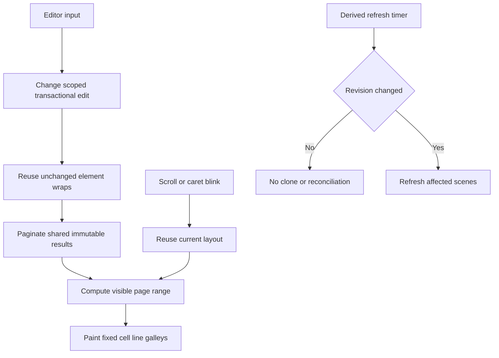

# UI Quality of Life v1 — Render speed

**Status:** RS-WO-001 through RS-WO-011 are implemented/submitted with user review and validation pending; WO-009's copy-on-write structural criterion is addressed by WO-010 implementation design only and has not been execution-confirmed; RS-WO-012 integration scenario and closeout documentation authored 2026-11-03, with user review, validation, measurements, and final acceptance pending
**Initiative:** Long-document scroll and text-input responsiveness
**Execution:** Twelve sequential work orders under the user's recorded authorization; no parallel implementation
**Validation owner:** User for every work order and final acceptance

> **Policy boundary:** This investigation used static source inspection only. No builds, tests, formatting, lint, desktop automation, profiling runs, reviews, independent validators, or other agent-run checks were performed. Authored tests proposed below are implementation artifacts, not evidence of passing behavior. Repository policy in [`project-manifest.md`](../../.forge/project-manifest.md:73) remains authoritative.

## 1. Outcome and acceptance approach

A representative 120-page screenplay should scroll without work proportional to the total number of glyphs in the document, and an ordinary text insertion should not rebuild or deeply clone the entire preserved document before the next frame can be painted.

The user has explicitly chosen **structural guarantees plus before/after user measurements**, not fixed timing thresholds. Accordingly:

- automated coverage must assert work performed, cache reuse, output equivalence, and interaction correctness rather than milliseconds;
- the user will compare wall-clock behavior before and after each implementation batch in the build profiles they actually use;
- no order claims a frame-rate, latency, or external-editor parity guarantee;
- fixed page geometry, canonical text, source preservation, transactional editing, undo/redo, native saves, and exports take priority over optimization.

## 2. Executive diagnosis

There is no evidence of FDX XML parsing or serialization on every frame. The dominant costs are in the immediate-mode paint path, whole-document layout invalidation, deep transactional snapshots, and periodic derived-scene reconciliation. RS-WO-008 now gates scheduled reconciliation on the active document revision, so unchanged due ticks do not enter project cloning or reconciliation; changed-revision reconciliation remains the subject of RS-WO-009.

| Priority | Mechanism | Evidence | Practical effect |
|---|---|---|---|
| Critical (pre-WO-004; paint portion addressed) | Every page was painted on every frame, including pages far outside the viewport | Before RS-WO-004, [`live_document_surface()`](../../apps/scriptcraft/src/main.rs:887) called [`paint_page()`](../../apps/scriptcraft/src/main.rs:737) for each allocated page; RS-WO-004 retains full page geometry but paints only the clip-intersecting range plus one-page overscan | Geometry consideration remains proportional to page count; page content paint, line submissions, and fixed-cell galley submissions are viewport-bounded, with galleys proportional to nonempty painted lines and their selection color spans |
| Critical (visible-line submission portion addressed by RS-WO-005) | Text was emitted one character at a time, allocating a new string for every glyph | Before RS-WO-005, the desktop renderer issued a separate painter request for each displayed scalar; it now emits cached fixed-cell line/selection-span galleys in [`main.rs`](../../apps/scriptcraft/src/main.rs) | Text layout work is now proportional to visible nonempty lines and their color spans, not glyph count; no user timing result is recorded |
| Critical (per-element wrapping addressed by RS-WO-006; whole-document placement remains) | Every content revision rebuilds layout for every element | Before RS-WO-006, [`LayoutCache`](../../crates/scriptcraft-core/src/layout.rs) retained only one complete result; it now retains bounded collision-safe immutable wraps keyed by effective element inputs, then visits every element for page placement on each revision | An ordinary one-element edit rewraps only that element when effective wrap inputs are unchanged; page placement remains whole-document and no measured timing improvement is claimed |
| Critical (preservation-copy portion addressed by RS-WO-010; ordinary managed validation scoped by RS-WO-011) | Every edit clones semantic project data and fully validates preserved source state | [`EditingSession::mutate()`](../../crates/scriptcraft-core/src/editing.rs:781) retains a detached semantic candidate and complete validation for structural/global edits; ordinary single-paragraph edits use a strictly preconditioned local validator against a valid baseline, with full fallback; preservation snapshots share original bytes and immutable source subtrees until a path is edited | Project element/history vectors and candidate equality remain whole-document work, but common managed source lookup and complete source validation are no longer mandatory for eligible ordinary edits; all global safety boundaries remain complete. This is implementation design, not a measured gain |
| High (per-frame lookup and interaction scans addressed structurally) | Caret lookup was repeated from every page paint and interaction helpers lacked indexes | RS-WO-004 resolves caret geometry at most once per frame and shares it with reveal and owner-page paint; RS-WO-007 adds complete-layout element/body-line indexes for caret, nearest-line, and vertical navigation paths | Caret/owner lookup now examines only the requested element's placed lines; nearest-line queries use ordered vertical candidates; vertical navigation does not flatten the complete body-line set |
| High (idle scheduling addressed by RS-WO-008; candidate preservation copying addressed by RS-WO-009/010) | Derived cast/scene work runs on a timer even when nothing changed | [`refresh_cast_lists_on_schedule()`](../../apps/scriptcraft/src/main.rs:245) runs every second; WO-008 revision-gates unchanged ticks, and changed revisions use one detached copy-on-write project candidate plus managed-heading candidates | Idle ticks skip before cloning. A changed reconciliation retains atomic detached publication while source bytes and untouched preservation subtrees remain shared; no elapsed-time result is recorded |
| Medium | Editor input is dispatched after the current frame's document paint | [`ScriptCraftApp::update()`](../../apps/scriptcraft/src/main.rs:1824) shows application panels at [`main.rs`](../../apps/scriptcraft/src/main.rs:1841) and only then calls [`handle_surface_input()`](../../apps/scriptcraft/src/main.rs:1188) at [`main.rs`](../../apps/scriptcraft/src/main.rs:1846) | A text edit cannot appear until a subsequent repaint, adding a guaranteed extra frame of latency after the edit work itself |
| Medium | Existing core responsiveness coverage does not measure the actual desktop render path | The [core layout benchmark](../../crates/scriptcraft-core/tests/wo006_responsiveness.rs) times core layout only; its candidate clone occurs before the timed region | The desktop oracle now measures actual page/line paint work; the core benchmark remains layout-only and cannot detect desktop input-dispatch, edit-clone, or periodic-refresh bottlenecks |

## 3. Detailed findings

### 3.1 Scrolling is dominated by painting, not repagination

The existing whole-layout cache does avoid a layout rebuild when the revision and effective inputs are unchanged. That is why scrolling and typing have different immediate causes.

On every desktop update:

1. [`layout_for_render()`](../../apps/scriptcraft/src/main.rs:269) obtains the cached layout.
2. [`live_document_surface()`](../../apps/scriptcraft/src/main.rs:887) allocates every page row and full rectangle, then selects only clip-intersecting pages plus fixed one-page overscan for painting.
3. [`paint_page()`](../../apps/scriptcraft/src/main.rs:737) walks lines only for selected pages; hidden pages issue no line, selection, text, underline, or page-fill paint.
4. [`paint_fixed_metric_text_with_selection()`](../../apps/scriptcraft/src/main.rs:1493) now submits one cached fixed-cell galley per visible line or same-color selection span. Fixed-cell glyph positions are restored after shaping; core document-point pagination remains authoritative.

The complete-layout cache saves all core layout work during scroll. On a document revision, RS-WO-006 performs whole-document page placement while reusing unchanged immutable per-element wraps. Page allocation and geometry tracking remain linear in page count. RS-WO-004 makes page content drawing and line work viewport-bounded and limits caret geometry resolution to one per frame. RS-WO-005 removes the per-character visible text submission/allocation path and retains bounded span-level shaping/cache work. RS-WO-007 indexes caret, nearest-line, and vertical navigation interaction lookups without changing complete layout placement.

RS-WO-006 also removed avoidable complete-layout cache-hit overhead: the cache compares source settings by reference and clones them only when a new immutable layout value is built, not before a cache hit.

### 3.2 Typing repeats several whole-document stages on the UI thread

An ordinary insertion currently pays for all of the following before the next visible frame:

1. [`EditingSession::mutate()`](../../crates/scriptcraft-core/src/editing.rs:702) clones semantic project data and generated-parenthetical state; preservation-owned bytes, vectors, text leaves, and images are now shared copy-on-write rather than deeply copied.
2. The edit transforms the semantic element and its managed source paragraph.
3. [`PreservationState::reconcile_body_structure()`](../../crates/scriptcraft-core/src/preservation.rs:843) builds identity sets even for a nonstructural edit.
4. [`Project::validate()`](../../crates/scriptcraft-core/src/lib.rs:488) validates every semantic element and calls [`PreservationState::validate_project_elements()`](../../crates/scriptcraft-core/src/preservation.rs:527), which in turn calls the complete source-tree validator.
5. The prior project is cloned again for undo history; preservation storage remains immutable and shared until a snapshot mutates its own managed path.
6. Full project equality is evaluated for no-op detection and dirty state.
7. The successful edit increments the revision at [`editing.rs`](../../crates/scriptcraft-core/src/editing.rs:746), invalidating the only layout result.
8. [`ScreenplayLayout::build_with_effective_inputs_for_purpose()`](../../crates/scriptcraft-core/src/layout.rs:289) validates and performs whole-document placement; RS-WO-006 reuses immutable wraps for unchanged effective element inputs and wraps only misses.
9. The current frame has already painted before the event was dispatched, so another repaint is required to show the edit.

The preservation model was the most expensive clone target. [`PreservationState`](../../crates/scriptcraft-core/src/preservation.rs:274) owns original source bytes, ordered source sections, arbitrary nested nodes, identities, references, and optional image payloads. RS-WO-010 shares source bytes, section/child vectors, text-like leaves, and image payloads immutably; managed mutation detaches only the index path and required sibling vectors. RS-WO-011 adds indexed managed-source lookup and change-scoped validation for provable ordinary single-element edits; complete source validation remains mandatory at imports, structural/global operations, explicit public boundaries and native saves. Semantic project-vector cloning and whole-project equality remain.

### 3.3 Derived refresh is periodic whole-document work

[`CAST_LIST_REFRESH_INTERVAL`](../../crates/scriptcraft-core/src/cast_list.rs:10) is one second. On schedule, the desktop calls [`EditingSession::refresh_cast_lists()`](../../crates/scriptcraft-core/src/editing.rs:227), which clones the project before calling [`correct_cast_lists()`](../../crates/scriptcraft-core/src/cast_list.rs:37).

Before RS-WO-009, that function created both an original and candidate clone. Scene reconciliation then created further project and preservation candidates, including a preservation-state clone for each managed heading in [`reconcile_project_with_outcome()`](../../crates/scriptcraft-core/src/scene_metadata.rs:42). RS-WO-009 retains one detached project candidate for atomic publication, clones only the managed heading being reconciled, and uses explicit changed/deferred outcomes rather than whole-project equality. Full project validation remains on changed candidates; unchanged candidates do not trigger that validation.

This is not an every-tick XML parse, but it is recurring whole-document derived work regardless of whether any relevant revision occurred. It can also land on the same frame as text input because input dispatch currently happens after the scheduled refresh.

### 3.4 Caret and navigation helpers now use layout-owned indexes

Before RS-WO-007, [`ScreenplayLayout::caret_geometry()`](../../crates/scriptcraft-core/src/layout.rs) scanned the complete layout until it found the caret; calling it once per page multiplied that scan by page count. RS-WO-004 first reduced this to at most once per frame, and RS-WO-007 now limits the lookup to the requested element's ordered placed-line entries, retaining first-match page/line behavior.

Before RS-WO-007, [`ScreenplayLayout::nearest_line_hit_test_fixed()`](../../crates/scriptcraft-core/src/layout.rs) scanned all body lines and [`ScriptCraftApp::move_vertical()`](../../apps/scriptcraft/src/main.rs) collected a flattened line vector. They are now served by a sorted vertical-index permutation and a document-ordered body-line index respectively. Nearest-line selection retains exact distance and page/line tie ordering; title pages remain outside the body hit-test/navigation domain.

### 3.5 FDX parsing is not the regular-frame culprit

The normal frame path does not call the FDX reader or writer. XML import occurs through document opening, and native serialization occurs through explicit saves and exports.

[`session_health()`](../../apps/scriptcraft/src/main.rs:588) does call [`write_v6()`](../../crates/scriptcraft-core/src/fdx.rs:484), but it is reached through error reporting such as [`show_error()`](../../apps/scriptcraft/src/main.rs:581), not ordinary scrolling or successful typing. It should not be misidentified as the routine performance cause.

### 3.6 Build profile is a measurement variable, not the repair

The workspace [`Cargo.toml`](../../Cargo.toml:1) does not define custom development optimization settings. WordCraft explicitly optimizes dependencies and its own development profile in its [`Cargo.toml`](../../../craft/wordcraft/Cargo.toml:102). An unoptimized ScriptCraft development run can amplify all of the costs above, especially per-glyph immediate-mode work.

The plan does not propose hiding the algorithmic problems behind release-only behavior. User measurements should record debug versus release profile, document dimensions, operation, and build revision so comparisons remain like-for-like.

## 4. What WordCraft does differently

WordCraft is useful as an architectural reference, not as code to copy wholesale.

| WordCraft mechanism | Reference | Lesson for ScriptCraft |
|---|---|---|
| Paragraphs carry content revisions | [`next_rev()`](../../../craft/wordcraft/crates/doc/src/para.rs:34) | Fine-grained invalidation avoids treating every element as changed |
| Wrapped paragraph results are memoized by revision and effective layout context | [`LayoutCache`](../../../craft/wordcraft/crates/layout/src/lib.rs:531), its key at [`Key`](../../../craft/wordcraft/crates/layout/src/lib.rs:505), and the hit path in [`Ctx::para_labelled()`](../../../craft/wordcraft/crates/layout/src/lib.rs:866) | Whole-document pagination may still run, but unchanged text is not shaped and wrapped again |
| The session reuses the same layout object when document/view inputs are unchanged | [`Session::layout_with()`](../../../craft/wordcraft/crates/engine/src/session.rs:1009) | Scroll should not invalidate layout merely because presentation changed |
| Page fingerprints are computed lazily and only for visible or cached pages | [`PageKeys::content()`](../../../craft/wordcraft/crates/ui-egui/src/canvas.rs:860) and the visible-page loop in [`show()`](../../../craft/wordcraft/crates/ui-egui/src/canvas.rs:1019) | Do not perform whole-document rendering preparation to draw a small viewport |
| Page render textures are bounded and rendered on demand | [`show()`](../../../craft/wordcraft/crates/ui-egui/src/canvas.rs:1019), especially [`canvas.rs`](../../../craft/wordcraft/crates/ui-egui/src/canvas.rs:1335) | Raster caching is available if direct visible painting later proves insufficient; it is not a prerequisite for fixing ScriptCraft's current per-glyph path |
| Input is handled before layout and painting | [`show()`](../../../craft/wordcraft/crates/ui-egui/src/canvas.rs:1019), particularly [`canvas.rs`](../../../craft/wordcraft/crates/ui-egui/src/canvas.rs:1070) | An accepted edit can be laid out and shown in the same frame |
| Performance regressions assert work counts and layout identity | [`scrolling_a_big_table_fingerprints_only_pages_coming_into_view()`](../../../craft/wordcraft/crates/ui-egui/src/tests_perf.rs:104) | Structural assertions are suitable here and align with the user's no-timing-threshold decision |

Notably, WordCraft still exposes a whole-document layout entry point in [`layout()`](../../../craft/wordcraft/crates/layout/src/lib.rs:2240). The useful optimization is **per-element reuse within whole-document pagination**, not an assumption that pagination must immediately become incremental from the edit to the end of the document.

## 5. Target architecture

### Structural invariants

- Unchanged scroll, selection-only repaint, and caret blink reuse the identical layout object.
- Only pages intersecting the viewport plus a small fixed overscan region perform text layout or drawing work.
- Page rectangles for all pages remain available for scroll extent, visible-page status, and pointer routing; hidden pages are allocated geometrically but not painted.
- Fixed-cell glyph positions are retained. Batching text must not replace deterministic screenplay metrics with ordinary host-font wrapping or advances.
- A caret lookup occurs at most once per frame during this batch's initial paint repair and becomes indexed in the layout work order.
- Ordinary insertion rebuilds wraps only for elements whose effective wrap inputs changed.
- Idle derived-refresh ticks perform no project clone and no scene reconciliation.
- Ordinary single-paragraph edits use indexed managed lookup and scoped validation only from a fully validated session baseline with provable unchanged global invariants; uncertain or topology-changing candidates fall back to complete validation. They do not deep-copy untouched preserved source subtrees.
- Open, structural editing where required, native Save/Save As, and explicit full-validation entry points retain complete safety validation.
- Cached and uncached layouts are structurally identical for the same project and effective inputs.

## 6. Authorization record and work-order index

**Authorization recorded 2026-11-03:** The user explicitly authorized implementation of all twelve work orders, sequentially, one coding agent per order. This authorization clears the prior draft/approval holds for the batch; it does not assert that any order is reviewed, validated, or accepted. The user retains all review and validation ownership under repository policy. RS-WO-001 through RS-WO-011 are implemented/submitted with user review and validation pending. WO-009's source-byte/unrelated-subtree structural limitation is addressed by WO-010's copy-on-write implementation design, but this has not been confirmed by execution. RS-WO-012's integrated scenario and closeout documentation are authored; user review, validation, measurements, and final acceptance remain pending.

All twelve orders are drafted in [`work-orders-v1`](work-orders-v1/) with discrete objectives, dependencies, structural acceptance checks, regression authorship, durable documentation steps, and user-owned validation.

| Sequence | Work order | Discrete objective | Authorization / implementation state |
|---:|---|---|---|
| 1 | [`RS-WO-001 — Privacy-safe performance diagnostics`](work-orders-v1/WO-001-performance-diagnostics.md) | Add resettable phase timings and work counters without behavior changes. | Implemented; user review and validation pending; not user-validated |
| 2 | [`RS-WO-002 — Representative desktop render-path oracle`](work-orders-v1/WO-002-render-path-oracle.md) | Build long-document fixtures and assert actual desktop work, not timing thresholds. | Implemented; user review and validation pending |
| 3 | [`RS-WO-003 — Same-frame editor input dispatch`](work-orders-v1/WO-003-same-frame-input.md) | Dispatch accepted editor input before layout and painting. | Implemented; user review and validation pending; not user-validated |
| 4 | [`RS-WO-004 — Viewport-bounded page and caret painting`](work-orders-v1/WO-004-viewport-page-culling.md) | Allocate all page geometry but paint only visible pages plus fixed overscan. | Implemented; user review and validation pending; not user-validated |
| 5 | [`RS-WO-005 — Fixed-cell line and selection-span galleys`](work-orders-v1/WO-005-fixed-cell-line-galleys.md) | Replace per-character text requests with geometry-equivalent line/span galleys. | Implemented; user review and validation pending; unsupported pinned-egui glyph structure uses a correctness-preserving scalar-paint fallback that reduces batching |
| 6 | [`RS-WO-006 — Per-element immutable wrap reuse`](work-orders-v1/WO-006-per-element-wrap-cache.md) | Reuse unchanged element wraps while retaining whole-document page placement. | Implemented; user review and validation pending; public session-layout entry point caveat recorded in WO-011; whole-document placement remains |
| 7 | [`RS-WO-007 — Indexed caret, hit-test, and vertical navigation`](work-orders-v1/WO-007-indexed-layout-interactions.md) | Replace repeated whole-line scans with layout-owned indexes. | Implemented; user review and validation pending; not user-validated |
| 8 | [`RS-WO-008 — Revision-gated derived refresh scheduling`](work-orders-v1/WO-008-revision-gated-derived-refresh.md) | Make unchanged timer ticks free of clones and reconciliation. | Implemented; user review and validation pending; not user-validated |
| 9 | [`RS-WO-009 — Affected-scene derived reconciliation`](work-orders-v1/WO-009-scoped-scene-reconciliation.md) | Replace redundant whole-state candidates with affected-scene candidates. | WO-009 plus WO-010 COW design addresses the source-byte/unrelated-subtree criterion; not execution-confirmed; user review and validation pending |
| 10 | [`RS-WO-010 — Copy-on-write preservation snapshots`](work-orders-v1/WO-010-copy-on-write-preservation.md) | Share untouched source structure while preserving exact transactions and history. | Implementation submitted; public preservation fields changed to wrapper types (`SharedVec`, `SharedText`, `SharedBytes`); external source compatibility is not established; review and validation pending |
| 11 | [`RS-WO-011 — Change-scoped managed edit path and validation`](work-orders-v1/WO-011-change-scoped-edit-validation.md) | Index managed paragraphs and validate only changed paths for ordinary edits. | Implementation submitted 2026-11-03; `PreservationState` public struct-literal construction is no longer available; public session-bound layout/diagnostic APIs require review; user review and validation pending |
| 12 | [`RS-WO-012 — Integrated equivalence and initiative closeout`](work-orders-v1/WO-012-integration-and-closeout.md) | Author integrated equivalence coverage, user validation/measurement steps, and reconciled closeout records. | Scenario and documentation authored; all tests/checks and manual validation remain user-owned and pending; no measurements or acceptance recorded |

## 7. Sequential execution and documentation policy

Execute **RS-WO-001 → RS-WO-002 → RS-WO-003 → RS-WO-004 → RS-WO-005 → RS-WO-006 → RS-WO-007 → RS-WO-008 → RS-WO-009 → RS-WO-010 → RS-WO-011 → RS-WO-012** in order under the user's authorization. Do not dispatch parallel orders because the desktop and core files overlap heavily.

Each coding handoff must include:

- exact files and interfaces changed;
- structural counters and regression cases authored;
- explicit statement that tests were authored but not executed by the agent;
- updated durable requirements/blueprints affected by that order;
- unresolved limitations and the next order's stable interface;
- no claim of user acceptance until the user records it.

All review and validation remain user-owned under [`project-manifest.md`](../../.forge/project-manifest.md:73). Agents must not run tests, builds, lint, formatting checks, desktop verification, implementation checks, reviews, or independent validation.

## 8. Explicit non-goals for this batch

- No WordCraft renderer or document-model port.
- No GPU page-texture cache unless direct visible painting still proves insufficient after measurement.
- No background-thread layout or cancellation protocol.
- No rope/piece-table rewrite of canonical screenplay text.
- No fully incremental suffix pagination requirement.
- No change to fixed-cell screenplay metrics, deterministic pagination, native FDX authority, undo granularity, save cadence, or export behavior.
- No timing thresholds presented as automated tests or product guarantees.

## 9. User baseline/result record

No user measurements have been recorded in this planning artifact. The original `master` reference from which the initiative branch was created is the credible baseline reference, but it was not captured or measured before implementation. There is therefore no actual before/after comparison or timing result yet. A user may compare against that original base from a separate checkout/worktree without switching, cleaning, or modifying the current initiative checkout; first confirm that the selected `master` reference still identifies the initiative base, or use the exact recorded base commit instead. RS-WO-004 and RS-WO-005 did not impose a measurement hard gate for implementation; their implementation status does not make these outstanding user-owned comparisons recorded or complete.

| Build profile | Document pages/elements | Operation | Before observation | After observation | Structural counter evidence | User/date |
|---|---|---|---|---|---|---|
| Pending | Pending | 120-page scroll | Pending | Pending | Pending | Pending |
| Pending | Pending | Beginning text insertion | Pending | Pending | Pending | Pending |
| Pending | Pending | Middle text insertion | Pending | Pending | Pending | Pending |
| Pending | Pending | End text insertion | Pending | Pending | Pending | Pending |
| Pending | Pending | Idle derived-refresh tick | Pending | Pending | Pending | Pending |
| Pending | 120-page fixture dimensions pending confirmation | Incremental/large scroll and caret blink | Pending | Pending | Pending | Pending |
| Pending | 120-page fixture dimensions pending confirmation | Selection, zoom, navigation, role change, split/join, undo/redo | Pending | Pending | Pending | Pending |
| Pending | Same source FDX and destination copies | Derived refresh including supported/deferred scenes | Pending | Pending | Pending | Pending |
| Pending | Same source FDX and destination copies | Save, Save As, reopen, PDF, plain-text export | Pending | Pending | Pending | Pending |

The desktop oracle's deterministic dimensions and structural assertions are implementation baselines, not user observations: target layout sizes are 1, 15, 120, and 180 pages; the 15/120/180 fixtures include one title page and 14/119/179 body pages, respectively, with 54 known visual lines per body page. Its current expected desktop scroll work considers and allocates every layout page but paints only pages intersecting the editor clip plus at most one page of overscan on either side; lines and fixed-cell galleys are submitted only for painted pages, including on a whole-layout cache hit. Galley builds and reuses are bounded by painted lines and their same-color selection spans. A one-element ordinary edit expects one wrap build and reuse of other unchanged fixture wraps while still placing the whole document. Pointer, caret-owner/geometry, and vertical-navigation operations now report indexed query counts and index-entry probes. The derived-refresh oracle expects one initial/current-revision pass, then no additional attempts on due ticks until the project revision or document replacement changes; it distinguishes successful changed/unchanged work, gate skips, and safe deferrals. Save candidate preparation remains independent of this timer gate. No later-order optimizations are presumed by those expectations. No build-profile result, elapsed-time observation, or user/date capture has been supplied; record those only after user validation. The core-only benchmark does not contribute painted-page evidence.

RS-WO-009 adds privacy-safe derived candidate counters for project candidates, managed-heading candidates, and redundant complete preservation clones. RS-WO-010 changes preservation ownership to immutable shared source bytes, section/child vectors, text-like leaves, and image payloads. Consequently, the one detached project candidate is designed to share original bytes and unaffected preservation subtrees; mutation detaches only the changed path and required sibling vectors. WO-009 plus WO-010 addresses the no-original-byte/no-unrelated-subtree-copy criterion by implementation design, with regression assertions authored for source-byte and unrelated managed-subtree identity in derived and Save/Save As candidate preparation. This is implementation evidence only, not user-reviewed or execution-confirmed. Core COW counters are value-free cumulative storage-share/detach counts, are not projected in desktop diagnostics, and are not measured speed results. No previous-implementation complete-output golden was present in the checkout; authored assertions supplement existing derived-scene, nested-ID, preservation, Cast List, history, and save/reopen coverage rather than claiming a generated baseline comparison. WO-001–WO-012 authored coverage remains user-owned and unrun. Public preservation field types now use wrappers rather than `Vec`/`String`/`Vec<u8>`; complete external source compatibility is not established.

## RS-WO-012 authored integration handoff — 2026-11-03

The core integration regression [`wo012_integrated_render_preservation.rs`](../../crates/scriptcraft-core/tests/wo012_integrated_render_preservation.rs) is authored, not run. It constructs a deterministic long FDX document, checks a long-layout page-count bound, compares cached and fresh complete layouts across an ordinary Unicode edit and undo/redo, exercises print/PDF and plain-text export isolation, and verifies an opaque source node and semantic text survive FDX serialization/reopen. It is codec-level coverage; it does not claim filesystem Save/Save As or desktop interaction coverage.

The user-run 120-page desktop procedure and coverage map are in [`WO-012`](work-orders-v1/WO-012-integration-and-closeout.md). It integrates earlier desktop-oracle and core cases with actual native Save/Save As, reopen, derived scene deferral, safe source preservation, PDF/text, and structural diagnostic observations. It is explicitly not an agent-run scenario. A result-table entry remains `Pending` until the user records the profile, dimensions, operation, observations/counters, user, and date. Do not write inferred timings, speedups, test outcomes, or approval.

All acceptance gates are outstanding: user review of WO-001–WO-011 and the new authored coverage; user-run compile/build, workspace checks, and tests; desktop and FDX/source-preservation manual checks; before/after observations and counter capture in selected build profiles; and final user acceptance/remediation. No checks or manual scenario were run for WO-012. The initiative is implemented/authored, not accepted.

Public API/correctness caveats to include in user review: WO-010 changed public preservation `Vec`/`String`/`Vec<u8>` fields to wrapper types `SharedVec`/`SharedText`/`SharedBytes`, without establishing compatibility for every external caller. WO-011 added a public session-bound layout entry point and public value-free diagnostic APIs; `PreservationState` public struct-literal construction is no longer available because transient derived state is private. Its fast path only applies under strict validated-baseline preconditions and falls back to complete validation for uncertain/topology-changing work. WO-006 does not make page placement incremental. WO-005 has a scalar-paint fallback if the pinned egui/epaint glyph structure is unsupported; correctness remains the intent, while batching is reduced for such spans. These caveats are not compatibility or correctness findings; user review/validation remains pending.

## 10. Consolidated user-owned closeout checklist

Everything below remains outstanding for the user. “Implemented/submitted” describes authored initiative work only: it does not mean reviewed, accepted, or validated. Coverage listed in RS-WO-001–RS-WO-012 is authored and unrun unless the user records otherwise. No result, successful check, or acceptance is inferred here.

### Review and authored checks

- [ ] Review the full change set, requirements/blueprint updates, every work-order record, and the integrated coverage. Decide whether the implementation matches the authorized scope and record any required remediation.
- [ ] Review public API compatibility before treating the core API as stable: preservation fields changed from `Vec`/`String`/`Vec<u8>` to `SharedVec`/`SharedText`/`SharedBytes`; downstream `PreservationState` public struct-literal construction is unavailable; WO-011 added a public session-bound layout entry point and diagnostic APIs. Compatibility for all external callers has not been established.
- [ ] Run and review the user-selected workspace formatting, lint, build/check, and test commands in applicable profiles. Include newly authored work-order coverage, particularly the desktop render oracle and [`wo012_integrated_render_preservation.rs`](../../crates/scriptcraft-core/tests/wo012_integrated_render_preservation.rs). Distinguish authored-but-unrun cases from cases actually run and preserve the user's output/evidence; nothing is reported as passing here.
- [ ] Review fixed-cell rendering behavior and its compatibility caveat: the pinned egui/epaint glyph layout is checked before mesh adjustment; unsupported glyph structure uses scalar painting for correctness, with reduced batching. No run has established which path is used in the user's environment.

### 120-page structural and desktop behavior

- [ ] On a representative 120-layout-page FDX (one title page, 119 body pages, and the fixture's known 54 visual lines per body page where applicable), inspect the authored structural assertions and exercise the actual desktop. Confirm all page geometry/status remains available while paint, lines, and fixed-cell spans are limited to the editor clip plus fixed one-page overscan; check first/middle/last pages, incremental and large scrolls, caret blink, zoom, horizontal overflow, pointer selection, caret reveal, offscreen caret, and IME placement.
- [ ] Confirm unchanged scroll/selection/caret-blink frames reuse the same layout, ordinary edits reuse unchanged wraps, and indexed caret/hit-test/navigation work remains structurally bounded. Confirm same-frame input appears once without duplicate key, paste, or IME handling. Record diagnostic counters as structural observations, not speed results.
- [ ] Exercise ordinary Unicode edits at the beginning, middle, and end; AllCaps/source-map and selection-boundary behavior where applicable; Enter/split, join, role changes, undo, and redo. Review exact canonical text, display/source mapping, selection, focus/IME behavior, history, and layout equivalence.
- [ ] Confirm the 120-page layout/page-count bound and compare complete cached and fresh layout structures across edits and undo/redo. Whole-document page placement remains on a document revision; this batch does not implement fully incremental suffix pagination.

### FDX, save safety, preservation, derived scenes, and exports

- [ ] Exercise actual filesystem native Save and Save As to a separate destination, then reopen both saved output and an untouched source copy. Inspect semantic content, identities where promised, title-page data, opaque/unsupported source nodes, original source bytes, and unaffected nested preservation subtrees. The WO-012 codec round-trip test is not desktop or filesystem Save/Save As coverage.
- [ ] Review and safely exercise selected failed-save scenarios with a backup and non-destructive destinations. Confirm failure does not publish partial state, corrupt/replace the source, or invalidate dirty/history state; do not risk the only source copy.
- [ ] Exercise supported and deliberately deferred/unsupported scenes together. Confirm supported Character/scene/Cast List data can reconcile independently, deferred scene subtrees and IDs remain intact, fatal failures publish no partial candidate, and undo/redo plus save/reopen preserve coherent results. Confirm due unchanged-revision ticks do not repeat clone/reconciliation work, while changed revisions and save preparation retain their required complete safety boundaries.
- [ ] Export PDF and plain text; review fixed print pagination, role/display output, applicable loss notice and HiddenText omission, and confirm export does not mutate native source, dirty state, selection, or history.
- [ ] Inspect the WO-009/WO-010 structural copy-on-write assertion against execution evidence. The record says its no-original-byte/no-unrelated-subtree-copy criterion is addressed by the WO-010 design, but is not execution-confirmed. No previous-implementation complete-output golden was present, and WO-010 coverage does not exhaustively compare every edit operation against a prior deep-clone implementation; do not describe either comparison as completed.

### Comparable user measurements and baseline

- [ ] Capture user before/after observations for the initiative result rows using the same input document, machine/display conditions, viewport, operation sequence, and comparable build profile on both revisions. Compare debug with debug and release with release (or record any unavoidable difference); note profile, document pages/elements, operation, qualitative observations, available counters, user, and date. Include the 120-page scroll, beginning/middle/end insertion, idle refresh, navigation/editing, scene refresh, Save/Save As/reopen, and export scenarios as observable. Do not impose timing thresholds or infer an elapsed-time improvement from structural counters; leave unavailable measurements pending or mark them not observable.
- [ ] The original `master` baseline was **not captured before implementation**. Before using it, confirm that `master` still points to the initiative's original base; otherwise identify the exact recorded base commit. The user may create a separate detached worktree at that confirmed reference (for example, `git worktree add --detach ../scriptcraft-render-speed-baseline <confirmed-base-ref>`) and run the baseline there. Keep the current initiative checkout/branch untouched; use identical input copies and do not overwrite the source. Record the actual chosen reference and any baseline limitation.

### Remaining implementation work and acceptance

- [ ] The reviewed work-order records identify no discrete open coding TODO or unresolved implementation blocker after WO-011; WO-012 is an authored integration/closeout handoff, not authorization for another optimization. This is not evidence that the implementation is correct. If user review or validation finds a defect or requests a new comparison/feature, record the gap and obtain the required user direction before treating it as follow-on implementation.
- [ ] Record actual user review, checks, manual findings, measurements, caveats/remediation, and final accept-or-reject decision in this initiative record. Until then, all work remains submitted/authored with user review, validation, measurements, and acceptance pending.
