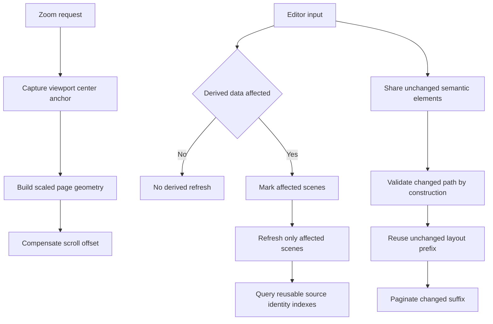

# UI Quality of Life v2 — Viewport-centered zoom and typing latency

**Status:** V2-WO-001.1 through V2-WO-002.5 and V2-WO-002.7 through V2-WO-003.2 implementation submitted; V2-WO-002.6 Scene Heading investigation blocked with no established defect; user validation pending for the authorized V2-WO-002.4 through V2-WO-003.2 batch; V2-WO-004 through V2-WO-006 remain deferred
**Initiative:** Follow-up to [`ui-quality-of-life-v1-render-speed.md`](ui-quality-of-life-v1-render-speed.md)
**Observed build:** User's light manual test of a roughly 120-page screenplay; build profile and timing values not recorded  
**Validation owner:** User for every work order and final acceptance  

> **Policy boundary:** This v2 investigation used static source inspection only. No builds, tests, formatting, lint, profiling, desktop automation, reviews, independent validators, or other agent-run checks were performed. Regression coverage below is proposed authorship, not evidence of passing behavior. [`project-manifest.md`](../../.forge/project-manifest.md:73) remains authoritative.

## 1. Observations and proposed response

| User observation | Static diagnosis | Proposed response |
|---|---|---|
| Initial load briefly seizes, then scrolling is snappy | Open performs synchronous file reading, FDX parsing, complete validation, and managed-index construction; session construction validates and indexes again; first render builds the cold complete layout; the first due derived refresh then performs whole-document work | Keep the necessary one-time import and cold-layout boundaries, but make initial derived reconciliation linear and reuse the improved shared edit storage. Do not add asynchronous import or background layout in this batch |
| Zooming in appears to scroll toward the document top | Zoom changes page scale and content extent without preserving any viewport anchor, so the existing numeric scroll offset remains effectively top-anchored | Preserve the document point at the viewport center for slider, preset, keyboard, and pinch zoom, in both axes, with normal clamping at document edges |
| Typing repeatedly hitches, especially in a document with many scenes and characters | Every text revision makes the next due derived refresh scan all scenes. Its removal-safety path can scan the complete preserved source once per paragraph identity. Ordinary edits also retain whole-document semantic cloning, equality, and page-placement costs | First suppress irrelevant refreshes and scope relevant ones to affected scenes; then replace the per-paragraph source rescanning with reusable indexes; then reduce ordinary-edit and layout work |

The number of distinct Character names contributes to derived projection and sorting, but it is **not the dominant pathological mechanism found in source**. The more serious issue is the interaction between paragraph identities and repeated complete source-tree scans.

## 2. Evidence-backed diagnosis

### 2.1 Derived refresh contains a potentially quadratic safety scan

This subsection is the historical v1 diagnosis. V2-WO-002 subsequently replaced the any-revision scheduler gate and scoped scene iteration, but did not remove the underlying source-scan cost described here. Before that change, [`refresh_cast_lists_on_schedule()`](../../apps/scriptcraft/src/main.rs:542) gated on whether the session revision changed, so an ordinary Action or Dialogue insertion made the next due tick eligible for derived work even though that edit could not change scene membership or a Cast List.

Each eligible refresh currently:

1. Clones a complete project candidate in [`corrected_cast_list_candidate()`](../../crates/scriptcraft-core/src/cast_list.rs:69).
2. Rebuilds every scene's Character projection through [`scene_casts()`](../../crates/scriptcraft-core/src/scene_metadata.rs:239).
3. Computes removal safety and reserved source IDs in [`reconcile_project_candidate_with_outcome()`](../../crates/scriptcraft-core/src/scene_metadata.rs:55).
4. Attempts every managed scene heading, even when only one scene could have changed.
5. Scans all body elements again for Cast List corrections in [`correct_cast_lists_candidate()`](../../crates/scriptcraft-core/src/cast_list.rs:79).

The critical loop is [`safe_paragraph_removals()`](../../crates/scriptcraft-core/src/scene_metadata.rs:833). For every Paragraph identity it rechecks identities, references, anchors, and calls [`external_id_attribute_use()`](../../crates/scriptcraft-core/src/scene_metadata.rs:892), which recursively scans all preserved sections and text. With P paragraph identities and S preserved source nodes, this path can approach O(P × S), in addition to repeated identity/reference scans. [`source_id_values()`](../../crates/scriptcraft-core/src/scene_metadata.rs:911) adds another complete source traversal.

This is the best static explanation for a multi-second periodic hitch on a large, scene-heavy FDX document. It remains a source-based diagnosis, not a profiler-confirmed timing attribution.

### 2.2 The v1 scoped edit validator still performs whole-document comparisons

[`EditingSession::mutate()`](../../crates/scriptcraft-core/src/editing.rs:812) clones the current semantic project for the candidate and again for undo history. Preservation payloads are shared, but screenplay element vectors, strings, and runs are still ordinary owned data.

The ordinary single-element path then:

- compares every non-target semantic element and the complete title page in [`validate_scoped_single_element_edit()`](../../crates/scriptcraft-core/src/lib.rs:550);
- compares the complete preserved source outside the edited paragraph through [`validate_scoped_managed_edit()`](../../crates/scriptcraft-core/src/preservation.rs:819) and its unchanged-section walk;
- performs whole-project no-op equality and a second whole-project comparison against the clean baseline in [`EditingSession::mutate()`](../../crates/scriptcraft-core/src/editing.rs:897);
- invalidates the complete layout on every successful content revision.

Thus v1 removed complete validation from eligible edits, but not all work proportional to document size.

### 2.3 Wrapping is cached; placement and indexes are still rebuilt

[`LayoutCache::get_or_build_with_optional_diagnostics()`](../../crates/scriptcraft-core/src/layout.rs:498) correctly reuses unchanged element wraps. On a content revision, [`ScreenplayLayout::build_with_effective_inputs_for_purpose_internal()`](../../crates/scriptcraft-core/src/layout.rs:681) still visits every element, recreates all pages and placed lines, and rebuilds all interaction indexes. This is linear rather than quadratic, but remains on the UI thread for each keystroke.

### 2.4 Zoom has no compensated scroll offset

Both native pinch handling in [`raw_input_hook()`](../../apps/scriptcraft/src/main.rs:2569) and status-control handling in [`show_application_panels()`](../../apps/scriptcraft/src/main.rs:2427) update zoom and invalidate geometry. [`live_document_surface()`](../../apps/scriptcraft/src/main.rs:1348) then allocates larger or smaller pages, but never translates the old viewport-centered document point into a new scroll offset. The user's top-anchor interpretation matches this implementation.

### 2.5 Initial loading has real cold costs plus the same derived-refresh defect

[`open_staged_native_at()`](../../apps/scriptcraft/src/main.rs:830) reads synchronously, and [`finish_fdx_import()`](../../apps/scriptcraft/src/main.rs:880) imports on the UI thread. [`read_v6()`](../../crates/scriptcraft-core/src/fdx.rs:577) builds the managed index and validates the project. [`EditingSession::with_policy_layout_and_session_timestamp()`](../../crates/scriptcraft-core/src/editing.rs:195) repeats complete validation and index construction, then clones the clean baseline.

The first render must build a cold complete layout. One second after activation, the derived scheduler becomes eligible for its initial full reconciliation. v2 should remove the pathological repeated source scanning and make clean/history storage cheaper, while preserving import and first-layout safety. The duplicate validation handoff is recorded as a possible later optimization, but this batch will not introduce a trusted unvalidated-import API.

## 2A. Follow-up user findings — 2026-11-04 analysis only

The user's latest observations substantially clarify which costs remain after V2-WO-002. They also expose two correctness/diagnostic failures that must not be mislabeled as performance-only follow-up. This section records analysis, not authorization or new work orders.

### 2A.1 The delayed hitches match complete derived invalidation

A new session initializes its pending derived state to Complete in [`EditingSession::with_policy_layout_and_session_timestamp()`](../../crates/scriptcraft-core/src/editing.rs:195), and document activation schedules the next refresh one second later. This explains the observed sequence: import and first paint become scrollable, then the initial complete derived pass blocks the UI thread, after which scrolling is normal again.

[`classify_derived_invalidation()`](../../crates/scriptcraft-core/src/editing.rs:1095) currently returns Complete whenever element count or ordered identities change. Therefore pressing Enter or otherwise creating an element queues a complete refresh even when the inserted role is Action and cannot alter any scene's Character projection. The one-second timer explains why the stall is delayed until after the new element appears; subsequent text insertions within that element produce no derived invalidation, explaining why typing then remains smooth indefinitely.

The current structural fallback is safe but overbroad. A future correction should classify inserted/deleted roles and old/new scene ownership precisely enough to avoid complete refresh for provably irrelevant structural edits, while retaining complete fallback for ambiguous ownership transfers. No such correction is drafted here.

### 2A.2 A failed Cast List pass retries forever, and the desktop hides its cause

[`EditingSession::refresh_cast_lists_with_outcome()`](../../crates/scriptcraft-core/src/editing.rs:436) returns immediately when candidate correction fails. It does not call [`complete_derived_invalidation()`](../../crates/scriptcraft-core/src/editing.rs:376), so the failed scope remains retryable. The desktop error arm in [`refresh_cast_lists_on_schedule()`](../../apps/scriptcraft/src/main.rs:542) records a generic deferral message but also does not put the failed scope to sleep. Every later due tick can therefore repeat the same expensive failing pass once per second, matching the permanent alternating-hitch report.

This retry policy is independent of the underlying correction error. The actual error is discarded by the desktop's generic error arm, so static inspection cannot establish whether this document failed in scene-arc reconciliation, Cast List source replacement, or complete candidate validation. A privacy-safe error category/call site is necessary for diagnosis. A failed scope should not spin on the timer without a later relevant revision, but converting every failure into silent safe-stop deferral would weaken existing fatal-error semantics and is not assumed to be the correct fix.

The scoped Cast List path has several possible failure boundaries: [`scene_arc_names()`](../../crates/scriptcraft-core/src/cast_list.rs:151), [`replace_cast_list_text()`](../../crates/scriptcraft-core/src/cast_list.rs:254), and complete candidate validation at [`cast_list.rs`](../../crates/scriptcraft-core/src/cast_list.rs:187). Only a formatted-list error is explicitly converted into per-scene deferral; other errors escape to the scheduler.

### 2A.3 Scene Heading failure is an internal synchronization error, not a disk conflict

The reported ManagedTextMismatch does not mean the opened file changed on disk. Ordinary editing does not re-read the source FDX file. The semantic screenplay projection and the retained in-memory FDX source tree are two parts of the live project candidate; managed edits must keep them synchronized so native Save can retain source-owned and unsupported data.

The preserved tree is therefore not an external document against which the writer is continuously reconciled. It is working memory that must evolve with the semantic elements. Original source bytes and opaque nodes are retained for native round-trip behavior, not because Save should reproduce a byte-identical original. Removing that retained model would discard source-owned data rather than optimize editing.

ManagedTextMismatch currently has several distinct in-memory sources:

- ordinary text replacement detects disagreement between semantic old text and preserved source segments in [`replace_managed_text()`](../../crates/scriptcraft-core/src/preservation.rs:1215);
- whole Cast List replacement detects run-text disagreement in [`replace_managed_text_elements()`](../../crates/scriptcraft-core/src/preservation.rs:1304);
- structural removal detects foreign-ID provenance disagreement in [`remove_managed_paragraph()`](../../crates/scriptcraft-core/src/preservation.rs:1626);
- scoped validation detects semantic/source projection disagreement in [`validate_scoped_managed_edit()`](../../crates/scriptcraft-core/src/preservation.rs:819).

The generic error does not identify which site fired for the Scene Heading operation. Structural insertion uses [`reconcile_body_structure()`](../../crates/scriptcraft-core/src/preservation.rs:1470), but the exact user command and failing branch are not established by the message alone. A value-free call-site diagnostic and a focused reproduction are needed before assigning a code fix. It would be premature to remove validation or force the source projection to match, because either action could conceal a real synchronization defect.

The desktop error path adds another potentially expensive operation: [`show_error()`](../../apps/scriptcraft/src/main.rs:1012) calls [`session_health()`](../../apps/scriptcraft/src/main.rs:1019), which invokes the complete in-memory FDX writer to report projection health. This does not access the original file, but it can add serialization/re-read work to an already failed large-document edit.

### 2A.4 Disposition of existing deferred orders

| Existing design | Disposition after the new observations |
|---|---|
| V2-WO-003 reusable source-identity-use indexes | **Keep deferred.** It directly targets the complete initial/structural refresh cost and the failing Character/Cast List path's repeated source scans. It does not address the underlying correction or Scene Heading mismatch by itself. |
| V2-WO-004 element-scoped edit storage | **Keep deferred, lower immediate priority.** Continued typing within one element is now reported smooth, so this is not the first mechanism to remediate for the observed stalls. |
| V2-WO-005 suffix-layout reuse | **Keep deferred, lower immediate priority.** The one-second delayed pattern is explained by derived scheduling rather than immediate per-keystroke layout work. |
| V2-WO-006 integration and closeout | **Keep deferred and expand when authorized.** Future integration must include irrelevant structural insertion, failed-refresh retry suppression, actionable error categories, Cast List correction, and Scene Heading insertion regression cases. |

Before any further work orders are drafted, the user must review this analysis and choose the remediation scope. Required candidates are: precise structural relevance, failed-refresh retry policy, privacy-safe error diagnostics, the actual Cast List correction defect, and the Scene Heading ManagedTextMismatch defect. V2-WO-003 remains relevant but is not a substitute for those correctness fixes.

## 3. Target behavior and invariants

- Zoom does not change semantic content, selection, revision, dirty state, undo history, fixed layout, or exports.
- The viewport-center document point remains stationary except where scroll extents require clamping.
- Non-cast edits schedule no scene/cast reconciliation.
- A Character-cue edit affects only its owning scene unless structural ownership is ambiguous; structural fallback remains conservative.
- Save and Save As always retain complete derived preparation and all existing validation gates.
- Source removal checks preserve the current substring/reference/anchor safety semantics without rescanning the complete tree per identity.
- Ordinary edits retain exact canonical UTF-8 text, run mapping, rollback, no-op behavior, dirty behavior, and history granularity.
- Cached/reused layout is structurally identical to a fresh complete layout for the same effective inputs.
- No optimization weakens opaque-source preservation or per-scene safe-stop behavior.

## 4. Proposed sequential work orders

**Authorization recorded 2026-11-03:** The user authorized V2-WO-001 and V2-WO-002, split into context-sized sequential orders under [`work-orders-v2`](work-orders-v2/). Execution was V2-WO-001.1 → V2-WO-001.2 → V2-WO-002.1 → V2-WO-002.2 → V2-WO-002.3, one individual Code agent per order.

**Additional authorization recorded 2026-11-04:** After reviewing Section 2A, the user authorized correctness-first remediation and V2-WO-003, split into V2-WO-002.4 → V2-WO-002.5 → V2-WO-002.6 → V2-WO-002.7 → V2-WO-002.8 → V2-WO-003.1 → V2-WO-003.2. Each order has one individual Code agent and must complete before the next begins. V2-WO-004 through V2-WO-006 remain unauthorized.

| Authorized suborder | Discrete objective |
|---|---|
| [`V2-WO-001.1`](work-orders-v2/WO-001.1-zoom-anchor-capture.md) | Capture viewport-centered zoom anchors and actual scroll geometry |
| [`V2-WO-001.2`](work-orders-v2/WO-001.2-zoom-scroll-compensation.md) | Apply one-shot scroll compensation and integrated zoom coverage |
| [`V2-WO-002.1`](work-orders-v2/WO-002.1-derived-relevance-tracking.md) | Track session-owned derived relevance and affected scenes |
| [`V2-WO-002.2`](work-orders-v2/WO-002.2-scoped-derived-correction.md) | Reconcile only affected scenes in the core correction path |
| [`V2-WO-002.3`](work-orders-v2/WO-002.3-derived-scheduler-integration.md) | Gate desktop scheduling on pending derived work and integrate diagnostics |
| [`V2-WO-002.4`](work-orders-v2/WO-002.4-privacy-safe-failure-diagnostics.md) | Add bounded managed-edit and derived-failure call-site categories |
| [`V2-WO-002.5`](work-orders-v2/WO-002.5-failed-refresh-retry-suspension.md) | Suspend failed refresh until later relevant invalidation |
| [`V2-WO-002.6`](work-orders-v2/WO-002.6-scene-heading-synchronization.md) | Reproduce and fix Scene Heading semantic/source mismatch |
| [`V2-WO-002.7`](work-orders-v2/WO-002.7-cast-list-correction.md) | Reproduce and fix Character/Cast List correction failure |
| [`V2-WO-002.8`](work-orders-v2/WO-002.8-structural-derived-relevance.md) | Narrow structural derived invalidation to affected scenes |
| [`V2-WO-003.1`](work-orders-v2/WO-003.1-source-identity-use-index.md) | Replace per-Paragraph source scans with reusable identity-use indexes |
| [`V2-WO-003.2`](work-orders-v2/WO-003.2-indexed-derived-heading-lookup.md) | Index derived heading lookup and integrate durable diagnostics |

### V2-WO-002.3 implementation/submission status — 2026-11-04

- **Exact changes:** The desktop no longer uses a revision/disposition watermark to decide timer eligibility. A due tick gates on the session-owned derived-work summary before correction/candidate cloning. Initial complete activation refresh remains eligible; pending relevant edits use their affected-scene scope; irrelevant Action/Dialogue revisions skip; deferred-only scenes stay pending but sleep until a later relevant invalidation. One-second scheduling, same-frame editor-input ordering, changed-result repaint, failure status, document-activation behavior, and full Save/Save As derived preparation are retained. A successful save rebase clears pending scheduling state because its published candidate has already undergone complete preparation, preventing a duplicate timer pass. Desktop diagnostics now expose numeric irrelevant-skip and requested/attempted/deferred-scene totals, with live value-free pending/complete/retryable/affected/deferred counts.
- **Public API caveat:** [`DerivedWorkSummary`](../../crates/scriptcraft-core/src/editing.rs) gained public `retryable` and `deferred_scene_count` fields. Existing field reads and `Default` construction are compatible; external exhaustive struct literals must supply the added fields. No general external struct-literal compatibility guarantee is made.
- **Authored coverage:** Updated the prior revision-gate and safe-deferral desktop expectations; authored desktop-oracle cases for Action and Dialogue no-attempt/no-candidate ticks, single owning-scene Character-cue refresh, activation's complete pass, value-free scene counters, unrelated edits not retrying deferred scenes, and existing Save/Save As timer independence. A core summary assertion covers pending-but-not-retryable deferred scope. Coverage has not been run.
- **Limitations and validation:** These are source changes and authored assertions only. No tests, builds, lint, formatting, desktop automation, implementation checks, reviews, independent validation, or user measurements were performed. No latency claim or acceptance is recorded. User validation/testing remains pending. V2-WO-003 through V2-WO-006 have not been started and remain unauthorized/deferred.

### Authorized remediation/index batch handoff — 2026-11-04

| Work order | Submission state at handoff | Test/validation disposition |
|---|---|---|
| [`V2-WO-002.4`](work-orders-v2/WO-002.4-privacy-safe-failure-diagnostics.md) | Implementation submitted | Authored coverage is unrun; user validation pending. |
| [`V2-WO-002.5`](work-orders-v2/WO-002.5-failed-refresh-retry-suspension.md) | Implementation submitted | Authored coverage is unrun; user validation pending. |
| [`V2-WO-002.6`](work-orders-v2/WO-002.6-scene-heading-synchronization.md) | **Blocked; implementation not submitted.** No exact failure fixture, command sequence, or mismatch call site was established. | Existing imported-FDX probes are diagnostic coverage only and remain unrun. Keep mismatch validation/rollback intact; user evidence or results are needed before resuming this investigation. |
| [`V2-WO-002.7`](work-orders-v2/WO-002.7-cast-list-correction.md) | Implementation submitted | Authored coverage is unrun; user validation pending. |
| [`V2-WO-002.8`](work-orders-v2/WO-002.8-structural-derived-relevance.md) | Implementation submitted | Authored coverage is unrun; user validation pending. |
| [`V2-WO-003.1`](work-orders-v2/WO-003.1-source-identity-use-index.md) | Implementation submitted | Source-index tests are authored/unrun; user validation pending. |
| [`V2-WO-003.2`](work-orders-v2/WO-003.2-indexed-derived-heading-lookup.md) | Implementation submitted | Indexed heading/context/counter cases are authored/unrun; user validation pending. |

This is a handoff for user testing, not a claim that the complete batch passed or that the Scene Heading issue is fixed. Repository policy prohibited agent-run tests, builds, lint, formatting, implementation checks, reviews, independent validators, and validation. No user validation, timing observation, or acceptance is recorded. V2-WO-004 through V2-WO-006 remain deferred; do not begin them before user review of this batch.

### V2-WO-001 — Preserve the viewport-center anchor during zoom

**Objective:** Make every zoom input keep the old viewport-center document point at the new viewport center.

**Implementation:**

1. Extend the published viewport snapshot to retain the actual scroll offset and viewport geometry needed to capture an anchor before either zoom entry point invalidates it.
2. Represent the pending anchor as a page-local document coordinate, including an explicit gap/edge representation when the center is outside a page. Do not infer an anchor from the caret or pointer.
3. Capture one pending anchor for status slider, preset, keyboard, and native pinch changes. Coalesce repeated pinch changes without losing the original visible content point.
4. After new page rectangles are allocated, apply the compensating horizontal and vertical scroll offset exactly once. Preserve constant page gaps rather than incorrectly scaling them.
5. Keep caret reveal and manual scrolling independent; zoom itself must not create a caret-reveal request.
6. Clamp only at the new scroll extents and clear the pending anchor after successful publication or document replacement.

**Structural acceptance:**

- Beginning, middle, and end viewports retain the same anchored page-local point across zoom-in and zoom-out, subject only to edge clamping.
- Both axes behave correctly with horizontal overflow and narrow viewports.
- Repeated pinch events and discrete controls use the same anchor policy.
- Zoom leaves session/layout/export state unchanged.

**Coverage to author:** Desktop geometry cases for 75–300%, both zoom directions, constant vertical gaps, horizontal overflow, edge clamping, repeated events, caret independence, and document replacement.

### V2-WO-002 — Track derived relevance and refresh only affected scenes

**Objective:** Replace any-revision refresh eligibility with explicit derived-data invalidation.

**Implementation:**

1. Add session-owned derived invalidation state with none, affected-scene set, and complete-refresh forms; keep identities out of diagnostics.
2. Do not mark ordinary text edits in Action, Dialogue, Parenthetical, or other non-cast roles as derived-relevant.
3. Mark the owning scene for Character-cue text changes and role transitions into or out of Character. Mark old/new owners or use complete fallback for scene-heading changes, split/join/delete, undo/redo, replacement, and other structural cases where ownership may move.
4. Add a scoped correction entry point that reconciles only pending scenes and visits only their Cast Lists. Preserve complete correction for initial activation and explicit Save/Save As preparation.
5. Keep a deferred scene deferred until a later revision relevant to that scene; unrelated typing must not retry it.
6. Publish changed candidates atomically without adding undo entries, and preserve revision/dirty behavior.

**Structural acceptance:**

- Action or Dialogue insertion causes zero derived reconciliation attempts on subsequent due ticks.
- A Character-cue edit reconciles its owning scene only.
- Unrelated scenes and their source subtrees remain untouched; safe deferral and fatal rollback remain scoped as before.
- Save/Save As remains complete even when no scheduled refresh occurred.

**Coverage to author:** Relevance matrices for text and role edits, structural fallback, multi-scene documents, undo/redo, deferred scenes, activation, and save preparation. Extend value-free counters with skipped irrelevant revisions and requested/completed scene counts.

### V2-WO-003 — Replace per-paragraph source scans with reusable identity-use indexes

**Objective:** Make derived removal safety and ID reservation linear to build and bounded to query.

**Implementation:**

1. Build a transient source-identity-use index during existing complete preservation validation/index reconstruction. Record identity multiplicity, reference/anchor use, external attribute/text/comment/PI occurrences, and reserved source ID values with the same matching semantics as the current code.
2. Reuse the existing managed-paragraph index for heading lookup and mutation instead of repeated recursive [`find_managed()`](../../crates/scriptcraft-core/src/scene_metadata.rs:95) searches.
3. Replace [`safe_paragraph_removals()`](../../crates/scriptcraft-core/src/scene_metadata.rs:833) and [`source_id_values()`](../../crates/scriptcraft-core/src/scene_metadata.rs:911) repeated scans with indexed queries.
4. Update or invalidate derived indexes transactionally on every managed/source mutation. Rebuild at structural, import, replacement, undo/redo, derived-publication, and save-rebase boundaries where local maintenance is not provably complete.
5. Exclude transient indexes from preservation semantic equality and keep their counters value-free.

**Structural acceptance:**

- One complete index build examines each source node a bounded constant number of times, not once per Paragraph identity.
- An affected-scene refresh performs no complete source-tree scan for removal safety or reserved IDs.
- Duplicate IDs, external substring uses, references, anchors, opaque nodes, and unsupported scenes produce exactly the current safe-stop outcomes.

**Coverage to author:** Differential current-versus-indexed safety outcomes, duplicate/external-use fixtures, index invalidation after every edit class, nested arcs, opaque source, and failure atomicity.

### V2-WO-004 — Make ordinary edits and history element-scoped rather than document-deep

**Objective:** Remove deep semantic clones and unchanged-document comparisons from eligible single-paragraph edits.

**Implementation:**

1. Introduce immutable per-element sharing for project/history/clean-baseline storage, or an equivalent restricted patch representation that preserves public semantics. Record any public field-type compatibility impact before implementation.
2. For eligible ordinary edits, restrict candidate mutation to the selected semantic element and its indexed managed source path so unchanged global invariants are guaranteed by construction rather than rechecked by complete equality walks.
3. Validate the changed element, selection, source projection, text budget, and affected role/run invariants. Retain complete candidate reconciliation and validation for structural or uncertain operations.
4. Make undo/redo snapshots share unchanged elements and preserved paths; rollback must discard only the detached edit candidate/patch.
5. Use structural sharing to short-circuit exact no-op and clean-baseline equality. Preserve the existing behavior where retyping the saved content can become clean.
6. Keep all source-owned global validation, native save gates, and public standalone validation boundaries complete.

**Structural acceptance:**

- An ordinary one-element insertion deep-clones neither the complete screenplay element vector nor the complete preserved tree.
- The scoped path performs no non-target element content comparisons and no unchanged-source-tree equality walk.
- History and clean-baseline comparisons reuse unchanged shared values while retaining exact equality outcomes.
- Any failed precondition falls back or rejects without changing live state.

**Coverage to author:** Differential scoped/complete validation, dirty return-to-clean behavior, no-op edits, Unicode/run boundaries, undo/redo, role changes, structural fallback, failure injection, source preservation, and Save/Save As/reopen.

### V2-WO-005 — Reuse unchanged layout prefixes and paginate only the changed suffix

**Objective:** Remove whole-document placement and index reconstruction from ordinary edits where a changed-element boundary is known.

**Implementation:**

1. Reuse complete-layout checkpoints for the unchanged prefix before the first changed element; retain current whole-layout cache behavior for selection, scroll, and zoom.
2. Resume page placement at the first changed element using its effective page-break/paragraph context and existing immutable wraps.
3. Repaginate the suffix because edits can change subsequent page flow. An edit near the document end should not rebuild earlier pages.
4. Reuse unaffected prefix interaction-index entries and rebuild only suffix indexes, preserving first-match caret behavior, nearest-line tie-breaking, and vertical-navigation order.
5. Retain complete fresh builders for imports, structural/global changes, unknown change sets, standalone callers, and any failed checkpoint precondition.
6. Require exact structural equality between reused and fresh complete layouts.

**Structural acceptance:**

- A one-element edit reuses all provably unchanged prefix placements and rebuilds only the edited element wrap plus required suffix placement/index work.
- Whole-document placement remains available as the safe fallback; no output or pagination rule changes.
- Cached and fresh layouts remain equivalent across edits, undo/redo, page-start roles, and title-page boundaries.

**Coverage to author:** Beginning/middle/end edits, page-boundary growth/shrink, explicit page starts, hidden print lines, AllCaps expansion, title pages, caret/hit-test/navigation indexes, fallback correctness, and layout-equivalence checks. Add prefix-reuse and suffix-placement counters.

### V2-WO-006 — Integrated regression, activation review, and user closeout

**Objective:** Integrate the zoom/edit/derived/layout paths and record actual user-owned outcomes.

**Implementation:**

1. Extend the existing desktop oracle and integrated core regression without treating structural counts as timings.
2. Capture activation counts for file import, complete validations, index builds, cold layout builds, initial derived reconciliation, and first painted frame. Confirm no per-identity complete-source scans remain.
3. Preserve the v1 desktop scenarios and add centered-zoom, irrelevant-edit refresh suppression, affected-scene refresh, ordinary-edit sharing, and suffix-layout cases.
4. Update affected durable requirements and blueprints, including any public storage/API changes and the new zoom-anchor contract.
5. Record user build profile, document dimensions, operations, observations, counters, and accept/remediate decisions without inventing timings or acceptance.

**Structural acceptance:**

- Initial activation has one cold layout build and a linear-bounded initial derived reconciliation; no per-identity full-source rescan occurs.
- A 120-page fixture demonstrates the new structural bounds while retaining complete output equivalence and FDX/save safety.
- All review, validation, measurements, and final acceptance remain explicitly user-owned.

## 5. Execution order and decision gates

The first five authorized suborders executed sequentially and stopped for user testing. Execute the follow-up batch **V2-WO-002.4 → V2-WO-002.5 → V2-WO-002.6 → V2-WO-002.7 → V2-WO-002.8 → V2-WO-003.1 → V2-WO-003.2** sequentially. The orders overlap heavily and must not be dispatched in parallel. After V2-WO-003.2, stop for user correctness and large-document responsiveness tests.

The former WO-003 through WO-006 sequence is a deferred design only. If the user later authorizes it, the same large-document typing check after WO-003 should distinguish removal of the pathological periodic hitch from the remaining per-keystroke linear costs before WO-004 begins.

Each implementation handoff must identify changed files/interfaces, authored-but-unrun coverage, structural counters, durable-document updates, unresolved limitations, and any public API compatibility impact. No order may claim user validation or acceptance without a user record.

## 6. Explicit non-goals

- No asynchronous FDX import, background layout, cancellation protocol, or progressive document activation.
- No pointer- or caret-anchored zoom; viewport center is the selected policy for every zoom input.
- No change to fixed-cell metrics, page geometry, canonical text, native FDX authority, save cadence, undo granularity, or export behavior.
- No weakening of complete import/save/global validation or opaque-source preservation.
- No rope/piece-table rewrite and no GPU page-texture cache.
- No automated millisecond thresholds or claims of external-editor parity.

## 7. User observation matrix

Use the same source copy, viewport, machine/display conditions, operation sequence, and comparable build profile for before/after observations.

| Operation | Structural evidence to capture | User observation |
|---|---|---|
| Open roughly 120-page FDX | Validation/index/cold-layout/initial-refresh counts | Initial hitch and time until responsive, qualitatively recorded |
| Zoom at beginning/middle/end | Anchored page/local point and resulting offset | No apparent jump toward document top; expected edge clamping |
| Type Action/Dialogue continuously | Zero irrelevant derived attempts; edit/layout work counts | Whether periodic multi-second hitches disappear |
| Edit Character cues in separate scenes | Requested/completed affected-scene counts | Only relevant derived data changes |
| Type near beginning/middle/end | Prefix reuse and suffix placement counts | Remaining position-dependent typing cost |
| Split/join/role change/undo/redo | Full fallback and validation counts | Correct content, history, dirty state, and derived data |
| Save/Save As/reopen/export | Existing complete gates and output equivalence | No preservation, save-safety, or export regression |

## 8. Durable documentation to update during implementation

- [`technical-context.md`](../../.forge/blueprints/technical-context.md) — viewport-anchor ownership, derived invalidation scopes, source-identity-use indexes, element-scoped edit storage, and suffix-layout reuse.
- [`screenplay-writing-loop.md`](../../.forge/requirements/features/screenplay-writing-loop.md) — only if user-facing zoom or editing contracts need clarification; performance instrumentation alone does not change product semantics.
- [`project-manifest.md`](../../.forge/project-manifest.md) — roadmap/initiative status only when the user approves or closes the initiative; no unverified result claims.
- This v2 record and each implemented work-order record — exact implementation state, authored coverage, user evidence, caveats, and final disposition.

## 9. Approval state

The user authorized V2-WO-001 and V2-WO-002 on 2026-11-03 and the follow-up correctness/index batch on 2026-11-04 after reviewing Section 2A. The selected zoom policy is **viewport center for all controls and pinch gestures**. V2-WO-004 through V2-WO-006 remain unapproved and must not be implemented. Follow-up user testing did not accept the derived-refresh behavior; the seven newly authorized orders target those findings and the retained V2-WO-003 source-scan mechanism.
