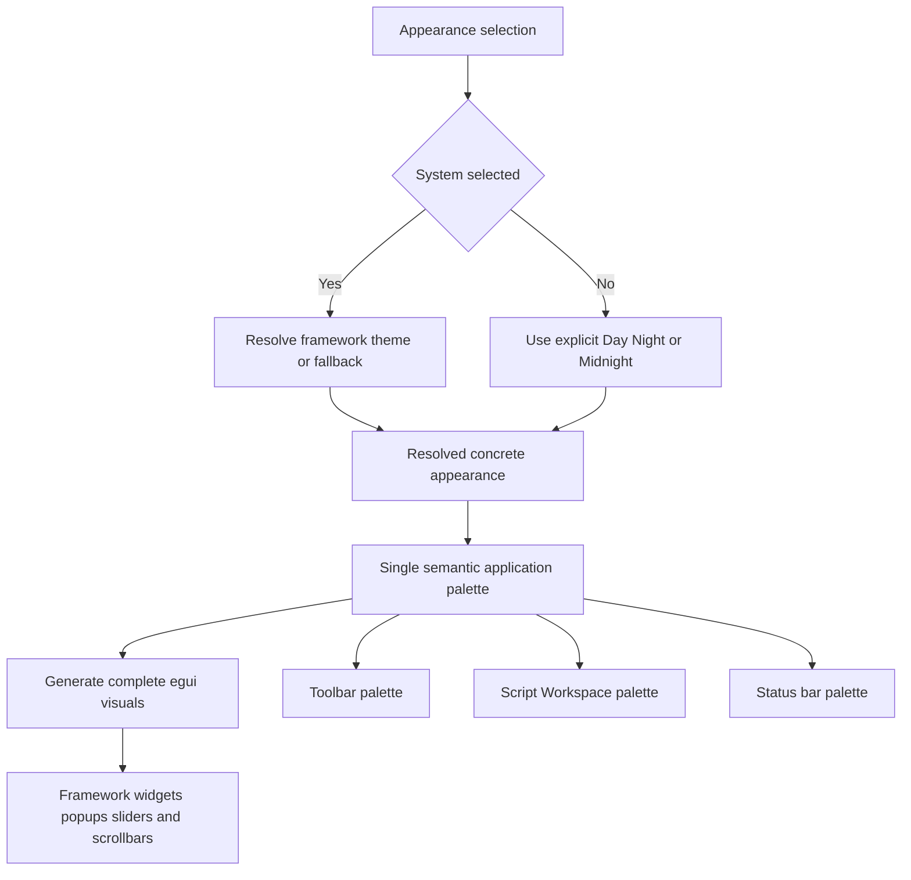

# Appearance theme consolidation and Day / Night / Midnight palette plan

- **Status:** Proposed for user review; no implementation authorized by this document
- **Date:** 2026-11-05
- **Validation owner:** User; no agent-run builds, checks, tests, lint, formatting checks, manual verification, reviews, or independent validators
- **Primary source area:** [`apps/scriptcraft/src`](../../../apps/scriptcraft/src)
- **Applicable appearance contract:** [`AC-WRITING-006.11`](../../../.forge/requirements/features/screenplay-writing-loop.md:793)

## 1. Outcome

Consolidate desktop color ownership into one app-owned semantic theme module, then apply estimated Day, Night, and Midnight palettes derived from the three supplied reference images.

The result should provide:

1. One authoritative color model for toolbar, Script Workspace, status bar, shared controls, overlays, selection, caret, IME, hidden text, hyperlinks, warnings, errors, sliders, and other framework-painted surfaces.
2. Complete egui light/dark visuals generated from that model without replacing egui or introducing a theme dependency.
3. Independent toolbar, Script Workspace, and status-bar surfaces; the current shared chrome fill must no longer force them to have the same background.
4. Preserved transient System, Day Mode, Night Mode, and Midnight Mode behavior, including live System changes and fallback resolution.
5. Preserved item-level color exceptions, geometry, interaction, accessibility, document state, pagination, and export behavior.
6. A final user calibration pass comparing the running application side by side with the references before the palette is treated as accepted.

The proposed central module is [`theme.rs`](../../../apps/scriptcraft/src/theme.rs). This is a proposed new file, not an existing implementation.

## 2. Decisions already made

- **Central-region name:** Script Workspace. Script Normal View, Script Page View, Script Speed View, Scene View, and future workspace types can add nested or sibling semantic groups without renaming the application shell.
- **Reference values:** Use visually estimated RGB values, explicitly labeled as image-derived starting points. They are not pixel-sampled or represented as exact reference colors.
- **Dark-image assignment:** The lighter gray-page dark reference is treated as Night; the darker-page reference is treated as Midnight. This matches the existing requirement that Midnight pages and major surfaces be darker than Night.
- **Accessible accents and feedback:** Preserve the existing screenplay selection fill/text, caret, IME, hidden-text, warning, and error colors initially. Preserve the existing global egui selection and generic text-cursor colors as well.
- **Selection boundary:** Expose a distinct selection-boundary token. Applying the lighter Night paper may reduce the preserved selection fill's contrast against the page; an explicit high-contrast boundary is preferable to silently changing the selected text/fill or abandoning the target paper color.
- **Native title bar:** The macOS title bar and traffic-light controls remain OS-owned. No pixel-parity claim is made for them.
- **Implementation sequence:** Consolidate with existing values first, apply target values second, calibrate with the user third.

## 3. Current ownership findings

| Concern | Current owner | Finding |
|---|---|---|
| Appearance selection | [`AppearanceMode`](../../../apps/scriptcraft/src/status_bar.rs:131) | System, Day, Night, and Midnight are defined inside the status-bar module even though they affect the entire application. |
| egui theme application | [`configure_appearance()`](../../../apps/scriptcraft/src/status_bar.rs:207) | Resolves System, installs default light/dark visuals, applies selected Midnight overrides, and updates the egui theme preference. |
| Page colors | [`PagePalette`](../../../apps/scriptcraft/src/status_bar.rs:159) | Page-specific colors are owned by the status-bar module and consumed by the main page painter. |
| Page painting | [`ScriptCraftApp::paint_page()`](../../../apps/scriptcraft/src/main.rs:1203) | Correctly consumes palette values, but depends on a status-bar-owned page type. |
| Toolbar background | [`toolbar_chrome_color()`](../../../apps/scriptcraft/src/toolbar.rs:891) | Uses the open widget's weak background fill rather than a toolbar semantic token. |
| Toolbar foregrounds | [`toolbar_presentation`](../../../apps/scriptcraft/src/toolbar.rs:58) | Owns enabled/disabled overrides and reduced-alpha disabled fallback. |
| Toolbar item exceptions | [`ItemPresentationOverrides`](../../../apps/scriptcraft/src/toolbar_items.rs:147) and [`IconSpec`](../../../apps/scriptcraft/src/toolbar_items.rs:31) | Per-item and per-icon colors are useful deliberate exceptions and should remain above theme defaults. |
| Toolbar hover | [`toolbar_group_fill()`](../../../apps/scriptcraft/src/toolbar.rs:922) | Uses the shared hovered widget fill; transparent when not hovered. |
| Toolbar border | [`chrome_frame()`](../../../apps/scriptcraft/src/main.rs:2470) | Currently has no stroke. A toolbar border token therefore needs an explicit mapping; it must not be described as an existing visible border color. |
| Script Workspace background | [`central_panel_frame()`](../../../apps/scriptcraft/src/main.rs:2478) | Reuses toolbar chrome color, so it cannot currently be tuned independently. |
| Window clear color | [`chrome_clear_color()`](../../../apps/scriptcraft/src/main.rs:2462) | Reuses the same open-widget fill as toolbar and Script Workspace. |
| Status background and border | [`status_panel_frame()`](../../../apps/scriptcraft/src/status_bar.rs:81) | Inherits the framework side/top-panel fill and stroke rather than explicit status tokens. |
| Status foregrounds | [`presentation`](../../../apps/scriptcraft/src/status_bar.rs:19) | Owns separate default, center-message, and hovered foreground overrides with egui fallbacks. |
| Status hover | [`paint_status_hover_control()`](../../../apps/scriptcraft/src/status_bar.rs:486) | Reuses toolbar hover fill, coupling two semantic regions. |
| Zoom slider | [`zoom_slider()`](../../../apps/scriptcraft/src/status_bar.rs:402) and [`paint_zoom_slider_knob()`](../../../apps/scriptcraft/src/status_bar.rs:444) | egui owns rail and trailing fill; ScriptCraft owns the custom knob using status default/hovered foregrounds. |
| Timer validation error | [`sprint_timer.rs`](../../../apps/scriptcraft/src/sprint_timer.rs:563) | Uses the egui error foreground and belongs in the centralized feedback catalog. |
| Layout error | [`live_document_surface()`](../../../apps/scriptcraft/src/main.rs:1366) | Uses an explicit pure-red literal and should use the semantic error token without changing its initial color. |
| Native window chrome | [`native_options()`](../../../apps/scriptcraft/src/main.rs:2810) | Requests native decorations; egui does not directly own the macOS title bar. |

### Principal architectural problem

Color ownership is split across status-bar appearance configuration, page painting, toolbar helpers, global egui visuals, and local override modules. The current arrangement works, but changing one visual family can unintentionally affect another. In particular, toolbar, Script Workspace, and clear color all depend on the same widget-state field.

This initiative should consolidate and retune the existing appearance feature, not create a second parallel theme mechanism.

## 4. Recommended architecture

### 4.1 App-owned semantic layer above egui Light / Dark

egui 0.34.3 supports only Light and Dark as its binary theme enum. ScriptCraft therefore needs an app-owned resolved appearance with three concrete palettes:

- Day
- Night
- Midnight

System is a selection mode, not a fourth concrete palette. It resolves to Day for framework Light and Night for framework Dark, including fallback Dark/Light resolution.

The proposed module should own:

1. The existing four-choice appearance selection type, moved without changing labels or transient behavior.
2. A resolved concrete appearance type or equivalent internal representation.
3. A single resolved application palette composed of semantic groups.
4. A resolver that handles System, explicit choices, and the framework fallback.
5. A visuals builder that starts from the appropriate egui default visuals and changes color values only.
6. An applier that installs Day into egui Light and the active Night or Midnight palette into egui Dark, then sets the existing theme preference.
7. Change detection equivalent to the current mode-plus-resolved-theme key so visuals are not needlessly rebuilt every frame.

### 4.2 Proposed semantic groups

These names describe the color model, not a requirement to expose a runtime customization UI.

| Group | Required coverage |
|---|---|
| Application / shared | Default panel, faint background, extreme background, code background, text-edit background, weak text, hyperlinks, global selection, generic text cursor, disabled treatment. |
| Toolbar | Background, border, primary icon/caption foreground, disabled foreground, hover fill/foreground/border, pressed fill/foreground/border, open fill/foreground/border. |
| Script Workspace | Workspace background, native clear color, page paper, page text, hidden/subdued text, page border, selection fill/text/boundary, caret, IME text, layout error. Future view-specific groups can extend this boundary. |
| Status bar | Background, border, default text/icon foreground, center-message foreground, disabled foreground, hover fill/foreground, pressed/open treatment, slider rail/trailing fill/knob/knob hover. |
| Shared controls | Noninteractive, inactive, hovered, active, and open fills; weak fills; foregrounds; background strokes; global selection; keyboard-focus/active treatment. Geometry remains in egui style and existing local presentation settings. |
| Overlays | Panel/window/popup fill, window/popup border, window shadow, popup shadow, tooltip/menu surfaces. |
| Feedback | Warning and error foregrounds. Existing error information and accessible text remain unchanged. |

### 4.3 Preserve exception precedence

Toolbar enabled foreground resolution must remain:

1. Per-icon enabled color.
2. Per-item enabled color.
3. Toolbar-wide optional override.
4. Central theme toolbar foreground.

Toolbar disabled foreground resolution must remain:

1. Per-icon disabled color.
2. Per-item disabled color.
3. Toolbar-wide optional disabled override.
4. Central theme disabled foreground or the existing 45%-alpha derivation from the resolved enabled color.

Status default, center-message, and hovered optional overrides must likewise remain above central theme fallbacks. Do not collapse the toolbar's custom 45% disabled multiplier into egui's separate disabled alpha; they serve different existing paths.

### 4.4 Color-only changes

The visuals builder may change color and stroke-color fields, but must preserve existing:

- Stroke widths except an explicitly approved toolbar divider in the target-palette work order.
- Corner radii, expansion, spacing, padding, margins, animation, opacity, scroll geometry, and slider shape.
- Font families, sizes, Material axes, text styles, hit regions, allocation, and clipping.
- Document layout and fixed-cell galley behavior.

Use scoped style modification only where a stock egui control cannot otherwise consume the intended semantic token. Do not introduce global context-data registries or a third-party theme framework.

## 5. Complete semantic color catalog and egui mapping

The table is the migration checklist. Every row should be owned by the central model or have an explicit documented derivation from it.

| Semantic designation | Consumer / native mapping |
|---|---|
| Shared default panel background | egui panel fill; explicit app panels may override with toolbar, Script Workspace, or status backgrounds. |
| Shared faint background | egui faint background for subtle striping and accents. |
| Shared extreme background | egui extreme background for plots, scroll-related surfaces, and contrasting recesses. |
| Text-edit background | egui text-edit background; keep distinct from screenplay page paper. |
| Code background | egui inline code/monospace background. |
| Primary noninteractive foreground | egui noninteractive widget foreground and default text color. |
| Weak foreground | egui weak text color or preserved alpha derivation. |
| Hyperlink | egui hyperlink color. |
| Disabled foreground / treatment | egui disabled alpha for stock widgets; toolbar's existing custom 45% alpha fallback for toolbar items; explicit optional overrides remain higher priority. |
| Inactive control background | egui inactive strong and weak fills. |
| Inactive control foreground | egui inactive foreground stroke color. |
| Inactive control border | egui inactive background stroke color. |
| Hovered control background | egui hovered strong and weak fills; toolbar and status custom hover helpers consume their semantic equivalents. |
| Hovered control foreground | egui hovered foreground stroke color and status hover fallback. |
| Hovered control border | egui hovered background stroke color. |
| Pressed / keyboard-active background | egui active strong and weak fills. |
| Pressed / keyboard-active foreground | egui active foreground stroke color. |
| Pressed / keyboard-active border | egui active background stroke color. |
| Open control background | egui open strong and weak fills; no longer the implicit toolbar/workspace background. |
| Open control foreground | egui open foreground stroke color. |
| Open control border | egui open background stroke color. |
| Global selection fill | egui selection background; used by selectable controls and stock slider trailing fill. Keep independent from screenplay selection fill. |
| Global selection foreground / stroke | egui selection stroke color. |
| Generic text-edit caret | egui text-cursor stroke color; independent from screenplay page caret. |
| Toolbar background | Explicit toolbar frame fill. |
| Toolbar border | Explicit toolbar frame stroke color; no current visible stroke, so behavior-preserving migration initially retains no stroke. |
| Toolbar icon and caption foreground | Existing toolbar presentation resolver, falling back to central toolbar foreground. |
| Toolbar disabled foreground | Existing item/icon/override precedence and alpha fallback. |
| Toolbar hover / pressed / open colors | Custom toolbar paint plus scoped stock-control visuals where applicable. |
| Script Workspace background | Explicit central-panel fill, independent from toolbar. |
| Script Workspace clear color | Native clear color derived from Script Workspace background so uncovered backing pixels do not expose another theme surface. |
| Page paper | Existing custom page painter. |
| Page text | Existing custom fixed-cell text painter. |
| Hidden / subdued page text | Existing custom page painter; retain current accessible values initially. |
| Page border | Existing custom page painter; preserve stroke geometry. |
| Page selection fill | Existing custom selection painter; independent from global egui selection. |
| Page selected text | Existing custom fixed-cell selection painter. |
| Page selection boundary | Explicit selection-boundary painting or stroke, separate from fill and caret. Required if target paper/fill combinations no longer provide the existing visible-boundary contrast. |
| Page caret | Existing custom caret painter. |
| IME preedit text | Existing custom IME painter. |
| Layout error | Central feedback error foreground instead of a direct red literal. |
| Status background | Explicit status-panel frame fill. |
| Status border / separator | Explicit status-panel frame stroke color while retaining panel geometry. |
| Status default text and icons | Existing status default resolver, falling back to central status foreground. |
| Status center message | Existing center resolver, falling back to status foreground or a distinct center-message token. |
| Status disabled foreground | Central status disabled token or documented derivation. |
| Status hover fill and foreground | Status-owned custom hover helper; no dependency on toolbar hover ownership even if values match. |
| Status pressed / open colors | Scoped widget visuals for status controls and popup anchors. |
| Zoom slider rail | egui inactive widget strong background fill in the scoped slider style. |
| Zoom slider trailing fill | egui global selection background in the scoped slider style; preserve existing value initially. |
| Zoom slider knob | Existing custom knob painter using status default/hovered foregrounds; do not invent an independent knob color in the initial migration. |
| Popup / menu / tooltip background | egui window fill and related menu frame path. |
| Popup / menu / tooltip border | egui window stroke and noninteractive border mapping as used by the active frame. |
| Window and popup shadows | Existing egui shadow colors and alpha; preserve blur, offset, spread, and shape. |
| Scrollbar track / background | egui extreme background and scroll-style path; centralize source color, preserve opacity and geometry. |
| Scrollbar handle / hovered handle | egui widget fills/foregrounds used by the scroll path; centralize source colors, preserve dormant/active/interacting opacity. |
| Warning foreground | egui warning foreground; preserve current value. |
| Error foreground | egui error foreground for stock and timer errors, plus central layout error. |

Transparent fills used for measurement or intentionally frameless painting are structural values, not theme colors. They may remain transparent where they do not represent a user-visible color decision.

## 6. Image-derived neutral starting palettes

### Estimation limitations

The following values are visual estimates from the supplied images, not sampled pixels. Display color management, screenshot compression/resizing, antialiasing, and native chrome can shift apparent RGB values. They are starting points for implementation and side-by-side calibration only.

System uses Day when egui resolves Light and Night when egui resolves Dark. There is no separate System RGB row.

### 6.1 Shell, workspaces, and page neutrals

| Token | Day RGB | Night RGB | Midnight RGB | Notes |
|---|---:|---:|---:|---|
| Toolbar background | 236, 236, 236 | 59, 59, 59 | 54, 54, 54 | Reference chrome is light gray in Day and similar medium gray in both dark appearances. |
| Toolbar border | 208, 208, 208 | 48, 48, 48 | 43, 43, 43 | Enable only the deliberate outer divider in WO-002; no layout resizing. |
| Toolbar primary foreground | 90, 90, 90 | 180, 180, 180 | 180, 180, 180 | Icons and captions share the default unless an existing item/icon override applies. |
| Script Workspace background | 239, 239, 239 | 29, 29, 29 | 17, 17, 17 | This is the most visible neutral change and becomes independent from toolbar background. |
| Clear color | Same as workspace | Same as workspace | Same as workspace | Derived, not a separately tuned visible surface. |
| Page paper | 255, 255, 255 | 54, 54, 54 | 27, 27, 27 | Night uses 54 rather than a lighter estimate to retain more headroom for preserved subdued text. |
| Page border | 189, 189, 189 | 20, 20, 20 | 10, 10, 10 | Color-only target; preserve border geometry. |
| Status background | 246, 246, 246 | 44, 44, 44 | 40, 40, 40 | Slightly lighter than dark toolbar chrome, as in the references. |
| Status border | 208, 208, 208 | 60, 60, 60 | 55, 55, 55 | Preserve the existing panel stroke geometry. |
| Status default foreground | 90, 90, 90 | 180, 180, 180 | 180, 180, 180 | Text, icons, percentage, page indicator, and Diagnostics fallback. |
| Status center-message foreground | 48, 48, 48 | 230, 230, 230 | 230, 230, 230 | The references emphasize the center helper more strongly than secondary status text. |
| Shared panel background | 248, 248, 248 | 44, 44, 44 | 40, 40, 40 | Explicit region frames still take precedence. |
| Overlay / popup background | 248, 248, 248 | 48, 48, 48 | 40, 40, 40 | Includes menus and ordinary window-style overlays. |
| Overlay / popup border | 190, 190, 190 | 60, 60, 60 | 55, 55, 55 | Preserve current stroke widths. |
| Faint background | 245, 245, 245 | 32, 32, 32 | 28, 28, 28 | Subtle surface only. |
| Extreme background | 255, 255, 255 | 10, 10, 10 | 8, 8, 8 | Preserve Day and dark egui defaults. |
| Text-edit background | 255, 255, 255 | 32, 32, 32 | 24, 24, 24 | Distinct from screenplay page paper. |
| Code background | 230, 230, 230 | 64, 64, 64 | 54, 54, 54 | Preserve Day default; neutralize dark targets. |

### 6.2 Control states and sliders

| Token | Day RGB | Night RGB | Midnight RGB | Notes |
|---|---:|---:|---:|---|
| Noninteractive control fill | 248, 248, 248 | 44, 44, 44 | 40, 40, 40 | Aligns with shared panel background. |
| Inactive control fill | 230, 230, 230 | 60, 60, 60 | 56, 56, 56 | Buttons, checkbox-like controls, and slider-rail source. |
| Inactive control foreground | 60, 60, 60 | 180, 180, 180 | 180, 180, 180 | Stock widget foreground. |
| Inactive control border | 160, 160, 160 | 70, 70, 70 | 60, 60, 60 | Where a stock control has a visible border. |
| Hover fill | 220, 220, 220 | 72, 72, 72 | 68, 68, 68 | Toolbar and status may have separate tokens initialized to the same value. |
| Hover foreground | 0, 0, 0 | 240, 240, 240 | 240, 240, 240 | Preserves existing egui light/dark foreground defaults. |
| Hover border | 105, 105, 105 | 150, 150, 150 | 145, 145, 145 | Preserve existing stroke geometry. |
| Pressed / active fill | 165, 165, 165 | 55, 55, 55 | 50, 50, 50 | Preserves Day default and dark pressed-state behavior. |
| Pressed / active foreground | 0, 0, 0 | 255, 255, 255 | 255, 255, 255 | Preserve existing defaults. |
| Pressed / active border | 0, 0, 0 | 255, 255, 255 | 255, 255, 255 | Preserve existing defaults. |
| Open control fill | 220, 220, 220 | 48, 48, 48 | 44, 44, 44 | No longer reused as application chrome. |
| Open control foreground | 0, 0, 0 | 210, 210, 210 | 210, 210, 210 | Preserve existing defaults. |
| Open control border | 160, 160, 160 | 60, 60, 60 | 55, 55, 55 | Preserve existing defaults except neutral Midnight adjustment. |
| Weak foreground | 140, 140, 140 | 140, 140, 140 | 140, 140, 140 | Starting estimate only; user calibration must check legibility on each actual surface. |
| Zoom slider rail | 215, 215, 215 | 70, 70, 70 | 60, 60, 60 | Apply through a scoped slider style so unrelated sliders are not accidentally retuned. |
| Zoom slider trailing fill | Preserve global selection | Preserve global selection | Preserve global selection | See the preserved-color table; screenshot blue is not adopted automatically. |
| Zoom slider knob | Status default / hover foreground | Status default / hover foreground | Status default / hover foreground | Preserve the current shared-knob contract rather than inventing a separate white/gray knob. |
| Window shadow | 0, 0, 0, alpha 25 | 0, 0, 0, alpha 96 | 0, 0, 0, alpha 96 | RGBA; preserve blur, offset, and spread. |
| Popup shadow | 0, 0, 0, alpha 25 | 0, 0, 0, alpha 96 | 0, 0, 0, alpha 96 | RGBA; preserve blur, offset, and spread. |

### 6.3 Deliberate reference mismatches pending calibration

The initial implementation should not force every visible screenshot color if doing so violates an existing interaction or accessibility contract.

- The reference slider trailing fill appears brighter blue than egui's preserved global selection defaults. Keep the existing global selection color in WO-002 and calibrate it separately only with user approval.
- The reference slider knob appears independent from status text, but the current requirement deliberately ties the custom knob to status default/hovered foregrounds. Preserve that contract.
- The native title bar may not exactly match the toolbar token because it is OS-owned.
- Night paper and preserved selection fill may not provide a sufficient visible selection boundary by themselves. Use the explicit selection-boundary token and user contrast review rather than silently changing the fill or selected text.

## 7. Preserved accent, accessibility, and feedback colors

These values are not image-derived targets. They are existing values intentionally carried into the centralized model unchanged in WO-001 and WO-002.

| Token | Day RGB | Night RGB | Midnight RGB |
|---|---:|---:|---:|
| Page text | 32, 32, 32 | 238, 238, 238 | 238, 240, 244 |
| Hidden / subdued page text | 98, 98, 98 | 156, 163, 173 | 156, 163, 173 |
| Page selection fill | 56, 109, 177 | 75, 117, 163 | 75, 117, 163 |
| Page selected text | 255, 255, 255 | 255, 255, 255 | 255, 255, 255 |
| Page caret | 20, 80, 150 | 85, 213, 255 | 85, 213, 255 |
| IME preedit text | 76, 42, 122 | 211, 194, 255 | 211, 194, 255 |
| Page selection boundary | 0, 83, 125 | 192, 222, 255 | 192, 222, 255 |
| Global egui selection fill | 144, 209, 255 | 0, 92, 128 | 0, 92, 128 |
| Global egui selection stroke | 0, 83, 125 | 192, 222, 255 | 192, 222, 255 |
| Generic egui text cursor | 0, 83, 125 | 192, 222, 255 | 192, 222, 255 |
| Hyperlink | 0, 155, 255 | 90, 170, 255 | 90, 170, 255 |
| Warning foreground | 255, 100, 0 | 255, 143, 0 | 255, 143, 0 |
| Error foreground, including layout error | 255, 0, 0 | 255, 0, 0 | 255, 0, 0 |

The page selection-boundary values reuse existing egui selection-stroke colors. The boundary's addition or visibility must be handled explicitly in WO-002 if required to preserve the visible-boundary criterion against the new paper colors; it is not a claim that the current custom page painter already draws this stroke.

## 8. Recommended work orders

### WO-001 — Centralize appearance resolution and semantic color ownership

- **Status:** Recommended first implementation order
- **Depends on:** Current toolbar item-model work must remain intact; no acceptance of prior unvalidated work is implied
- **Validation owner:** User

#### Outcome

Move appearance and palette ownership out of the status bar and into one app-owned semantic theme module without intentionally changing any rendered color or geometry.

#### Scope

1. Add [`theme.rs`](../../../apps/scriptcraft/src/theme.rs) and register it from [`main.rs`](../../../apps/scriptcraft/src/main.rs:1).
2. Move [`AppearanceMode`](../../../apps/scriptcraft/src/status_bar.rs:131), its labels/theme-preference mapping, System resolution, and applied-appearance tracking into the theme module without changing public menu labels or transient startup behavior.
3. Move and expand [`PagePalette`](../../../apps/scriptcraft/src/status_bar.rs:159) into the proposed Script Workspace palette, retaining every current value.
4. Introduce semantic groups for shared controls, toolbar, Script Workspace, status bar, overlays, and feedback. Initialize them from current values and current egui defaults, not the screenshot estimates.
5. Move [`configure_appearance()`](../../../apps/scriptcraft/src/status_bar.rs:207) behavior into a theme resolver/applier. Preserve the mode-plus-resolved-theme change key, fallback behavior, and live System response.
6. Replace toolbar, central-panel, and clear-color dependence on the open-widget weak fill with explicit toolbar and Script Workspace tokens. For WO-001, assign those tokens so their current visual results remain equivalent within each existing appearance.
7. Route status-panel fill/border and status foreground fallbacks through status tokens while retaining the three optional local override points.
8. Route toolbar enabled/disabled fallbacks through toolbar tokens while retaining per-icon, per-item, toolbar override, and 45%-alpha precedence.
9. Give toolbar and status custom hover helpers separate semantic entry points even if their WO-001 colors remain equal.
10. Route the central layout error through the feedback error token at pure red, preserving its current appearance.
11. Document stock slider rail/trailing-fill ownership and the custom knob's continued status foreground dependency. Do not retune them in this order.
12. Author focused source-level tests for concrete appearance resolution, System Light/Dark/fallback mapping, palette selection, unchanged preserved colors, and override precedence where practical. Do not execute them under the repository's current validation policy.

#### Structural acceptance for user review

1. One central module owns all concrete theme palette selection and egui visuals generation.
2. The status bar no longer owns application-wide appearance resolution or page palette definitions.
3. Toolbar, Script Workspace, and status bar have independent semantic backgrounds and foregrounds.
4. Existing item/icon/local override precedence remains intact.
5. Existing visible colors, geometry, menu behavior, selection, caret, IME, slider behavior, and document/export behavior remain unchanged to the best of source inspection; actual rendered equivalence remains user-reviewed.
6. No new dependency, persistence, or screenplay-core change appears.

#### Durable records

- Reconcile [`AC-WRITING-006.11`](../../../.forge/requirements/features/screenplay-writing-loop.md:793) only as needed to state centralized semantic ownership without weakening any behavior or contrast invariant.
- Update [`technical-context.md`](../../../.forge/blueprints/technical-context.md) with the theme module, palette groups, egui mapping, System resolution, and exception precedence.
- Append implementation evidence and limitations to this document and [`project-manifest.md`](../../../.forge/project-manifest.md) without claiming user acceptance.

### WO-002 — Apply the image-derived Day, Night, and Midnight targets

- **Status:** Recommended after WO-001 user review
- **Depends on:** WO-001
- **Validation owner:** User

#### Outcome

Apply the neutral starting palettes in sections 6 and the preserved accent/feedback values in section 7 through the centralized model. Do not retune colors at individual paint call sites.

#### Scope

1. Replace WO-001's compatibility neutral values with the target Day, Night, and Midnight values.
2. Apply independent toolbar, Script Workspace, status, popup, and shared-control surfaces through their semantic mappings.
3. Add the deliberate toolbar divider using the toolbar border token, retaining all current panel allocation and control geometry. Use the existing/default one-point stroke only; do not redesign the toolbar frame.
4. Apply scoped zoom slider rail/trailing-fill mappings. Preserve the global selection color and custom knob contract initially.
5. Preserve every value in section 7. Add explicit page selection-boundary handling where required by the target paper/selection combination, using the existing global selection-stroke values as starting tokens.
6. Author contrast checks for normal page text, IME text, selected text, hidden/subdued text, caret, and visible selection boundary against their actual composited target backgrounds. Include Night paper at 54,54,54 and Midnight paper at 27,27,27. Do not execute the checks; the user owns running them.
7. Check source mappings for weak text, disabled items, pressed/open states, popup/menu borders, scrollbars, and text-edit/code backgrounds so no visible family remains accidentally coupled to toolbar chrome.
8. Record any target value that cannot satisfy an existing contrast or interaction invariant as a calibration issue. Do not silently alter preserved accent colors or weaken the requirement.

#### Structural acceptance for user review

1. Day, Night, and Midnight render through three concrete central palettes; System follows Day/Night as resolved.
2. Night and Midnight approximate their respective dark references, with Midnight page, workspace, and major surfaces measurably darker than Night.
3. Toolbar and status foregrounds remain legible in default, hover, pressed, open, and disabled states.
4. Page selection, selected text, caret, IME, and hidden text retain their designated colors and required contrast behavior.
5. Slider rail, trailing fill, and knob retain their documented owners and interactions.
6. No layout, pagination, screenplay-content, session-state, zoom, persistence, or export changes occur.

#### Durable records

- Update the appearance and visible-page portions of [`screenplay-writing-loop.md`](../../../.forge/requirements/features/screenplay-writing-loop.md:595) if explicit selection-boundary behavior or newly independent semantic surfaces need durable wording.
- Update [`technical-context.md`](../../../.forge/blueprints/technical-context.md) with final token mappings and the scoped slider/global-selection distinction.
- Record all applied RGB values and unresolved calibration differences in this document and the manifest handoff.

### WO-003 — Side-by-side user calibration and durable reconciliation

- **Status:** Final calibration and acceptance order
- **Depends on:** WO-002
- **Validation owner:** User

#### Outcome

Compare the running application with each reference under the user's normal macOS display conditions, make only user-approved token adjustments, and record the final accepted palette and evidence.

#### User calibration procedure

1. Use the same representative screenplay content and comparable window size for Day, Night, and Midnight comparisons.
2. Compare toolbar background, icon/caption foreground, hover, pressed/open state, disabled items, and divider against the corresponding reference.
3. Compare Script Workspace background, page paper, page border, normal text, hidden text, selection, selected text, selection boundary, caret, and IME composition.
4. Compare status background/border, default and center-message foregrounds, all hover states, slider rail/trailing fill/knob, and percentage/page text.
5. Open Elements, Appearance, zoom presets, overflow, Sprint Timer, and tooltip/popup surfaces; inspect popup fill, border, shadow, selected row, hover row, and error/warning text.
6. Exercise scrolling and inspect scrollbar track/handle colors in dormant, hovered, and interacting states.
7. Check System while switching the macOS appearance in both directions, then check explicit Day, Night, and Midnight. Confirm Midnight remains darker than Night.
8. Review contrast using the user's chosen validation commands/tools. Pay particular attention to Night subdued text and the preserved selection fill/boundary against Night paper.
9. Record every accepted adjustment as a before/after semantic token value. Do not make undocumented paint-local exceptions.
10. If a brighter slider accent or independent knob color is desired, explicitly approve changing the preserved global-selection or shared-knob contract before adjusting it; otherwise retain the documented deliberate mismatch.

#### Completion evidence

- Final RGB/RGBA table replacing all remaining starting-estimate uncertainty.
- User-recorded review results for System, Day, Night, and Midnight, including popups, disabled/hover/pressed/open states, selection/IME/caret, and scrolling.
- User-run compilation/check/test/formatting results recorded separately if desired; no agent result is claimed.
- Durable requirements, technical blueprint, manifest, and this initiative reconciled with the final implementation and evidence.
- Any remaining native-title-bar or reference mismatch documented as a limitation rather than hidden by an unsupported parity claim.

## 9. Non-goals and boundaries

- No appearance persistence, settings file, theme editor, or user-authored custom themes.
- No screenplay-core color model or presentation values in shared document layout.
- No screenplay data, source mapping, pagination, revision, dirty/undo, zoom, PDF, or plain-text output changes.
- No toolbar/status geometry, spacing, typography, Material icon, allocation, overflow, or interaction redesign.
- No new theme dependency or generic third-party theme registry.
- No direct claim of native macOS title-bar coloring or traffic-light parity.
- No automatic adoption of every screenshot accent when it conflicts with the explicit preservation decisions.
- No agent execution of builds, tests, formatting, lint, manual validation, independent reviews, or validators under current project policy.

## 10. Research references

- egui 0.34.3 theme enum: only Light and Dark — https://docs.rs/egui/0.34.3/egui/enum.Theme.html
- egui 0.34.3 visuals and widget fields — https://docs.rs/egui/0.34.3/egui/style/struct.Visuals.html
- egui 0.34.3 style source, including default color values — https://raw.githubusercontent.com/emilk/egui/0.34.3/crates/egui/src/style.rs
- egui 0.34.3 slider source, including inactive rail and selection trailing fill — https://raw.githubusercontent.com/emilk/egui/0.34.3/crates/egui/src/widgets/slider.rs
- Current appearance requirements — [`AC-WRITING-006.11`](../../../.forge/requirements/features/screenplay-writing-loop.md:793)
- Current implementation evidence — [`status_bar.rs`](../../../apps/scriptcraft/src/status_bar.rs), [`main.rs`](../../../apps/scriptcraft/src/main.rs), [`toolbar.rs`](../../../apps/scriptcraft/src/toolbar.rs), and [`toolbar_items.rs`](../../../apps/scriptcraft/src/toolbar_items.rs)

## 11. Planning-task evidence

This document records research, source inspection, image-based estimation, and recommendations only. No source file or durable project record was modified by the planning task. No build, check, test, lint, formatting command, manual application verification, independent review, or validator was run. All implementation and visual outcomes remain proposed until the user reviews and accepts them.

## 12. WO-001 / WO-002 implementation handoff — 2026-11-05

The user approved WO-001 and WO-002 for sequential implementation. The source and durable-record changes below are submitted for user review; this handoff does not establish successful compilation, visual correctness, accessibility, acceptance, or validation.

### WO-001 — centralized ownership

- Added [`theme.rs`](../../../apps/scriptcraft/src/theme.rs) with the four transient appearance choices, System-to-egui resolution, semantic palette groups, egui visuals generation, and current palette selection.
- Moved appearance resolution and page palette ownership out of [`status_bar.rs`](../../../apps/scriptcraft/src/status_bar.rs).
- Added separate toolbar, Script Workspace, and status backgrounds and borders. The toolbar and workspace still shared their prior neutral color during the ownership migration; WO-002 now assigns separate image-derived values.
- Routed toolbar, page, status, clear-color, and layout-error consumers through the central model while retaining toolbar per-icon/per-item/local precedence and status-local foreground overrides.
- Preserved the four Appearance menu labels and the applied mode/resolved-egui-theme change key.
- Updated [`AC-WRITING-006.11`](../../../.forge/requirements/features/screenplay-writing-loop.md:793) and [`technical-context.md`](../../../.forge/blueprints/technical-context.md) to record centralized desktop palette ownership and its boundaries.

### WO-002 — initial image-derived targets

- Applied the estimated Day/Night/Midnight neutral RGBs recorded in the plan's palette tables to [`theme.rs`](../../../apps/scriptcraft/src/theme.rs). These remain estimates, not sampled screenshot values.
- Toolbar and Script Workspace have separate fills; the Script Workspace clear color follows its fill. Toolbar divider painting is a one-point line along the bottom edge only; no frame border, panel allocation, or toolbar geometry redesign was introduced.
- The status panel uses explicit palette fill/border while retaining its frame sizing and stroke width. Status hover uses its local semantic mapping.
- Mapped controls, overlays, warnings/errors, text-edit/code surfaces, global selection/cursor, and slider colors through egui visuals. The zoom slider rail is scoped; its trailing fill remains tied to the preserved egui global-selection token. The custom knob retains the existing status default/hover override chain.
- Preserved page selection fill/text, page caret, IME, hidden text, generic global selection/text-cursor, hyperlink, warning, and error colors. Added a one-point page-selection boundary stroke sourced from preserved egui selection-stroke colors.
- Added implementation submission evidence to [`project-manifest.md`](../../../.forge/project-manifest.md) and updated the technical blueprint. No desktop automated test target was added.

### User review and remaining calibration

- Review System, Day, Night, and Midnight after application launch, including live System changes and fallback behavior.
- Calibrate the estimated neutral RGBs side by side with all three supplied references. In particular review the Night paper and border, toolbar/status separation, workspace gray, control states, popup surfaces, and status slider.
- Review normal/hidden text, selection fill/text/boundary, caret, IME, disabled controls, and warning/error states against the existing accessibility requirements. No agent contrast calculation or visual inspection was run.
- Review the new thin selection boundary on actual selected screenplay text and the toolbar lower divider at multiple window widths/scales.
- Confirm no document, pagination, zoom, persistence, or export behavior changed. These invariants were preserved by implementation intent/source scope but were not runtime-verified.
- User-owned validation remains mandatory. No build, check, test, lint, format, manual verification, independent review, or validator was run for WO-001 or WO-002.
