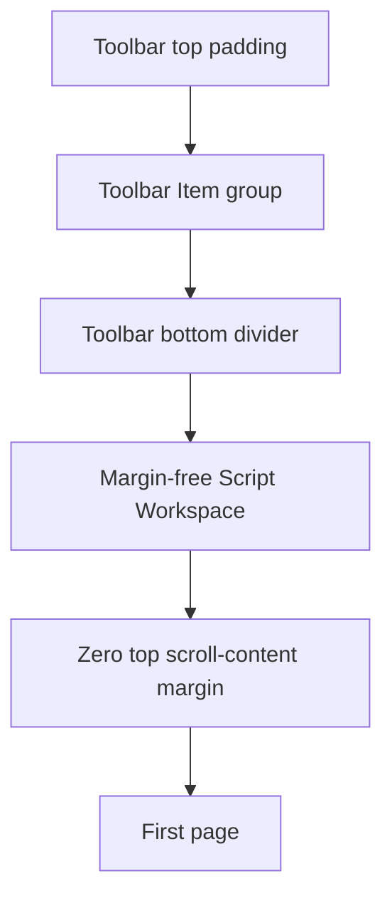

# Toolbar, Script View, and status boundary investigation

- **Status:** WO-008 and WO-009 implementations submitted for user validation; no validation or acceptance recorded
- **Date:** 2026-11-06
- **Parent initiative:** [`gui-spacing-and-scroll.md`](gui-spacing-and-scroll.md)
- **Related follow-up:** [`follow-up-refinements.md`](follow-up-refinements.md)
- **Research basis:** Read-only inspection of current source and installed egui 0.34.3 behavior; no runtime or visual validation performed
- **Remaining gap:** [`toolbar-script-view-gap-investigation.md`](toolbar-script-view-gap-investigation.md) records the screenshot/source contradiction and a proposed development-only rectangle trace; its runtime owner is not yet established.

## 1. Toolbar-to-Script View boundary

### Finding: the remaining blank allocation belongs to the toolbar

There is no separate application-owned spacer between the top toolbar panel and central Script View panel. The panels are allocated consecutively in [`show_application_panels()`](../../../apps/scriptcraft/src/main.rs:1051), and Script View has both a margin-free central frame and zero top scroll-content margin.

The remaining fixed blank region was [`TOOLBAR_BOTTOM_PADDING`](../../../apps/scriptcraft/src/toolbar.rs:18), previously 6 logical points. The submitted source sets it to zero. The setting remains applied after the Item group through [`ui.add_space()`](../../../apps/scriptcraft/src/toolbar.rs:923) and included in the exact top-panel allocation by [`toolbar_content_height()`](../../../apps/scriptcraft/src/toolbar.rs:1011), where it contributes no trailing allocation.

The current vertical allocation is therefore:

| Region | Current logical-point allocation | Owner |
|---|---:|---|
| Toolbar top padding | 4 | [`TOOLBAR_TOP_PADDING`](../../../apps/scriptcraft/src/toolbar.rs:14) |
| Toolbar Item group | 36 under current interaction metrics | [`toolbar_item_group_height()`](../../../apps/scriptcraft/src/toolbar.rs:1007) |
| Toolbar bottom padding | 0 | [`TOOLBAR_BOTTOM_PADDING`](../../../apps/scriptcraft/src/toolbar.rs:18) |
| Total exact toolbar panel | 40 under current metrics | [`Panel::exact_size()`](../../../apps/scriptcraft/src/main.rs:1068) |
| Toolbar bottom divider | Painted at the panel's lower edge | [`toolbar()`](../../../apps/scriptcraft/src/toolbar.rs:926) |
| Central Script Workspace frame margin | 0 | [`central_panel_frame()`](../../../apps/scriptcraft/src/script_view.rs:1476) |
| Script View top content margin | 0 | [`SCRIPT_VIEW_TOP_PAGE_EDGE_PADDING`](../../../apps/scriptcraft/src/script_view.rs:17) |

The framework separator is not the top-gap source: the toolbar already disables it through [`show_separator_line(false)`](../../../apps/scriptcraft/src/main.rs:1067). Its frame is also explicitly margin-free and stroke-free through [`chrome_frame()`](../../../apps/scriptcraft/src/main.rs:1043).

### Submitted correction

The existing bottom-padding setting is zero. The existing height helper propagates that value into the exact panel allocation, so the toolbar divider sits at the resized panel's lower edge and Script View follows immediately after the toolbar panel.

This is a toolbar sizing change, not another Script View margin change. Preserve current top padding, Item group metrics, caption geometry, and the current user-adjusted divider width.

## 2. Border and separator inventory before explicit border ownership

All widths below are logical-point stroke widths, not guaranteed physical pixel counts. Native pixels-per-point and stroke rasterization determine their displayed pixel coverage.

| Surface | Current width | Current color owner | Current geometry owner |
|---|---:|---|---|
| Toolbar bottom divider | 1.5 | [`ToolbarPalette::border`](../../../apps/scriptcraft/src/theme.rs:59) | Explicit full-width line at [`toolbar_rect.bottom() - 0.5`](../../../apps/scriptcraft/src/toolbar.rs:928) |
| Screenplay page border | 3 nominal | [`PagePalette::border`](../../../apps/scriptcraft/src/theme.rs:48) | [`StrokeKind::Middle`](../../../apps/scriptcraft/src/script_view.rs:210), with the page painter clipped to the page rectangle |
| Status theme-owned frame stroke | 0 effective | [`StatusPalette::border`](../../../apps/scriptcraft/src/theme.rs:77) | [`status_panel_frame()`](../../../apps/scriptcraft/src/status_bar.rs:84) reuses the inherited zero width |
| Visible framework status separator | 1 by egui defaults | Generic noninteractive widget background stroke, not the status palette | Bottom-panel separator enabled by default in [`Panel::bottom()`](../../../apps/scriptcraft/src/main.rs:1115) |

### Page-border qualification

[`paint_page()`](../../../apps/scriptcraft/src/script_view.rs:185) obtains its painter through [`ui.painter_at(page_rect)`](../../../apps/scriptcraft/src/script_view.rs:203). Its nominal centered stroke straddles the page rectangle, but the painter clip prevents the outside portion from painting beyond the page clip. The nominal source width and the finally visible thickness are therefore not interchangeable concepts.

This page border is page-local and cannot explain a separate full-viewport-width line above the status bar.

### Status-border root cause

[`status_panel_frame()`](../../../apps/scriptcraft/src/status_bar.rs:84) constructs a stroke with [`frame.stroke.width`](../../../apps/scriptcraft/src/status_bar.rs:86) and the theme's status border color. The inherited egui side/top-panel frame has no stroke, so that width is zero. Changing the theme color cannot make a zero-width stroke visible.

Independently, egui panels default to showing a separator. The bottom panel does not disable it. Egui paints that separator using the generic noninteractive background stroke rather than [`StatusPalette::border`](../../../apps/scriptcraft/src/theme.rs:77). The installed egui defaults use a 1-point stroke for this generic separator. This precisely explains the visible light-gray line that ignores a black status-border test value.

## 3. Proposed bounded follow-ups

### WO-008 implementation-submission handoff — Remove the toolbar's trailing blank allocation

- **Standalone draft:** [`WO-008-toolbar-trailing-allocation.md`](work-orders/WO-008-toolbar-trailing-allocation.md)
- **Branch:** `dev/2026-11-05-gui-spacing-and-scroll`; existing checkout, prior handoffs, and user-owned adjustments were preserved.
- **Exact source change/value:** [`TOOLBAR_BOTTOM_PADDING`](../../../apps/scriptcraft/src/toolbar.rs:18) changed from `6.0` to `0.0`; the `ui.add_space()` call and exact-height derivation remain intact. Top padding remains `4.0`, the Item group remains 36 under current interaction metrics, and exact toolbar panel height is 40 under those metrics.
- **Boundary result from source structure:** The toolbar divider is painted at the panel's lower edge. The consecutive Script View panel has a margin-free frame and zero top scroll-content margin; no application spacer intervenes. Script View's bottom page-end allowance and zoom geometry were not changed.
- **Files changed for this submission:** [`toolbar.rs`](../../../apps/scriptcraft/src/toolbar.rs:18), [`screenplay-writing-loop.md`](../../../.forge/requirements/features/screenplay-writing-loop.md:612), [`technical-context.md`](../../../.forge/blueprints/technical-context.md:51), [`WO-008-toolbar-trailing-allocation.md`](work-orders/WO-008-toolbar-trailing-allocation.md:1), and this investigation note.
- **Evidence limitations:** No build, check, test, lint, formatting command, manual verification, independent reviewer, validator, or user validation was run or claimed. This is an implementation submission only; user validation and acceptance remain outstanding.

### WO-009 implementation-submission handoff — Make border width and color ownership explicit

- **Standalone draft:** [`WO-009-explicit-border-ownership.md`](work-orders/WO-009-explicit-border-ownership.md)
- **Branch:** `dev/2026-11-05-gui-spacing-and-scroll`; the existing checkout, WO-008 and earlier handoffs, and user-owned source adjustments were preserved. No branch or history operations were performed.
- **Exact source changes and values:** [`TOOLBAR_BOTTOM_BORDER_WIDTH`](../../../apps/scriptcraft/src/toolbar.rs:19) is a named `1.5`-logical-point setting for the existing toolbar divider. [`PAGE_BORDER_WIDTH`](../../../apps/scriptcraft/src/script_view.rs:19) is a named `3.0`-logical-point setting for the page stroke; page painter clipping and [`StrokeKind::Middle`](../../../apps/scriptcraft/src/script_view.rs:211) remain unchanged. [`STATUS_PANEL_TOP_BORDER_WIDTH`](../../../apps/scriptcraft/src/status_bar.rs:26) is a named `1.0`-logical-point setting, matching the former generic separator's effective width. The bottom status panel disables its framework separator, the status frame uses [`Stroke::NONE`](../../../apps/scriptcraft/src/status_bar.rs:93), and one full-width top divider is painted from the status palette against the outer panel rectangle returned by [`Panel::show_inside()`](../../../apps/scriptcraft/src/main.rs:1119), rather than the inset content rectangle.
- **Resulting ownership:** Toolbar, screenplay page, and status divider use separate named local widths and their respective semantic palette colors. The status surface has one explicit top divider only; no full box border, global noninteractive color change, or unrelated geometry change was introduced.
- **Files changed for this submission:** [`toolbar.rs`](../../../apps/scriptcraft/src/toolbar.rs:19), [`script_view.rs`](../../../apps/scriptcraft/src/script_view.rs:18), [`status_bar.rs`](../../../apps/scriptcraft/src/status_bar.rs:25), [`main.rs`](../../../apps/scriptcraft/src/main.rs:1115), [`screenplay-writing-loop.md`](../../../.forge/requirements/features/screenplay-writing-loop.md:612), [`technical-context.md`](../../../.forge/blueprints/technical-context.md:26), [`WO-009-explicit-border-ownership.md`](work-orders/WO-009-explicit-border-ownership.md:1), and this note. No theme palette source change was made.
- **Evidence limitations:** No build, check, test, lint, formatting command, manual verification, reviewer, validator, or user validation was run or claimed. This is an implementation submission only; user validation and acceptance remain outstanding.

## 4. Durable-record policy

The lasting toolbar, page, and status boundary contracts are recorded in [`screenplay-writing-loop.md`](../../../.forge/requirements/features/screenplay-writing-loop.md) and [`technical-context.md`](../../../.forge/blueprints/technical-context.md). Those records omit work-order identifiers, implementation chronology, and numeric tuning values. Exact widths and implementation handoffs belong only in this planning directory.

## 5. User-owned visual checks after any implementation

- Set each semantic border color to a distinct high-contrast test color and confirm only its owned divider changes.
- Confirm no generic framework separator remains visible above the status bar.
- Inspect toolbar and page boundaries at multiple native display scales and page zoom levels.
- Confirm removing toolbar trailing allocation does not clip captions, hover rectangles, or the divider.
- Confirm status sizing, controls, Diagnostics behavior, Script View scrolling, and page-border clipping remain coherent.
