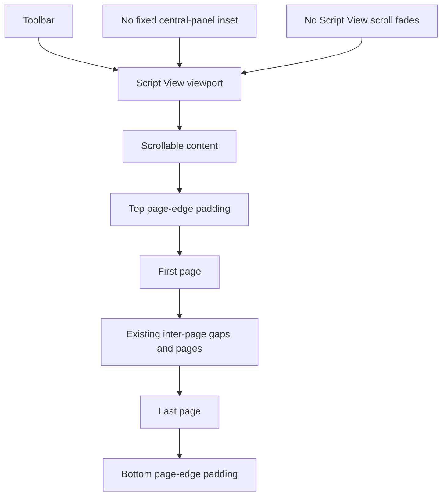

# GUI spacing, Script View scrolling, and toolbar caption plan

- **Status:** WO-001, WO-002, WO-003, and WO-004 implementations submitted for user review; none is user-validated or accepted.
- **Date:** 2026-11-05
- **Validation owner:** User; no agent-run builds, checks, tests, lint, formatting checks, manual verification, reviews, or independent validators
- **Research basis:** Read-only inspection of current desktop source and the installed egui 0.34.3 source resolved by [`Cargo.lock`](../../../Cargo.lock)
- **Primary source area:** [`apps/scriptcraft/src`](../../../apps/scriptcraft/src)
- **Follow-up:** [`follow-up-refinements.md`](follow-up-refinements.md) proposes WO-005 through WO-007 for post-implementation user feedback; no follow-up implementation is authorized by those drafts.

## 1. Outcome

Resolve three small but related desktop presentation problems without changing screenplay semantics, document layout, persistence, or export behavior:

1. Make status-bar row/panel height ownership explicit while preserving the current effective normal height.
2. Give Script View breathing room only at the scroll content's beginning and end, remove the fixed frame insets and fuzzy scroll overlays that cover pages, and extract Script View from the application shell.
3. Give action Items and Elements one explicit control-to-caption spacing setting, and make toolbar panel allocation include all of its vertical padding.

The only proposed new numeric appearance defaults are:

| Setting | Proposed initial value | Status |
|---|---:|---|
| [`STATUS_ROW_HEIGHT`](../../../apps/scriptcraft/src/status_bar.rs:20) | 18 logical points | Agent-default extraction of the current effective egui row height |
| [`SCRIPT_VIEW_PAGE_EDGE_PADDING`](../../../apps/scriptcraft/src/script_view.rs:1) | 16 logical points at each content end | Agent-default pending user visual review |
| [`TOOLBAR_CONTROL_CAPTION_GAP`](../../../apps/scriptcraft/src/toolbar.rs:7) | 1 logical point | Agent-default reduction from the current effective 3-point gap |

These are developer-facing source settings, not runtime preferences or persisted document state.

## 2. Source findings

### 2.1 Status-bar height

There is currently no single full-status-height constant.

| Contributor | Current source | Effect |
|---|---|---|
| Panel vertical inset | [`PANEL_VERTICAL_INSET`](../../../apps/scriptcraft/src/status_bar.rs:26) | 5 logical points above and below the content, for 10 points total. |
| Ordinary row height | [`show_impl_with_appearance()`](../../../apps/scriptcraft/src/status_bar.rs:1259) | Reads the framework interaction height through [`ui.spacing().interact_size.y`](../../../apps/scriptcraft/src/status_bar.rs:1282), currently 18 points by default. |
| Bottom-panel sizing | [`Panel::bottom()`](../../../apps/scriptcraft/src/main.rs:2564) | Has no app-provided exact or default height. egui's ordinary horizontal-panel default is the framework interaction height plus the frame's vertical margins. |
| Optional Diagnostics | [`ENABLE_DIAGNOSTICS`](../../../apps/scriptcraft/src/status_bar.rs:56) | Production-off and allocates no second row. Explicit development enablement may add its existing disclosure content and must not be forced into the ordinary 28-point row allocation. |

The resulting normal height is **18 + 5 + 5 = 28 logical points**. Internal controls also use framework interaction metrics, but text font sizes do not independently determine the ordinary panel height. The top/bottom inset is already parameterized; the ordinary row height is not status-local.

**Recommendation:** introduce a status-local row-height setting initialized to 18 and one derived default-panel-height helper. Do not introduce an independent full-height number that could disagree with the row and inset settings. Use default sizing rather than a fixed exact panel size so the explicitly enabled Diagnostics development view retains its bounded expansion path.

### 2.2 Script View fixed gaps, page coverage, and fuzzy edges

Three separate mechanisms contribute to the reported behavior.

#### Fixed central-panel margin

[`central_panel_frame()`](../../../apps/scriptcraft/src/main.rs:2491) starts from egui's central-panel frame at [`Frame::central_panel()`](../../../apps/scriptcraft/src/main.rs:2497). In the installed egui version, that constructor supplies an 8-point margin on every side. The application changes only its fill.

That margin is outside the scroll content. It creates the initial gap, remains fixed while scrolling, and clips page content at the inset viewport edge. It is therefore the wrong owner for padding that should exist only at the document's top and bottom extremes.

#### Framework scroll fades

The installed egui [`ScrollFadeStyle`](../../../../.cargo/registry/src/index.crates.io-1949cf8c6b5b557f/egui-0.34.3/src/style.rs:792) defaults to 20-point fades at 0.5 strength. [`paint_fade_areas()`](../../../../.cargo/registry/src/index.crates.io-1949cf8c6b5b557f/egui-0.34.3/src/containers/scroll_area.rs:1531) paints them over scrolling content:

- At the top after vertical offset becomes positive.
- At the bottom whenever content remains below the viewport.
- At the corresponding left and right edges during horizontal overflow.

ScriptCraft currently constructs its editor with [`ScrollArea::both()`](../../../apps/scriptcraft/src/main.rs:1414) and does not override this style. These gradients explain the fuzzy bands that cover the page. They are not an app-authored page shadow: [`paint_page()`](../../../apps/scriptcraft/src/main.rs:1204) paints only the page fill, border, text, selection, caret, and related page content.

The fade strength varies with distance from the corresponding content end, which explains why one band can appear more pronounced than the other and why the bottom can look close to the desired behavior near the final scroll position.

#### Missing explicit page-end allowance

[`PAGE_VERTICAL_GAP`](../../../apps/scriptcraft/src/main.rs:42) supplies the existing 12-point inter-page spacer, and egui's vertical item spacing contributes to the row stride. This is not a named top/bottom document-boundary allowance. Horizontal centering and overflow already have a separate 16-point exterior side buffer through [`PAGE_HORIZONTAL_PADDING`](../../../apps/scriptcraft/src/main.rs:41).

**Recommendation:** remove the central frame's inherited margin, disable scroll fades only for Script View, and add symmetric vertical content margin inside the existing scroll area. Content margin scrolls with the pages and contributes to scroll extent, so the blank space is visible at the content extremes but cannot remain as a fixed cover during ordinary scrolling.

### 2.3 Elements and toolbar caption spacing

Two independent vertical-budget defects are present.

#### Top-panel height omits top padding

[`toolbar_content_height()`](../../../apps/scriptcraft/src/toolbar.rs:964) currently returns two framework interaction heights plus [`TOOLBAR_BOTTOM_PADDING`](../../../apps/scriptcraft/src/toolbar.rs:17). With current values, the exact panel allocation is **18 × 2 + 6 = 42 points**.

The actual vertical composition in [`toolbar()`](../../../apps/scriptcraft/src/toolbar.rs:812) also adds [`TOOLBAR_TOP_PADDING`](../../../apps/scriptcraft/src/toolbar.rs:14), so its intended height is **6 + 36 + 6 = 48 points**. The exact top-panel allocation therefore omits 6 points and can clip the bottom of its content.

#### Elements caption uses implicit spacing beyond its group budget

[`elements_toolbar_item()`](../../../apps/scriptcraft/src/toolbar.rs:619) allocates a 36-point group. Inside it, the closed ComboBox ordinarily consumes an 18-point interaction row, top-down layout adds the current 3-point vertical item gap, and the caption then receives another 18-point interaction allocation at [`ui.allocate_space()`](../../../apps/scriptcraft/src/toolbar.rs:701). That produces a 39-point nominal stack inside a 36-point group before considering the outer panel shortfall.

Action Items separately calculate caption placement from the same framework item spacing at [`toolbar_action_button()`](../../../apps/scriptcraft/src/toolbar.rs:537). Thus the undesirable gap is not owned by the Elements role-option padding or by one Elements-only caption constant.

**Recommendation:** introduce one shared control-to-caption gap for action graphics and the Elements control, allocate the caption from the remaining group height rather than adding a second full interaction row through implicit layout, and include top padding in the exact toolbar panel height. Keep icon hover padding, ComboBox button padding, role-option row padding, horizontal item allocation, and popup behavior separate.

### 2.4 Documentation caution

Some numeric presentation values in the durable records predate the current source. Implementation must preserve current source-owned values unless a work order explicitly changes them, then reconcile the affected requirement and blueprint text. It must not incidentally restore older numbers while making these geometry edits.

## 3. Target ownership and geometry

| Concern | Proposed owner | Contract |
|---|---|---|
| Status row | [`presentation`](../../../apps/scriptcraft/src/status_bar.rs:20) | One status-local row-height setting initialized to the current effective 18 points. |
| Status panel | [`status_bar.rs`](../../../apps/scriptcraft/src/status_bar.rs) | Derive ordinary default height from row height plus both existing vertical insets; no second independent total-height constant. |
| Script View module | [`script_view.rs`](../../../apps/scriptcraft/src/script_view.rs) | Own page-surface layout, painting, scrolling, pointer/caret/IME interaction, presentation scaling, and fixed-cell galley support. |
| Script Workspace frame | [`script_view.rs`](../../../apps/scriptcraft/src/script_view.rs) | Retain the semantic background fill with no inherited fixed margin. |
| Page-end breathing room | [`SCRIPT_VIEW_PAGE_EDGE_PADDING`](../../../apps/scriptcraft/src/script_view.rs:1) | Symmetric 16-point vertical scroll-content margin; fixed logical points, not zoom-scaled document geometry. |
| Script View fades | Scoped Script View style | Zero fade strength for this scroll area only; toolbar popups and unrelated scroll areas retain framework behavior. |
| Inter-page and horizontal geometry | Existing Script View constants | Preserve the existing 12-point page gap, framework row-spacing contribution unless deliberately made explicit without changing its value, and 16-point horizontal page buffer. |
| Toolbar caption gap | [`TOOLBAR_CONTROL_CAPTION_GAP`](../../../apps/scriptcraft/src/toolbar.rs:7) | One shared 1-point action/Elements setting; no framework item-spacing dependency for this visual gap. |
| Toolbar panel height | [`toolbar_content_height()`](../../../apps/scriptcraft/src/toolbar.rs:964) | Top padding + shared Item group height + bottom padding; initially 48 points. |

No setting enters FDX, screenplay Project data, fixed document points, pagination, PDF, plain-text export, or native save/reopen state.

## 4. Work orders

The four work orders were executed sequentially on the initiative branch after preserving the then-current checkout. WO-001 through WO-004 implementation handoffs are submitted for user review; none is user-validated or accepted.

### WO-001 — Explicit status-row and panel-height ownership

- **Standalone draft:** [`WO-001-status-height-ownership.md`](work-orders/WO-001-status-height-ownership.md)

**Single outcome:** make the normal status row height locally adjustable and the panel derivation explicit without changing its current 28-point effective height.

Implementation steps:

1. Add [`STATUS_ROW_HEIGHT`](../../../apps/scriptcraft/src/status_bar.rs:20) under status presentation, initialized to 18 logical points.
2. Add a derived status-panel default-height helper that returns the row setting plus two existing [`PANEL_VERTICAL_INSET`](../../../apps/scriptcraft/src/status_bar.rs:26) values. Do not add a separate total-height constant.
3. Use the status row setting for the ordinary row rectangle and its bounded control regions. Keep existing internal text, icon, slider, hover, and interaction geometry coherent when the row setting changes.
4. Supply the derived default to the bottom panel in [`show_application_panels()`](../../../apps/scriptcraft/src/main.rs:2500). Use default rather than exact sizing so the explicitly enabled Diagnostics presentation is not artificially prohibited from adding its existing disclosure row.
5. Preserve the current 28-point normal initial height, status allocation priorities, page tracking, zoom behavior, accessibility, and all theme colors. Do not mutate global egui spacing.
6. Update the affected status height contract in [`screenplay-writing-loop.md`](../../../.forge/requirements/features/screenplay-writing-loop.md:668) and [`technical-context.md`](../../../.forge/blueprints/technical-context.md:140). Record the source change and evidence limitations in this plan.

User-owned acceptance review:

- Confirm the ordinary bar remains visually 28 points high at the current settings and remains stable across scrolling, zoom, long messages, and window resizing.
- Confirm every ordinary control remains visible, centered, nonoverlapping, and interactive at wide and compact widths.
- Adjust the new source setting locally if desired and verify that row plus insets, rather than an unrelated hidden number, determines ordinary panel height.
- If Diagnostics is explicitly enabled for development, confirm its existing disclosure still works without changing production-off behavior.

#### WO-001 implementation-submission handoff

- **Branch:** `dev/2026-11-05-gui-spacing-and-scroll`, created from the inspected current checkout while preserving its pre-existing untracked initiative directory; no work was staged, committed, stashed, discarded, merged, or based on another branch.
- **Exact source changes:** [`status_bar.rs`](../../../apps/scriptcraft/src/status_bar.rs) adds `presentation::STATUS_ROW_HEIGHT = 18.0`, retains `PANEL_VERTICAL_INSET = 5`, derives the ordinary panel default as `18 + 5 + 5 = 28` logical points, and uses the row setting for the row rectangle and status-local slider, icon, and reusable-item interaction geometry. It adds no independent total-height constant and does not change global egui spacing. [`main.rs`](../../../apps/scriptcraft/src/main.rs) passes `status_bar::default_panel_height()` to the status bottom panel with `.default_size(...)`, not exact sizing, leaving the existing Diagnostics expansion path available.
- **Durable records:** [`screenplay-writing-loop.md`](../../../.forge/requirements/features/screenplay-writing-loop.md) and [`technical-context.md`](../../../.forge/blueprints/technical-context.md) now describe the lasting row/inset ownership, derived default sizing, ordinary-height stability, and optional Diagnostics expansion without implementation chronology or numeric spacing/padding/panel-height tuning values.
- **Files changed for this submission:** [`status_bar.rs`](../../../apps/scriptcraft/src/status_bar.rs), [`main.rs`](../../../apps/scriptcraft/src/main.rs), [`screenplay-writing-loop.md`](../../../.forge/requirements/features/screenplay-writing-loop.md), [`technical-context.md`](../../../.forge/blueprints/technical-context.md), [`WO-001-status-height-ownership.md`](work-orders/WO-001-status-height-ownership.md), and this initiative overview.
- **Evidence limitations:** No build, check, test, lint, formatting command, manual verification, independent review, or validator was run. Compilation, framework compatibility, runtime appearance, interaction/accessibility behavior, and Diagnostics expansion remain unverified and user-owned. This is an implementation submission only; no user validation or acceptance is claimed.

### WO-002 — Extract Script View without behavior changes

- **Standalone draft:** [`WO-002-script-view-extraction.md`](work-orders/WO-002-script-view-extraction.md)

**Single outcome:** establish the same desktop-module boundary already used for toolbar and status code before changing Script View geometry.

Implementation steps:

1. Add [`script_view.rs`](../../../apps/scriptcraft/src/script_view.rs) and register it from [`main.rs`](../../../apps/scriptcraft/src/main.rs:27).
2. Move the page-surface implementation into that module: page allocation and painting, viewport culling, scroll geometry, presentation scaling, prepaint zoom compensation, pointer selection, caret/IME painting and interaction, surface input routing, and fixed-cell galley cache support.
3. Move only Script View-owned constants and helpers. Keep project/session/file operations, native dialogs, toolbar/status composition, Appearance, Sprint Timer, application notifications, and top-level app orchestration in their existing owners.
4. Use minimal module visibility and existing application/session adapters. Do not create a parallel document state, duplicate zoom state, or move presentation values into screenplay core.
5. Preserve every numeric value and behavior in this order, including page geometry publication, visible-page tracking, deep-scroll zoom compensation, conditional caret reveal, focus locking, input ordering, culling/overscan, and diagnostics counters.
6. Update the project map and Script View ownership description in [`technical-context.md`](../../../.forge/blueprints/technical-context.md:7). No requirement change is needed for a pure module move. Record the extraction and its unverified compatibility surface in this plan.

User-owned acceptance review:

- Exercise text entry, selection, keyboard navigation, IME, caret reveal, scrolling, page status, and all zoom paths before accepting the extraction.
- Confirm title pages, multiple pages, narrow horizontal overflow, disabled/popup overlays, and document replacement retain their existing behavior.
- Review that application shell and screenplay core responsibilities did not move into the new presentation module.

#### WO-002 implementation-submission handoff

- **Branch:** `dev/2026-11-05-gui-spacing-and-scroll`, the existing initiative branch. Existing checkout changes and the WO-001 implementation/handoff were preserved; no work was staged, committed, stashed, discarded, merged, or rebased.
- **Exact source changes:** Added [`script_view.rs`](../../../apps/scriptcraft/src/script_view.rs) and registered it from [`main.rs`](../../../apps/scriptcraft/src/main.rs). The module owns page allocation/painting/culling, scroll and presentation-scale geometry, prepaint zoom compensation, pointer selection, caret/IME presentation, surface event and keyboard routing, vertical navigation, fixed-cell galley support, and Script Workspace frame/clear-color helpers. [`main.rs`](../../../apps/scriptcraft/src/main.rs) retains application/session/file orchestration and panel composition. This is a behavior-preserving extraction; no spacing, margin, fade, clipping, color, zoom-geometry, page-gap, or interaction change was included.
- **Durable record:** [`technical-context.md`](../../../.forge/blueprints/technical-context.md) now describes the lasting module boundary, ownership of application state, geometry publication and status/zoom coordination, and the separation from orchestration and screenplay-core semantics. No requirements change was needed.
- **Files changed for this submission:** [`apps/scriptcraft/src/main.rs`](../../../apps/scriptcraft/src/main.rs), [`apps/scriptcraft/src/script_view.rs`](../../../apps/scriptcraft/src/script_view.rs), [`technical-context.md`](../../../.forge/blueprints/technical-context.md), [`WO-002-script-view-extraction.md`](work-orders/WO-002-script-view-extraction.md), and this overview. The WO-001 handoff above remains intact.
- **Evidence limitations:** No build, check, test, lint, formatting command, manual verification, independent review, or validator was run. Compilation, compatibility, runtime behavior, editing/input, scrolling/zoom, diagnostics, and appearance remain unverified and user-owned. This is an implementation submission only; no user validation or acceptance is claimed.

### WO-003 — Scrollable page-edge padding and no Script View fades

- **Standalone draft:** [`WO-003-script-view-scroll-edges.md`](work-orders/WO-003-script-view-scroll-edges.md)

**Single outcome:** provide blank space only beyond the first and last pages while allowing unobscured page content throughout ordinary scrolling.

Depends on WO-002.

Implementation steps:

1. Replace the inherited central-panel frame in Script View with a margin-free frame retaining the active Script Workspace background.
2. Add [`SCRIPT_VIEW_PAGE_EDGE_PADDING`](../../../apps/scriptcraft/src/script_view.rs:1), initially 16 logical points, and apply it as symmetric top/bottom content margin on the existing page scroll area. Keep left/right content margin at zero and preserve existing horizontal page centering/buffers.
3. Scope the scroll area's fade strength to zero before construction/paint so its top, bottom, left, and right gradient overlays are all disabled. Do not change global scroll style or Elements popup fades.
4. Update vertical scroll-extent and page-origin calculations so top content margin precedes page zero and both vertical margins contribute exactly once to total content height. Keep the existing page gap and row-spacing contribution coherent; do not double-add either margin or gap.
5. Apply the same geometry in actual allocation and [`prepaint_zoom_scroll_offset()`](../../../apps/scriptcraft/src/main.rs:2101), moved into Script View by WO-002. Page-local document coordinates still scale with zoom; content margin, page gaps, outside-page displacement, and horizontal padding remain fixed logical-point quantities.
6. Preserve actual page-rectangle publication, visible-page selection, pointer routing, caret reveal, manual-scroll cancellation, one-shot zoom anchoring, and viewport culling against the true new clip.
7. Extend the desktop editor geometry contract in [`screenplay-writing-loop.md`](../../../.forge/requirements/features/screenplay-writing-loop.md:137) with scrollable page-end padding and unobscured viewport edges. Update the Script View/zoom contracts in [`technical-context.md`](../../../.forge/blueprints/technical-context.md:177) with content-margin ownership and scoped fade disablement. Record the changes and evidence limitations in this plan.

User-owned acceptance review:

- At the document top, confirm only the intended 16-point blank space precedes page one. Scroll downward and confirm that blank space scrolls away rather than covering the page.
- In the middle of a multi-page document, confirm pages can reach the top and bottom viewport edges without fuzzy overlays or fixed frame blocks.
- At the document bottom, confirm the same 16-point allowance lies beyond the last page and no band covers that page while approaching or reaching the end.
- Repeat with horizontal overflow, 75%/100%/300% zoom, continuous native pinch, the status slider/presets, caret reveal, window resize, short documents, and every Appearance.
- Confirm Elements and other unrelated scroll areas retain their existing popup behavior and that page status, selection, editing, and zoom anchoring remain correct.

#### WO-003 implementation-submission handoff

- **Branch:** `dev/2026-11-05-gui-spacing-and-scroll`. The existing checkout work and WO-001/WO-002 handoffs remain preserved; nothing was staged, committed, stashed, discarded, merged, or rebased.
- **Exact source changes:** [`script_view.rs`](../../../apps/scriptcraft/src/script_view.rs) defines `SCRIPT_VIEW_PAGE_EDGE_PADDING = 16.0` logical points and applies it at the top and bottom of the existing scroll content with zero horizontal margin. The current Script View `Ui` style's fade strength is temporarily set to `0.0` around scroll-area construction and painting, then restored; this disables gradients on both axes without changing shared styling or scroll-area identity. The Script Workspace frame is now `Frame::NONE` with the active background fill. Prepaint zoom compensation offsets each page origin by the top allowance and adds both allowances once to predicted vertical content extent. Existing page stride remains scaled page height plus the 12-point page gap and framework row spacing; page-local geometry scales while edge padding, gap, row spacing, horizontal buffers, and outside-page displacement remain fixed logical-point values.
- **Durable records:** [`screenplay-writing-loop.md`](../../../.forge/requirements/features/screenplay-writing-loop.md) and [`technical-context.md`](../../../.forge/blueprints/technical-context.md) now state the lasting scroll-content spacing ownership, local fade policy, presentation/document-layout separation, and equivalent actual/prepaint zoom geometry. The durable wording contains no work-order identifiers, implementation chronology, or numeric spacing/margin/fade/gap settings.
- **Files changed for this submission:** [`apps/scriptcraft/src/script_view.rs`](../../../apps/scriptcraft/src/script_view.rs), [`.forge/requirements/features/screenplay-writing-loop.md`](../../../.forge/requirements/features/screenplay-writing-loop.md), [`.forge/blueprints/technical-context.md`](../../../.forge/blueprints/technical-context.md), [`WO-003-script-view-scroll-edges.md`](work-orders/WO-003-script-view-scroll-edges.md), and this initiative overview. Earlier handoffs are retained; WO-004 was not implemented.
- **Evidence limitations:** No build, check, test, lint, formatting command, manual verification, independent review, or validator was run. Compilation, framework/API compatibility, actual scroll extent/clamping, visual presentation, fade behavior, zoom anchoring, and input behavior remain unverified and user-owned. This is an implementation submission only; no user validation or acceptance is claimed.

### WO-004 — Shared toolbar caption rhythm and complete panel height

- **Standalone draft:** [`WO-004-toolbar-caption-rhythm.md`](work-orders/WO-004-toolbar-caption-rhythm.md)

**Single outcome:** remove Elements caption clipping and make action/Elements control-to-caption spacing explicitly tunable from one setting.

Implementation steps:

1. Add [`TOOLBAR_CONTROL_CAPTION_GAP`](../../../apps/scriptcraft/src/toolbar.rs:7), initially 1 logical point, for both action graphics/captions and the Elements control/caption.
2. Give action Items and Elements explicit control, gap, and remaining-caption rectangles inside the existing two-interaction-height Item group. Remove the caption's dependence on implicit vertical item spacing and avoid allocating a second full interaction row beyond the group.
3. Correct [`toolbar_content_height()`](../../../apps/scriptcraft/src/toolbar.rs:964) to include top padding, Item group height, and bottom padding. Preserve the current 6/36/6-point components, producing an intentional 48-point panel allocation instead of the clipped 42-point allocation.
4. Reuse the same group-height calculation at allocation and render call sites so panel, action Items, and Elements cannot silently adopt different budgets.
5. Preserve item widths, flexible spaces, overflow, icon glyph placement, per-edge icon hover padding, ComboBox selection/popup/accessibility behavior, role-option typography and row padding, disabled treatment, commands, cursors, and theme palettes.
6. Update the toolbar caption/geometry contract in [`screenplay-writing-loop.md`](../../../.forge/requirements/features/screenplay-writing-loop.md:534) and [`technical-context.md`](../../../.forge/blueprints/technical-context.md:28). Record the intentional panel-height correction and evidence limitations in this plan.

User-owned acceptance review:

- Confirm the Elements caption is fully visible with the intended small gap below the closed role control, at every supported selected-role label.
- Confirm New, Open, Save, Save As, Show/Hide, Export Text, and Export PDF captions remain fully visible and consistently spaced.
- Check wide, compact, and overflow layouts; verify right-edge fitting, flexible spaces, disabled items, role selection, popup height, keyboard behavior, and command routing.
- Confirm toolbar height is stable and that the corrected panel allocation no longer clips the lowest caption pixels.

#### WO-004 implementation-submission handoff

- **Branch:** `dev/2026-11-05-gui-spacing-and-scroll`, the existing initiative branch. WO-001 through WO-003 and their planning handoffs remain preserved; nothing was staged, committed, stashed, discarded, merged, or rebased.
- **Exact source changes and values:** [`toolbar.rs`](../../../apps/scriptcraft/src/toolbar.rs) adds `TOOLBAR_CONTROL_CAPTION_GAP = 1.0` logical point, shared by action graphics/captions and the Elements control/caption. One Item-group helper derives `2 × interact_size.y` (`2 × 18 = 36` logical points) and supplies the panel row, action Items, and Elements allocation. Within the group, the control occupies 18 points, the explicit caption gap 1 point, and the remaining caption area 17 points. Action captions are centered in that remaining vertical area; Elements explicitly allocates its control, gap, and caption area, disabling child vertical item spacing only for those caption allocations after the ComboBox and its popup have completed their normal layout. `toolbar_content_height()` derives `6` points top padding + `36` points group + `6` points bottom padding = `48` logical points, correcting the prior exact panel allocation from `42` to `48`. Horizontal item allocation, control widths, icon graphics and hover padding, ComboBox button padding, role-option padding, popup behavior, and other toolbar behavior were not intentionally changed.
- **Durable records:** [`screenplay-writing-loop.md`](../../../.forge/requirements/features/screenplay-writing-loop.md) and [`technical-context.md`](../../../.forge/blueprints/technical-context.md) describe shared action/Elements caption rhythm, common Item-group budgeting, complete panel-height derivation/containment, and separate ownership of icon-hover, ComboBox, and role-option padding. The durable toolbar contract contains no work-order identifiers, implementation chronology, or numeric spacing, padding, font, or panel-height tuning values.
- **Files changed for this submission:** [`apps/scriptcraft/src/toolbar.rs`](../../../apps/scriptcraft/src/toolbar.rs), [`.forge/requirements/features/screenplay-writing-loop.md`](../../../.forge/requirements/features/screenplay-writing-loop.md), [`.forge/blueprints/technical-context.md`](../../../.forge/blueprints/technical-context.md), [`WO-004-toolbar-caption-rhythm.md`](work-orders/WO-004-toolbar-caption-rhythm.md), and this initiative overview. Earlier WO-001 through WO-003 handoffs remain intact.
- **Evidence limitations:** No build, check, test, lint, formatting command, manual verification, independent review, or validator was run. Compilation, framework/API compatibility, visual geometry, toolbar height, caption visibility, Elements selection/popup behavior, overflow layouts, commands, and accessibility remain unverified and user-owned. This is an implementation submission only; no user validation or acceptance is claimed.

## 5. Durable-document reconciliation

Implementation handoffs must update the affected records rather than leaving this plan as the only description:

- [`screenplay-writing-loop.md`](../../../.forge/requirements/features/screenplay-writing-loop.md): status row/default-panel derivation, Script View page-end/no-overlay behavior, and toolbar caption/panel geometry only.
- [`technical-context.md`](../../../.forge/blueprints/technical-context.md): the new Script View module boundary, settings ownership, scroll-content/zoom geometry, and toolbar/status derivations.
- These requirements and blueprints must remain independently reviewable descriptions of the repository's lasting product behavior and technical ownership. Do not include work-order identifiers, implementation chronology, or numeric spacing, padding, margin, fade, font, or panel-height values.
- No initiative-specific development log is required in [`project-manifest.md`](../../../.forge/project-manifest.md) for these presentation orders.
- This plan and the standalone drafts: retain exact per-order source changes, intentional value changes, unresolved behavior, and user-owned review status without retroactively claiming acceptance.

## 6. Boundaries and non-goals

- No screenplay-core, semantic editing, FDX, pagination, fixed-layout, export, or native-save changes.
- No new persisted appearance/layout preference or document field.
- No global egui spacing or scroll-fade mutation.
- No changes to page zoom limits, page dimensions, horizontal page buffer semantics, visible-page selection rules, toolbar item order, item enablement, or role catalog.
- No generic replacement of egui panels, ComboBox, ScrollArea, or toolbar interactions.
- No new automated desktop-test target and no agent execution of validation under the repository policy.
- No claim that source inspection establishes current runtime appearance; all visual and behavioral acceptance remains user-owned.

## 7. Implementation choices submitted for review

The implementation choices currently submitted for user review are:

1. Preserve the current 28-point normal status bar through an 18-point status row plus the existing 5-point top/bottom insets.
2. Perform the Script View extraction as a separate behavior-preserving order before fixing its geometry.
3. Use 16 points of scrollable top/bottom page-edge padding, remove the fixed central margin, and disable Script View fades on all axes.
4. Use one shared 1-point toolbar control-to-caption gap and correct the exact toolbar height from 42 to 48 points by accounting for the already-used top padding.
