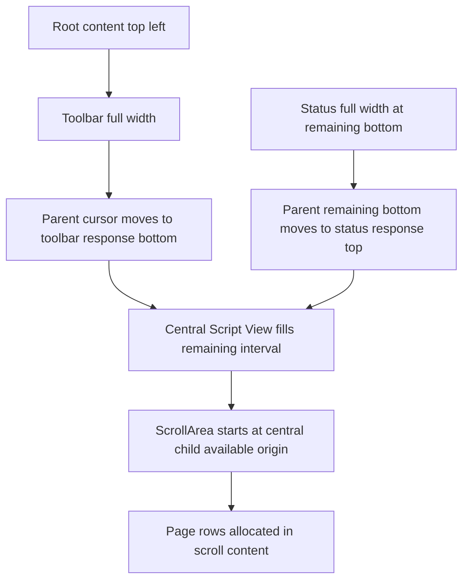

# Toolbar-to-Script View gap — continuation record

- **Status:** WO-011 and WO-012 source corrections submitted; user runtime review and validation pending
- **Date:** 2026-11-06
- **Current investigation branch:** `dev/2026-11-06-script-view-boundary`
- **Committed baseline:** `728282270489822770fea5141ddb3595aad340e9` on `dev/2026-11-05-gui-spacing-and-scroll`
- **Validation owner:** User. Agents must not run builds, checks, tests, lint, formatting commands, manual verification, independent reviews, or validators under repository policy.
- **Latest source findings and WO-012 handoff:** [`toolbar-script-view-gap-findings.md`](../2026-11-06-toolbar-script-view-gap/toolbar-script-view-gap-findings.md) and [`WO-012-elements-spacing-overflow.md`](../2026-11-06-toolbar-script-view-gap/work-orders/WO-012-elements-spacing-overflow.md) identify and correct the remaining closed-Elements response overflow; runtime acceptance remains user-owned.

## 1. Purpose

This is the standalone handoff for continuing the remaining toolbar-to-Script View gap investigation. It consolidates the relevant screenshot observations, allocation evidence, implemented corrections, current layout model, unresolved residual, and next steps.

Do not restart by changing Script View padding or repeating the earlier toolbar-bottom-padding/status-border fixes. Those owners have already been inspected and changed where appropriate.

## 2. Current user-visible result

The user supplied a screenshot showing a workspace-colored band between the toolbar and the first page. The page appeared clipped at the bottom of that band, and the vertical scrollbar also began below the toolbar rather than meeting its lower edge.

After the WO-011 toolbar-scope correction, the user reported that the gap became approximately half as large but did not disappear. No agent has observed the application or validated the visual result.

The remaining problem is therefore a **smaller persistent response/paint/allocation discrepancy**, not the original full-size gap.

## 3. Branch and worktree context

The earlier GUI work was committed on `dev/2026-11-05-gui-spacing-and-scroll` as:

- Commit: `728282270489822770fea5141ddb3595aad340e9`
- Message: `Implement GUI spacing and boundary refinements`

A separate branch, `dev/2026-11-06-script-view-boundary`, was created from that commit so the investigation can be reverted independently.

WO-010 and WO-011 were subsequently implemented on the investigation branch. Do not assume that the current worktree is clean; inspect and preserve all current changes before further work. WO-010's user capture is complete and the temporary trace instrumentation was retired afterward; it is no longer present in the application source.

## 4. Already-completed relevant changes

### Toolbar trailing allocation and borders

- Current [`TOOLBAR_BOTTOM_PADDING`](../../../apps/scriptcraft/src/toolbar.rs:18) is 4 points and remains explicitly included in exact toolbar height. Earlier WO-008-era notes that say zero describe a prior source snapshot; the user directed that the current value be preserved and the durable contract updated to allow explicit trailing padding.
- The toolbar framework separator is disabled in [`show_application_panels()`](../../../apps/scriptcraft/src/main.rs:1052).
- The toolbar frame is margin-free and stroke-free through [`chrome_frame()`](../../../apps/scriptcraft/src/main.rs:1044).
- The toolbar bottom divider has a named local width through [`TOOLBAR_BOTTOM_BORDER_WIDTH`](../../../apps/scriptcraft/src/toolbar.rs:20) and uses the toolbar palette.
- The page border has a separate named local width through [`PAGE_BORDER_WIDTH`](../../../apps/scriptcraft/src/script_view.rs:19).

### Status border separation

- The status frame is stroke-free through [`status_panel_frame()`](../../../apps/scriptcraft/src/status_bar.rs:86).
- Egui's generic status separator is disabled.
- One explicit status top divider uses the status palette through [`paint_panel_top_border()`](../../../apps/scriptcraft/src/status_bar.rs:96).
- This status-border work is not the owner of the top toolbar gap.

### Script View margins and fades

- The central Script Workspace frame uses [`Frame::NONE`](../../../apps/scriptcraft/src/script_view.rs:1481), so it has no fixed margin.
- [`SCRIPT_VIEW_TOP_PAGE_EDGE_PADDING`](../../../apps/scriptcraft/src/script_view.rs:17) is zero.
- [`SCRIPT_VIEW_BOTTOM_PAGE_EDGE_PADDING`](../../../apps/scriptcraft/src/script_view.rs:18) retains the user's bottom allowance.
- Script View scroll fades are disabled locally; unrelated scroll areas retain their own behavior.

These changes must not be undone as a speculative way to address the residual gap.

## 5. WO-010 runtime evidence

WO-010's development-only bounded instrumentation captured numeric rectangles and fixed labels, suppressed repeated snapshots, and limited output. It was retired after the user's capture was complete and is no longer present. The capture summary below remains historical evidence; no raw trace lines or simultaneous painted-pixel measurement were supplied.

### Stable snapshots

At effective scale 2.0 and committed vertical offset zero, stable snapshots reported:

- Toolbar bottom: y=50.
- Central-panel top: y=50.
- Scroll-inner top: y=50.
- First-page top: y=50.
- All four derived vertical deltas: zero.

This establishes contiguous **allocation origins** in those stable states. It does not establish that the toolbar's visible painted background reaches the same bottom edge.

### Transient snapshot

One intermediate snapshot reported first-page top y=39 and first-page clip top y=50, producing negative page-origin deltas of -11. The following snapshot returned to y=50. This is not a persistent positive-gap explanation.

### Evidence limitation

The trace measures allocation and clipping, not the actual painted toolbar edge. No simultaneous screenshot proves that the visible band coexists with the stable zero-delta rectangles. The user nevertheless confirms that a smaller gap remains after WO-011.

## 6. WO-011 correction and why it helped

The actual change is in [`toolbar()`](../../../apps/scriptcraft/src/toolbar.rs:840):

1. [`vertical_item_spacing`](../../../apps/scriptcraft/src/toolbar.rs:842) captures the normal vertical metric.
2. [`ui.spacing_mut().item_spacing.y = 0.0`](../../../apps/scriptcraft/src/toolbar.rs:870) suppresses implicit vertical spacing at the outer toolbar composition level.
3. Explicit top padding and Item-group allocation then define the intended content extent.
4. [`ui.spacing_mut().item_spacing.y = vertical_item_spacing`](../../../apps/scriptcraft/src/toolbar.rs:886) restores normal spacing inside the Item-group child so nested controls and role-popup rows retain their own metrics.
5. Explicit bottom padding remains at [`ui.add_space()`](../../../apps/scriptcraft/src/toolbar.rs:933).

### Root cause established by source analysis

The outer toolbar scope had inherited normal vertical item spacing, adding implicit gaps between its explicit top padding, Item group, and bottom padding. The returned content/response extent could therefore exceed the exact visible panel composition. The top panel used that response to position Script View, while the toolbar divider painted at the explicit panel edge.

This response-versus-paint mismatch explained the original band. Suppressing only the outer implicit spacing reduced the gap, as the user observed. Normal nested popup spacing was deliberately preserved.

### Remaining implication

The user reported that the gap was smaller but persisted after the outer-scope correction. Source/framework inspection subsequently identified one remaining post-ComboBox spacing contribution in the closed Elements child. WO-012 now suppresses that spacing before the ComboBox and restores normal vertical spacing inside popup role rows. This is source-level correction evidence only; no post-correction runtime capture or visual acceptance is recorded. Do not add a negative margin or change Script View spacing if the user still observes a residual; use the conditional nested measurements in the latest findings record.

## 7. Current anchoring model

The ordinary composition is in [`show_application_panels()`](../../../apps/scriptcraft/src/main.rs:1052), in this order:

1. [`Panel::top()`](../../../apps/scriptcraft/src/main.rs:1071) for the toolbar.
2. [`Panel::bottom()`](../../../apps/scriptcraft/src/main.rs:1124) for status.
3. [`CentralPanel::default()`](../../../apps/scriptcraft/src/main.rs:1182) for Script View.

### Toolbar anchor

The toolbar is top-left anchored and full width. [`Panel::exact_size()`](../../../apps/scriptcraft/src/main.rs:1074) supplies a fixed configured height, but the parent cursor advances using the actual returned response bottom rather than independently reusing the height constant.

### Status anchor

The status bar is bottom-left anchored and full width. [`Panel::default_size()`](../../../apps/scriptcraft/src/main.rs:1126) supplies a default rather than an exact height. Its ordinary default is derived from [`STATUS_ROW_HEIGHT`](../../../apps/scriptcraft/src/status_bar.rs:24) plus both [`PANEL_VERTICAL_INSET`](../../../apps/scriptcraft/src/status_bar.rs:30) values.

The returned status extent can differ because default sizing is not exact, Diagnostics can expand in development, and egui panels have their own state/resize behavior. Script View's bottom therefore also follows a response, not just a constant.

### Central and scroll anchor

The central panel fills the interval between the two responses. Its frame is margin-free. [`live_document_surface()`](../../../apps/scriptcraft/src/script_view.rs:358) obtains the central child's available rectangle, and the scroll inner origin begins at that available outer origin in egui.

The page is centered horizontally by explicit geometry, not left-anchored. Its top comes from scroll content allocation and the top content margin.

## 8. Desired mathematical model

The desired layout is:

- Toolbar rectangle: root top-left, full root width, explicit toolbar height.
- Status rectangle: root bottom-left, full root width, explicit status height.
- Script View rectangle: root left/right, from toolbar bottom to status top.

Script View height should equal root content height minus toolbar height minus status height.

The current egui panel model approximates this but uses actual response extents. Thus hard-coded constants alone do not guarantee contiguous visible boundaries. Paint clipping and response geometry must be treated as separate measurements.

## 9. Remaining hypotheses in priority order

1. **Enclosing toolbar panel/frame response mismatch:** the response used to advance the parent cursor still exceeds the visible or configured toolbar panel extent because of behavior outside [`toolbar()`](../../../apps/scriptcraft/src/toolbar.rs:840).
2. **Residual implicit spacing in another outer scope:** a frame, panel, or scope beyond the corrected toolbar body contributes to returned content geometry.
3. **Visible paint clip shorter than response:** the toolbar response and central origin agree, but the toolbar background does not paint through the full response, leaving an unpainted band.
4. **Status response mismatch:** relevant only if a similar lower-boundary discrepancy appears; status uses default rather than exact sizing.
5. **Runtime/source mismatch:** consider only if new traces do not match current source; do not assume this without evidence.

The Script View top content margin is already zero and should not be increased or made negative to mask the upstream issue.

## 10. WO-012 implementation handoff

The approved WO-012 source correction and durable-contract update are recorded in the latest findings and work-order links above. Current explicit toolbar bottom padding is retained; popup role rows keep normal spacing; WO-010 instrumentation remains retired. The user owns runtime, build, and other validation. Any future nested boundary capture requires a separately scoped, user-authorized instrumentation change only if new evidence or a request justifies it.

## 11. Optional explicit three-region architecture

If response-driven panel behavior continues to produce discrepancies, compute three explicit rectangles from the root available rectangle and two app-owned heights, then render each region inside its own clipped child UI.

That model would:

- Make toolbar top-left and status bottom-left anchoring explicit.
- Make Script View height exactly the remaining interval by construction.
- Prevent a child response from repositioning another region.
- Give future click-drag toolbar/status resizing a clear transient state model.

It is a larger architectural correction and must preserve paint order, clipping, interaction, popup layering, native window behavior, page publication, and panel-state behavior. It should follow measured evidence, not replace another round of speculative offsets.

## 12. Future dynamic-height direction

For predictable user resizing:

- Keep one explicit transient height owner for toolbar and one for status unless persistence is separately approved.
- Use current defaults only as initial values.
- On drag, clamp the selected height to usable bounds and recompute Script View from the remaining root interval.
- Use the same region rectangles for allocation, background paint, clipping, and interaction.
- Do not allow a hidden content-response height to compete with the user-selected region height.

## 13. Acceptance checklist for the eventual correction

- At the initial/top scroll position, no workspace-colored band appears between the toolbar and first page.
- The vertical scrollbar begins immediately below the toolbar.
- The first page is not clipped early and remains unobscured during ordinary scrolling.
- Toolbar captions, Elements alignment, Item interaction, and role popup spacing remain correct.
- Status top-border color and height remain correct, with no generic second separator.
- Bottom page-end padding remains available.
- Zoom compensation, visible-page status, pointer routing, caret reveal, native resizing, and all Appearance themes remain coherent.
- The WO-010 development trace was retired after its capture and is no longer present; future tracing would require separate scope and authorization.
- The user performs all runtime and build validation; no agent result is claimed.
