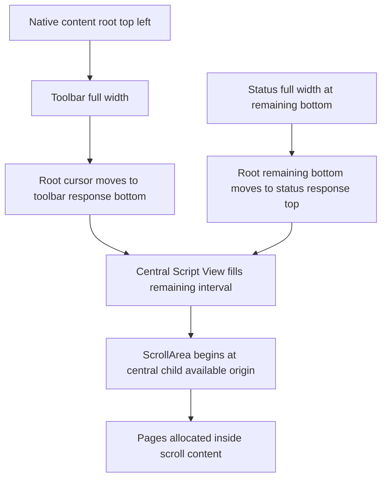

# Window-region allocation and anchoring

- **Status:** Source analysis for user review; no layout change authorized by this note
- **Date:** 2026-11-06
- **Related investigation:** [`toolbar-script-view-gap-investigation.md`](toolbar-script-view-gap-investigation.md)
- **Standalone continuation:** [`toolbar-script-view-gap-continuation.md`](toolbar-script-view-gap-continuation.md)
- **Validation owner:** User; no agent-run builds, checks, tests, lint, formatting checks, manual verification, reviews, or independent validators

## 1. Current composition order

The ordinary application UI is composed in [`show_application_panels()`](../../../apps/scriptcraft/src/main.rs:1052) in this order:

1. Top toolbar panel.
2. Bottom status panel.
3. Central Script View panel.

Panel order matters. The top and bottom panels reduce the parent UI's remaining vertical interval before the central panel consumes it.

The native macOS title bar is outside this egui content layout. Coordinates below are egui logical points within the native content UI, not physical screenshot pixels.

## 2. Anchoring by region

| Region | Horizontal anchor | Vertical anchor | Current height input | What actually positions the next region |
|---|---|---|---|---|
| Toolbar | Root left, full available width | Root top | [`Panel::exact_size()`](../../../apps/scriptcraft/src/main.rs:1074) from [`toolbar_content_height()`](../../../apps/scriptcraft/src/toolbar.rs:1012) | Returned [`toolbar.response.rect.max.y`](../../../apps/scriptcraft/src/main.rs:1077), through egui's parent cursor update |
| Status | Remaining region left, full width | Remaining region bottom | [`Panel::default_size()`](../../../apps/scriptcraft/src/main.rs:1126) from [`default_panel_height()`](../../../apps/scriptcraft/src/status_bar.rs:112) | Returned status response top, through egui's parent cursor update |
| Script View central panel | Remaining region left/right | Between the two panel responses | Remaining available height | Central child available rectangle and frame margins |
| Script View scroll area | Central child left, minus allocated vertical scrollbar width where applicable | Central child available top | Remaining central child height | Actual scroll inner rectangle and offset |
| Screenplay page | Centered by explicit horizontal geometry, not left-anchored | Scroll content top plus top margin, then page stride | Fixed page geometry times presentation scale | Actual allocated page rectangle inside the scroll child |

The toolbar and central region are therefore top-left anchored within their available rectangles. The status panel is bottom-left anchored. The screenplay page itself is not left-anchored; it is centered horizontally within the scroll viewport by [`page_scroll_geometry()`](../../../apps/scriptcraft/src/script_view.rs:1074).

## 3. Toolbar details

[`Panel::top()`](../../../apps/scriptcraft/src/main.rs:1071) starts from the root available rectangle. Egui's top-side sizing keeps the top fixed and sets the bottom to top plus height. After showing the panel, egui sets the parent cursor's minimum Y to the returned response rectangle's bottom.

The configured height is exact, but the parent does not independently recompute it from the constant. It consumes the response returned by the panel/frame/content composition.

The toolbar's current explicit composition is:

- Top padding from [`TOOLBAR_TOP_PADDING`](../../../apps/scriptcraft/src/toolbar.rs:14).
- Item group height from [`toolbar_item_group_height()`](../../../apps/scriptcraft/src/toolbar.rs:1008).
- Explicit trailing padding from [`TOOLBAR_BOTTOM_PADDING`](../../../apps/scriptcraft/src/toolbar.rs:18), currently retained as a toolbar-owned component.
- Top and trailing padding surround the shared Item group; implicit vertical item spacing is suppressed between those components and in the closed Elements control/caption allocation. Popup role rows restore normal vertical spacing.

This exact-size/response distinction is why implicit content expansion was able to affect the next region despite the hard-coded panel height.

The current exact size also prevents normal panel drag resizing from providing a useful dynamic-height model. A future user-draggable toolbar needs either an app-owned height value or a deliberate egui size range/state policy, followed by recomputation of Script View's remaining region.

## 4. Status details

[`Panel::bottom()`](../../../apps/scriptcraft/src/main.rs:1124) keeps the remaining region's bottom fixed and positions its top at bottom minus height. Egui then moves the parent cursor's maximum Y to the returned response top.

The ordinary default height is derived from [`STATUS_ROW_HEIGHT`](../../../apps/scriptcraft/src/status_bar.rs:24) plus both [`PANEL_VERTICAL_INSET`](../../../apps/scriptcraft/src/status_bar.rs:30) values. This is not an exact height:

- [`Panel::default_size()`](../../../apps/scriptcraft/src/main.rs:1126) establishes a default, not a fixed point size range.
- The enabled Diagnostics development disclosure may expand content.
- Egui panels are resizable by default unless configured otherwise, with panel state keyed by the panel ID.

Thus the status bar has a static application default, but its actual returned extent need not always equal that default. Script View's bottom is based on the returned response, just as its top is based on the toolbar response.

The status top divider is painted separately from layout through [`paint_panel_top_border()`](../../../apps/scriptcraft/src/status_bar.rs:96), using the actual outer response rectangle. It does not itself allocate additional height.

## 5. Central Script View and scroll details

[`CentralPanel::default()`](../../../apps/scriptcraft/src/main.rs:1182) uses the remaining available rectangle after the two side panels. Its custom [`central_panel_frame()`](../../../apps/scriptcraft/src/script_view.rs:1476) has no margin, so the central child should begin at that remaining rectangle's origin.

Inside [`live_document_surface()`](../../../apps/scriptcraft/src/script_view.rs:358):

1. [`scroll_outer_rect`](../../../apps/scriptcraft/src/script_view.rs:378) is the central child's available rectangle.
2. [`ScrollArea::both()`](../../../apps/scriptcraft/src/script_view.rs:412) constructs the scrolling viewport. In egui, the scroll inner rectangle begins at the available outer rectangle's origin; allocated scrollbar extent affects cross-axis size rather than adding a top margin.
3. Explicit [`content_margin()`](../../../apps/scriptcraft/src/script_view.rs:414) applies independent top and bottom values. Top is currently zero.
4. Every page row is allocated in the scroll child. Each page has an explicit page rectangle, followed by [`PAGE_VERTICAL_GAP`](../../../apps/scriptcraft/src/script_view.rs:462) and the layout's vertical item-spacing contribution.
5. [`scroll_output.inner_rect`](../../../apps/scriptcraft/src/script_view.rs:619) and the parent clip determine published editor geometry and the interactive surface.

The Script View constants influence content and extent, but the viewport's top-left anchor originates in the central child available rectangle. If that origin is lower than the visible toolbar bottom, the cause is upstream in response/cursor geometry or frame composition rather than horizontal page painting.

## 6. Desired mathematical model versus current model

The desired model is:

- Toolbar rectangle: root top-left, full root width, explicit toolbar height.
- Status rectangle: root bottom-left, full root width, explicit status height.
- Script rectangle: root left/right, from toolbar bottom to status top.

Conceptually, Script View height equals root content height minus toolbar height minus status height.

The current egui panel model approximates this, but uses **actual returned response extents** rather than enforcing the mathematical rectangles directly. Consequences:

1. A hard-coded exact toolbar size is not sufficient if returned content extends beyond it.
2. A default status size is not a strict invariant.
3. Paint clipping and response geometry can disagree, producing an unpainted band even when the central and page origins are contiguous with the response bottom.
4. Implicit item spacing must be audited at every outer frame/scope, not only inside toolbar Items.

## 7. Remaining audit points for the small residual gap

1. The nested Elements cursor-spacing overflow has a source-level correction submitted in [`WO-012`](../2026-11-06-toolbar-script-view-gap/work-orders/WO-012-elements-spacing-overflow.md); user runtime review remains pending.
2. If a residual remains, compare configured toolbar height, actual response height, Elements desired/actual group extent, and the visible frame/paint extent; the earlier stable trace did not capture these as separate values.
3. Inspect the panel/frame scope outside [`toolbar()`](../../../apps/scriptcraft/src/toolbar.rs:840) only if new evidence identifies it as the first discrepant boundary.
4. Check status response height separately if the lower Script View boundary shows a similar discrepancy; status is default-sized, not exact-sized.
5. Keep scroll-origin and page-origin deltas separate from paint boundaries. A zero allocation delta does not prove that the toolbar's visible background reaches the response bottom.

## 8. Optional explicit-region architecture

If response-driven panel behavior continues to produce boundary discrepancies, an alternative is to compute three explicit rectangles from the root available rectangle and two app-owned heights, then render each region inside its own clipped child UI.

That model would:

- Make top-left/bottom-left anchoring explicit.
- Make Script View height exactly the remaining interval by construction.
- Avoid using an overflowing child response to reposition another region.
- Provide a natural future path for user-draggable toolbar/status heights through app-owned ephemeral values and bounded drag handling.

This would be a larger architectural correction than suppressing another spacing value. It would need to preserve panel paint order, clipping, interaction, popup layering, native window behavior, page publication, and any intentionally retained egui panel-state behavior. It should not be undertaken merely as another speculative offset.

## 9. Future dynamic-height direction

For predictable user resizing, prefer one explicit height owner per region:

- Toolbar height and status height remain transient desktop presentation state unless persistence is separately approved.
- Pointer drag changes the relevant height within usable bounds.
- Script View is recomputed from the remaining root interval on every affected frame.
- Content clipping and interaction use the same region rectangles as background paint.
- Existing default settings supply initial values; they do not compete with a second hidden response-size owner.

That model aligns directly with the requested toolbar/view/status anchoring behavior and avoids compensating for implicit framework layout after the fact.
