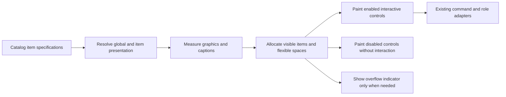

# Toolbar Item Model and Temporary Composition v1

- **Status:** WO-001, WO-002, and WO-003 implementations submitted; none user-validated or accepted
- **Created:** 2026-11-05
- **Validation owner:** User; no agent-run builds, checks, tests, lint, formatting checks, manual verification, reviews, or independent validators
- **Execution:** Three sequential work orders on one manifest-conforming initiative branch, with a fresh coding agent for each order
- **Branch evidence:** `dev/2026-11-05-toolbar-item-model` was created from the observed `master` checkout after preserving its pre-existing tracked and untracked work.

## Outcome

Make toolbar entries declarative, render the complete Toolbar Temporary composition with the assigned Material icons, and let the Elements dropdown extend to its complete role list at ordinary usable window heights.

A single desktop-owned catalog module will describe each item's identity, text, graphic, behavior, enablement, and width policy. The toolbar renderer will consume those definitions rather than rebuilding icon and label decisions in separate branches. Toolbar-wide presentation defaults will provide common enabled/disabled colors, disabled-opacity fallback, icon point size, and related graphic spacing; optional item- and icon-level overrides will take precedence.

Show/Hide and Export Text will be visible but disabled: subdued icons and captions, no hover fill, no pointer or keyboard activation, and no popup or export behavior. This initiative does not invent Show/Hide menu contents or add a desktop plain-text export route.

## Current findings

1. [`ToolbarItem`](../../apps/scriptcraft/src/toolbar.rs:43) currently contains one label, one icon string, a kind, and a width override. [`toolbar_action_button()`](../../apps/scriptcraft/src/toolbar.rs:341) and [`elements_toolbar_item()`](../../apps/scriptcraft/src/toolbar.rs:406) own separate presentation decisions.
2. [`default_toolbar_items()`](../../apps/scriptcraft/src/toolbar.rs:127) currently contains eight entries. It omits the reference's leading and trailing Flexible Spaces, Show/Hide, Export Text, and Material overflow indicator.
3. The current action glyphs are ordinary Unicode strings rather than typed Material icons. The icon foundation and outlined/fill conventions are already established in [`apps/scriptcraft/Cargo.toml`](../../apps/scriptcraft/Cargo.toml:8) and [`icon_assignement.md`](../../.reference/icon_assignement.md:1).
4. [`SUPPORTED_SCREENPLAY_ROLES`](../../apps/scriptcraft/src/toolbar.rs:100) contains 17 roles. Both the central [`ComboBox`](../../apps/scriptcraft/src/toolbar.rs:423) and the overflow submenu at [`toolbar_overflow_menu()`](../../apps/scriptcraft/src/toolbar.rs:483) need the same full-list vertical policy.
5. Plain-text generation exists in [`export_text_with_layout_inputs()`](../../crates/scriptcraft-core/src/exports.rs:52), but no desktop command route was found. The user-directed disabled presentation avoids expanding that behavior here.
6. The historical desktop-container blueprint is absent. Durable implementation updates will use the existing [`screenplay-writing-loop.md`](../../.forge/requirements/features/screenplay-writing-loop.md:515) and [`technical-context.md`](../../.forge/blueprints/technical-context.md:20), without recreating an unrelated blueprint file.

## Resolved design decisions

- **Catalog location:** create [`toolbar_items.rs`](../../apps/scriptcraft/src/toolbar_items.rs) as the single source for toolbar item specifications and ordered compositions. Keep allocation, painting, popup behavior, and application dispatch in [`toolbar.rs`](../../apps/scriptcraft/src/toolbar.rs).
- **Item separation:** graphics describe what is painted; behavior describes what activation does; enablement describes whether interaction is available. None of these is inferred from an icon.
- **Graphic variants:** support no graphic, one icon, multiple icons, an icon with a separate disclosure icon, and a text dropdown. Each icon specification can override its own point size and enabled/disabled colors.
- **Text:** every item has a stable label/accessibility name. Caption visibility is explicit, allowing ordinary captions and the icon-only overflow control to share the same item model.
- **Defaults:** toolbar-wide settings live in one presentation surface in [`toolbar.rs`](../../apps/scriptcraft/src/toolbar.rs). Theme-derived enabled color remains the default; disabled color defaults to reduced alpha of the resolved enabled color unless explicitly overridden. Sizes are logical points.
- **Material variants:** use outlined icons for the temporary toolbar. The existing Regular-weight implementation exception remains unchanged.
- **Elements:** retain its unique selected-role text dropdown and native disclosure presentation. Role semantics remain in the existing transactional session path.
- **Overflow:** define the indicator in the catalog but show it only when allocation produces overflow entries. It is not a permanent extra command at wide widths.
- **Transient state:** item order, enablement, graphic settings, overflow state, and popup geometry remain desktop-only and are not persisted in FDX or the screenplay core.

## Rendering flow

## Work-order plan

| ID | Single outcome | Depends on |
|---|---|---|
| [`WO-001`](work-orders/WO-001-declarative-toolbar-items-and-presentation.md) | Introduce the item catalog, graphic variants, shared presentation defaults, per-icon overrides, and generic measurement/painting while retaining the current composition and behavior | None |
| [`WO-002`](work-orders/WO-002-complete-temporary-toolbar-composition.md) | Render the complete temporary composition and assigned icons, including subdued inert Show/Hide and Export Text items and the conditional Material overflow indicator | WO-001 |
| [`WO-003`](work-orders/WO-003-elements-full-height-dropdown.md) | Make central and overflow Elements role lists use their full measured content height within safe viewport bounds | WO-002 |

Each order owns its scoped source edits, durable-document reconciliation, and implementation handoff. A later order must not begin until the preceding implementation handoff exists. Handoff does not imply user validation or acceptance.

## Implementation authorization — 2026-11-05

The user directly commissioned individual coding agents to complete all three work orders. Execute them sequentially on the proposed shared initiative branch, with a fresh coding agent for each and an implementation handoff before the next dispatch. Verify the checkout and preserve all pre-existing user work before branch creation. This authorization does not permit agent-run validation or independent review agents and does not claim that any order is complete.

## Non-goals

- No drag-and-drop customization, saved arrangements, profiles, user-defined items, or persisted toolbar state.
- No implementation of items from the future Toolbar WIP table beyond the reusable graphic capabilities needed by the temporary composition.
- No Show/Hide behavior, new plain-text desktop export behavior, new save dialogs, or new export semantics.
- No screenplay-core, FDX, pagination, editor, status-bar, global Appearance, or document-font changes.
- No new automated desktop-test target. Any future coverage request requires separate user authorization and reconciliation with the consolidated acceptance-suite policy.
- No agent-run validation or independent review agents.

## Durable records to update during implementation

- [`REQ-WRITING-LOOP-005`](../../.forge/requirements/features/screenplay-writing-loop.md:520): final composition, declarative presentation, disabled-item interaction contract, graphic-aware measurement, Material overflow presentation, and complete Elements list behavior.
- [`technical-context.md`](../../.forge/blueprints/technical-context.md:20): desktop catalog ownership, global/default versus per-icon resolution, behavior separation, transient allocation, disabled rendering, and popup-height policy.
- [`icon_assignement.md`](../../.reference/icon_assignement.md:12): record only the implemented temporary assignments and disabled states; preserve future WIP assignments and the Regular-weight exception.
- [`project-manifest.md`](../../.forge/project-manifest.md:73): update only if implementation creates a durable initiative status or dependency fact that belongs there; do not claim checks or validation.
- The initiative record and each work order receive exact implementation handoffs and unresolved evidence. No user validation is inferred.

## User review boundary

Final review should cover all enabled commands, current-role display and transactional role changes, all 17 role choices, popup height and dismissal, narrow-width overflow and its nested Elements menu, disabled-item pointer and keyboard inertness, subdued colors in every Appearance, per-icon size/color adjustment points, wide and narrow fitting, and unchanged document semantics.

At planning time, no branch creation, source change, build, test, lint, formatting command, native observation, review, validation, or acceptance was claimed. The implementation handoff below records the later WO-001 source and branch evidence without implying validation or acceptance.

## WO-001 implementation handoff — 2026-11-05

WO-001 implementation has been submitted for user review. It is not user-
validated, accepted, or marked complete. WO-002 and WO-003 remain unstarted;
orchestration must wait for the user's next instruction.

- **Checkout/branch:** The initial status observed `master`, with pre-existing
  modifications in `.reference/icon_assignement.md` and
  `apps/scriptcraft/src/toolbar.rs`, and the untracked initiative plan/work-order
  directory. No initiative branch existed. The new
  `dev/2026-11-05-toolbar-item-model` branch was created from `master` and
  switched to. A subsequent status showed those same pre-existing paths on the
  initiative branch; none were staged, committed, merged, or discarded. WO-001
  preserved the existing toolbar padding edits and did not modify the reference
  icon assignment file.
- **Implementation:** Added the desktop declarative toolbar catalog and
  registered it from `main.rs`; updated `toolbar.rs` to resolve and paint
  declarative graphics and captions, apply toolbar-local enabled/disabled color
  defaults and per-item/per-icon overrides, measure icon groups and visible
  captions, and retain the existing allocator and adapters. The only composition
  rendered remains New, Open, Save, Save As, Flexible Space, Elements, Flexible
  Space, Export PDF. The five current actions use their assigned typed outlined
  Material icons; overflow remains the literal `>>` text menu. Action dispatch,
  hover/click geometry, cursor, labels, Elements role selection and transaction
  path remain routed through the existing desktop implementation.
- **Agent-default presentation:** Default Material icon point size is **14.0
  logical points**, matching the current default Body glyph-size baseline.
  Default graphic gap is **4.0 logical points**, and disabled fallback alpha is
  multiplied by **0.45**. Explicit toolbar enabled/disabled foreground overrides
  are unset; enabled foreground follows active Appearance text and disabled
  foreground reduces the resolved enabled color's alpha unless an explicit
  disabled color override applies. These controls are isolated from status-bar
  presentation.
- **Authorized durable records:** AC-WRITING-005.3 and AC-WRITING-005.5 were
  updated for declarative graphic/caption presentation and graphic-aware
  measurement. `technical-context.md` now records desktop catalog ownership,
  override precedence, logical-point units, transient state, and the
  intermediate composition. The icon assignment reference was not changed by
  WO-001.
- **Evidence limitation:** No build, check, test, lint, formatting command,
  manual verification, review, or independent validator was run. No automated
  desktop-test target or test coverage was added. Compilation, rendered icon
  appearance, interaction, layout, colors, and Elements preservation remain
  unverified and user-owned for review/validation.

## WO-002 implementation handoff — 2026-11-05

WO-002 implementation is submitted for user review and validation. Neither
WO-001 nor WO-002 is marked complete, accepted, or validated; WO-003 has not
started.

- **Checkout/branch:** The current branch remains
  `dev/2026-11-05-toolbar-item-model`, as observed with `git status --short
  --branch`. Existing work was preserved; nothing was staged, committed, merged,
  discarded, or switched.
- **Implementation:** Expanded the catalog to the exact 12-item temporary
  sequence—leading Flexible Space; New; Open; Save; Save As; pre-Elements
  Flexible Space; Elements; post-Elements Flexible Space; Show/Hide; Export
  Text; Export PDF; trailing Flexible Space—plus a catalog-only conditional
  overflow indicator. The four Flexible Spaces have unique IDs, equally share
  remaining width when ordinary items fit, and are omitted from narrow overflow.
  Allocation keeps the existing leftmost-fit policy and adds the overflow
  control only when non-spacing entries overflow. Show/Hide paints outlined
  Visibility plus independently specified outlined Keyboard Arrow Down;
  Export Text paints the typed outlined `ICON_DRIVE_EXPORT` glyph assigned to
  File Export. Both resolve disabled color for all graphics and captions, have
  disabled accessibility metadata and no focus/activation/popup/command route,
  and remain disabled-color plain labels in overflow. No Show/Hide action or
  desktop plain-text export route was added. The icon-only overflow trigger is
  outlined `ICON_DOUBLE_ARROW`, named “Toolbar overflow,” and retains the
  toolbar cursor/hover treatment and two-point corner radius. Enabled command
  and Elements routing were kept on the existing adapters.
- **Material assignment caveat:** `egui_material_icons` 0.6.0 exposes the typed
  `ICON_DRIVE_EXPORT` and singular `ICON_DOUBLE_ARROW` names; it does not expose
  constants named `ICON_FILE_EXPORT` or `ICON_DOUBLE_ARROWS`. The former is used
  for the requested File Export glyph, so its rendered appearance remains a
  user review item.
- **Authorized documentation:** Revised AC-WRITING-005.1, AC-WRITING-005.3, and
  AC-WRITING-005.5; updated the toolbar catalog paragraph in `technical-context.md`;
  and annotated the implemented temporary assignments in `icon_assignement.md`
  without changing the future WIP table. WO-001's implementation handoff and
  its evidence limitations remain intact.
- **Evidence limitations:** No build, check, test, lint, formatting command,
  manual verification, review, or validator was run. Compilation, icon
  appearance, disabled interaction/accessibility, all Appearance choices,
  width allocation and clipping, overflow behavior, and preservation of enabled
  commands/Elements remain unverified and user-owned. No test target or coverage
  was added. No WO-003 work was performed.

## WO-003 implementation handoff — 2026-11-05

WO-003 implementation is submitted for user review and validation; no work order
is marked complete, accepted, or validated, and no subsequent order was started.

- **Checkout/branch:** Read-only status observed the existing
  `dev/2026-11-05-toolbar-item-model` branch. Prior work remains preserved; no
  staging, commit, merge, branch switch, or discard occurred.
- **egui height diagnosis:** In egui 0.34.3, stock `ComboBox` defaults its
  maximum inner menu ScrollArea height to `Spacing::combo_height`, whose default
  is 200 logical points. That default scroll cap, not the closed Elements
  control's 128-point width, limits the 17-row central popup. The overflow
  Elements `MenuButton` had no bounded inner role-list ScrollArea or matching
  content-height policy.
- **Implementation:** `toolbar.rs` now derives the role-list scroll extent from
  all supported labels' active Button font metrics, row interaction/padding
  metrics, and inter-row spacing. It caps the desired inner extent using
  `Context::content_rect()` less the active popup frame's total vertical margin.
  The central ComboBox's explicit height and the overflow submenu's vertical
  ScrollArea use the shared result. Full measured content is requested when it
  fits; shorter viewports cap and scroll rather than extending off-screen. Role
  ordering, current-role synchronization, selection transaction, popup anchors,
  close/input paths, toolbar allocation, and document layout were not
  intentionally changed.
- **Authorized durable records:** AC-WRITING-005.4 now includes full measured
  list visibility at ordinary usable viewport heights, viewport-only bounds,
  constrained-height reachability, and central/overflow parity.
  `technical-context.md` documents the shared measured-height and viewport/frame
  cap. No other requirement or blueprint was changed for WO-003.
- **Evidence limitations:** No build, check, test, lint, formatting command,
  manual verification, review, or validator was run. The diagnosis uses the
  locally installed egui 0.34.3 source. Compilation and all runtime sizing,
  anchoring, scrolling, keyboard, dismissal, role transaction, and unchanged
  toolbar/document geometry behavior remain unverified and user-owned. No test
  target or coverage was added.

## Toolbar presentation follow-up — 2026-11-05

The user requested a toolbar-wide outlined icon default and a named item text
font-size setting. The follow-up adds `DEFAULT_MATERIAL_ICON_VARIANT` defaulting
to Outlined with optional per-icon Filled/Outlined overrides, and
`DEFAULT_ITEM_TEXT_POINT_SIZE` at 14.0 logical points for toolbar captions,
menu/dropdown text, and their measurement. The technical-context blueprint and
WO-001 implementation handoff were reconciled. The current source retains
`DEFAULT_MATERIAL_ICON_POINT_SIZE` at 18.0 logical points; this follow-up did not
change that value. No validation or manual review was run for this follow-up;
user review remains pending.
