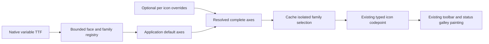

# Toolbar Item Model v2 — Native Material font integration

- **Status:** Implementation plan; no font integration authorized or implemented
- **Date:** 2026-11-05
- **Parent plan:** [`toolbar-item-model-v1.md`](toolbar-item-model-v1.md)
- **Research method:** Inspection of current desktop source, the official Material Symbols repository, and published egui/epaint 0.34.3 source
- **Validation owner:** User; no project build, check, test, lint, formatting command, visual comparison, or manual app verification was run

## Outcome

Use the native Material Symbols Rounded variable TTF for matching outlined and filled icons, make weight 200 the application default, and let desktop developers adjust supported font axes globally and per toolbar icon with minimal changes to the existing renderers.

Keep [`egui_material_icons`](apps/scriptcraft/Cargo.toml:10) for its typed icon constants, codepoints, and filled/outlined selection. Replace only its embedded-font initialization with app-owned native font registration. Do not fork the crate, duplicate its icon catalog, or rewrite toolbar/status item behavior.

The intended control surface is developer-facing, not a new user preference: named defaults plus optional per-icon overrides in [`toolbar_items.rs`](apps/scriptcraft/src/toolbar_items.rs:32), with a compatible default for the status icons in [`status_bar.rs`](apps/scriptcraft/src/status_bar.rs:643). No axis value enters screenplay content, FDX, or another persisted document setting.

## Current integration boundary

1. [`document_font::install()`](apps/scriptcraft/src/document_font.rs:55) installs the bundled Courier Prime definitions, after which [`egui_material_icons::initialize()`](apps/scriptcraft/src/main.rs:2828) registers the crate's embedded Regular fonts. The two steps must remain ordered, but the second step can be replaced without changing the first.
2. Toolbar icons retain identity and variant in [`IconSpec`](apps/scriptcraft/src/toolbar_items.rs:32). Current overrides cover filled/outlined selection, point size, and enabled/disabled colors, but not weight or the other variable axes.
3. Existing painting calls the crate's [`MaterialIcon.rich_text()`](apps/scriptcraft/src/toolbar.rs:395), including the overflow trigger at [`toolbar_overflow_menu()`](apps/scriptcraft/src/toolbar.rs:641) and the shared status control at [`status_icon_control()`](apps/scriptcraft/src/status_bar.rs:643). Only a small adapter boundary is needed; allocation, interaction, accessibility, and command routing can remain unchanged.
4. The checkout resolves egui/epaint 0.34.3 in [`Cargo.lock`](Cargo.lock:885). The desktop already embeds static font bytes through [`FontData::from_static()`](apps/scriptcraft/src/document_font.rs:48), so native TTF registration is an established local pattern.
5. The only repository-owned typeface assets are currently under [`fonts/CourierPrime/`](fonts/CourierPrime/). There is no app-owned Material font or license/source record yet.

## Native font findings

### The upstream variable TTF is sufficient

The official Material Design Icons repository publishes a Rounded variable TTF with these axes:

| Axis | Published range | Proposed default | Per-icon direction |
|---|---:|---:|---|
| [`wght`](apps/scriptcraft/src/material_font.rs:1) | 100–700 | **200** | Allow every standard 100-step weight |
| [`FILL`](apps/scriptcraft/src/material_font.rs:1) | 0–1 | 0 outlined / 1 filled | Preserve the existing variant selection |
| [`opsz`](apps/scriptcraft/src/material_font.rs:1) | 20–48 | **24**, agent-default pending visual review | Allow finite developer-defined overrides |
| [`GRAD`](apps/scriptcraft/src/material_font.rs:1) | -50–200 | **0**, agent-default pending visual review | Allow finite developer-defined overrides |

The same upstream file can therefore supply both variants; separate filled and outlined source files are unnecessary. Use TTF rather than the Google Fonts CSS response's WOFF2. No operating-system font installation, font lookup, network fetch at application runtime, CSS engine, or offline static-instance generation is required for the proposed path.

The upstream repository uses Apache License 2.0. Implementation must carry the license and relevant notices, identify the exact pinned upstream commit and source URLs, and record any content modifications. Merely normalizing the local asset filename does not require pretending the font itself was modified.

### egui 0.34 exposes native variation controls

The locked epaint stack accepts TTF/OTF data and supports default variation coordinates on each registered face. It also exposes per-text coordinates through the rich-text API. This gives two useful integration levels:

- Registering default coordinates on a face supplies the weight-200 baseline without changing any painting call.
- A small adapter can select a registered face and return the existing typed icon's codepoint with the corresponding family, preserving current galley construction and paint behavior.

Do not assume that a variable font loaded with default coordinates will automatically select optical size from the requested point size. Pin optical size explicitly, initially to 24. Grade also remains explicit, initially zero.

### Replace initialization rather than competing with it

The app should stop calling the crate initializer and call an app-owned installer in the same place. Egui's additive font API preserves existing definitions; replacing the complete definitions again would risk discarding earlier registrations.

For the default weight, use the crate's existing family names, `material-icons` and `material-icons-outlined`, so its existing rich-text method continues to resolve. Other weights and custom axis combinations receive app-owned family names. The default outlined and filled faces should also retain the crate's low-priority proportional fallback and 0.05 vertical-offset behavior; nondefault faces need only their explicit named families.

This avoids two initializers competing for the same family, avoids duplicate highest-priority entries, and avoids initializing embedded Regular fonts that the product no longer intends to use.

### Isolate mixed weights by face and family

Per-text variation coordinates are attractive, but the examined epaint 0.34.3 glyph-allocation cache key does not include the resolved variation location. A single shared face used with different weights can therefore reuse a glyph allocated for another weight. Source inspection alone does not establish the exact visual failure, and the user must validate it if direct per-text variation is ever prototyped.

The recommended implementation avoids that uncertainty: each supported style/weight combination gets its own registered font face and named family, with fixed coordinates on that face. Glyph caches then remain face-local. This is required for reliable side-by-side weights, not merely for future runtime changes.

The same static TTF byte slice can back every face; do not add one font file per weight. Registration does duplicate face parsing and permits more atlas entries, so keep the registry bounded and record no memory or startup-performance claim without user measurement.

## Recommended architecture

Add [`material_font.rs`](apps/scriptcraft/src/material_font.rs) beside [`document_font.rs`](apps/scriptcraft/src/document_font.rs). Give it four narrow responsibilities:

1. Embed the native Rounded TTF and install bounded face registrations.
2. Define typed axis values and overrides, including the standard weights and validated optical-size/grade values.
3. Map each supported complete axis combination to a unique data key and family.
4. Return rich text for an existing typed Material icon by preserving its codepoint and filled/outlined selection while selecting the matching app-owned family.

Use a small typed model along these lines, with exact names left to implementation style rather than treated as a required public API:

- A complete [`IconFontAxes`](apps/scriptcraft/src/material_font.rs:1) value contains weight, optical size, and grade. Filled/outlined remains the existing icon variant rather than being duplicated in this value.
- An [`IconFontAxesOverride`](apps/scriptcraft/src/material_font.rs:1) contains optional fields and resolves against application defaults.
- An [`IconWeight`](apps/scriptcraft/src/material_font.rs:1) enumeration covers 100 through 700 in 100 steps. Optical size and grade use validated finite values rather than accepting NaN, infinity, or out-of-range input.
- A bounded [`ICON_FONT_FACES`](apps/scriptcraft/src/material_font.rs:1) registry covers all standard weights at the default optical size and grade, plus any explicitly used custom optical-size/grade combinations. The default faces use the crate's family names; other entries use deterministic ScriptCraft-owned names.

Add an optional axis-override field to [`IconSpec`](apps/scriptcraft/src/toolbar_items.rs:32), defaulting to no override. Existing item construction continues unchanged. Toolbar presentation resolves application defaults first, then the per-icon field. The shared adapter replaces the crate rich-text call in ordinary toolbar painting, overflow, and status painting without changing their geometry or interaction code.

The default application axes are weight 200, optical size 24, and grade zero. A toolbar-local default weight may override weight 200 later, but the initial implementation should use the shared default everywhere to avoid an unexplained visual difference between toolbar and status icons.

### Rendering flow

### Why keep the icon crate

The crate remains useful as the source of typed icon constants and style selection. Bypassing only its initializer is smaller and less risky than recreating those constants or converting every icon to strings/SVGs. If a future crate release changes codepoints, the native upstream source and the crate's constants still need a compatibility review; keeping them visible in one adapter makes that boundary explicit.

### Fallback if the variable TTF fails at runtime

If the user's first runtime check shows that the locked stack cannot parse or render the upstream variable TTF correctly, generate static TTF instances offline for the required filled/outlined and axis combinations. Keep the same face registry and adapter, replacing only the backing assets. Do not respond with a broader renderer rewrite or an unverified WOFF2 dependency. Any generated instance needs its transformation command, source commit, and modified-file notice recorded.

## Work-order plan

Execute sequentially on one manifest-conforming initiative branch after recording the checkout and preserving all current toolbar/status work. A suitable new branch name is `dev/2026-11-05-material-icon-fonts`; continuing on the existing toolbar branch is a separate user decision, not an assumption. Each order owns its scoped source edits and durable-document handoff. No order is complete, accepted, or validated until the user says so.

### WO-001 — Native weight-200 outlined and filled baseline

**Single outcome:** Render the existing typed icons from the native Rounded variable TTF at weight 200 without changing catalog definitions or painting logic.

Implementation steps:

1. Add the pinned upstream TTF, its Apache license and applicable notices, and a source record under [`fonts/MaterialSymbols/`](fonts/MaterialSymbols/). Record the upstream commit, source URL, local checksum, axes, and the fact that the font content was not locally modified.
2. Add [`material_font.rs`](apps/scriptcraft/src/material_font.rs) with default outlined and filled registrations at weight 200, optical size 24, and grade zero. Preserve the existing family names, proportional fallback, and 0.05 vertical offset.
3. Replace only the crate initializer at [`main()`](apps/scriptcraft/src/main.rs:2823) with the app-owned installer. Leave [`document_font::install()`](apps/scriptcraft/src/document_font.rs:55) first and leave every toolbar/status call site unchanged.
4. Reconcile the weight-200 requirement and registration boundary in [`screenplay-writing-loop.md`](.forge/requirements/features/screenplay-writing-loop.md:534), [`technical-context.md`](.forge/blueprints/technical-context.md:61), and [`icon_assignement.md`](.reference/icon_assignement.md:3). Update [`project-manifest.md`](.forge/project-manifest.md:40) only with durable dependency/implementation status, not with validation claims.
5. Record the exact source and asset changes plus all unverified behavior in this plan's WO-001 handoff.

User review gate:

- Compile and launch the app, then compare every currently used icon for identity, weight, baseline, clipping, and visual consistency at the existing toolbar/status sizes.
- Confirm outlined toolbar icons and the filled Appearance icon use the new native assets, while ordinary labels and screenplay text retain their prior typography.
- Inspect wide/narrow toolbar layouts, overflow, disabled items, all Appearance choices, and representative display scales. Confirm commands, role selection, status actions, and document layout are unchanged.

### WO-002 — Typed axis controls and cache-safe per-icon overrides

**Single outcome:** Let developers select weight and other supported axes through named defaults and optional per-icon overrides without allowing glyph data to leak between weights.

Implementation steps:

1. Expand [`material_font.rs`](apps/scriptcraft/src/material_font.rs) with the typed complete/override models and bounded face registry described above. Cover all seven standard weights at default optical size and grade; register only explicitly used custom optical-size/grade combinations.
2. Add the shared rich-text adapter that preserves typed icon identity and variant while selecting the resolved family. Use it in [`paint_toolbar_icon()`](apps/scriptcraft/src/toolbar.rs:388), [`toolbar_overflow_menu()`](apps/scriptcraft/src/toolbar.rs:641), and [`status_icon_control()`](apps/scriptcraft/src/status_bar.rs:643).
3. Add optional per-icon overrides to [`IconSpec`](apps/scriptcraft/src/toolbar_items.rs:32), with no override as the compatibility default. Keep size, color, variant, behavior, enablement, and layout as separate fields.
4. Add named application defaults for weight, optical size, and grade. Keep the initial defaults at 200/24/0 and do not add a runtime user control or persisted preference.
5. Reconcile per-icon precedence, bounded registration, cache isolation, and status defaults in [`screenplay-writing-loop.md`](.forge/requirements/features/screenplay-writing-loop.md:534), [`technical-context.md`](.forge/blueprints/technical-context.md:24), and [`icon_assignement.md`](.reference/icon_assignement.md:3). Record implementation and limitations in this plan's WO-002 handoff.
6. Do not add a new automated desktop-test target under the consolidated acceptance-suite policy. Pure mapping checks may be proposed separately if desired, but are not silently included as authorization for a new test suite.

User review gate:

- Render representative icons at weights 100, 200, 400, and 700 **side by side**, including at least one mixed filled/outlined comparison, and verify that each glyph has the requested design rather than the first-cached weight.
- Exercise optical-size and grade overrides if custom combinations are introduced. Confirm every override has a registered face and that the default remains weight 200/24/0.
- Recheck all WO-001 visuals and interactions, including independently sized disclosure icons, disabled colors, status hover behavior, overflow, and accessible names.
- Review the added asset/startup cost and binary contents without treating registration alone as performance evidence.

## Durable-document reconciliation

The implementation handoffs must update, rather than merely mention, the durable records:

- [`icon_assignement.md`](.reference/icon_assignement.md:3): replace the implementation-only Regular exception with the actual native weight-200 implementation and document supported overrides. Preserve future WIP assignments and any unvalidated appearance caveats.
- [`screenplay-writing-loop.md`](.forge/requirements/features/screenplay-writing-loop.md:534): add the declarative font/weight resolution contract to the toolbar criteria and the corresponding status default to the status criteria. Do not alter command, pagination, persistence, or export requirements.
- [`technical-context.md`](.forge/blueprints/technical-context.md:61): document app-owned native assets, initializer ordering, face/family isolation, override precedence, and the absence of document persistence or core typography changes.
- [`project-manifest.md`](.forge/project-manifest.md:40): record only relevant dependency/asset and initiative-status facts. Never turn dependency resolution or implementation submission into build/runtime evidence.
- [`toolbar-item-model-v2.md`](.plan/2026-11-05-toolbar-item-model/toolbar-item-model-v2.md): append exact implementation handoffs and unresolved evidence without retroactively marking either order user-validated.

## Non-goals and boundaries

- No operating-system font discovery, required system installation, runtime download, CSS/WOFF2 loader, or browser text stack.
- No fork of the icon crate and no new icon-to-codepoint table owned by ScriptCraft.
- No user-facing weight slider, continuous-axis UI, saved visual preference, FDX field, sidecar, or screenplay-core change.
- No changes to Courier Prime, screenplay role typography, pagination, PDF, plain-text export, FDX, semantic editing, or native save behavior.
- No toolbar/status behavior redesign, item reordering, accessibility changes, or new filled assignments beyond the current catalog unless separately authorized.
- No new automated desktop-test target and no agent-run build, check, test, lint, formatting, visual validation, independent review, or validator.
- No claim of pixel parity with the crate's embedded Regular fonts, Final Draft, Material's web renderer, or automatic optical sizing.

## Remaining implementation-time questions

- Does the pinned upstream font contain every currently used crate codepoint with the intended design? Resolve any mismatch explicitly before accepting changed icon identity.
- Do weight 200, optical size 24, and grade zero produce the desired appearance at the existing 17-point status and 18-point toolbar sizes? These are agent defaults until the user reviews them.
- Does the locked stack parse and shape the variable TTF as the source suggests? If not, use the static-instance fallback while retaining the adapter contract.
- Is the bounded seven-weight registry acceptable after the user reviews startup and atlas behavior, or should only currently used weights be registered? Start with all standard weights unless the user reports a concrete cost concern.

## Research references

- [Official Material Design Icons variable-font directory](https://github.com/google/material-design-icons/tree/master/variablefont) — native Rounded TTF and matching codepoint manifest.
- [Official Material Design Icons license](https://raw.githubusercontent.com/google/material-design-icons/master/LICENSE) — Apache License 2.0 and redistribution conditions.
- [`egui_material_icons` 0.6.0 source](https://docs.rs/egui_material_icons/0.6.0/src/egui_material_icons/lib.rs.html) — embedded Regular assets, typed codepoint/style representation, family names, rich-text mapping, vertical offset, and initializer behavior.
- [egui 0.34.3 context source](https://docs.rs/egui/0.34.3/src/egui/context.rs.html#2021-2069) — replacement versus additive font registration and family-priority handling.
- [epaint 0.34.3 font definitions](https://docs.rs/epaint/0.34.3/src/epaint/text/fonts.rs.html#115-206) — native TTF/OTF data and per-face variation coordinates.
- [epaint 0.34.3 text formats](https://docs.rs/epaint/0.34.3/src/epaint/text/text_layout_types.rs.html#302-474) — per-text variation coordinates and hashing.
- [epaint 0.34.3 glyph allocation](https://docs.rs/epaint/0.34.3/src/epaint/text/font.rs.html#143-168) — glyph cache-key fields that omit the variation location, motivating face isolation.
- [egui 0.34.3 rich-text source](https://docs.rs/egui/0.34.3/src/egui/widget_text.rs.html#201-217) — rich-text variation methods.
- [`icon_assignement.md`](../../.reference/icon_assignement.md) — original weight-200 design preference and icon-to-glyph assignments, reconciled by the implementation handoffs below.

## WO-001 implementation handoff — 2026-11-05

- **Checkout:** Work was performed on the observed branch `dev/2026-11-05-toolbar-item-model`. Before implementation, the checkout showed only this approved plan as modified; that pre-existing change was preserved. No branch switch or destructive Git operation was performed.
- **Asset:** Added `fonts/MaterialSymbols/MaterialSymbolsRounded[FILL,GRAD,opsz,wght].ttf`, copied the upstream Apache license, and recorded source commit `10ecc14790612ca8fd164e3f4ffe9c16fc50d5b7`, URL, axes, unmodified status, and SHA-256 in `fonts/MaterialSymbols/README.md`.
- **Registration:** Added `apps/scriptcraft/src/material_font.rs`. It uses the native variable TTF for the existing filled (`material-icons`) and outlined (`material-icons-outlined`) families, with `FILL=1` and `FILL=0` respectively, and common axes `wght=200`, `opsz=24`, `GRAD=0`. Both faces retain the crate's proportional fallback and `y_offset_factor=0.05`. Registration is additive; Courier Prime remains first and existing toolbar/status paint call sites are unchanged.
- **Durable records:** Updated the icon assignment reference, toolbar/status requirements, technical context, and project manifest to describe the bundled native faces and current defaults. The icon crate remains in use for typed identities; no document/core typography or persistence behavior was changed.
- **Not performed / unresolved:** No build, test, lint, formatter, manual launch, visual check, agent review, or validation was run, in accordance with repository policy. Actual shaping of the variable TTF, glyph coverage/design parity, baseline/clipping, icon weight at existing sizes, and the proposed 200/24/0 appearance remain for user review. WO-001 is submitted, not user-validated or accepted.
- **Sequence:** WO-002 was implemented next under the user's explicit approval of both orders; user review of WO-001 remains pending alongside WO-002 review.

## WO-002 implementation handoff — 2026-11-05

- **Typed settings:** `material_font.rs` now owns named defaults and typed axis choices. The weight enum covers 100–700 in standard 100 increments; the initial optical-size and grade choices are 20/24/48 and -50/0/200. Per-icon override fields are optional, so omitted values inherit the shared defaults (200/24/0).
- **Bounded registration:** Startup registers outlined and filled faces for all seven standard weights at the default optical size/grade. `toolbar_items.rs` enumerates explicit non-default optical-size/grade combinations from the toolbar and overflow catalog; only those combinations receive additional faces. Each full axes/fill tuple is registered under its own family, avoiding weight-dependent glyph-cache reuse. No continuous arbitrary-axis or unbounded runtime face creation was added.
- **Rendering integration:** The shared native-font rich-text adapter preserves the typed Material codepoint and outlined/filled identity while selecting the resolved family. Toolbar painting, overflow menu rendering, and status icon controls use this adapter. Toolbar icons resolve per-icon axes over the defaults; status icons use the defaults. Existing point sizes, colors, layout, interaction, accessibility, and document typography were not intentionally changed.
- **Durable records:** Updated the toolbar/status requirement, technical context, icon assignment reference, asset record, and project manifest with the typed overrides, registration boundary, and cache-isolation behavior.
- **Not performed / unresolved:** No build, check, test, lint, formatting, manual launch, visual comparison, agent review, or validation was run, in accordance with repository policy. User review remains necessary for all WO-001 visuals and for mixed-weight comparisons, override correctness, app startup/asset cost, and any axis choices beyond the listed discrete values. WO-002 is submitted, not user-validated or accepted.
- **State:** Both implementation orders have been submitted sequentially on `dev/2026-11-05-toolbar-item-model`. User review and validation remain pending and user-owned.

## Toolbar presentation follow-up — 2026-11-05

- Added an Elements role-option font-size constant independent from the existing toolbar item text-size constant. The closed selected role and option rows in both the central ComboBox and overflow submenu share the role-option size; the Elements caption retains toolbar item sizing. Popup-height calculation measures the same role-option font. The current user-owned values are 11 points for item text and 14 points for role-option text. Role rows also have 12 points of horizontal padding per side in both dropdown paths.
- Replaced symmetric toolbar icon hover padding with a four-edge typed value (left/top/right/bottom), retaining the pre-existing 8/1/8/1 values. The main toolbar hit/hover rectangle now supports asymmetric edges. egui's overflow menu button only accepts symmetric `Vec2` padding, so it receives the average of each opposing pair; status-bar padding remains uniformly 2 points.
- This padding changes hover/click geometry, not glyph placement or baseline; the Material font's vertical tweak is unchanged. Updated the screenplay requirement and technical context accordingly.
- Replaced the central Elements ComboBox's stock painted triangle with the outlined native Material Unfold More glyph through egui's custom icon-painter hook. The framework still owns selection, keyboard, popup, and accessibility behavior; the overflow submenu indicator is unchanged.
- No build, check, test, lint, formatting, manual launch, visual verification, or agent review was run. User review and validation remain pending.
