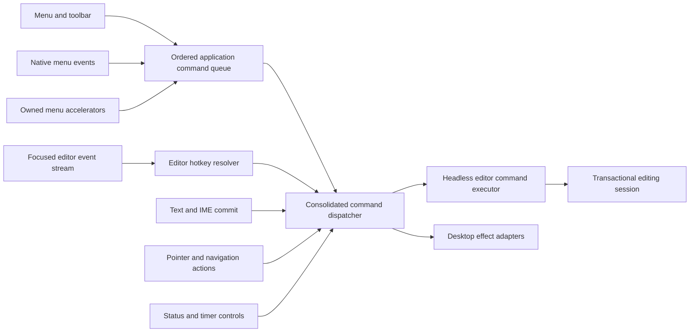

# Hotkeys and consolidated command layer v1

- **Status:** WO-001 through WO-008 implementation submissions recorded; user-owned validation and acceptance pending
- **Date:** 2026-11-06
- **Reference capture:** [Final Draft shortcut reference](final-draft-shortcut-reference.md)
- **Guiding principles:** [Goals.md](../../../.reference/Goals.md)
- **Validation owner:** User. No agent-run build, check, test, lint, formatting, application launch, manual verification, review, or independent validation was performed while preparing this plan.

## Requested outcome

Establish one stable command boundary for every enabled ScriptCraft-owned user action, then build screenplay hotkeys on that boundary. The first user-visible slice routes existing Enter and Tab behavior through commands and adds the platform-specific number shortcuts for all 17 screenplay elements. Subsequent orders in the same initiative finish routing existing document, clipboard, selection, navigation, focus, viewport, status, appearance, timer, and modal actions without adding new product features.

The user explicitly selected full desktop-action consolidation rather than limiting the refactor to the first hotkey slice.

## Pre-initiative source findings (historical baseline)

### Existing command and shortcut seams

- [`app_commands.rs`](../../../apps/scriptcraft/src/app_commands.rs) owns 13 parameterless desktop commands, fresh availability, and dispatch for File, PDF export, Edit history, clipboard, deletion, and Select All.
- [`menu_items.rs`](../../../apps/scriptcraft/src/menu_items.rs) owns the ordered menu catalog and logical shortcut metadata. Only real command rows participate in input recognition; disabled placeholders never dispatch.
- [`menu.rs`](../../../apps/scriptcraft/src/menu.rs:90) resolves in-window menu shortcuts and owns the pending menu FIFO. [`raw_input_hook()`](../../../apps/scriptcraft/src/main.rs:1250) consumes matching in-window accelerators before editor input.
- Native macOS menus own catalog accelerators whenever installed; Windows uses the in-window owner. This arbitration must remain intact. Editor-local hotkeys need a separate path because native macOS does not contain element-number menu items.
- [`key_event()`](../../../apps/scriptcraft/src/script_view.rs:754) directly invokes session operations for Backspace, Delete, Enter, Tab, and navigation. Text, paste, and IME commit also invoke the session directly in [`dispatch_surface_events()`](../../../apps/scriptcraft/src/script_view.rs:680).
- Toolbar role selection bypasses the shared application dispatcher through [`change_role_from_toolbar()`](../../../apps/scriptcraft/src/toolbar.rs:592).
- Pointer selection, status zoom/appearance/timer/focus controls, sprint-timer popup actions, migration-modal decisions, and native window effects still mutate their owners directly.

### Existing semantic operations are sufficient

The headless core already supplies the required behavior:

| Action | Existing authority |
|---|---|
| Typing and IME commit | [`EditingSession::insert()`](../../../crates/scriptcraft-core/src/editing.rs:606) |
| Paste text | [`EditingSession::insert_paste()`](../../../crates/scriptcraft-core/src/editing.rs:625) |
| Forward/backward deletion | [`EditingSession::delete()`](../../../crates/scriptcraft-core/src/editing.rs:631) and [`EditingSession::backspace()`](../../../crates/scriptcraft-core/src/editing.rs:714) |
| Enter | [`EditingSession::enter()`](../../../crates/scriptcraft-core/src/editing.rs:768) |
| Tab | [`EditingSession::tab()`](../../../crates/scriptcraft-core/src/editing.rs:844) |
| Explicit element change | [`EditingSession::change_role()`](../../../crates/scriptcraft-core/src/editing.rs:972) |
| Undo/redo | [`EditingSession::undo()`](../../../crates/scriptcraft-core/src/editing.rs:1013) and [`EditingSession::redo()`](../../../crates/scriptcraft-core/src/editing.rs:1049) |
| Selection | [`EditingSession::set_selection()`](../../../crates/scriptcraft-core/src/editing.rs:576) |
| Role/transition defaults | [`ROLE_FORMATTING_DEFAULTS`](../../../crates/scriptcraft-core/src/formatting.rs:322), [`enter_transition()`](../../../crates/scriptcraft-core/src/editing.rs:1925), and [`tab_transition()`](../../../crates/scriptcraft-core/src/editing.rs:1935) |

No Enter, Tab, role-transition, preservation, history, pagination, persistence, or export algorithm needs to be invented for this initiative.

### Reference discrepancies that do not authorize changes

The captured article conflicts with ScriptCraft's approved policy in several places: its general Tab list says Note to Note while ScriptCraft uses Note to Summary; its example tables say Character to Parenthetical while ScriptCraft permits only blank Character to Transition; and its Mac example table uses Control-only Shot/Transition bindings while the dedicated Mac element table uses Command. The dedicated platform element tables govern only the new number bindings. Existing semantic matrices remain authoritative.

The Windows article omits an ordinary Save As binding and contains conflicting Elements Settings/Find Selection bindings. These omissions and conflicts are recorded in the reference log and are not repaired by inventing ScriptCraft behavior.

## Architecture decision

### UI-independent command vocabulary

Add a small workspace crate at [`crates/scriptcraft-commands/`](../../../crates/scriptcraft-commands/) with no eframe, egui, rfd, arboard, AppKit, filesystem-dialog, or native-window dependency. It owns:

- a typed command enum covering every enabled ScriptCraft-owned action;
- stable dotted command IDs such as `editor.paragraph.enter` and `editor.element.change`;
- typed parameters using screenplay Role and Selection values, owned strings, bounded integers, paths, and UI-independent enums;
- serializable command envelopes suitable for future CLI, MCP, macros, and recorded actions;
- a descriptor catalog for ID lookup, validation, availability metadata, and future discovery;
- explicit command origin metadata so menu, toolbar, shortcut, pointer, keyboard, CLI, MCP, and internal follow-up dispatch can be distinguished in diagnostics without changing command semantics.

Serialization is an integration contract, not screenplay persistence. Commands, origins, pointer phases, timer state, zoom, and appearance never enter FDX. Unknown IDs, malformed parameters, unsupported targets, and unavailable commands fail without mutating the session.

A separate command crate is preferred over putting desktop command descriptions in screenplay core or tying them to egui. The screenplay core remains the semantic authority; the command crate may depend on its public model and editing APIs. The desktop remains one executor/host for the shared vocabulary.

### One desktop dispatcher with explicit effect adapters

Evolve [`app_commands.rs`](../../../apps/scriptcraft/src/app_commands.rs) into the single application dispatch boundary. It receives a typed command plus origin and context, recomputes current availability, executes semantic commands through the headless editor executor, and routes side effects through narrow adapters:

| Adapter | Existing effects retained |
|---|---|
| Semantic editor | EditingSession transactions, selection, history, dirty state, and revision |
| Document/storage | New, direct-path Open/Save/Save As, current fixed-path PDF export, import activation |
| Dialog | Existing Open and Save As picker requests only |
| Clipboard | Canonical Copy, clipboard-first Cut, activation-time Paste |
| Viewport | Close, fullscreen target, imported window restore |
| Focus | Recorded screenplay-surface focus request and repaint |
| View | Zoom normalization/anchoring, appearance selection, reveal invalidation |
| Timer/notification | Existing timer transitions and native notification request/result handling |
| Native application | Existing native menu event handoff and platform-owned services |

The command descriptor contains no egui context or native toolkit object. Those are supplied only by the desktop host at execution. Direct-path commands provide the future headless/CLI/MCP route; picker-request commands are desktop interactions that select a path and then dispatch the direct-path command.

A command result distinguishes accepted mutation, accepted no-op, unavailable, rejected input, and effect failure without exposing screenplay text in diagnostics. Existing status/error wording and transactional failure behavior remain unchanged unless a specific defect is separately approved.

### Ordering and ownership rules

1. Menu clicks, native menu events, and owned menu accelerators retain the existing ordered queue and current-availability recheck.
2. Focused editor input is dispatched in original event order. Text, Enter, Tab, deletion, role shortcuts, and navigation must not be extracted into a separate earlier queue, because doing so could move Enter ahead of preceding text.
3. Enter, Tab, and number-key role commands are editor-local. They do not become native menu accelerators and do not change native/in-window menu accelerator ownership.
4. A recognized keydown produces at most one command. Key releases remain untouched. Existing key-repeat behavior remains event-driven.
5. Disabled placeholders and disabled toolbar items have no command identity for activation and remain excluded from matching, queues, native command maps, and dispatch.
6. Framework-only bookkeeping—hover, popup geometry, repaint scheduling, caret blink, IME preedit lifecycle, raw scroll delivery, and layout publication—is not promoted to user commands. Committed actions such as choosing a zoom value, toggling a popup, moving a caret, or changing appearance are commands.
7. Native predefined About, Hide, Hide Others, Show All, and Quit remain OS-owned menu services unless a safe existing host API can route them without broadening the AppKit unsafe boundary. This limitation must be recorded rather than silently claiming those predefined items pass through ScriptCraft dispatch.

## Initial hotkey contract

### Element-number map

Primary means Command on macOS and Control on Windows. Extended means Primary + Control on macOS and Primary + Shift on Windows.

| Element | Command parameter | Mac | Windows |
|---|---|---|---|
| General | `general` | Command + 0 | Control + 0 |
| Scene Heading | `scene_heading` | Command + 1 | Control + 1 |
| Action | `action` | Command + 2 | Control + 2 |
| Character | `character` | Command + 3 | Control + 3 |
| Parenthetical | `parenthetical` | Command + 4 | Control + 4 |
| Dialogue | `dialogue` | Command + 5 | Control + 5 |
| Transition | `transition` | Command + 6 | Control + 6 |
| Shot | `shot` | Command + 7 | Control + 7 |
| Cast List | `cast_list` | Command + 8 | Control + 8 |
| New Act | `new_act` | Command + 9 | Control + 9 |
| Sequence | `sequence` | Command + Control + 8 | Control + Shift + 8 |
| End of Act | `end_of_act` | Command + Control + 9 | Control + Shift + 9 |
| Summary | `summary` | Command + Control + 0 | Control + Shift + 0 |
| Outline 1 | `outline_1` | Command + Control + 1 | Control + Shift + 1 |
| Outline 2 | `outline_2` | Command + Control + 2 | Control + Shift + 2 |
| Outline 3 | `outline_3` | Command + Control + 3 | Control + Shift + 3 |
| Note | `note` | Command + Control + 4 | Control + Shift + 4 |

Each binding resolves to the same `editor.element.change` command with a typed Role parameter. It does not duplicate role policy in the hotkey resolver. The existing session operation determines same-role behavior, automatic Parenthetical delimiters, selection restrictions, source updates, history, and preservation rejection.

### Enter and Tab

Unmodified Enter resolves to `editor.paragraph.enter`; unmodified Tab resolves to `editor.paragraph.tab`. They retain every existing core behavior, including:

- the full approved 17-role matrices in [AC-WRITING-001.4a](../../../.forge/requirements/features/screenplay-writing-loop.md:38);
- Dialogue end-versus-interior splitting;
- blank-only Character to Transition;
- same-role and special-case consumed no-ops;
- automatic Parenthetical and strict-boundary policy;
- transactional history, selection, dirty state, source preservation, and failure rollback.

The current key handler does not check modifiers for Enter/Tab. The hotkey resolver should recognize only the unmodified bindings so modified combinations are not accidentally treated as screenplay transitions. This is a deliberate input-routing correction, not a change to the semantic operation.

### Focus, modifiers, IME, and modal gates

- Editor hotkeys execute only when the screenplay surface was focused by the preceding rendered frame, matching current editor input routing.
- Matching uses the pressed event's logical key and exact modifier set. Extra Option/Alt, Shift, Control, or Command modifiers reject the binding unless explicitly listed.
- Top-row number keys use logical Digit 0 through Digit 9. Numpad aliases are not added by this initiative.
- IME-active frames and frames containing IME events do not recognize editor hotkeys. Text/commit duplicate suppression remains in the surface adapter.
- Pending FDX migration blocks editor dispatch as it does today. Unavailable role changes are rejected transactionally without changing document, selection, history, dirty state, or revision.
- Number-key commands restore/retain editor focus and request the existing reveal/repaint behavior without depending on menu popup focus.
- Existing menu shortcuts continue to work outside editor focus. Existing native macOS and Windows menu ownership remains unchanged.

## Command inventory for full consolidation

The descriptor catalog must cover at least the following enabled ScriptCraft-owned actions. Names are stable proposals for approval; disabled placeholder rows are intentionally absent.

| Family | Commands and parameters |
|---|---|
| File/document | `file.new`; `file.open.request`; `file.open` with path; `file.close`; `file.save`; `file.save-as.request`; `file.save-as` with path; `file.save-as-pdf`; `file.import.resolve` with Continue/Cancel |
| Edit/clipboard | `edit.undo`; `edit.redo`; `edit.cut`; `edit.copy`; `edit.paste`; `edit.delete`; `edit.select-all` |
| Text and paragraph | `editor.text.insert` with text; `editor.text.paste` with text; `editor.delete.backward`; `editor.paragraph.enter`; `editor.paragraph.tab`; `editor.element.change` with Role |
| Selection | `editor.selection.set` with Selection; `editor.selection.pointer` with semantic Position and pointer phase |
| Navigation | `editor.navigation.horizontal` with direction/extend; `editor.navigation.vertical` with direction/extend; `editor.navigation.line-edge` with edge/extend |
| Focus | `editor.focus` for the recorded editor surface |
| View/status | `view.zoom.set` with whole percent; `view.zoom.pinch` with validated factor; `view.appearance.set` with System/Day/Night/Midnight; `view.focus-mode.toggle` |
| Sprint timer | `tools.sprint-timer.toggle-popup`; `close-popup`; `set-mode`; `set-minutes`; `start`; `pause`; `resume`; `reset`; `end`, with typed mode/text parameters where applicable |

Cut and Paste may produce internal follow-up editor commands after their clipboard effect succeeds. Save without a current path may produce the existing Save As request. These follow-ups use the same dispatcher and preserve activation order; they must not create a second implementation of the semantic operation.

## Proposed work orders

Execute sequentially on a manifest-conforming initiative branch such as `dev/2026-11-06-hotkey-command-layer`, after recording the checkout and preserving all pre-existing work. The first four orders deliver the requested hotkey slice; the remaining orders complete the user-selected full consolidation.

1. [WO-001 — Stable command vocabulary and serializable envelopes](work-orders/WO-001-command-vocabulary.md): create the UI-independent command crate, typed command catalog, IDs, parameters, origins, and serialization boundaries without changing runtime behavior.
2. [WO-002 — Headless editor command executor](work-orders/WO-002-headless-editor-commands.md): route existing editing, history, role, and selection operations through one reusable executor and command-based acceptance coverage.
3. [WO-003 — Unified desktop dispatcher and existing menu commands](work-orders/WO-003-desktop-command-dispatcher.md): replace parameterless application dispatch with typed commands, fresh availability, ordered origins, and existing File/Edit/toolbar/native-menu adapters.
4. [WO-004 — Focused hotkeys and element-number commands](work-orders/WO-004-focused-hotkeys.md): add the shared logical key registry, route text/IME/editing keys in order, enable unmodified Enter/Tab, and implement all 17 platform element bindings.
5. [WO-005 — Selection, layout navigation, pointer, and focus commands](work-orders/WO-005-selection-navigation-focus.md): migrate Select All, direct/pointer selection, horizontal/vertical/line-edge navigation, drag state, and editor focus without changing geometry or navigation semantics.
6. [WO-006 — Document, clipboard, modal, and native-window effects](work-orders/WO-006-document-and-platform-effects.md): complete direct-path/dialog separation, clipboard follow-ups, migration decisions, viewport effects, and native application-boundary documentation.
7. [WO-007 — View, status, appearance, and sprint-timer commands](work-orders/WO-007-view-status-timer-commands.md): migrate zoom/pinch, appearance, focus mode, timer popup/mode/input/lifecycle, and notification effects with no new controls or features.
8. [WO-008 — Durable contracts and user-validation handoff](work-orders/WO-008-durable-contracts-and-validation.md): reconcile Forge records, inventory any remaining direct action bypasses, and provide user-owned automated and native validation scenarios.

### WO-001 implementation handoff — 2026-11-06

The UI-independent `scriptcraft-commands` package and 41-command typed catalog are implemented on the initiative branch. The work-order handoff records changed files, dependency choice, serialization boundary, and the user-owned validation boundary. No runtime desktop dispatcher integration has been performed. WO-002 proceeded under explicit user direction without awaiting separate WO-001 validation; that validation remains user-owned and pending.

### WO-002 implementation handoff — 2026-11-06

The reusable headless semantic executor is implemented in `crates/scriptcraft-commands/src/executor.rs` and exposed through the `scriptcraft-commands` crate root. It executes the existing session methods for text insertion/paste, Backspace/forward Delete, Enter/Tab, typed Role changes, Undo/Redo, Select All, and direct Selection updates; other commands are rejected at this boundary. Results distinguish changed, no-op, unavailable history/selection, rejected input/command, and the original core `EditError` failure. No desktop dispatcher integration or core semantic change was made.

The semantic Unicode/Role/dirty-state/history acceptance scenario moved from `crates/scriptcraft-core/tests/core_acceptance.rs` into `crates/scriptcraft-commands/tests/editor_executor.rs`, which also authors focused Role, matrix delegation, text/paste, deletion, no-op/history, invalid selection, rollback, unsupported-command, and Select All cases. This relocates coverage to avoid a dependency cycle; authored scenarios have not been executed. Exact changed-file list, API/outcome details for WO-003, outstanding risks, and user-owned checks are recorded in the [WO-002 handoff](work-orders/WO-002-headless-editor-commands.md).

No tests, builds, checks, Clippy, formatting, manual verification, review, or independent validation were run. Compilation and all semantic scenarios remain unverified; user validation remains required.

### WO-003 implementation handoff — 2026-11-06

The existing File/Edit menu and toolbar command slice now uses typed `scriptcraft_commands::Command` invocations and `CommandOrigin` at the single desktop dispatcher. Static catalog rows carry stable `CommandId`s; menu clicks, native macOS event IDs, and owned in-window shortcuts enter the generalized detached FIFO in activation order with `Menu`, `NativeMenu`, and `Shortcut` origins. Toolbar commands and Role changes use the same dispatcher with `Toolbar` origin. The shared availability projection is recomputed at dispatch and remains the source for native menu enablement.

WO-003 routes New, Open request, Close, Save, Save As request, PDF export, Undo, Redo, Cut, Copy, Paste, Delete, and Select All through the typed dispatcher. Semantic editing delegates to WO-002's executor, including toolbar `editor.element.change`; the common mutation adapter preserves status, reveal, repaint, and focus behavior while retaining original `EditError` values. Existing file/dialog/PDF/clipboard effects remain behind their prior desktop adapters, with effect results described only as dispatched, not successful. Placeholder exclusion and the existing native-versus-in-window accelerator ownership and Redo alias remain in place. Pointer/navigation/focus, direct-path document operations, text/IME/Enter/Tab key migration, view/status/timer effects, and migration decisions remain later-order work.

Exact WO-003 files changed: `apps/scriptcraft/Cargo.toml`, `apps/scriptcraft/src/app_commands.rs`, `apps/scriptcraft/src/main.rs`, `apps/scriptcraft/src/menu.rs`, `apps/scriptcraft/src/menu_items.rs`, `apps/scriptcraft/src/macos_menu.rs`, `apps/scriptcraft/src/toolbar.rs`, `apps/scriptcraft/src/toolbar_items.rs`, `.forge/blueprints/technical-context.md`, `.forge/requirements/features/screenplay-writing-loop.md`, and `.plan/2026-11-06-hotkey-command-layer/work-orders/WO-003-desktop-command-dispatcher.md`, plus this initiative plan. `Cargo.lock` already recorded the local desktop dependency edge to `scriptcraft-commands`; no lockfile edit was needed. The work-order file is the detailed handoff for dispatch outcomes, evidence, risks, and user-owned checks.

WO-004 handoff: treat `Command`/`CommandOrigin` and `ScriptCraftApp::dispatch_command` as the application boundary. Editor-local commands must retain synchronous event ordering and must not enter the menu FIFO ahead of preceding text; keep native macOS/in-window accelerator ownership unchanged. The `execute_editor_command` executor still intentionally excludes pointer-selection, navigation, focus, and all desktop effects.

No tests, builds, checks, Clippy, formatting, application launch, manual verification, review, or independent validation were run for WO-003. Source implementation is not compilation or behavior evidence. User-owned validation remains pending for command convergence, FIFO/no-duplicate behavior, fresh availability, platform accelerator routing, editor focus restoration, transactional Role status/error/reveal behavior, and macOS/Windows surfaces. Existing effect-handler risks and the pre-existing New dirty-session consent discrepancy remain recorded in the WO-003 handoff.

### WO-004 implementation handoff — 2026-11-06

WO-004 adds the shared desktop logical shortcut model and deterministic Mac/Windows editor resolver in `apps/scriptcraft/src/shortcuts.rs`, with all 17 requested element roles and exact base/extended modifier chords. The menu catalog, in-window accelerator resolver, and native key adapter consume the shared shortcut definitions, but element bindings remain editor-local and were not added to menu/native command catalogs. Top-row digits are checked against the event physical key; numpad aliases are not introduced.

Focused screenplay Text, Paste, IME Commit, Backspace/Delete, unmodified Enter/Tab, and element-role events now dispatch synchronously in the source event iteration through the WO-003 typed dispatcher and WO-002 semantic executor. Existing text filtering/duplicate suppression, IME state, key-release/repeat handling, native diagnostics, preceding-frame surface-focus gate, and migration-modal exclusion remain in place. Navigation and pointer/selection/focus behavior remain outside this order for WO-005. Core editing semantics were not changed.

Exact WO-004 files changed: `apps/scriptcraft/src/shortcuts.rs`, `apps/scriptcraft/src/main.rs`, `apps/scriptcraft/src/menu_items.rs`, `apps/scriptcraft/src/menu.rs`, `apps/scriptcraft/src/macos_menu.rs`, `apps/scriptcraft/src/app_commands.rs`, `apps/scriptcraft/src/script_view.rs`, `.forge/blueprints/technical-context.md`, `.forge/requirements/features/screenplay-writing-loop.md`, `.plan/2026-11-06-hotkey-command-layer/work-orders/WO-004-focused-hotkeys.md`, and this initiative plan. The work-order handoff records the resolver/source evidence, authored but unexecuted headless cases, risks, user-owned validation, and exact WO-005 handoff.

Implementation evidence is source-level only. No tests, builds, checks, Clippy, formatting, manual verification, review, or independent validation were run. Compilation, cross-platform physical-key behavior, editor ordering/focus/IME behavior, menu coexistence, semantic outcomes, and runtime behavior remain unverified. User validation remains pending; no pass or acceptance is claimed. WO-005 must retain synchronous event order and focus/modal/IME gates while migrating only selection, navigation, pointer, and explicit focus paths; the complete handoff is in [WO-004](work-orders/WO-004-focused-hotkeys.md).

### WO-005 implementation handoff — 2026-11-06

WO-005 adds typed, synchronous `editor.navigation.horizontal`, `editor.navigation.vertical`, `editor.navigation.line-edge`, `editor.selection.pointer`, `editor.selection.set`, and `editor.focus` handling through the consolidated desktop dispatcher. Arrow/Home/End commands are constructed and dispatched within the existing focused event loop in original event order. Desktop layout handlers calculate desired Selection values using the existing immutable visual layout and source mapping, while `execute_editor_command` remains the only Selection commit path. The pointer adapter keeps geometry and coordinates local, maps existing page/layout hit testing to a semantic Position, and dispatches focus before typed pointer-selection phase commands. The recorded editor surface lookup and egui focus request are kept in the desktop focus adapter. Select All remains routed through the existing executor.

Exact WO-005 files changed: `apps/scriptcraft/src/script_view.rs`, `apps/scriptcraft/src/app_commands.rs`, `.forge/blueprints/technical-context.md`, `.forge/requirements/features/screenplay-writing-loop.md`, `.plan/2026-11-06-hotkey-command-layer/work-orders/WO-005-selection-navigation-focus.md`, and this initiative plan. Source evidence and implementation boundaries are detailed in the WO-005 work-order handoff. Current layout geometry, navigation direction/edge behavior, UTF-8 source mapping, Shift extension, preferred vertical goal, pointer page selection/title-page exclusion, and existing Enter/Tab/Role semantics were not intentionally redesigned; no branch behavior has been runtime-confirmed.

Implementation evidence is source-level only: navigation event mapping creates typed commands in the ordered focused-event loop; navigation handlers return Selection values; the dispatcher submits them as `editor.selection.set` to the semantic executor; pointer payloads contain typed Position/phase only; the focus command calls the recorded-surface adapter. No tests, builds, checks, Clippy, formatting, manual verification, review, or independent validation were run. Compilation, navigation/selection behavior, pointer gesture delivery, focus restoration, and interaction with the WO-004 gates remain unverified. User-owned validation is required; next user review should follow the scenarios in [WO-005](work-orders/WO-005-selection-navigation-focus.md) before proceeding to WO-006.

### WO-006 implementation handoff — 2026-11-06

WO-006 routes document, clipboard, migration-modal, and viewport effects through the typed desktop dispatcher and narrow host adapters. Open/Save As picker requests now obtain paths only and, on selection, dispatch path-bearing `file.open`/`file.save-as` commands; picker cancellation dispatches no direct-path command. Direct-path Open reuses the staged content-based reader, FDX preflight, migration staging, activation, and baseline updates. Direct-path Save As reuses existing extension checks and transactional save. Save retains native-path Save/Save As mode selection and dispatches the existing Save As request when no path exists. PDF remains at fixed `scriptcraft.pdf`, and no dirty-session confirmation or PDF picker was added. UTF-8-incompatible picker paths are rejected rather than lossily rewritten.

Migration Continue/Cancel dispatches typed `file.import.resolve`; fresh availability allows that command only while a pending import exists and continues blocking other commands during the modal. The pending source, dirty-session refusal, cancellation, and one-shot activation remain in existing host methods. Copy keeps canonical UTF-8 extraction; Cut dispatches deletion through the common dispatcher only after a successful clipboard write; Paste dispatches text paste only after a successful nonempty activation-time read, retaining the existing successful Cut/Paste status strings. File Close and imported one-shot restore use the viewport effect adapter, while window-state capture remains a host observation. `EffectDispatched` continues to mean only that the adapter was routed; its existing status/error handling is authoritative. Predefined macOS Application-menu services remain OS-owned, with no new unsafe AppKit messaging.

Exact WO-006 files changed: `apps/scriptcraft/src/app_commands.rs`, `apps/scriptcraft/src/main.rs`, `.forge/blueprints/technical-context.md`, `.forge/requirements/features/screenplay-writing-loop.md`, `.plan/2026-11-06-hotkey-command-layer/work-orders/WO-006-document-and-platform-effects.md`, and this initiative plan. No dependency or lockfile change was needed. Source-level evidence consists of distinct request/direct-path dispatcher arms, nested dispatch for picker selection and Save's no-path request, typed modal-resolution dispatch with modal-specific availability, dispatcher-based clipboard follow-ups, and viewport-adapter Close/restore calls. This is implementation evidence only, not compilation or behavior evidence.

No tests, builds, checks, Clippy, formatting, manual verification, review, or independent validation were run; all implementation and platform behavior remains user-unverified. User-owned validation is recorded in the [WO-006 handoff](work-orders/WO-006-document-and-platform-effects.md), including picker/direct-path and transactional save scenarios, FDX preflight and migration safety, clipboard ordering/failure cases, Close/window restore, and the native Application-menu boundary. Risks include the typed UTF-8 path limitation and unconfirmed nested dispatcher/platform effect behavior. No acceptance or pass is claimed. WO-007 must next route only view/status/appearance/focus-mode and sprint-timer/notification actions; retain WO-006 document, clipboard, modal, viewport, status/error, and editing behavior unchanged, and continue to treat effect-dispatched outcomes as distinct from effect success. The complete WO-007 handoff is in [WO-006](work-orders/WO-006-document-and-platform-effects.md).

### WO-007 implementation handoff — 2026-11-06

WO-007 routes status zoom, native pinch, appearance, Focus Mode, and Sprint Timer actions through the existing typed dispatcher. Status rendering emits command intents rather than mutating application-owned view/timer state. The dispatcher applies typed zoom and appearance values, requests focus-mode transitions through the viewport adapter after committing controller state, and owns timer popup/mode/input/lifecycle transitions. Native Zoom events are validated into `view.zoom.pinch`, dispatched before layout, and removed from later egui processing. Existing viewport-center anchoring, pinch baseline synchronization, geometry invalidation, manual-scroll precedence, transient theme resolution, focus gates/recovery, timer validation/arithmetic/generation behavior, and popup cleanup remain the existing behavior owners.

Timer popup controls issue stable commands; primary action identity is projected from timer state rather than selected by button-label text. Completion notification requests and asynchronous results pass through a dedicated desktop timer-notification adapter and the existing native sink; accepted/pending results remain explicitly short of delivery confirmation. `EffectDispatched` remains a routing outcome only, and existing WO-006 document/clipboard/modal/viewport/status/error/editing behavior was not intentionally changed.

Exact WO-007 files changed: `apps/scriptcraft/src/app_commands.rs`, `apps/scriptcraft/src/main.rs`, `apps/scriptcraft/src/sprint_timer.rs`, `apps/scriptcraft/src/status_bar.rs`, `.forge/blueprints/technical-context.md`, `.forge/requirements/features/screenplay-writing-loop.md`, `.plan/2026-11-06-hotkey-command-layer/work-orders/WO-007-view-status-timer-commands.md`, and this initiative plan. No command vocabulary, dependency, manifest, or lockfile change was needed. Source-level evidence and the focused user-owned validation matrix are in the [WO-007 handoff](work-orders/WO-007-view-status-timer-commands.md).

No tests, builds, checks, Clippy, formatting, application launch, manual verification, review, or independent validation were run. Compilation, user interaction, layout, platform fullscreen/pinch, notification behavior, and all existing preserved behavior remain unverified; no pass or acceptance is claimed. User-owned validation should cover the WO-007 scenarios and reconfirm that prior editing, document, clipboard, migration, viewport, and status/error behavior is unchanged. WO-008 reconciles durable contracts and inventories remaining source boundaries; it does not treat prior handoffs as validation or alter earlier work-order scope.

### WO-008 implementation submission — 2026-11-06

WO-008 reconciles the product overview, writing-loop requirements, technical context, project manifest,
initiative status, and existing work-order handoffs. The stable internal contract now records all 41
command IDs and typed parameter families, one desktop dispatcher, the headless semantic executor,
direct-path and host-effect ownership, the exact 17-role macOS/Windows hotkey mapping, focus/modifier/
IME/modal gates, ordering, fresh availability, effect-result semantics, preservation boundaries, and
product non-goals. Prior WO-001–WO-007 changed-file records remain historical implementation
submissions; none is marked accepted or validated.

The scoped source inventory found enabled interaction routes converging on the typed dispatcher and
headless executor. It also found document-open TextState Selection restoration calling the session
setter directly. This minimal WO-008 correction now submits `editor.selection.set` to the existing
headless executor before publishing the replacement session; invalid restored Selection still falls
back to caret 0,0. No editing semantics changed. Remaining direct writes/effects are named
dispatcher/effect-adapter operations or framework/host bookkeeping (pointer geometry, timer popup
geometry and flags, focus-mode observation, clock reconciliation, repaint/layout publication, and
notification result application). Native predefined macOS About/Hide/Hide Others/Show All/Quit remain
OS-owned; picker paths without UTF-8 representation remain rejected. This inventory is source
documentation, not review, validation, or runtime evidence.

Exact WO-008 changed files: `apps/scriptcraft/src/main.rs`, `.forge/requirements/features/screenplay-writing-loop.md`, `.forge/requirements/product-overview.md`, `.forge/blueprints/technical-context.md`, `.forge/project-manifest.md`, this initiative plan, `work-orders/WO-008-durable-contracts-and-validation.md`, and `work-orders/WO-008-user-validation-handoff.md`. No dependency or lockfile changed. The user-designated existing branch is `dev/2026-11-06-hotkey-command-layer`; no Git inspection, commit, or push was performed for this handoff.

The detailed user-owned scenario matrix and blank evidence record are in the [WO-008 validation handoff](work-orders/WO-008-user-validation-handoff.md). No agent tests, builds, checks, Clippy, formatting, manual verification, review, or independent validation were performed. Source compilation, serialization behavior, desktop behavior, native macOS/Windows behavior, and all acceptance outcomes remain unverified and user-owned. WO-008 is implementation submission only; initiative review, validation, and acceptance remain pending.

## Acceptance boundary for the complete initiative

- Every enabled ScriptCraft-owned action named in the inventory resolves to a stable command ID and typed parameters and passes through the consolidated desktop dispatcher.
- Every semantic editor command can execute headlessly against the real EditingSession without egui or native services.
- Menu, toolbar, native menu, hotkey, keyboard, pointer, status, timer, and future non-GUI clients share command identities rather than parallel operation implementations.
- Enter/Tab and all element-number bindings meet the exact focus, modifier, IME, modal, ordering, and transactional rules above.
- Existing disabled placeholders and disabled toolbar controls remain inert. Find, search, SmartType, revision changes, Beat Board, Index Cards, Scene View, Dual Dialogue, and other reference-only features remain unimplemented.
- Existing FDX safety, canonical text, role semantics, fixed layout, exports, native save/reopen, appearance, zoom, timer, and native-window behavior are preserved rather than redesigned.
- No command, origin, hotkey, or desktop view state enters FDX or becomes a private screenplay extension.
- User review and validation remain required for every order and for final native macOS/Windows behavior. No agent validation is authorized by this plan.

## Explicit non-goals

- No new Find, search, Go To, formatting, revision, SmartType, planning, board, card, scene-view, or other Final Draft feature behavior.
- No user shortcut customization UI, persisted keymap, FDX Behavior execution, numpad aliases, command palette, macro UI, CLI binary, MCP server, network protocol, or plugin host in this initiative.
- No semantic Enter/Tab matrix changes, no new role types, and no bypass of existing editing/preservation safe-stops.
- No redesign of page geometry, navigation algorithms, timer behavior, appearance palettes, native menu presentation, file format, persistence, or exports.
- No replacement of native predefined macOS services through new unsafe AppKit messaging.
- No agent-run checks, tests, builds, lint, formatting, application launch, manual verification, design review, or independent validator under repository policy.
