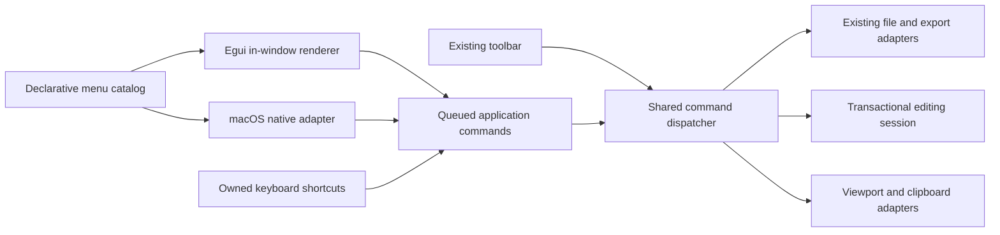

# Menu System v1 — shared commands, Windows-style egui menus, and native macOS menus

- **Status:** WO-001 through WO-013 implementation submissions are complete and pending user review/validation; no order is accepted or validated
- **Date:** 2026-11-06
- **Source references:** [`initial-menus.md`](../../../.reference/initial-menus.md), [`final-draft-13-menus.md`](../../../.reference/final-draft-13-menus.md), and [`file.png`](../../../.reference/file.png)
- **Validation owner:** User. No build, check, test, lint, formatting command, application launch, visual verification, agent review, or independent validation was run while preparing this assessment.

## Assessment

ScriptCraft currently has working desktop adapters for New, Open, Save, Save As, and PDF export, but they are owned by the toolbar-specific [`ToolbarAction`](../../../apps/scriptcraft/src/toolbar_items.rs:15) and [`dispatch_toolbar_action()`](../../../apps/scriptcraft/src/toolbar.rs:507). The menu initiative should not create a second implementation of those operations. It should promote them to a shared desktop command vocabulary and let the toolbar, egui menu, native macOS menu, and keyboard shortcuts invoke the same dispatcher.

The initial Edit menu requires more than presentation work:

- Undo, redo, deletion, and Select All already have suitable transactional session operations.
- The existing keyboard path handles Undo/Redo and Select All only while the custom screenplay surface is focused in [`key_event()`](../../../apps/scriptcraft/src/script_view.rs:754).
- Cut, Copy, and menu-initiated Paste do not yet have an application adapter. Clipboard text must be extracted from canonical screenplay content and mutations must continue through [`EditingSession`](../../../crates/scriptcraft-core/src/editing.rs:232).
- Menu activation must not depend on the custom editor retaining egui focus while a menu is open. There is one application editing session, so menu commands can target that session explicitly and then restore editor focus where appropriate.

The two presentations should share data and behavior, not rendering code:

1. **Windows:** an application-owned egui menu strip immediately above the existing toolbar. Egui 0.34's button atom support provides left content, ordinary label content, and weak right-aligned shortcut text, which closely matches the supplied reference without replacing the framework menu system.
2. **macOS:** an OS-owned application menu implemented outside egui with `muda`. AppKit supplies native popup appearance, separators, shortcut rendering, optional item images, accessibility, and standard application-menu behavior.

During development, both presentations should work on macOS. A single source switch controls the in-window preview and remains enabled throughout this work-order batch so the Windows-style menu can be reviewed while developing on macOS. Windows never constructs the macOS backend. Automatic production OS-only selection and disabling the preview on macOS are deferred to a later explicitly approved change.

## Recommended architecture

### New desktop modules

| Module | Responsibility |
|---|---|
| [`app_commands.rs`](../../../apps/scriptcraft/src/app_commands.rs) | Shared command identity, command-state projection, single dispatcher, clipboard/selection adapters, and viewport-close routing. |
| [`menu_items.rs`](../../../apps/scriptcraft/src/menu_items.rs) | Declarative ordered top-level menus and entries, stable item IDs, labels, optional semantic icons, shortcuts, and commands. No native toolkit objects or application operations. |
| [`menu.rs`](../../../apps/scriptcraft/src/menu.rs) | Development/production presentation policy, command queue integration, shortcut extraction, and the Windows-style egui renderer. |
| [`macos_menu.rs`](../../../apps/scriptcraft/src/macos_menu.rs) | macOS-only `muda` construction, native accelerator mapping, menu/item retention, dynamic enablement, event wakeups, and event-to-command mapping. |
| [`macos_sf_symbols.rs`](../../../apps/scriptcraft/src/macos_sf_symbols.rs) | Narrow main-thread AppKit bridge for optional SF Symbol image creation and one-time native item resolution/retention; no menu command or state ownership. |

The exact internal type names remain implementation choices. The important boundaries are stable command identity, one ordered catalog, and independent rendering adapters.

### Catalog shape

Use a static ordered catalog conceptually containing:

- top-level menu identity and label;
- ordered entries that are a command, disabled placeholder, or separator;
- stable string item identity such as `file.save-as`;
- visible label and accessibility label;
- optional semantic icon;
- optional logical shortcut;
- command behavior identity (command or non-dispatching disabled placeholder).

Enablement is **not** a static catalog field. Undo/redo, selection-dependent clipboard operations, modal state, and future commands need a fresh application-state projection. Both backends consume the same command-state result so their enabled states cannot drift.

The initial architecture allowed adding a top-level menu by appending one catalog specification. WO-013 now supplies the complete ten-menu reference catalog; later menu additions remain outside scope and must not be inferred from this earlier extensibility note.

At the initial WO-004 stage submenu support was deliberately omitted because no initial File/Edit row needed a caret. WO-013 later authorizes disabled disclosure-only rows for the reference's `>` markers, but no submenu children, recursive functional menus, or submenu navigation.

### Initial visible catalog

This table records the initial WO-004 File/Edit command baseline from [`initial-menus.md`](../../../.reference/initial-menus.md), not the complete catalog after WO-013. WO-013 supersedes this initial-only scope with every entry, separator, and display annotation in [`final-draft-13-menus.md`](../../../.reference/final-draft-13-menus.md); new rows are disabled placeholders rather than new commands.

| Menu | Group | Label | Shared command | Logical shortcut |
|---|---|---|---|---|
| File | 1 | New | New | Primary+N |
| File | 1 | Open... | Open | Primary+O |
| File | 1 | Close | Close window | Primary+W |
| File | 2 | Save | Save | Primary+S |
| File | 2 | Save As... | Save As | Shift+Primary+S |
| File | 2 | Save As PDF... | Existing PDF export | Shift+Primary+P |
| Edit | 1 | Undo | Undo | Primary+Z |
| Edit | 1 | Redo | Redo | Shift+Primary+Z; retain Primary+Y as an unadvertised Windows alias |
| Edit | 2 | Cut | Cut | Primary+X |
| Edit | 2 | Copy | Copy | Primary+C |
| Edit | 2 | Paste | Paste | Primary+V |
| Edit | 3 | Delete | Existing forward-delete operation | None |
| Edit | 3 | Select All | Select entire body | Primary+A |

Primary means Command on macOS and Ctrl on Windows. The macOS dual-preview's in-window copy should display Windows-style Ctrl labels so it remains a useful Windows presentation preview; the native menu continues to display native Command symbols.

The reference's bracketed Undo/Redo action-name text is treated as a placeholder, not as a request to invent history descriptions. Initial labels remain Undo and Redo because the session exposes availability but no action-label metadata. The catalog/dispatcher boundary can support resolved labels later without redesign.

Save As PDF... deliberately routes to the existing [`export_pdf()`](../../../apps/scriptcraft/src/main.rs:966) adapter rather than creating another export path.

### Command flow

Actual command activations converge on one dispatcher. Functional menu clicks can enqueue commands and request repaint; mapped native events and owned command shortcuts enter the same queue. Disabled placeholders, including those with display-only shortcut annotations, are excluded. The queue is drained at a defined point before ordinary editor input dispatch, and every queued command is rechecked against current enablement to reject stale or modal-blocked activation.

Only one backend should own keyboard accelerators on a given OS:

- native macOS is the intended owner whenever its backend is active, including dual preview;
- the in-window backend owns accelerators on Windows, or in any explicit in-window-only development configuration;
- clickable activation remains available in both visible backends during dual preview.

This ownership rule prevents a single keypress from executing both the native and egui command paths. Shortcut extraction should occur in the existing [`raw_input_hook()`](../../../apps/scriptcraft/src/main.rs:1213), with consumed events removed before [`handle_surface_input()`](../../../apps/scriptcraft/src/script_view.rs:785). Existing command-key handling then moves out of [`key_event()`](../../../apps/scriptcraft/src/script_view.rs:754) rather than remaining as a duplicate route. Until WO-009 installs native macOS arbitration, WO-007 temporarily gives shortcuts to the enabled in-window backend even during macOS dual preview; the target-derived native-enabled flag does not mean a native menu is installed.

### Command behavior details

- **Existing File commands:** move the current New/Open/Save/Save As/PDF match arms behind the shared dispatcher without changing their persistence, status, error, or export behavior.
- **Close:** send the normal egui viewport close command. Do not implement a second window destruction path.
- **Undo/Redo:** call the existing transactional session methods through the common mutation/status adapter; enable them from [`can_undo()`](../../../crates/scriptcraft-core/src/editing.rs:590) and [`can_redo()`](../../../crates/scriptcraft-core/src/editing.rs:593).
- **Select All:** select from the first body-element byte zero to the existing document-end position, request repaint, and preserve canonical content, dirty state, and history semantics.
- **Copy:** extract the ordered noncollapsed selection from canonical UTF-8 body text, inserting one newline for each crossed paragraph boundary. Do not apply AllCaps, print HiddenText omission, pagination, or export transformations to ordinary clipboard copy.
- **Cut:** write the selected canonical text to the clipboard first and delete only after clipboard success. Clipboard failure leaves the document and selection unchanged.
- **Paste:** read text through one application clipboard adapter and call [`insert_paste()`](../../../crates/scriptcraft-core/src/editing.rs:625). Empty or nontext clipboard content produces a privacy-safe status/error and no semantic mutation.
- **Delete:** invoke the same forward-delete operation as the Delete key, including its existing transactional cross-paragraph safety behavior.
- **Focus:** menu commands target the single screenplay session rather than whichever egui widget happens to own focus during a popup. After an editing command, restore focus to the recorded editor surface when available.

Use a direct desktop dependency on `arboard`, already present transitively in the lockfile, for explicit clipboard reads/writes and error handling. Do not rely on AppKit's predefined Cut/Copy/Paste responder actions: the screenplay editor is not an AppKit text view. Custom native items must therefore emit ScriptCraft commands for all Edit operations.

Undo/redo availability comes from session history. Cut/Copy require a noncollapsed selection. Paste can remain enabled without polling clipboard contents on every frame; activation reports unavailable text safely. Commands that would conflict with the FDX migration modal are disabled or rejected while that modal is pending.

### Presentation policy

Use one documented source constant in [`menu.rs`](../../../apps/scriptcraft/src/menu.rs), keeping the in-window preview enabled throughout this batch:

| Target | Current development behavior | Later production behavior, not in this batch |
|---|---|---|
| macOS | Native application menu and in-window egui strip are both visible and clickable; native owns shortcuts | Disable the preview separately so only the native application menu remains |
| Windows | In-window egui strip; no macOS backend is compiled | Same |

This is a developer switch, not a persisted preference, runtime settings control, document field, or screenplay-core concern. The present batch must not turn it off.

### Egui presentation

Insert a distinct top panel before [`titlebar-toolbar`](../../../apps/scriptcraft/src/main.rs:1065) only when the in-window presentation is active. The resulting order is menu strip, existing toolbar, Script Workspace, with the existing status panel unchanged. The menu strip owns its exact height and lower divider; the toolbar's existing boundary rules remain untouched.

Use framework menu-button/popup behavior for top-level menus. Item rows should use egui button atoms or an equivalent menu-row adapter to provide:

- a fixed-width optional left icon slot, including blank-icon alignment;
- the visible command label immediately after that slot;
- framework separators between declared nonempty groups;
- weak/low-opacity right shortcut text using the button shortcut-text facility;
- full-width hover/click bounds, disabled state, keyboard navigation, and accessible labels;
- menu-local text, icon, row-height, popup-padding, separator, and corner-radius settings resolved from the active theme without changing toolbar/status numeric settings or global screenplay typography.

Use existing typed Material glyphs for suitable in-window icons and reserve blank slots elsewhere. Initial values are agent-defaults pending side-by-side user review against [`file.png`](../../../.reference/file.png); pixel parity with Final Draft is not claimed.

The initial File/Edit implementation had no submenu caret. WO-013 supersedes that initial limitation only for disabled disclosure placeholders: egui shows a trailing caret and native macOS shows a disabled empty submenu. Functional submenu contents and navigation remain out of scope.

### Native macOS presentation

Add `muda` as a macOS-target dependency with default features disabled so no Linux GTK backend is introduced. Construct menus on the main thread during the existing app-creation callback. Keep the root menu, submenus, and item objects alive in an app-owned controller.

Use stable catalog IDs to construct native menu IDs and retain a native-ID-to-command lookup. Install the documented event handler to request an egui repaint through a cloned context so menu activation wakes the application. In resolved muda 0.17.2, a registered handler suppresses delivery to [`MenuEvent::receiver()`](https://docs.rs/muda/0.17.2/muda/struct.MenuEvent.html#method.receiver); therefore forward the handler's event IDs through an app-drained inbox into the shared command queue. This wakeup/event path requires user runtime verification and is not a behavior claim based only on documentation.

Native accelerators come from the same logical shortcut definitions. Dynamic command availability is synchronized to native items after application-state changes. Native items use AppKit-owned shortcut and disabled presentation.

The native File and Edit assignments use the macOS AppKit SF Symbols adapter: File New `plus`, Open `arrow.up.right`, Close `xmark`, Save `square.and.arrow.down`, Save As `square.and.arrow.down.on.square`; Edit Undo `arrow.uturn.backward`, Redo `arrow.uturn.forward`, Cut `scissors`, Copy `doc.on.doc`, Paste `doc.on.clipboard`. Save As PDF, Delete, and Select All have no native image. Symbol names remain in the macOS adapter, independent of the shared catalog; 18-point template images are resolved once against retained native items after muda installation. The adapter is owned by the native controller, retains the root and resolved item references on the main thread, and does not perform per-frame image assignment or hierarchy lookup. Missing items/symbols are nonfatal and produce bounded static warnings. The implementation submission does not establish target OS symbol availability or visual acceptance.

Include a macOS-only standard Application menu using predefined native About, Hide, Hide Others, Show All, and Quit items as an agent-default platform requirement. It is not part of the shared File/Edit catalog and has no Windows counterpart. File/Edit commands remain custom ScriptCraft commands rather than predefined native responder items.

The workspace unsafe-code policy remains unchanged. The package retains `unsafe_code = "deny"`; the AppKit image adapter has one function-local unsafe allowance for retaining muda's borrowed root NSMenu pointer, with all other code still denied. This exception is limited to the documented adapter call and does not introduce raw Objective-C message sends or a broader unsafe bridge.

## Existing gaps and boundaries

- The durable toolbar requirement says New must not replace a dirty session without informed consent, while the inspected [`dispatch_toolbar_action()`](../../../apps/scriptcraft/src/toolbar.rs:507) currently constructs a replacement session without that consent flow. This is a pre-existing discrepancy, not something the menu plan should silently claim to fix. Refactoring must not weaken whatever safety behavior is present at implementation time; disposition of the missing consent flow needs a separate user decision.
- Close uses ordinary viewport-close behavior. Unsaved-change close confirmation is not added by this initiative and must not be claimed.
- Clipboard copy is canonical editing text, not the deliberately lossy print-layout plain-text export. It therefore does not inherit export AllCaps or HiddenText omission rules.
- Native and egui appearance will not be pixel-identical. macOS intentionally follows AppKit; Windows follows the supplied structure and active ScriptCraft theme.
- Menu definitions, enablement, open popups, focus, icons, and presentation settings are transient desktop state. Nothing enters FDX, screenplay semantics, fixed layout, exports, or the headless core.
- The initial WO-004 order excluded New from Template, Open Recent, Export, Backup, Revert, templates, Print, Register Script, Select Scene, Find, Go To, Writing Tools, AutoFill, Dictation, Emoji, and all View/other menus. WO-013 supersedes that exclusion by adding the complete reference entries as disabled placeholders only; none receives behavior. Functional submenu contents/navigation, entries beyond the linked reference, and new commands remain excluded.

## Proposed work orders

Execute the following ten orders sequentially on a manifest-conforming initiative branch such as `dev/2026-11-06-menu-system`, after recording the checkout and preserving all pre-existing work. Each linked order owns one outcome, its user-review requests, and its implementation handoff. No order is complete, accepted, or validated until the user says so.

1. [`WO-001 — Shared File command dispatcher`](work-orders/WO-001-shared-file-command-dispatcher.md): move existing File/PDF commands behind one toolbar-independent dispatcher and add ordinary viewport Close routing.
2. [`WO-002 — Non-clipboard Edit commands and availability`](work-orders/WO-002-non-clipboard-edit-commands.md): expose Undo, Redo, Delete, and Select All with fresh command availability.
3. [`WO-003 — Canonical clipboard Edit commands`](work-orders/WO-003-canonical-clipboard-commands.md): add transactional Cut/Copy/Paste over canonical screenplay text.
4. [`WO-004 — Declarative menu catalog and preview policy`](work-orders/WO-004-menu-catalog-and-preview-policy.md): define the exact initial catalog and keep the in-window preview enabled on macOS.
5. [`WO-005 — Egui menu panel and activation shell`](work-orders/WO-005-egui-menu-panel-and-activation.md): place functional catalog-driven popups above the toolbar.
6. [`WO-006 — Reference-aligned egui menu presentation`](work-orders/WO-006-egui-menu-presentation.md): add aligned icon/label/shortcut columns and theme-local visual treatment.
7. [`WO-007 — Shortcut ownership and menu-command focus`](work-orders/WO-007-shortcut-ownership-and-focus.md): consolidate in-window keyboard routing and remove popup-focus dependence.
8. [`WO-008 — Native macOS menu construction`](work-orders/WO-008-native-macos-menu-construction.md): construct and retain the native Application/File/Edit menus while retaining the egui preview.
9. [`WO-009 — Native macOS events, state sync, and dual-preview arbitration`](work-orders/WO-009-native-events-and-dual-preview-arbitration.md): connect native activation/wakeups and make native macOS the sole accelerator owner.
10. [`WO-010 — Durable menu contracts and development closeout`](work-orders/WO-010-durable-contracts-and-development-closeout.md): reconcile Forge records and submit the dual-presentation development state without turning off the preview.

The in-window preview switch remains enabled (`IN_WINDOW_MENU_PREVIEW_ENABLED = true`). The former automatic production switch-off is not part of this batch. It remains a later decision requiring explicit approval after both presentations have been reviewed.

## SF Symbols follow-up implementation submissions

11. [`WO-011 — AppKit SF Symbols bridge and File-menu icons`](work-orders/WO-011-appkit-sf-symbols-file-menu.md): add the narrow native symbol-image adapter and implement the reference-style File icon assignments. **Implementation submitted; user review/validation pending.**
12. [`WO-012 — SF Symbols Edit-menu completion and durable contracts`](work-orders/WO-012-sf-symbols-edit-menu-and-closeout.md): complete the initial Edit assignments, remove the obsolete named-image path, and reconcile lifecycle and durable records. **Implementation submitted; user review/validation pending.**

These follow-up orders are separate from the initial ten-order batch. Both were explicitly authorized and implemented sequentially on the existing `dev/2026-11-06-menu-system` branch. WO-012 proceeded under the user's explicit authorization without waiting for WO-011 review/validation; neither submission constitutes acceptance or validation.

## Authorized complete-placeholder follow-up

13. [`WO-013 — Complete disabled placeholder menu catalog`](work-orders/WO-013-complete-disabled-placeholder-menu-catalog.md): expand the one shared catalog to the complete Final Draft reference structure, preserving current commands while rendering every new entry as disabled in both backends. This order expressly supersedes the earlier exclusions of additional top-level menus and disclosure-only placeholder entries; functional submenu contents remain out of scope.

## Explicit non-goals

- No functional/recursive submenu contents or submenu navigation. Disabled disclosure-only placeholder rows are authorized by WO-013 and do not imply children or behavior.
- No top-level menus or menu entries beyond the complete ten-menu catalog in [`final-draft-13-menus.md`](../../../.reference/final-draft-13-menus.md). This supersedes the initial File/Edit-only scope; the native Application menu remains separate and native-only.
- No menu customization UI, runtime backend preference, persisted menu state, FDX fields, sidecar data, or screenplay-core menu abstraction.
- No native Win32 menu replacement for the requested egui Windows presentation. The narrow macOS AppKit SF Symbols adapter is part of the implemented native presentation; direct AppKit use remains confined to that documented adapter and its single local unsafe retain boundary, with no broad unsafe exemption.
- No redesign of toolbar/status controls, screenplay editing, pagination, FDX, native saving, PDF, or plain-text export.
- No new automated desktop-test target and no agent-run build, check, test, lint, formatting, manual verification, review, or independent validator under current repository policy.
- No claim of pixel parity with Final Draft, native Windows menu rendering, dynamic Undo action labels, unsaved-change consent fixes, or cross-OS runtime verification before the user performs it.

## WO-001 implementation handoff — 2026-11-06

- **State:** WO-001 implementation is submitted for user review and validation only. It is not marked accepted or validated. WO-002 through WO-010 have not started.
- **Exact branch/checkout evidence:** The pre-branch checkout was `master` at `0d72f8f3c0258a09c99ef00078c97df263661783`; the target local branch did not exist. The pre-branch status showed no tracked/staged changes and the pre-existing untracked paths `.plan/2026-11-06-menu-system/`, `.reference/file.png`, `.reference/final-draft-13-menus.md`, and `.reference/initial-menus.md`. `git switch -c dev/2026-11-06-menu-system` succeeded, producing branch `dev/2026-11-06-menu-system` at that same base commit. No pre-existing work was stashed, discarded, overwritten, staged, or committed; no commit was created for this submission.
- **Exact implementation scope:** [`app_commands.rs`](../../apps/scriptcraft/src/app_commands.rs) now defines shared New/Open/Close/Save/Save As/Save As PDF command identity and a single desktop dispatcher receiving the command and egui context. Existing New/Open/Save/Save As/PDF branches moved out of toolbar-specific dispatch; their operation adapters and behavior were retained. Close sends the ordinary egui viewport-close command. [`toolbar_items.rs`](../../apps/scriptcraft/src/toolbar_items.rs) references the shared command type, and [`toolbar.rs`](../../apps/scriptcraft/src/toolbar.rs) routes both toolbar activation paths through the same dispatcher. [`main.rs`](../../apps/scriptcraft/src/main.rs) registers the module. Source changes are limited to these four paths plus this handoff and the WO-001 handoff.
- **Out-of-scope confirmation:** No Edit commands, menu presentation, shortcuts/keyboard changes, clipboard behavior, native menu code/dependency, or screenplay-core changes were added. No later work order was begun. The pre-existing New dirty-session consent discrepancy is expressly not fixed or represented as fixed. Close does not add unsaved-change confirmation.
- **Evidence limitations:** No build, check, test, lint, formatting command, launch, manual verification, review, or independent validator was run, as required by repository policy. User review and validation remain pending. The implementation handoff does not imply behavior verification or acceptance; no visible menu exists yet.

## WO-002 implementation handoff — 2026-11-06

- **State:** WO-002 implementation is submitted for user review and validation only; it is not marked accepted or validated. WO-003 and all subsequent orders remain unstarted.
- **Exact source changes:** [`app_commands.rs`](../../apps/scriptcraft/src/app_commands.rs) now includes shared Undo, Redo, Delete, and Select All identities, a fresh `AppCommandAvailability` projection, and dispatcher branches delegating to the existing `EditingSession` undo/redo/delete/set-selection operations. All accepted operations use the common application mutation/status adapter and request repaint. Select All spans byte offset zero of the first body element through the end of the final body's text. No source outside [`app_commands.rs`](../../apps/scriptcraft/src/app_commands.rs) was changed by WO-002; in particular, no screenplay-core or keyboard-routing changes were made.
- **Availability contract:** Undo/Redo use current `can_undo()`/`can_redo()` history state. Delete is available for a noncollapsed selection, a caret before a character in the current element, or a caret in a delimiter-only Parenthetical (`(`, `()`, `)`) covered by the existing special forward-delete path. Select All is available when the project contains a body element. All four report unavailable while `pending_fdx_open` is set. Dispatcher activation recomputes availability and ignores an edit command that has become unavailable. File commands are outside this edit-only migration gate.
- **Behavior and remaining focus limitations:** Delete continues to call the existing transactional forward-delete operation, including its collapsed-caret and cross-paragraph rules. Select All changes only session selection and uses `set_selection()`, so it does not directly create semantic content, dirty state, or history. Current Undo/Redo/Select All/Delete keyboard behavior remains on the focused custom-screenplay-surface path for WO-007 to consolidate later. No menu is visible; menu activation focus restoration and shortcut ownership remain future scope.
- **Changed paths:** [`app_commands.rs`](../../apps/scriptcraft/src/app_commands.rs), [`WO-002-non-clipboard-edit-commands.md`](work-orders/WO-002-non-clipboard-edit-commands.md), and this initiative plan. WO-001's pre-existing source changes and all untracked plan/reference artifacts were preserved. No new branch or commit was created.
- **Blocker and evidence limitations:** The environment surfaced a pre-existing diagnostic in [`toolbar_items.rs`](../../apps/scriptcraft/src/toolbar_items.rs): `ToolbarBehavior::Action(ToolbarAction)` names an unresolved type. WO-002 did not alter this out-of-scope WO-001 source, and compilation may be blocked until it is addressed. No build, check, test, lint, formatting command, launch, manual verification, review, or independent validator was run; user validation remains the only validation evidence. No behavior, acceptance, or visual menu result is claimed.

### Follow-up integration cleanup — 2026-11-06

Before WO-003 implementation, the stale `ToolbarBehavior::Action(ToolbarAction)` reference reported above was changed in [`toolbar_items.rs`](../../apps/scriptcraft/src/toolbar_items.rs) to the already imported shared `AppCommand`. This is a narrow integration correction only; no compilation or other validation was run, and no claim is made that this resolves any other diagnostic.

## WO-003 implementation handoff — 2026-11-06

- **State and scope:** WO-003 implementation is submitted for user review and validation only; it is not accepted or validated. Work stayed on the existing `dev/2026-11-06-menu-system` branch, preserving WO-001/WO-002 changes and pre-existing untracked work. No additional branch or commit was created. WO-004 and later orders have not started.
- **Exact source and dependency edits:** [`app_commands.rs`](../../apps/scriptcraft/src/app_commands.rs) adds shared Cut/Copy/Paste identities, a single desktop clipboard read/write adapter, direct canonical selection extraction, command dispatch, and availability projection. [`apps/scriptcraft/Cargo.toml`](../../apps/scriptcraft/Cargo.toml) adds direct `arboard = "3.7.0"`; [`Cargo.lock`](../../Cargo.lock) records arboard in the application package dependency list. The lockfile already recorded arboard 3.7.0 when inspected. No resolver was run, so no dependency-resolution operation or outcome beyond that existing lockfile fact is claimed. [`toolbar_items.rs`](../../apps/scriptcraft/src/toolbar_items.rs) has the narrowly corrected shared command type.
- **Clipboard semantics:** Copy/Cut extract the ordered selection from canonical body UTF-8, respect reversed selection direction, preserve exact casing and characters, and include one newline per crossed paragraph boundary. No layout, role inference, AllCaps, HiddenText omission, or export transformation is used. Copy does not mutate the session. Cut writes first and only then invokes transactional Delete; clipboard write failure leaves content/selection unchanged. Paste reads at activation and delegates nonempty text to existing `insert_paste()`; empty text and unreadable/nontext/error cases make no semantic edit and produce static privacy-safe notices (`Paste unavailable: clipboard text is empty; screenplay unchanged` or `Paste unavailable: clipboard has no readable text; screenplay unchanged`).
- **Availability and boundaries:** Cut/Copy require a noncollapsed selection and no pending FDX migration; Paste requires only that migration not be pending. Clipboard contents are not polled per frame. Menu UI, shortcut consolidation, native menu integration, and WO-004 scope were not begun; no screenplay-core source was changed.
- **Changed paths:** [`apps/scriptcraft/Cargo.toml`](../../apps/scriptcraft/Cargo.toml), [`Cargo.lock`](../../Cargo.lock), [`app_commands.rs`](../../apps/scriptcraft/src/app_commands.rs), [`toolbar_items.rs`](../../apps/scriptcraft/src/toolbar_items.rs), [`WO-002-non-clipboard-edit-commands.md`](work-orders/WO-002-non-clipboard-edit-commands.md), [`WO-003-canonical-clipboard-commands.md`](work-orders/WO-003-canonical-clipboard-commands.md), and this plan.
- **Evidence limitations:** No build, check, test, lint, formatting command, launch, manual verification, review, or independent validator was run. Canonical extraction edge cases, transactional outcomes, clipboard failure behavior, and platform/native clipboard behavior remain unverified and are for user-owned validation. No runtime or acceptance claim is made. No visible menu exists yet.

## WO-004 implementation handoff — 2026-11-06

- **State and scope:** WO-004 is submitted for user review and validation only; it is not accepted or validated. Work remained on the existing `dev/2026-11-06-menu-system` branch, preserving earlier initiative work. No branch or commit was created, and WO-005 and later work have not started.
- **Exact catalog schema and IDs:** [`menu_items.rs`](../../apps/scriptcraft/src/menu_items.rs) defines an ordered `MENU_CATALOG` of `MenuSpec` values with stable menu IDs, label/accessibility name, and ordered item/separator entries. `MenuItemSpec` carries stable ID, visible label, accessibility name, optional semantic icon, optional logical key/Primary/Shift shortcut, a distinct unadvertised Windows alias, and the shared `AppCommand`. The menu IDs are `file`, `edit`; File IDs in order: `file.new`, `file.open`, `file.close`, `file.save`, `file.save-as`, `file.save-as-pdf`; Edit IDs in order: `edit.undo`, `edit.redo`, `edit.cut`, `edit.copy`, `edit.paste`, `edit.delete`, `edit.select-all`. Only separators between nonempty reference groups are encoded. All visible strings match the uncommented reference labels; no commented item, submenu, dynamic undo label, or additional menu was added. `file.save-as-pdf` routes to `AppCommand::ExportPdf`; Redo advertises Primary+Shift+Z and retains Primary+Y only as its `windows_alias`.
- **Policy and queue:** [`menu.rs`](../../apps/scriptcraft/src/menu.rs) documents `IN_WINDOW_MENU_PREVIEW_ENABLED = true`. Windows in-window presentation is always enabled; macOS in-window preview follows that switch; `NATIVE_MACOS_MENU_ENABLED` is independently target-derived and unaffected by the preview switch. No automatic production OS-only selection or switch-off is included. One app-owned `PendingMenuCommands` FIFO (`VecDeque<AppCommand>`) is initialized in [`main.rs`](../../apps/scriptcraft/src/main.rs); future egui/native producers share `enqueue()`, and [`dispatch_pending_menu_commands()`](../../apps/scriptcraft/src/menu.rs) takes and dispatches the queued batch in order through the shared dispatcher, which rechecks current availability. WO-004 adds no producers and does not call the dispatch handoff.
- **Integration and changed paths:** `apps/scriptcraft/src/menu_items.rs`, `apps/scriptcraft/src/menu.rs`, [`app_commands.rs`](../../apps/scriptcraft/src/app_commands.rs) (adds the Cut/Copy/Paste command variants already used by its clipboard dispatcher arms), [`main.rs`](../../apps/scriptcraft/src/main.rs), this work order, and this initiative plan. No visible menu UI, native menu construction, or shortcut ownership/consolidation was implemented.
- **Evidence limitations:** No build, check, test, lint, formatting command, application launch, manual verification, review, or independent validator was run under repository policy. Catalog/schema compilation, UI/native behavior, target behavior, and queue integration have not been verified; implementation submission is not an acceptance or runtime claim. User validation remains pending.

## WO-005 implementation handoff — 2026-11-06

- **State:** WO-005 is submitted for user review and validation only; it is not accepted or validated. Work stayed on the existing `dev/2026-11-06-menu-system` branch and preserved earlier source and untracked work. No branch or commit was created. WO-006 has not started.
- **Panel and APIs:** The egui menu renderer consumes the shared `MENU_CATALOG` using `Ui::menu_button`, `Ui::add_enabled`, `Ui::separator`, and `Ui::close`; the exact-height `Panel::top` is **28 logical points**, inserted immediately before the unchanged toolbar only when `in_window_menu_enabled()` is active. The preview source switch remains `true`. The menu panel paints a lower divider and does not alter toolbar or lower-panel composition.
- **Command flow:** A clicked row enqueues its shared `AppCommand` once, closes through egui, and requests repaint. The FIFO is drained at the start of `ScriptCraftApp::update()`, after native-window-state refresh and before ordinary editor-input routing. Shared dispatch recomputes availability, preserving migration-modal/edit-command gating and rejecting stale disabled Edit commands.
- **Deferred limitations:** Current rows use simple label-plus-weak-shortcut content and do not implement icon slots, aligned columns, reference-calibrated visual/theme metrics, shortcut interception/ownership, or explicit focus restoration. Those remain WO-006/WO-007 scope. Framework keyboard navigation, popup dismissal, and runtime behavior await user review; no native menu was added by WO-005.
- **Evidence and integration limits:** No build, check, test, lint, formatting, launch, manual verification, review, or independent validator was run under repository policy. Source inspection/search only found no remaining prior `ToolbarAction`/`dispatch_toolbar_action` references; no runtime, compilation, visual, or acceptance claim is made.

## WO-006 implementation handoff — 2026-11-06

- **State and checkout:** WO-006 is submitted for user review and validation only; it is not accepted or validated. Work stayed on the existing `dev/2026-11-06-menu-system` branch and preserved all prior source changes plus untracked plan/reference artifacts. No branch or commit was created. The in-window preview switch remains `true`; WO-007 and later orders have not started.
- **Exact changed paths:** [`apps/scriptcraft/src/menu.rs`](../../apps/scriptcraft/src/menu.rs), [`work-orders/WO-006-egui-menu-presentation.md`](work-orders/WO-006-egui-menu-presentation.md), and this plan. The existing `main.rs` menu panel height call now consumes the menu-local metric through the existing `MENU_PANEL_HEIGHT` constant. No toolbar/status/document typography, command routing, global-style, shortcut-ownership, native-menu, or additional feature changes were made.
- **Initial agent-default values (logical points):** Menu strip height **28**; menu-bar label **15**; menu-bar item gap **8 × 0**; item label **14**; shortcut label **13**; icon glyph **18**; row height **28**; fixed optional-icon slot **28**; menu-bar button padding **8 × 0**; row button padding **4 × 0**; row atom spacing **6 × 2**; popup padding **10 horizontal × 8 vertical**; separator spacing **9** and stroke **1**; menu-bar, row, and popup corner radii **7**, **4**, and **8**, respectively. The vertical popup inset contracts for very short viewports. These are agent defaults, not calibrated reference measurements. Active egui/application visuals supply separator color, row state colors, focus outline, and popup fill/border.
- **Typed in-window icon mapping:** New → `ADD`; Open → `FOLDER_OPEN`; Close → `CLOSE`; Save → `SAVE`; Save As → `SAVE_AS`; Save As PDF → `PICTURE_AS_PDF`; Undo → `UNDO`; Redo → `REDO`; Cut → `CONTENT_CUT`; Copy → `CONTENT_COPY`; Paste → `CONTENT_PASTE`; Delete → `DELETE`; Select All → `SELECT_ALL`. Icons use the existing app-owned native-font adapter's default filled face and axes (weight **W200**, optical size **24**, grade **0**). The icon glyph's presentation size remains **18** logical points. A fixed-size blank atom is used when a catalog item has no icon; all current entries are assigned an icon, so this fallback is not presently exercised.
- **Presentation and framework behavior:** Egui Button atoms provide fixed left icon slot, label, and built-in weak, right-aligned `shortcut_text`, with an empty shortcut atom on rows that have no shortcut. Rows remain full-row enabled/disabled buttons with catalog accessibility labels; active theme visuals govern enabled/hovered/disabled treatments, and keyboard-focused rows use the active selection stroke for an outline. The preview continues to render Windows-style `Ctrl` shortcuts on macOS and other targets without changing logical shortcuts. Egui `MenuBar`/`menu_button` retains popup and menu behavior. Vertical `ScrollArea` caps contents to the egui content viewport after popup insets/frame allowance, adapts vertical padding in very short viewports, and enables framework scrolling only if content exceeds the cap.
- **Framework limitations and visual caveats:** Popup width remains content-driven with no explicit narrow-window width cap or custom reflow; long shortcut labels and narrow-window behavior need user review. Focus has no separate row-focus palette state in this adapter, so the implementation paints a theme-derived selection outline while egui owns keyboard navigation. Framework separators use the themed stroke and configured spacing, spanning the padded popup content width rather than a separately measured inset. The provided reference is a dark Final Draft macOS menu with Command-symbol shortcuts; ScriptCraft intentionally previews Ctrl labels and follows the active Appearance mode, so palette, glyph metrics, and geometry can differ. No pixel parity is claimed.
- **Evidence limitations:** No build, check, test, lint, formatting command, launch, manual verification, review, or independent validator was run. Compilation, runtime menu/focus/scroll behavior, exact row/popup geometry, contrast, hit bounds, narrow/short viewport behavior, and visual reference alignment are unverified and remain user-owned.

## WO-007 implementation handoff — 2026-11-06

- **State:** WO-007 is submitted for user review and validation only, not accepted or validated. Work remained on `dev/2026-11-06-menu-system`; existing work was preserved, no branch or commit was created, the in-window preview switch remains `true`, and WO-008 has not started.
- **Consumed-event contract:** Only catalog-matched pressed logical key events are enqueued and removed. Primary maps to Command on macOS and Ctrl on non-macOS; the catalog Shift state must match exactly, Alt and the other platform modifier are rejected. Windows additionally routes Primary+Y to Redo. Releases, unmatched keys, and unrelated events remain; IME state/raw IME frames suppress shortcut recognition. Text, paste, IME, scrolling, and existing native page zoom behavior are preserved. Repeat keydown events are independently handled once per raw event. Dispatch rechecks availability, so migration-modal and changed selection/history state can reject stale queued commands.
- **Focus contract:** Shared Edit commands operate on the single application session rather than current egui focus. After queued Edit dispatch the recorded editor surface is asked to take focus and repaint; mutation reveal intents remain conditional for selection/caret-changing operations, while Copy does not change selection or reveal state. Focus restoration cannot be requested before the editor ID has been recorded.
- **Temporary ownership and future handoff:** The in-window backend currently owns accelerators on enabled platforms, including macOS preview, because WO-008 has not built a native menu and WO-009 has not implemented arbitration. WO-009 must transfer macOS accelerator ownership to the native backend while keeping the clickable in-window preview. This temporary behavior is not a final dual-preview ownership claim.
- **Changed source paths:** `apps/scriptcraft/src/main.rs`, `apps/scriptcraft/src/menu.rs`, `apps/scriptcraft/src/app_commands.rs`, and `apps/scriptcraft/src/script_view.rs`, plus this plan and the WO-007 handoff.
- **Evidence limitations:** No build, check, test, lint, formatting, launch, manual verification, review, or independent validator was run. Shortcut/framework behavior, focus transfer, IME and event interaction, and platform runtime behavior are unverified; user-owned validation remains pending. No runtime, acceptance, or validation claim is made.

## WO-008 implementation handoff — 2026-11-06

- **State and scope:** WO-008 is submitted for user review and validation only; it is not accepted or validated. Work stayed on the existing `dev/2026-11-06-menu-system` branch, preserving the existing implementation and plan/reference artifacts. No branch or commit was created. `IN_WINDOW_MENU_PREVIEW_ENABLED` remains `true`. WO-009 has not started.
- **Dependency resolution:** The macOS-only target dependency in [`apps/scriptcraft/Cargo.toml`](../../apps/scriptcraft/Cargo.toml) is `muda = { version = "0.17", default-features = false }`. The permitted setup-only command `cargo fetch --target aarch64-apple-darwin` completed successfully; [`Cargo.lock`](../../Cargo.lock) resolved muda **0.17.2** and lists it under ScriptCraft. This records dependency setup only, not compilation or runtime evidence.
- **Native API and catalog mapping (at WO-008 handoff, before WO-011/WO-012):** The new macOS-only [`macos_menu.rs`](../../apps/scriptcraft/src/macos_menu.rs) builds a root with `Menu::new()`, stable-ID File/Edit submenus with `Submenu::with_id()`, custom commands with `MenuItem::with_id()` or `IconMenuItem::with_id_and_native_icon()`, catalog separators with `PredefinedMenuItem::separator()`, and installs via safe `Menu::init_for_nsapp()`. Catalog string IDs are passed through for File/Edit and each custom command item. Logical shortcuts map Primary to `Modifiers::SUPER`, Shift additively, and catalog keys to `Code` values. Initial edit enablement comes from the current `AppCommandAvailability`; File commands initialize enabled. At that historical stage, only DocumentNew → native Add and FolderOpen → native Folder received images. WO-011 replaced that route with the AppKit SF Symbols adapter; the final File/Edit mapping is recorded above and in the WO-012 handoff.
- **Application menu and retention:** A ScriptCraft Application submenu is installed first, with predefined About (package name/version metadata), Hide, Hide Others, Show All, and Quit. Edit commands are custom ScriptCraft items, not native Cut/Copy/Paste/Undo/Redo responders. [`main.rs`](../../apps/scriptcraft/src/main.rs) constructs and installs the controller inside eframe's existing app-creation callback. On macOS, `ScriptCraftApp` owns the controller, which retains the root, submenu handles, custom item handles, and predefined item handles, and is explicitly non-Send via an `Rc` marker. No unsafe application code or policy relaxation was introduced.
- **WO-009 boundary:** Native event handling/queueing, repaint wakeups, post-construction availability synchronization, and native-versus-egui accelerator arbitration were not implemented. WO-007's temporary in-window shortcut ownership remains; both presentations stay available during macOS development preview.
- **Changed paths and evidence limits:** WO-008 changed `apps/scriptcraft/Cargo.toml`, `Cargo.lock`, `apps/scriptcraft/src/macos_menu.rs`, `apps/scriptcraft/src/main.rs`, this work order, and the initiative plan. No build, check, test, lint, formatting command, launch, manual verification, review, or independent validator was run. Menu API compatibility, startup installation, visual/native behavior, initial enabled state, and object retention have not been validated at runtime; user review remains pending.

## WO-009 implementation handoff — 2026-11-06

- **State and checkout:** WO-009 is submitted for user review and validation only; it is not accepted or validated. Work remained on `dev/2026-11-06-menu-system`, preserving earlier source and plan work. No branch or commit was created. The in-window preview remains enabled. WO-010 has not started.
- **Exact event/wakeup and queue path:** [`macos_menu.rs`](../../apps/scriptcraft/src/macos_menu.rs) retains a map from each custom catalog `MenuId` to its shared `AppCommand` and native item handle. Its `muda 0.17.2` event handler captures the cloned egui context, appends the event ID to a thread-safe inbox, and requests repaint. At the start of `ScriptCraftApp::update()`, [`main.rs`](../../apps/scriptcraft/src/main.rs) drains IDs, maps known IDs to shared commands, and enqueues them in the existing application FIFO before dispatch. The dispatcher continues to process the FIFO once in order.
- **Receiver API constraint:** The resolved `muda 0.17.2` API explicitly does not deliver to `MenuEvent::receiver()` when `MenuEvent::set_event_handler(Some(...))` is installed. The wakeup-capable handler therefore feeds the ID inbox drained by the app rather than the receiver; the same native activations converge on the shared command queue. This is the chosen API-compatible adaptation, not a runtime claim.
- **Availability and synchronization cadence:** [`AppCommandAvailability`](../../apps/scriptcraft/src/app_commands.rs) is the shared projection consumed by egui and native rows. Dispatch rechecks it for all menu commands; its modal-blocked state disables/rejects every catalog command while the FDX migration modal is pending, and the per-command Edit values continue to reflect history, selection, and document state. At the end of every application update, after queued dispatch, editor/state processing, and panel/dialog handling, native labels are restored from the catalog and enabled states synchronized from this projection. egui enabled state uses the same projection.
- **Final ownership:** macOS native menu accelerators are sole owners whenever the native backend is active, including dual preview; recognized egui raw key events are consumed before editor input. The in-window preview remains clickable. Windows remains in-window accelerator owned. Cut/Copy/Paste remain custom ScriptCraft commands, while native OS appearance and accessibility remain owned by muda/AppKit.
- **Changed paths:** `apps/scriptcraft/src/app_commands.rs`, `apps/scriptcraft/src/macos_menu.rs`, `apps/scriptcraft/src/main.rs`, `apps/scriptcraft/src/menu.rs`, the WO-009 work order, and this initiative plan.
- **Evidence limitations:** No build, check, test, lint, formatting, launch, manual verification, review, or independent validator was run under repository policy. Native event/wakeup delivery, queue execution, synchronization timing, accelerator arbitration, clipboard routing, and OS appearance/accessibility are not runtime-verified and remain user-owned review items. No acceptance or behavior claim is made.

### User-reported WO-009 E0282 source correction — 2026-11-06

The user reported E0282 at `MenuEvent::set_event_handler` in [`macos_menu.rs`](../../apps/scriptcraft/src/macos_menu.rs), because the callback parameter type was not inferred for `event.id`. The callback now explicitly types it as `MenuEvent` (`move |event: MenuEvent|`). This is a narrow annotation fix for native `muda 0.17.2`; eframe remains 0.34 (locked 0.34.3), with no dependency changes. No build or other validation was run, and compilation is not claimed to pass.

## WO-010 implementation handoff — 2026-11-06

- **State and checkout:** WO-010 implementation is submitted for user review and validation only; it is not accepted or validated. Work remained on the existing `dev/2026-11-06-menu-system` branch. The pre-edit status showed the expected initiative source modifications and untracked plan/reference/source artifacts; these were preserved. No branch or commit was created.
- **Source reconciliation:** The in-window preview switch in [`menu.rs`](../../apps/scriptcraft/src/menu.rs) is confirmed `true` and was left true. The integrated source has a shared catalog and dispatcher, a 28-logical-point in-window File/Edit strip before the toolbar, and panel order menu → toolbar → Script Workspace with the existing status panel. Windows uses the in-window backend; macOS installs native Application/File/Edit menus while retaining the clickable in-window preview. Native macOS owns accelerators whenever installed; Windows uses in-window shortcut handling. Native menu events enter a handler-fed inbox, then the app drains known IDs into the shared FIFO before dispatch. This reflects the `muda` 0.17.2 constraint that installing `MenuEvent::set_event_handler` suppresses delivery to `MenuEvent::receiver()`.
- **Contracts and facts recorded:** Added REQ-WRITING-LOOP-011, actual module/flow/policy and menu-metric details to technical-context, and actual dependency/implementation-submission facts to project-manifest without changing repository validation policy or historical evidence. The direct clipboard dependency is `arboard = "3.7.0"`; macOS declares `muda = { version = "0.17", default-features = false }`, resolved as 0.17.2 in the lockfile. Menu metrics remain agent defaults, not reviewed measurements. Known source boundaries include no submenus, content-driven popup width/no custom narrow reflow, no Close confirmation, and the pre-existing New dirty-session consent discrepancy; none is represented as fixed.
- **Handoff reconciliation:** All WO-001–WO-009 handoffs receive a WO-010 addendum preserving their as-submitted historical account and stating the relevant final integrated source fact or outstanding limitation. This does not rewrite historical status as validation or acceptance.
- **Changed paths:** `.forge/requirements/features/screenplay-writing-loop.md`, `.forge/blueprints/technical-context.md`, `.forge/project-manifest.md`, this initiative plan, and WO-001 through WO-010 work-order records. No production switching, preview switch-off, desktop automated tests, unrelated source edits, or core/persistence changes were made.
- **Evidence limitations and pending user evidence:** No build, check, test, lint, formatting, application launch, manual verification, review, or independent validator was run. No validation or acceptance is claimed. User evidence remains pending for native macOS Application/File/Edit menus with simultaneous in-window preview, Windows menu placement and command/shortcut behavior, native wakeup/event routing and availability synchronization, canonical Unicode/reversed/cross-paragraph clipboard cases and clipboard failures, focus/IME/modal behavior, resize/narrow/short-viewport/display-scale visuals, and any desired workspace checks. Implementation submission does not establish Windows acceptance from macOS preview or establish native runtime behavior.
- **Deferred decision:** Automatic production OS-only selection and turning the preview off require a later explicitly approved change; no production switch-off is included here.

## Menu follow-up handoff — 2026-11-06

- **Exact source changes:** [`apps/scriptcraft/src/menu.rs`](../../apps/scriptcraft/src/menu.rs) now makes each command-label atom grow into the available label column and align `LEFT_CENTER`, keeping it after the existing fixed icon slot and retaining the weak right shortcut atom. Its File/Edit menu loop tracks the open top-level popup ID and uses egui `Popup::open_id` to switch to the other menu when hovered, only while a File/Edit popup is already open; click-to-open/toggle, row activation, accessibility metadata, and menu metrics are otherwise unchanged. No command is synthesized on hover. [`screenplay-writing-loop.md`](../../.forge/requirements/features/screenplay-writing-loop.md) now states the in-window hover-switch behavior and preserved keyboard/dismissal behavior; [`technical-context.md`](../../.forge/blueprints/technical-context.md) records the locked egui API boundary and app-local adapter.
- **Framework finding and limitation:** The exact locked egui version is 0.34.3. Its `MenuBar`/`MenuConfig` API has no top-level hover-switch option; `MenuButton` uses click-driven `Popup::menu`, while `SubMenuButton` hover handling is specifically for nested sibling menus and does not switch an already-open sibling. The local adapter relies on popup memory and requests repaint after a switch. This is source/API evidence only; no runtime interaction or next-frame presentation is claimed.
- **Preservation and validation boundary:** No native macOS menu code, dependencies, command behavior, enabled preview switch, global pointer/focus state, or metrics were changed. No build, check, test, lint, formatting, launch, manual verification, review, or validator was run under repository policy. Label alignment, popup switching, keyboard behavior, and dismissal remain user-owned validation items.

## Research references

- [`muda` crate documentation](https://docs.rs/muda/latest/muda/) — macOS main-thread constraint, global application-menu installation, menu events, and winit wakeup guidance.
- [`muda` native icons](https://docs.rs/muda/latest/muda/enum.NativeIcon.html) — optional platform-native item images.
- [Egui 0.34 button atoms and shortcut text](https://docs.rs/egui/0.34.3/egui/widgets/struct.Button.html) — left content and weak right shortcut presentation.
- [`initial-menus.md`](../../../.reference/initial-menus.md) — authoritative initial File/Edit entries.
- [`file.png`](../../../.reference/file.png) — visual structure reference only.

## Elements ComboBox presentation follow-up handoff — 2026-11-06

- **State and preservation:** The presentation follow-up is submitted for user review only on the existing `dev/2026-11-06-menu-system` branch. Existing menu implementation and initiative artifacts were preserved; no menu-system source or behavior was changed.
- **Exact source change:** [`apps/scriptcraft/src/toolbar.rs`](../../apps/scriptcraft/src/toolbar.rs) adds `DEFAULT_ELEMENTS_CLOSED_COMBO_OUTLINE_WIDTH = 1.0` logical point and `DEFAULT_ELEMENTS_CLOSED_COMBO_HEIGHT = 18.0` logical points in `toolbar_presentation`, and applies both only to the central desktop Elements ComboBox. The height is locally applied as the closed control's minimum interaction height (matching egui's current default interaction-height floor) and restored before caption layout and role rows. Content and button padding may make the full response taller. Existing `.height(role_popup_height)` remains the independently calculated popup-height setting. The local outline takes its color from the app-owned toolbar palette's `hover_foreground`, not the widget hover stroke or `hover_fill`.
- **State behavior and geometry:** A 1-point outline is painted around the closed control using the toolbar palette's hover foreground, both while idle and hovered. The stock hovered fill remains unchanged and distinct from the outline color; the open/active appearance, Unfold More icon, popup, keyboard, accessibility, selection and transactional role-change paths remain framework/session owned. The paint-only outline avoids a visual-style override leaking to popup frames or role-option rows. The 18-point closed minimum matches egui's current default interaction-height floor and does not change the Item group/caption budget or add spacing.
- **Durable records:** [`screenplay-writing-loop.md`](../../../.forge/requirements/features/screenplay-writing-loop.md) and [`technical-context.md`](../../../.forge/blueprints/technical-context.md) record the two parameter defaults, separation of closed and popup heights, and idle/hover/open state behavior.
- **Evidence limits:** No build, check, test, lint, formatting command, launch, manual verification, review, or validator was run under repository policy. These behaviors and geometry remain unverified; the handoff is not an acceptance or validation claim. No implementation blocker is known; validation is intentionally deferred.

## WO-011 implementation handoff — 2026-11-06

- **State and checkout (at WO-011 submission):** WO-011 implementation is submitted for user review and validation only; it is not accepted or validated. Work remained on the existing `dev/2026-11-06-menu-system` branch, preserving all pre-existing source changes and untracked plan/reference work. No branch or commit was created. WO-012 had not started at that point; it was later explicitly authorized and implemented as recorded below.
- **Dependencies and setup evidence:** [`apps/scriptcraft/Cargo.toml`](../../apps/scriptcraft/Cargo.toml) adds macOS-target-only `objc2 = "=0.6.5"` with defaults off and `std`; `objc2-app-kit = "=0.3.2"` with defaults off and `std`, `NSImage`, `NSMenu`, `NSMenuItem`; and `objc2-foundation = "=0.3.2"` with defaults off and `std`, `NSGeometry`, `NSString`. Existing `muda = { version = "0.17", default-features = false }` resolves to 0.17.2. `cargo fetch --target aarch64-apple-darwin` completed successfully solely to resolve/fetch dependency setup; [`Cargo.lock`](../../Cargo.lock) records direct ScriptCraft edges to the three objc2 packages and the resolved macOS dependency graph. This is not build evidence. eframe/egui versions remain unchanged.
- **Native adapter and resolution mechanism:** New macOS-only [`macos_sf_symbols.rs`](../../apps/scriptcraft/src/macos_sf_symbols.rs) is registered from [`main.rs`](../../apps/scriptcraft/src/main.rs). Immediately after `root.init_for_nsapp()`, it verifies `MainThreadMarker::new()`, obtains muda's borrowed installed-root handle through `ContextMenu::ns_menu()`, retains the `NSMenu`, and searches only the File top-level item and its direct item rows. It uses `MENU_CATALOG` top-level/item labels and accepts only unique title matches (`NSMenu::numberOfItems`, `itemAtIndex`, `NSMenuItem::title`, and `submenu`). Item handles and images are collected before any image assignment, then the root and all resolved requested `NSMenuItem` references are retained in the controller-owned adapter. No menu hierarchy traversal or image assignment occurs per frame.
- **Exact image behavior:** AppKit `NSImage::imageWithSystemSymbolName_accessibilityDescription(name, None)` creates each requested image; the adapter sets `NSSize(18, 18)` and template rendering. New → `plus`; Open → `arrow.up.right`; Close → `xmark`; Save → `square.and.arrow.down`; Save As → `square.and.arrow.down.on.square`. Save As PDF remains image-free. These SF Symbol names exist only in the native adapter; the shared catalog and egui Material icon assignments remain unchanged.
- **Failure policy (at WO-011 handoff):** Missing/ambiguous File menu or item resolution, a missing AppKit symbol, or unavailable main-thread/root resolution leaves the optional item image-free and does not fail startup or affect command activation. The five File requests could emit at most five static, value-free warnings during installation, each naming only the catalog item ID and requested symbol name. After WO-012, the final File/Edit request set can emit at most ten warnings per installation. No user/document content or dynamic API error detail is logged.
- **Unsafe boundary:** Exactly one unsafe call exists in this adapter: `Retained::retain(muda_root.ns_menu().cast::<NSMenu>())`, inside `retain_native_menu()` with one function-local `#[allow(unsafe_code)]`. Its SAFETY comment covers muda's borrowed-handle validity while the root lives, the caller's main-thread check, and creation of an owned retained reference. No module/crate-wide allowance, raw Objective-C message call, or root/workspace policy change was made; the app package and source retain their deny policies elsewhere.
- **Behavior preservation and changed paths:** [`macos_menu.rs`](../../apps/scriptcraft/src/macos_menu.rs) now builds ordinary muda items for all commands and removes the prior named `NativeIcon::Add`/`NativeIcon::Folder` route. Native IDs, labels, accelerators, command routing, event wakeups, enablement updates, Application menu, and muda-owned hierarchy remain unchanged. The egui preview remains enabled. Paths changed by WO-011 are the app manifest, lockfile, `main.rs`, `macos_menu.rs`, new `macos_sf_symbols.rs`, WO-011, and this plan. Durable requirements, technical context, and project-manifest files were read but not changed because their SF Symbols lifecycle/unsafe/dependency reconciliation is scoped to WO-012.
- **Evidence limits and sequential handoff (at WO-011 submission):** No build, check, test, lint, formatting command, application launch, manual verification, review, or independent validator was run. Cached source inspection supports the chosen API names but does not establish that this crate code compiles. Target SF Symbol availability, actual native lookup, Light/Dark template colors, disabled appearance, 18-point visual alignment, optional-failure runtime behavior, native commands/shortcuts/wakeups, and dual-preview interactions remain unverified and pending user-owned validation. At that time WO-012 was proposed/unstarted; the user's later explicit authorization to proceed without WO-011 validation and the resulting implementation are recorded below.

## WO-012 implementation handoff — 2026-11-06

- **State and checkout:** WO-012 is submitted for user review/validation only; it is not accepted or validated. It was implemented sequentially after WO-011 on the existing `dev/2026-11-06-menu-system` branch under the user's explicit authorization, without waiting for WO-011 review/validation. Existing work was preserved; no branch or commit was created.
- **Final native symbols:** File New → `plus`; Open → `arrow.up.right`; Close → `xmark`; Save → `square.and.arrow.down`; Save As → `square.and.arrow.down.on.square`. Edit Undo → `arrow.uturn.backward`; Redo → `arrow.uturn.forward`; Cut → `scissors`; Copy → `doc.on.doc`; Paste → `doc.on.clipboard`. Save As PDF, Delete, and Select All remain image-free. Native mappings stay in `macos_sf_symbols.rs`; shared semantic icons and egui Material icons are unchanged, and the in-window preview remains enabled.
- **Adapter and lifecycle:** The adapter resolves File/Edit catalog submenus and requested direct item rows once after muda installs the root, collects item references and images before assignment, and retains the root `NSMenu` plus resolved `NSMenuItem`s within the `NativeMenuController` lifetime. It is main-thread-confined. There is no per-frame image assignment or hierarchy lookup; muda still owns native IDs, commands/events, labels, and enablement synchronization. `macos_menu.rs` already used ordinary muda text items following WO-011's removal of the `NativeIcon::Add`/`NativeIcon::Folder` route, so no additional item-model/import removal was needed.
- **Dependencies, warnings, and unsafe boundary:** Existing macOS-target dependencies are objc2 0.6.5, objc2-app-kit 0.3.2, and objc2-foundation 0.3.2, matching the objc2 generation used by muda 0.17.2. WO-012 adds no dependencies. Missing requested paths/symbols leave images absent and cannot block startup/command activation; warnings contain only static catalog IDs and symbol names, at most ten per installation. Exactly one function-local unsafe operation remains: retaining muda's borrowed root NSMenu pointer in `retain_native_menu()` under a local allowance and safety comment. No raw Objective-C message calls or broader unsafe allowance were introduced.
- **Durable updates and changed paths:** Updated native-menu AC-WRITING-011.6; technical-context adapter ownership, retained references, mapping, dependency generation, and narrow unsafe boundary; project-manifest dependency/submission facts; WO-011's interim handoff; and WO-012. Production source change was limited to `apps/scriptcraft/src/macos_sf_symbols.rs`; `macos_menu.rs`, `menu.rs`, `material_font.rs`, shared catalog icons, and dependency manifests/lockfile were unchanged by WO-012.
- **Evidence limits and pending user evidence:** No build, check, test, lint, formatting command, launch, manual verification, review, or independent validator was run; no automated desktop tests were added. Compilation, OS symbol availability, native menu lookup/fallback, Light/Dark and disabled appearance/alignment, commands/shortcuts/wakeups/enablement, and preview interaction remain unverified and user-owned. Neither WO-011 nor WO-012 is accepted or validated.

## WO-013 implementation handoff — 2026-11-06

- **State and checkout:** WO-013 is submitted for user review/validation only; it is not accepted or validated. Work remained on the existing `dev/2026-11-06-menu-system` branch, preserving the pre-existing implementation and initiative artifacts. No branch or commit was created. The in-window preview remains enabled. The native standard Application menu remains separate and native-only.
- **Catalog model and inventory:** [`menu_items.rs`](../../apps/scriptcraft/src/menu_items.rs) now carries the complete ordered File, Edit, View, Format, Insert, Document, Tools, Production, Window, Help catalog from [`final-draft-13-menus.md`](../../../.reference/final-draft-13-menus.md). `MenuItemBehavior` explicitly separates `Command(AppCommand)` from `DisabledPlaceholder(PlaceholderKind)`; the latter distinguishes ordinary, disclosure, checked, and Search placeholders. The existing thirteen File/Edit command rows keep their prior IDs, labels, accessibility names, icons, shortcuts/Redo alias, availability projection, and command behavior. The remaining 132 reference rows are disabled placeholders: 99 ordinary rows, 30 disclosure-only rows, two statically checked rows (Script - Page View and `blank document.fdx`), and one noninteractive Help Search label. The Help reference's search-field marker is interpreted as the accessible disabled label “Search”, not an input or focus target. No placeholder `AppCommand`, no-op handler, dynamic state, or placeholder icon was added.
- **Display-only shortcut handling:** The catalog adds 33 placeholder shortcut annotations using primary/Command, Control, Option, Shift and A–Z, Return, punctuation, brackets, backslash/pipe, and right-arrow key metadata. Egui renders Windows-style `Ctrl`/`Alt`/`Shift` text and the visible key; native may carry corresponding accelerators on disabled items. Raw-input matching first requires `Command` behavior and only maps the existing functional letter-key commands; placeholder shortcuts cannot be recognized. Native IDs enter the command map only for the thirteen real commands, and only mapped IDs can enter the shared pending FIFO.
- **Renderer adaptations and preserved presentation:** [`menu.rs`](../../apps/scriptcraft/src/menu.rs) renders the complete catalog through the existing aligned icon/label/shortcut row, showing disabled disclosure carets, checkmarks in the existing icon slot, and a disabled Search label. The ten top-level menus reuse existing click-to-open/hover-switch behavior. [`macos_menu.rs`](../../apps/scriptcraft/src/macos_menu.rs) renders disabled ordinary/Search items, disabled checked items, and disabled empty disclosure submenus; placeholders are excluded from its ID-to-command map. Existing File/Edit icon assignments remain, and [`macos_sf_symbols.rs`](../../apps/scriptcraft/src/macos_sf_symbols.rs) receives no new symbol mapping. Existing Material icons, bar/popup geometry and height bounds, native events, command synchronization, and enabled File/Edit command paths were left as-is by intent; these are not runtime or visual findings.
- **Durable reconciliation and boundaries:** Updated REQ-WRITING-LOOP-011, technical context, and the project-manifest submission facts. Explicitly superseded the initial File/Edit-only and no-caret/no-submenu exclusions while preserving the boundary against functional submenu children/navigation. No dependency, lockfile, screenplay core, FDX, toolbar/status behavior, or production preview-switch change was made.
- **Evidence limitations:** No build, check, test, lint, formatting command, launch, manual verification, review, or independent validator was run under repository policy. Compilation, native disabled-submenu/check rendering, exact native accelerator appearance, accessibility behavior, egui visual/interaction behavior, and shortcut nonactivation remain unverified and user-owned. The handoff is implementation submission only, not acceptance or validation.

## User-authorized Git closeout — 2026-11-06

The user explicitly authorized committing all current menu-system initiative changes on `dev/2026-11-06-menu-system` and merging the branch back into `master`. The authorization covers all current source, dependency/lockfile, documentation, font, reference, plan, and untracked initiative work and requires preserving it. Use ordinary non-destructive Git behavior only; do not force, rewrite history, use a remote, or create a pull request. If master has diverged or conflicts occur, stop and report the exact state rather than discarding or overriding changes. Git history after completion is the evidence source for the implementation commit and resulting merge/final master HEAD; this pre-operation record intentionally supplies no commit hash or merge result. Commit/merge closeout is not validation or acceptance, and all validation remains user-owned.
