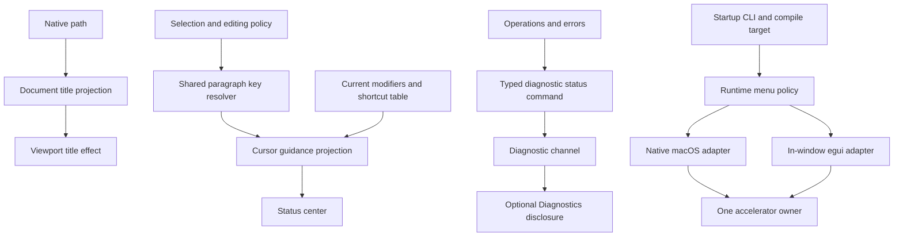

# UI indicators and platform shell v1

- **Date:** 2026-11-06
- **Status:** WO-001–WO-006 implementation submissions and WO-007 documentation handoff recorded; all submissions remain unaccepted and user-owned validation is pending
- **Scope:** Native document title, cursor-driven status guidance, diagnostic status command routing, and OS-specific menu presentation with a development override
- **Validation owner:** User. No build, check, test, lint, formatting command, application launch, visual verification, agent review, or independent validation was performed while preparing this assessment.

## Executive conclusions

1. Replace the static native window title with the current FDX filename, including its extension. Use **Untitled Screenplay** until a successful Save As or Open establishes a native path. Update only after successful document activation/save, never after a failed operation. Let the native OS title bar position the title; do not build a custom title bar merely to force centering.
2. Make the status center exclusively cursor guidance: **Ready**, contextual Enter/Tab targets, or held-modifier element choices. Routine operation and development messages no longer appear there.
3. Add one typed diagnostic-status command for the requested command-layer posting function. Its payload updates only the diagnostic message channel. It cannot override cursor guidance. Diagnostics remains source-disabled by default, so diagnostic errors are intentionally not visible in the ordinary production-style footer.
4. Resolve Enter/Tab hints through shared nonmutating core editing logic, not a desktop copy of the transition matrix. Resolve modifier lists from the existing 17-binding table, not a second role/digit mapping.
5. Change the normal menu policy to native-only on macOS and in-window-only on Windows. Add a narrowly scoped runtime **menu platform** override so a macOS development run can select the Windows-style in-window renderer. Do not pretend the host is another OS for document geometry, native APIs, or platform integrations.
6. No new dependency is needed. WO-002 adds the single optional-payload diagnostic command; the typed command catalog now contains 42 IDs.

## Initial source findings (pre-WO implementation baseline)

The following observations and conclusions record the original planning baseline before WO-001–WO-006.
Where they describe the former command count, center messages, or dual-preview policy, the later dated
implementation submissions and WO-007 durable contracts supersede them as current behavior.

### Native title bar

- Startup supplies the static application name through [`main()`](../../apps/scriptcraft/src/main.rs:1506) and [`eframe::run_native()`](../../apps/scriptcraft/src/main.rs:1508).
- Native decorations and the title bar are enabled in [`native_options()`](../../apps/scriptcraft/src/main.rs:1474). The title strip is OS-owned, not an egui toolbar caption.
- The active document path is already held in [`ScriptCraftApp.native_path`](../../apps/scriptcraft/src/main.rs:409).
- New clears that path in the [`Command::FileNew`](../../apps/scriptcraft/src/app_commands.rs:176) dispatcher branch.
- Open sets it only during successful project activation in [`activate_opened_project()`](../../apps/scriptcraft/src/main.rs:906). Save and Save As update it only after transactional success in the save adapter at [`main.rs`](../../apps/scriptcraft/src/main.rs:774).
- The Save As picker already uses **Untitled Screenplay.fdx** as its suggested filename in [`save_as_native()`](../../apps/scriptcraft/src/main.rs:987).
- No current native-title synchronization or use of the viewport title command was found.

**Conclusion:** A small pure filename projection plus change-deduplicated viewport synchronization is sufficient. No screenplay-core or FDX change is needed. Native title placement should remain OS-owned. macOS normally supplies centered native title treatment; the current egui/windowing boundary does not establish a cross-platform centered-title guarantee, especially for a decorated Windows title bar. A custom decoration/title-bar implementation would be disproportionate to the request's **if possible** qualifier.

### Status center and diagnostic messages

- [`ScriptCraftApp`](../../apps/scriptcraft/src/main.rs:391) currently stores both an operation string and an optional error string.
- [`project_center()`](../../apps/scriptcraft/src/status_bar.rs:1049) copies those values into the center projection, and [`status_message()`](../../apps/scriptcraft/src/status_bar.rs:1165) renders either the operation, the error, or both.
- Routine editor commands pass development-oriented success strings such as **Edited through EditingSession** through [`execute_editor()`](../../apps/scriptcraft/src/app_commands.rs:547) into [`mutate()`](../../apps/scriptcraft/src/main.rs:1077). This is the direct source of the persistent messages described in the request.
- Other direct producers include New/Open/Save/PDF/clipboard outcomes, migration state, cast-list refresh failures, and error adapters in [`main.rs`](../../apps/scriptcraft/src/main.rs:435) and [`app_commands.rs`](../../apps/scriptcraft/src/app_commands.rs:458).
- The Diagnostics presentation is already gated by the source-only setting in [`status_bar.rs`](../../apps/scriptcraft/src/status_bar.rs:1478). Disabled mode constructs no disclosure row or accessibility node.
- The 41-ID command vocabulary and descriptor catalog live in [`CommandId`](../../crates/scriptcraft-commands/src/lib.rs:24), [`Command`](../../crates/scriptcraft-commands/src/lib.rs:531), and [`COMMAND_DESCRIPTORS`](../../crates/scriptcraft-commands/src/lib.rs:758). There is no status-posting command today.
- Desktop effects already converge on [`dispatch_command()`](../../apps/scriptcraft/src/app_commands.rs:129), so a diagnostic-status effect can be added without touching the semantic executor.

**User decision recorded:** The center is reserved exclusively for Ready/cursor/modifier guidance. Routine operation messages are removed. Errors are assigned to the Diagnostics area for now, and Diagnostics remains off.

**Consequence:** With the gate off, an error retained in the diagnostic channel is not visibly presented in the status center. Existing failure-safe document behavior remains mandatory, but the current requirement that every operation error remain visibly identifiable must be revised explicitly. This is an intentional presentation change, not a claim that users will still see errors while Diagnostics is disabled.

### Enter and Tab targets

- The shared application-default role labels and Return/Tab targets are in [`ROLE_FORMATTING_DEFAULTS`](../../crates/scriptcraft-core/src/formatting.rs:322).
- [`enter_transition()`](../../crates/scriptcraft-core/src/editing.rs:1925) and [`tab_transition()`](../../crates/scriptcraft-core/src/editing.rs:1935) expose useful role-level defaults, including blank-only Character to Transition.
- Actual behavior is richer than those helpers. [`EditingSession::enter()`](../../crates/scriptcraft-core/src/editing.rs:768) and [`EditingSession::tab()`](../../crates/scriptcraft-core/src/editing.rs:844) also enforce collapsed selection, strict boundaries, Parenthetical repair/generated-pair behavior, Dialogue interior splitting, same-role behavior, and transactional safe stops.
- At an actual paragraph end, strict Scene Heading/Character/Transition boundaries do not reject. An empty element has caret offset zero equal to text length zero and therefore qualifies for end guidance.
- Parenthetical behavior proves why a desktop lookup table would be wrong: some actual-end positions transition to Dialogue, while others are consumed no-ops; the position immediately before a closing delimiter differs from the position after it.
- General has a displayable same-role Tab target even though same-role Tab is a consumed no-op. A hint model therefore must distinguish **displayable target role** from **document mutation guaranteed**.

**Conclusion:** Extract a shared, nonmutating paragraph-key resolution seam in the core and use it from both mutation and presentation. Do not clone the core matrix into the desktop and do not simulate edits every frame. The preview should describe the resolved target under current editing policy; later preservation/capacity rejection still remains transactional and need not be speculatively executed for a hint.

### Modifier choices and platform labels

- [`EDITOR_ELEMENT_BINDINGS`](../../apps/scriptcraft/src/shortcuts.rs:202) is already the complete 17-role mapping.
- Base roles use Primary+0 through Primary+9. Extended roles use Primary+Control on macOS and Primary+Shift on Windows in [`editor_command_for_key_event()`](../../apps/scriptcraft/src/shortcuts.rs:224).
- [`ShortcutPlatform`](../../apps/scriptcraft/src/shortcuts.rs:9) is explicitly parameterizable for either supported desktop platform. [`RoleFormatting.fdx_label`](../../crates/scriptcraft-core/src/formatting.rs:232) supplies display names such as Scene Heading and Outline 1.
- The durable requirement confirms Windows extended chords are Control+Shift, not Command+Control, in [`screenplay-writing-loop.md`](../../.forge/requirements/features/screenplay-writing-loop.md:1017).
- Focus is already tracked in [`ScriptCraftApp.surface_focused`](../../apps/scriptcraft/src/main.rs:402), and current modifiers are already sampled for editor routing in [`handle_surface_input()`](../../apps/scriptcraft/src/script_view.rs:821).

**Conclusion:** Generate hint rows from the binding table and role formatting metadata. On macOS show base choices while Command is held and extended choices while Command+Control is held. On Windows show base choices while Control is held and extended choices while Control+Shift is held. This preserves actual Windows behavior rather than reproducing macOS labels verbatim.

### Menu platform policy

- [`IN_WINDOW_MENU_PREVIEW_ENABLED`](../../apps/scriptcraft/src/menu.rs:74) currently forces the macOS dual presentation.
- [`in_window_menu_enabled()`](../../apps/scriptcraft/src/menu.rs:82) and [`in_window_menu_shortcuts_owned()`](../../apps/scriptcraft/src/menu.rs:88) are compile-target policies rather than runtime policy.
- The top panel is conditionally composed in [`show_application_panels()`](../../apps/scriptcraft/src/main.rs:1106), raw shortcut extraction uses the same global policy in [`raw_input_hook()`](../../apps/scriptcraft/src/main.rs:1287), and native installation is unconditional for a compiled macOS target in [`main()`](../../apps/scriptcraft/src/main.rs:1519).
- The catalog renderer, command FIFO, native adapter, availability projection, and dispatcher are already shared. Only presentation selection and accelerator ownership need to change.

**Conclusion:** Replace the source boolean with a small app-owned runtime policy resolved once at startup. Default behavior becomes realistic for each OS; a CLI override can select the in-window presentation on macOS. Native installation must consult that policy before constructing the controller. Accelerator ownership must consult the actual installed/selected backend, not merely the compile target.

## Proposed behavior contracts

### A. Native document title

| Document state | Native title |
|---|---|
| Fresh project or successful New | Untitled Screenplay |
| Successful Open | Filename with extension, such as Screenplay Title.fdx |
| Successful first Save As | Newly selected filename with extension |
| Successful subsequent Save or Save As | Current/new filename with extension |
| Failed Open, Save, or Save As | Previous title unchanged |

- Show only the final path component, never the full directory path.
- Do not add a dirty marker, a second application-name suffix, or an FDX document field.
- Initialize the native title to **Untitled Screenplay** and synchronize only when the projected title changes.
- Use the existing desktop viewport-effect boundary for native title requests. The existing UTF-8 picker-path restriction remains unchanged.
- Retain native decorations and OS-owned title positioning. Do not add a custom title bar in this batch.

### B. Status-center priority and cursor guidance

The status center always renders exactly one automatic projection; command-posted diagnostic text never participates in this priority order.

| Priority | Conditions | Center content |
|---:|---|---|
| 1 | Editor focused, no active IME or migration modal, exact extended-element chord held | Extended seven-role digit list |
| 2 | Editor focused, no active IME or migration modal, exact base-element chord held | Base ten-role digit list |
| 3 | Editor focused, collapsed caret at element end, no active IME or migration modal, no unsupported extra modifiers | Available Tab/Enter targets plus hold-for-Elements hint |
| 4 | Every other ordinary state | Ready |

- A collapsed caret at offset equal to canonical UTF-8 text length qualifies, including offset zero in an empty element.
- A noncollapsed selection or interior caret suppresses only paragraph-key guidance; an exact held-element chord may still replace it while the editor is focused and input policy permits. An unfocused editor, active IME, or migration modal always yields **Ready**.
- Omit an unavailable Tab or Enter segment. For example, a nonempty Character at its end shows Enter to Dialogue but no Tab target. If neither paragraph key has a displayable target, show **Ready** rather than inventing a role.
- A same-role displayable target remains displayable. General can therefore show Tab General even though that Tab is a consumed no-op.
- macOS paragraph guidance uses **[Cmd] hold for Elements**; Windows uses **[Ctrl] hold for Elements**.
- Exact modifier matching matters. Option/Alt and unrelated additional modifiers suppress the element-list projection rather than advertising a chord that the resolver will reject.

Example for Action at its end on macOS:

`[Tab] Character, [Enter] Action, [Cmd] hold for Elements`

The same state on Windows ends with **[Ctrl] hold for Elements**.

### C. Held-modifier role lists

Base list, in order:

`[0] General, [1] Scene Heading, [2] Action, [3] Character, [4] Parenthetical, [5] Dialogue, [6] Transition, [7] Shot, [8] Cast List, [9] New Act`

Extended list, in order:

`[0] Summary, [1] Outline 1, [2] Outline 2, [3] Outline 3, [4] Note, [8] Sequence, [9] End of Act`

Use the Summary-first display order shown above because it follows the requested example. This is a presentation-only projection over the shared bindings and does not change their existing digit associations or execution order.

| Host target | Base-list chord | Extended-list chord |
|---|---|---|
| macOS | Command | Command+Control |
| Windows | Control | Control+Shift |

The lists are projections only. They do not dispatch commands, alter key ownership, or add menu items. Releasing or changing the modifier returns to the ordinary cursor projection on the next frame.

**Layout risk:** The complete lists are substantially longer than current operation messages. Preserve the one-row, clipped status architecture, but add an explicit fitting policy for modifier guidance: use the available middle allocation and a status-local modifier-hint text size, with measurement before painting. Do not shrink or move the permanent right controls. User review must confirm that the complete base and extended lists are usable at the default window size and that narrow-width clipping remains bounded and accessible.

### D. Diagnostic status command

Add one stable command conceptually named [`ui.status.set`](../../crates/scriptcraft-commands/src/lib.rs:115):

- Payload: an optional bounded, single-line diagnostic message value. A value replaces the current diagnostic message; no value clears it.
- Execution: desktop-only diagnostic state update through the consolidated dispatcher. The headless semantic executor rejects it as unsupported, like other host-only effects.
- Availability: posting and clearing must remain possible during a migration modal so the triggering operation can report its outcome. It never mutates screenplay content, selection, history, dirty state, FDX, layout, or exports.
- Routing: refactor direct status/error producers to enqueue or synchronously dispatch this command with InternalFollowUp origin. Preserve event order and avoid recursive dispatch; the command handler alone writes the diagnostic field.
- Success behavior: remove routine success-message arguments and assignments. Successful operations may clear stale diagnostic state but do not post **Saved**, **Copied**, **Edited**, or similar text to the center.
- Failure behavior: preserve existing failure categories and document-unchanged semantics in the diagnostic message. Do not add screenplay text, serialized source, IDs, or unnecessary paths.
- Presentation: when Diagnostics is explicitly enabled, include the current diagnostic message in that disclosure. When it is disabled, allocate no row, placeholder, focus target, or accessibility node for it.

This expands the typed catalog to 42 entries and requires all count-based catalog assertions and durable inventories to be updated together.

### E. OS-specific menus and development override

Use a runtime menu-platform value with Auto, macOS, and Windows choices. Auto resolves from the compile target. The setting is process-transient and is not a preference, document field, environment-wide compatibility mode, or core concern.

| Compile target | Auto/default | Windows override | macOS override |
|---|---|---|---|
| macOS | Native Application and catalog menus only; no egui strip | Egui in-window strip only; do not install native controller | Same as Auto |
| Windows | Egui in-window strip only | Same as Auto | Reject as unsupported before launch |
| Other target | No menu backend, preserving current fallback | Egui in-window strip for development | Reject as unsupported before launch |

Proposed CLI form:

`cargo run -p scriptcraft -- --menu-platform=windows`

Also accept `auto` and `macos` values. Reject unknown values, duplicate arguments, and unexpected positional arguments with a concise usage error rather than silently ignoring them. No argument parser dependency is necessary for this single bounded option.

The override controls menu presentation and its accelerator owner. It does not change:

- document-point conversion in [`current_presentation_platform()`](../../apps/scriptcraft/src/script_view.rs:1058);
- native display scale, file dialogs, clipboard, notifications, or window controls;
- compiled native dependencies or unsafe/AppKit boundaries;
- screenplay editing commands or semantic behavior;
- the target-derived platform used to describe actual macOS/Windows editor element chords.

On a macOS Windows-menu development run, the egui renderer remains a Windows-style visual preview. Existing host modifier semantics must not be silently rewritten as part of this override. The work order must document and test which host chords own menu accelerators so one activation cannot execute twice. Windows builds continue to use Control labels and behavior natively.

## Architecture flow

## Proposed work-order batches

Execute sequentially on a manifest-conforming initiative branch, proposed as `dev/2026-11-06-ui-indicators-platform-shell`, after inspecting the checkout and preserving all existing work. Each order includes authored focused coverage and user-owned acceptance steps; authoring coverage is not evidence that it ran.

### Batch 1 — Native document identity

#### WO-001 — Dynamic native document title

**Outcome:** The decorated native window displays Untitled Screenplay or the active FDX filename and follows successful document lifecycle changes.

**Primary ownership:** [`main.rs`](../../apps/scriptcraft/src/main.rs:391) and the viewport adapter in [`app_commands.rs`](../../apps/scriptcraft/src/app_commands.rs:755).

**Scope:**

1. Add a pure path-to-title projection with Untitled fallback and final-component-only behavior.
2. Initialize the native title consistently at startup and send deduplicated title effects after document lifecycle changes.
3. Preserve prior title/path on every failed Open/Save/Save As and avoid dirty markers or full paths.
4. Keep native title positioning OS-owned; record why no custom centered title bar is introduced.
5. Author focused cases for unsaved, New, Open, Save As, repeated title, filenames with spaces/Unicode, and failure preservation.

**User acceptance:** Check startup, New, Open, ordinary Save, first and subsequent Save As, failed operations, long filenames, and native title placement on macOS and Windows. Confirm no content-layout or toolbar change.

### Batch 2 — Command-routed diagnostics and cursor status

#### WO-002 — Diagnostic status command and routine-message removal

**Outcome:** Every retained diagnostic post/clear goes through one typed command, while the status center no longer displays routine operation or error text.

**Primary ownership:** [`lib.rs`](../../crates/scriptcraft-commands/src/lib.rs:24), [`app_commands.rs`](../../apps/scriptcraft/src/app_commands.rs:163), [`main.rs`](../../apps/scriptcraft/src/main.rs:1037), and [`status_bar.rs`](../../apps/scriptcraft/src/status_bar.rs:1043).

**Scope:**

1. Add the optional diagnostic-message payload, stable ID, descriptor, command mapping, serialization validation, and 42-entry catalog updates.
2. Route all retained diagnostic posts and clears through the desktop dispatcher with bounded single-line values and deterministic ordering.
3. Remove routine success statuses and development wording from editor, selection, clipboard, document, export, and scheduled-refresh paths without changing their transactional results.
4. Move error details exclusively into the diagnostic channel and expose them only inside the explicitly enabled Diagnostics disclosure.
5. Keep Diagnostics off by default and preserve all save/open/edit failure safety.
6. Author catalog/round-trip/bounds tests and desktop projection cases for set, replace, clear, modal reporting, disabled Diagnostics, and no center-message leakage.

**User acceptance:** Confirm ordinary typing, selection, clipboard, Save/Open/New/PDF, and scheduled work never replace cursor guidance with routine text. Exercise failure cases with Diagnostics off and then explicitly enabled; confirm the intentional visibility difference and unchanged document safety.

#### WO-003 — Shared paragraph-key target projection

**Outcome:** A nonmutating core projection supplies exact displayable Enter/Tab targets for the current selection and policy without duplicating editing rules in the desktop.

**Primary ownership:** [`editing.rs`](../../crates/scriptcraft-core/src/editing.rs:753), [`formatting.rs`](../../crates/scriptcraft-core/src/formatting.rs:320), and focused core/command coverage.

**Scope:**

1. Extract shared paragraph-key resolution used by both actual editing and read-only hint projection.
2. Represent displayable same-role targets separately from unavailable special-case no-ops.
3. Preserve collapsed-selection, end/interior, empty-element, blank Character, Dialogue, Parenthetical, strict-boundary, and automatic-parenthetical behavior.
4. Return role values, not formatted UI strings; keep egui and modifier state out of core.
5. Author a 17-role matrix plus empty/nonempty, interior/end, noncollapsed selection, delimiter/generated Parenthetical, same-role, and policy cases. Compare projection with actual command outcomes wherever behavior is safely representable.

**User acceptance:** Run the authored core/command scenarios and review the Parenthetical and same-role cases explicitly. Confirm no semantic mutation, history entry, dirty-state change, or source-preservation change occurs from requesting hints.

#### WO-004 — Live cursor and modifier guidance in the status center

**Outcome:** The status center displays Ready, exact end-of-element Enter/Tab guidance, and live platform-correct element choices.

**Primary ownership:** [`status_bar.rs`](../../apps/scriptcraft/src/status_bar.rs:1292), [`shortcuts.rs`](../../apps/scriptcraft/src/shortcuts.rs:195), [`main.rs`](../../apps/scriptcraft/src/main.rs:1148), and the WO-003 core projection.

**Scope:**

1. Replace operation/error center inputs with a typed guidance projection derived from focus, selection, IME/modal state, current modifiers, and target platform.
2. Generate base and extended rows from the existing binding table and role labels; do not add a second digit/role table.
3. Implement exact macOS and Windows chord recognition, release restoration, unsupported-modifier suppression, and platform-specific hold labels.
4. Preserve page counter, right controls, palette ownership, accessibility, panel height, and clipping while adding a measured fitting policy for long modifier lists.
5. Ensure modifier-only changes request/observe repaint without becoming semantic commands or entering the menu FIFO.
6. Author projection tests for every priority state, all 17 roles, both platforms, empty elements, interior/end caret, noncollapsed selection, focus loss, IME, modal state, extra modifiers, release, and narrow allocations.

**User acceptance:** Exercise every role at empty/nonempty end and representative interiors; hold/release Command, Command+Control, Control, and Control+Shift as applicable; check actual role changes match displayed digits. Review default and narrow windows, focus changes, IME, migration modal, and both Appearance extremes.

### Batch 3 — Realistic OS menu presentation

#### WO-005 — Runtime OS-default menu policy

**Outcome:** macOS normally shows only native menus and Windows normally shows only the in-window menu, with one backend owning accelerators.

**Primary ownership:** [`menu.rs`](../../apps/scriptcraft/src/menu.rs:68), [`main.rs`](../../apps/scriptcraft/src/main.rs:1120), and native installation in [`main.rs`](../../apps/scriptcraft/src/main.rs:1519).

**Scope:**

1. Replace the development source boolean and compile-target-only functions with an app-owned runtime menu policy.
2. Make native installation, panel composition, event drain/synchronization, and shortcut ownership consume the same selected backend state.
3. Default macOS to native-only and Windows to in-window-only; preserve the complete catalog, icons, placeholders, availability, FIFO, and command behavior.
4. Retain a policy value suitable for the later CLI adapter and reject unsupported native requests safely.
5. Author policy-matrix tests proving exactly one visible renderer and one accelerator owner per supported configuration.

**User acceptance:** Confirm the Windows-style strip is absent in an ordinary macOS run, native menus still operate, and Windows still presents the full in-window catalog. Verify menu commands, shortcuts, popup switching, focus restoration, and toolbar boundaries.

#### WO-006 — CLI menu-platform development override

**Outcome:** A bounded startup argument selects the Windows-style in-window menu on macOS without changing unrelated OS behavior.

**Primary ownership:** startup parsing near [`main()`](../../apps/scriptcraft/src/main.rs:1506), app construction in [`ScriptCraftApp::new()`](../../apps/scriptcraft/src/main.rs:442), and the WO-005 policy.

**Scope:**

1. Parse Auto/macOS/Windows menu-platform values before app/native-menu construction, including the equals-form development invocation shown above.
2. Reject malformed, duplicate, unexpected, and unsupported combinations with deterministic usage errors.
3. On macOS Windows override, skip native installation, render only the egui strip, and transfer menu-accelerator ownership consistently.
4. Keep editor shortcut labels/behavior, document-point conversion, native scale, notifications, file dialogs, clipboard, and platform dependencies host-accurate.
5. Author parser and policy tests for every value, malformed input, duplicates, host/override combinations, and accelerator ownership.
6. Record the development-only nature and host-modifier limitation plainly; do not persist the selection or add a settings UI.

**User acceptance:** Launch ordinary macOS, macOS with Windows override, and Windows normally. Confirm visible renderer, native-menu absence/presence, shortcut ownership, and no change to page scale or other OS integrations. Check invalid arguments fail before presenting a misleading UI.

### Closeout

#### WO-007 — Durable contracts and user-validation handoff

**Outcome:** Source, requirements, blueprints, manifest evidence, and the initiative record describe the same implemented behavior without claiming unrun validation.

**Scope:**

1. Update [`screenplay-writing-loop.md`](../../.forge/requirements/features/screenplay-writing-loop.md:636) for the native title, cursor-only center, diagnostic error visibility, 42-ID command inventory, exact modifier hints, production OS defaults, and CLI override.
2. Replace the obsolete dual-preview requirement in [`screenplay-writing-loop.md`](../../.forge/requirements/features/screenplay-writing-loop.md:882) rather than leaving contradictory current directives.
3. Update [`technical-context.md`](../../.forge/blueprints/technical-context.md:123) with title-effect ownership, diagnostic command flow, shared hint projection, runtime menu policy, accelerator arbitration, and disabled-Diagnostics behavior.
4. Update [`project-manifest.md`](../../.forge/project-manifest.md:330) with exact implementation submission evidence, changed dependencies if any, branch/checkout facts, and explicit user-owned validation pending. Do not insert validation claims before evidence exists.
5. Complete each proposed work-order handoff with exact changed files, authored coverage, limitations, and user acceptance state.
6. Supply a consolidated platform/lifecycle/editing validation matrix and record that no agent checks are authorized by this plan.

## Durable-document conflicts to resolve during implementation

- The current status requirement calls for operation/error center text and always-identifiable errors in [`AC-WRITING-006.2`](../../.forge/requirements/features/screenplay-writing-loop.md:684) and [`AC-WRITING-006.3`](../../.forge/requirements/features/screenplay-writing-loop.md:689). The user decision in this initiative supersedes that presentation policy: the center is cursor-only and errors are Diagnostics-gated.
- The current menu requirement requires the enabled macOS in-window preview in [`REQ-WRITING-LOOP-011`](../../.forge/requirements/features/screenplay-writing-loop.md:884). This initiative supersedes it with native-only macOS defaults plus the explicit runtime development override.
- The technical context calls automatic production OS-only selection deferred in [`technical-context.md`](../../.forge/blueprints/technical-context.md:341). This initiative is the separately approved change that removes that deferral.
- The command inventory currently says 41 IDs in [`screenplay-writing-loop.md`](../../.forge/requirements/features/screenplay-writing-loop.md:1039) and [`project-manifest.md`](../../.forge/project-manifest.md:341). Update counts, descriptors, and test expectations atomically with the new command.

## Non-goals and safeguards

- No custom cross-platform title bar, dirty indicator, full-path display, or guaranteed Windows title centering.
- No routine toast/message system, timed status notices, or command-posted override of cursor guidance.
- No newly visible Diagnostics section by default and no claim that hidden diagnostic errors remain visible.
- No second Enter/Tab matrix, role/digit table, editing session, document model, or dispatcher.
- No speculative transactional edit on each frame merely to calculate hints.
- No new menu items, enabled placeholders, native Win32 menu, OS compatibility layer, document-scale override, or persisted platform preference.
- No changes to FDX semantics, native saving, fixed pagination, PDF/plain-text exports, screenplay role shortcuts, or failure rollback.
- No agent-run build, test, check, lint, formatting, launch, review, or independent validation under the repository-wide policy.

## Recommended approval boundary

Approve the seven-order batch as one initiative, with sequential implementation and consolidated user review. The most important review points are the intentional hidden-by-default diagnostic errors, exact Parenthetical/no-op hint behavior, long modifier-list fitting, native title placement on each OS, and single accelerator ownership under the macOS Windows-menu override.

## WO-001 implementation submission — 2026-11-07

Only **WO-001 — Dynamic native document title** is implemented in this submission. The native viewport
starts with **Untitled Screenplay** and later projects only the active native filename, including its
extension, through the existing viewport-effect boundary when the projected value changes. The
projection is derived from the existing activated/saved native path; failed or cancelled lifecycle
operations leave that path and title projection unchanged. Native decorations and OS-owned title
positioning are retained. No custom title bar, persistence change, or WO-002–WO-007 implementation is
included.

The local branch was created as `dev/2026-11-06-ui-indicators-platform-shell` from the observed
`master` checkout at `20496cd`; the pre-existing untracked initiative assessment directory was
preserved. Focused projection tests were authored but not run. No build, check, test, lint, formatting,
launch, manual verification, review, or independent validation was performed. User-owned review,
validation, and acceptance remain pending. Exact checkout state, changed paths, coverage boundaries,
and lifecycle acceptance scenarios are in the [WO-001 handoff](work-orders/WO-001-dynamic-native-document-title-handoff.md).

### WO-002 implementation submission — 2026-11-07

Only **WO-002 — Diagnostic status command and routine-message removal** is implemented in this
submission, building on the existing uncommitted WO-001 source and documentation work on
`dev/2026-11-06-ui-indicators-platform-shell`. The existing branch and all pre-existing tracked and
untracked work were preserved; no branch switch, stash, reset, commit, or overwrite was performed.

The UI-independent command catalog now contains 42 IDs, including `ui.status.set` with a validated
optional single-line `DiagnosticMessage` bounded to 512 UTF-8 bytes. The desktop dispatcher alone
writes the diagnostic channel; post/clear producers enqueue typed internal follow-ups and drain them
in FIFO order, including during migration modal state. A reentrancy guard prevents nested diagnostic
dispatch from recursively draining the queue or changing report order. The headless editor executor
rejects this desktop-only effect without session mutation. Routine operation/development text has been
removed. The status center currently projects only **Ready** until WO-004 implements live guidance.
Errors and warnings are retained only in Diagnostics; that disclosure remains disabled by default,
and errors are intentionally hidden while its gate is off. Privacy-safe save categories/details and
document-unchanged semantics are retained without exposing screenplay contents or paths; existing
migration modal warnings and title behavior remain in place.

Focused catalog, bound, headless-rejection, dispatcher set/replace/clear, queue ordering, migration
availability, Ready projection, and default-disabled-gate tests were authored but not run. No build,
check, test, lint, formatting command, launch, manual verification, review, agent validator, or other
validation was performed under repository policy. User review, validation, and acceptance remain
pending. Exact source/document paths, design notes, authored coverage, limitations, and user scenarios
are recorded in the [WO-002 implementation handoff](work-orders/WO-002-diagnostic-status-command-handoff.md).

### WO-003 implementation submission — 2026-11-07

Only **WO-003 — Shared paragraph-key target projection** is included in this submission. It builds
on the existing WO-001/WO-002 work on `dev/2026-11-06-ui-indicators-platform-shell`; those
submissions and all tracked/untracked work were preserved. No branch switch, stash, reset, overwrite,
commit, or merge was performed.

Core `EditingSession::paragraph_key_targets()` now returns typed Enter/Tab `ParagraphKeyTarget`
decisions (`Target(Role)`, `NoOp`, or `Unavailable`) based on the current selection, runtime editing
policy, and generated-Parenthetical provenance. The read-only projection and real Enter/Tab methods
share the same decision resolver; only actual editing executes the resolved action through the
existing transactional candidate path. Same-role Tab remains displayable as `Target(General)` while
its command is a no-op. No desktop integration or presentation text was added. Projection results
describe key-resolution targets, not the success of later capacity or preservation validation.

Focused 17-role, boundary, selection, UTF-8, Character, Dialogue, same-role, and Parenthetical
coverage was authored. It compares projection targets with real Enter/Tab command outcomes where
meaningful. No tests, build, check, lint, formatting command, launch, manual verification, review,
independent validator, or other validation was run; compilation and runtime behavior are not claimed
verified. User review, validation, and acceptance remain pending. Exact API, changed paths, coverage,
limitations, and the WO-004 integration contract are in the [WO-003 handoff](work-orders/WO-003-shared-paragraph-key-target-projection-handoff.md).

WO-004 through WO-007 remain pending and are not covered by this submission. No commit or merge was
made.

### WO-004 implementation submission — 2026-11-07

Only **WO-004 — Live cursor and modifier guidance in the status center** is included. The prior
WO-001–WO-003 implementation submissions and all tracked/untracked work were preserved on
`dev/2026-11-06-ui-indicators-platform-shell`; no branch switch, stash, reset, overwrite, commit, or
merge was performed.

The center now projects Ready outside the eligible editor state; otherwise it uses
`EditingSession::paragraph_key_targets()` only at a collapsed canonical UTF-8 element end, including
empty elements, and displays only actual `Target(role)` decisions. Exact base/extended held chords
take priority and project every matching role/digit from the existing shared shortcut binding table,
using canonical role labels and Summary-first extended ordering. macOS uses Command and
Command+Control; Windows uses Control and Control+Shift. Unsupported modifiers suppress ordinary
paragraph guidance; focus loss, IME activity/current-frame IME events, and migration modal state
yield Ready. The modal's prior application-panel suppression remains; it now retains a noninteractive
Ready status-center footer without status controls or Diagnostics. Modifier lists use measured
status-local text sizing, bounded shrink-to-floor behavior, clipping, and a full accessible label.
Modifier-only state changes request repaint without dispatching commands. WO-002's Diagnostics gate
remains disabled, and editing/Enter/Tab/element routing, document semantics, title, menu policy, and
normal status controls are unchanged.

Focused projection, chord, list/order, release/focus/IME/modal/selection, modifier-transition, and
layout-bound tests were authored but not run. No build, check, test, lint, formatting command,
launch, manual verification, review, or independent validation was performed. Source compilation,
platform modifier delivery, rendering/accessibility, input ordering, modal presentation, and all
runtime behavior remain unverified; user review, validation, and acceptance are pending. Exact files,
coverage, limits, and user acceptance scenarios are in the [WO-004 handoff](work-orders/WO-004-live-cursor-modifier-guidance-handoff.md).

### WO-005 implementation submission — 2026-11-07

Only **WO-005 — Runtime OS-default menu policy** is included in this submission. WO-001–WO-004
source and durable-document work, all other substantial uncommitted changes, and the initiative's
untracked contents were preserved on the already checked-out `dev/2026-11-06-ui-indicators-platform-shell`
branch. No branch switch, reset, stash, overwrite, commit, or merge was performed.

The source-only dual-preview boolean and compile-target policy functions have been replaced with an
app-owned `RuntimeMenuPolicy` resolved once by startup and retained by `ScriptCraftApp`. `Auto`
selects native Application plus shared catalog menus only on macOS, the in-window catalog only on
Windows, and no menu backend on other targets. The injectable `MenuPlatformChoice::{Auto, MacOS,
Windows}` plus `RuntimeMenuPolicy::resolve(host, choice)` is the deliberately CLI-free seam for WO-006:
a Windows-style in-window presentation can be selected on any target, while a macOS-native request is
rejected off macOS. No CLI parsing, settings UI, or persisted override was added.

That one policy gates native controller construction, in-window panel rendering, native event drain
and availability synchronization, and raw-input shortcut extraction. Native and in-window backends
are mutually exclusive renderer/accelerator owners; no-backend mode owns neither. In-window matching
retains actual host shortcut semantics. Existing shared catalog, placeholders, command FIFO and
dispatcher, availability, focus, keyboard behavior, status guidance, title, and document state were
not intentionally changed. Native installation failure now aborts startup with contextual failure
instead of silently continuing without the selected menu or risking a second accelerator owner.

Focused policy/ownership cases were authored but not run: Auto behavior for macOS/Windows/other,
supported in-window requests, unsupported native requests, exclusive selected renderer, and exact
accelerator owner. No build, check, test, lint, formatting command, application launch, manual
verification, review, independent validator, or other validation was performed. Compilation,
platform behavior, native menu installation and failure presentation, visual/accessibility behavior,
event delivery, and accelerator behavior remain unverified. User review, validation, and acceptance
are pending. Exact changed paths, types/API for WO-006, authored coverage, risks, and user-owned
acceptance scenarios are in the [WO-005 runtime menu policy handoff](work-orders/WO-005-runtime-os-default-menu-policy-handoff.md).

WO-006 and WO-007 remained pending at the time of this WO-005 submission. No commit or merge was made.

### WO-006 implementation submission — 2026-11-07

Only **WO-006 — CLI menu-platform development override** is included in this submission, building on
the existing WO-001–WO-005 source and documentation work on
`dev/2026-11-06-ui-indicators-platform-shell`. All tracked and untracked work was preserved without
branch switching, stashing, resetting, overwriting, committing, or merging.

Startup now accepts the process-transient `--menu-platform=auto|macos|windows` argument, including the
approved example `cargo run -p scriptcraft -- --menu-platform=windows`. Parsing and host-policy
resolution happen before eframe launch and native menu construction. Malformed/empty values, duplicate
options, unknown or positional arguments, non-UTF-8 arguments, and unsupported native-macOS choices
produce deterministic concise usage errors and exit before launch. No parser dependency or persistence
was added. The resolved WO-005 policy continues to select one renderer and one accelerator owner:
macOS `windows` uses only the egui strip and skips native controller installation; Windows `macos`
and non-macOS `macos` requests reject; Auto remains native-only on macOS, in-window-only on Windows,
and backend-free on other targets; Windows-style in-window selection remains available on other targets.

The macOS Windows-menu selection is explicitly a development simulation of menu presentation, not OS
emulation. Actual host keyboard semantics and editor shortcut/status labels remain unchanged: the
in-window menu accelerator matcher still uses the macOS host platform, so a Windows-style `Ctrl` menu
annotation does not change macOS primary input from Command to Control. Document-point conversion,
native scale, native file dialogs, clipboard, notifications, window controls, platform dependencies,
and document behavior remain host-owned. The CLI option is transient and adds no settings UI.

Focused parser and startup-policy/accelerator-owner tests were authored but not run. No tests, build,
check, lint, formatting command, launch, manual verification, review, independent validator, or other
validation was performed under the repository-wide user-owned policy. Compilation, argument-process
exit presentation, native/in-window runtime behavior, shortcut delivery, and platform integrations
remain unverified. User review, validation, and acceptance are pending. Exact paths, failures,
host-modifier limitations, coverage boundaries, and user-owned scenarios are in the
[WO-006 implementation handoff](work-orders/WO-006-cli-menu-platform-development-override-handoff.md).

WO-007 remains pending and is not covered by this submission. No commit or merge was made.

### WO-007 documentation submission — 2026-11-07

WO-007 completed the documentation-only closeout on the existing reported branch
`dev/2026-11-06-ui-indicators-platform-shell`. It reconciles the product overview, writing-loop
requirements, technical context, manifest, and this initiative record against the WO-001–WO-006
implementation handoffs. Exact changed files and the user-owned evidence boundary are recorded in the
[WO-007 durable-contract handoff](work-orders/WO-007-durable-contracts-and-user-validation-handoff.md).

The current durable behavior records 42 command IDs; a native title projected from successful document
lifecycle state with OS-owned placement; a status center reserved for Ready/cursor/modifier guidance;
and Diagnostics intentionally disabled by default, which hides errors assigned to it. Menu defaults
are native-only on macOS and in-window-only on Windows, with no backend on other targets by default.
The process-transient CLI preview changes menu presentation only; on a macOS Windows-menu preview, menu
annotations say Ctrl while actual host accelerators remain Command-based. Historical baseline claims are
retained as history and no longer asserted as current policy.

All WO-001–WO-006 submissions remain unvalidated and unaccepted. WO-007 changed documentation only; it
did not change production source or tests and did not run workspace commands, launch the application,
conduct manual verification, review, or validate. The consolidated [user-validation handoff](work-orders/WO-007-user-validation-handoff.md)
lists commands solely for the user and covers native title/menu lifecycle, macOS and Windows behavior,
all role hints and input states, diagnostics/error visibility, clipping, CLI/accelerators, and regression
safety. The missing concrete Serde codec round-trip coverage from WO-002, possible narrow-width visual
clipping, and unobserved native startup-error presentation remain explicit risks. No acceptance, pass,
or successful runtime result is implied; no commit or merge was made.
